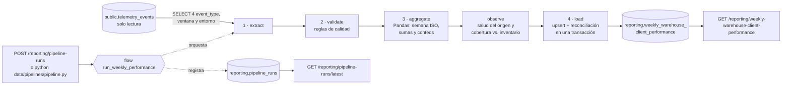

# Diseño del pipeline — Reporte semanal de desempeño por almacén y cliente

> Proyecto de data pipeline de TrackFlow (práctica sin número de hito). Fuente: el BRIEFING
> [`CONTEXT-datapipelines.es.md`](../../CONTEXT-datapipelines.es.md), construido sobre las métricas obligatorias del
> BRIEFING de telemetría ([`CONTEXT-telemetria.es.md`](../../CONTEXT-telemetria.es.md)) y sobre la tabla
> `telemetry_events` ([`docs/telemetry/telemetry-storage.md`](../../docs/telemetry/telemetry-storage.md)).
>
> Este documento se escribió **antes** del código y es el contrato que sigue la implementación. La §17 (preguntas de
> idempotencia, observabilidad, recuperabilidad y concurrencia) se añadió después, en una revisión que también
> amplió §5, §9–§12 y §14. El funcionamiento, la operación y la verificación están en
> [`docs/reporting/weekly-performance-pipeline.md`](../../docs/reporting/weekly-performance-pipeline.md).
>
> **Parte 2 (2026-11-13): implementación con Prefect 3.** El documento se movió de `docs/reporting/` a
> `data/pipelines/`, junto al pipeline. La §18 describe la implementación real: flows y tasks de Prefect en
> [`pipeline.py`](./pipeline.py), transformaciones puras en [`data/process/`](../process/), reintentos, caché,
> tareas opcionales y estados de ejecución. Las reglas de negocio (§2–§4, §6–§8) y el contrato de la API (§11) no
> cambian; donde la Parte 2 sustituye una decisión de la Parte 1 (sin orquestador, §5 y §15) se indica.

## 1. Para qué existe este pipeline

Thomas (CEO) quiere abrir cada lunes un consolidado semanal sin llamar a Ana ni a Miguel. Hoy cada director lo arma a
mano el domingo por la noche. **Único entregable:**

> **Reporte Semanal de Desempeño por Almacén y Cliente** — una fila por almacén, cliente y semana ISO con cuatro KPIs.

- **Audiencia:** Thomas (CEO) y Ana (Head of Warehouse Operations). No técnicos: quieren números, no eventos.
- **Frecuencia:** semanal, fresco el lunes por la mañana.
- **Regla de diseño:** todo lo que aparece en este documento se puede rastrear hasta una de las cuatro columnas KPI de
  la tabla de la §2. Lo que no sirve a esos cuatro números queda fuera (§3).

## 2. Trazabilidad: KPI → columna → evento → cálculo

| KPI (BRIEFING §2) | Columna de `reporting.weekly_warehouse_client_performance` | Evento de `telemetry_events` | Cálculo por fila (almacén, cliente, semana) | Quién decide con él |
| --- | --- | --- | --- | --- |
| Volumen de entrada | `inbound_units_count` | `inbound_order_created` | `SUM(tags.quantity)` | Ana: capacidad y personal |
| Throughput de salida | `outbound_orders_count` | `outbound_order_created` | `COUNT(*)` (pedidos, no unidades) | Ana: cuellos de botella |
| Frecuencia de quiebre de stock | `stockout_events_count` | `stock_threshold_triggered` | `COUNT(*)` | Miguel: avisar al cliente |
| Tasa de discrepancia | `discrepancy_rate` (+ `discrepancy_events_count` de apoyo) | `inventory_discrepancy_detected` / `outbound_order_created` | `discrepancy_events_count / outbound_orders_count`; **0 si no hubo pedidos** | Ana: qué auditar |

Las dimensiones salen del mismo evento: `tags.warehouse` (`los_angeles` / `zaragoza`), `tags.client_id` (slug del
cliente, §8.4 del plan de telemetría) y la semana ISO de `timestamp`.

## 3. Alcance

**Dentro:** los cuatro `event_type` de la tabla anterior; agregación semanal por almacén y cliente; tabla de destino
en el esquema `reporting`; registro de ejecuciones; tres endpoints en un módulo nuevo `reporting`; ejecución manual
(API y línea de comandos) y programable.

**Fuera (decidido):**

- Cualquier otro `event_type` (el BRIEFING lo dice expresamente: «resiste la tentación de ampliar el alcance»).
- Moneda, costes o facturación: el entregable es operacional (volumen y precisión).
- `services/api/app/telemetry/analysis.py` y `GET /telemetry/report` (BRIEFING §7): no se tocan.
- Escribir en `telemetry_events`: el pipeline la lee en modo solo lectura (§6.1).
- Una vista en el backoffice para Thomas: el BRIEFING pide el endpoint; la vista es el siguiente paso natural (§14).
- Instrumentar `stock_threshold_triggered` e `inventory_discrepancy_detected`: siguen bloqueados por decisiones de
  negocio (§4.1).

## 4. Datos de origen

`public.telemetry_events` (migración `services/api/migrations/20261110120000_telemetry_events.sql`), tabla de solo
inserción con triggers que impiden UPDATE/DELETE/TRUNCATE. Columnas que usa el pipeline:

| Columna | Uso |
| --- | --- |
| `id` | Trazabilidad y deduplicación (clave primaria, `eventId` del envelope) |
| `event_type` | Filtro `IN` de los cuatro eventos (índice B-tree) |
| `timestamp` | Momento del hecho en UTC → semana ISO (índice B-tree) |
| `tags` (JSONB) | `warehouse`, `client_id`, `quantity`, `order_id` |
| `environment` | Filtro: solo el entorno en el que corre el pipeline (`TELEMETRY_ENVIRONMENT`) |

Propiedades de `tags` según el contrato (`docs/telemetry/event-schemas.json`): los cuatro eventos exigen `warehouse`,
`client_id`, `product_id`, `product_category` y `quantity`; los de órdenes, además, `order_id`.

### 4.1. Estado de instrumentación (riesgo principal del reporte)

| Evento | ¿Se emite hoy? | Consecuencia en el reporte |
| --- | --- | --- |
| `inbound_order_created` | Sí (API tras el commit de la orden y seed del inventario) | KPI real |
| `outbound_order_created` | Sí (solo salidas de tipo `dispatch`) | KPI real |
| `stock_threshold_triggered` | **No**: no existen mínimos de stock por cliente | `stockout_events_count` = 0 |
| `inventory_discrepancy_detected` | **No**: no existe un proceso de conteo físico | `discrepancy_events_count` y `discrepancy_rate` = 0 |

Un 0 en esas columnas significa hoy «no medido», no «sin quiebres» ni «inventario perfecto». El pipeline los
calcula igual (el día que se emitan, el reporte los recoge sin cambiar código) y **cada ejecución registra cuántos
eventos de cada tipo leyó** (§9), para que nadie confunda ausencia de datos con buenas noticias.

### 4.2. Entorno

La base de Supabase puede tener eventos de `development` (pruebas E2E) y, más adelante, de `production`. Mezclarlos
falsearía los KPIs, así que el pipeline lee solo los eventos cuyo `environment` coincide con el suyo
(`TELEMETRY_ENVIRONMENT`, por defecto `development`, el mismo valor con el que la API etiqueta lo que emite). La
tabla de destino no tiene columna de entorno (su esquema lo fija el BRIEFING): cada entorno debe escribir en su propia
base.

## 5. Arquitectura: un flujo con subflows



> Parte 2: cada caja es una **task** de Prefect y `F` es el **flow** `weekly-warehouse-client-performance`; `validate`
> y `aggregate` van juntas en la task `transform-weekly-kpis` (cacheada). Detalle en la §18.

Cada subflow es una función pura o casi pura con una entrada y una salida tipadas, que se prueba por separado:

| Subflow | Entrada → salida | Toca la base |
| --- | --- | --- |
| `extract` | ventana de semanas + entorno → DataFrame de eventos crudos | Lee `telemetry_events` (transacción `READ ONLY`) |
| `validate` | eventos crudos → eventos válidos + rechazos contados por tipo y motivo | No |
| `aggregate` | eventos válidos + semanas → filas del reporte | No |
| `observe` | ventana + eventos crudos → señales y avisos (§17.2); nunca hace fallar la corrida | Lee `telemetry_events` y las tablas del inventario (`READ ONLY`) |
| `load` | filas + semanas + `run_id` → filas escritas y eliminadas, cambios por semana | Escribe solo en `reporting` |

El **flow** (`run_weekly_performance`) resuelve la ventana, abre el registro de la ejecución, encadena los subflows y
cierra el registro con su resultado (éxito o fallo). Así una ejecución fallida también deja rastro auditable.

**Orquestador.** *Parte 1:* sin orquestador externo; los subflows se modelaron como funciones Python con la misma
separación que un `@flow`/`@task` de Prefect, «de modo que migrar a un orquestador más adelante solo cambia el
envoltorio, no la lógica». *Parte 2 (vigente):* esa migración se hizo con **Prefect 3** (lo pide el enunciado de la
Parte 2): las funciones de cada etapa no cambiaron de lógica; se envolvieron en tasks con reintentos y caché, y la
orquestación pasó a un flow con estados (§18).

**Ubicación.** El BRIEFING pide un módulo `services/reporting/` separado de `services/telemetry/`. En este repositorio
la telemetría vive en `services/api/app/telemetry/` (decisión de las prácticas anteriores: una sola API, una conexión,
un despliegue), así que el equivalente es **`services/api/app/reporting/`**, con su propio router `/reporting`, sin
importar nada de `analysis.py` ni de `report.py`. Desde la Parte 2 el ETL no vive ahí sino en `data/` (§18.1): el
backend solo conserva las lecturas, el registro de ejecuciones y el contrato JSON, e **importa** el flow.

## 6. Reglas de cálculo

### 6.1. Lectura

- `SELECT id, event_type, timestamp, tags FROM telemetry_events WHERE event_type IN (…4…) AND environment = :env AND
  timestamp >= :desde AND timestamp < :hasta`. Los filtros van en SQL (índices de `timestamp` y `event_type`); nunca se
  carga la tabla entera.
- En PostgreSQL la lectura se hace en una transacción `SET TRANSACTION READ ONLY`: aunque hubiera un error de código, la
  base rechazaría cualquier escritura. El pipeline no tiene ninguna sentencia que escriba en `telemetry_events`.

### 6.2. Semana

- Semana ISO en **UTC**: `week_start` = lunes 00:00 UTC; la semana es `[lunes, lunes + 7 días)` (inicio inclusivo,
  fin exclusivo). Un evento del domingo 23:59:59 UTC cae en esa semana; el del lunes 00:00:00, en la siguiente.
- Consecuencia que conviene conocer: para Los Ángeles la semana termina el domingo por la tarde (hora local); para
  Zaragoza, el domingo a medianoche (CET) o a las 2:00 (CEST). Es lo que fija el BRIEFING (UTC) y se documenta así.

### 6.3. Calidad de datos (validate)

Una fila de origen se **rechaza** (no se corrige ni se imputa) si:

| Regla | Motivo registrado |
| --- | --- |
| `tags.warehouse` no es `los_angeles` ni `zaragoza` | `invalid_warehouse` |
| `tags.client_id` no es un slug válido (`^[a-z0-9]+(-[a-z0-9]+)*$`, ≤ 64) | `invalid_client_id` |
| `inbound_order_created` sin `tags.quantity` entero ≥ 1 | `invalid_quantity` |
| `timestamp` no interpretable | `invalid_timestamp` |
| Misma orden repetida (`event_type` + `warehouse` + `order_id`) con otro `id` | `duplicate_order` |

La API ya valida estos eventos contra el contrato antes de guardarlos, así que en la práctica no debería rechazarse
nada; las reglas existen porque el pipeline no debe confiar en que siempre sea así (p. ej. una versión futura del
esquema). Los rechazos se cuentan por `event_type` y motivo en el registro de la ejecución (§9): si un KPI baja de
golpe, se ve si es la operación o los datos.

### 6.4. Agregación (aggregate)

Por `(warehouse, client_id, week_start)`:

- `inbound_units_count` = suma de `quantity` de `inbound_order_created`.
- `outbound_orders_count` = número de `outbound_order_created`.
- `stockout_events_count` = número de `stock_threshold_triggered`.
- `discrepancy_events_count` = número de `inventory_discrepancy_detected`.
- `discrepancy_rate` = `discrepancy_events_count / outbound_orders_count`, redondeada a 4 decimales; **0 si
  `outbound_orders_count` = 0** (BRIEFING §4).

Se genera una fila por cada combinación con **al menos un evento** en la semana; las combinaciones sin actividad no
tienen fila (no se inventan ceros para clientes que no operaron). Cada fila es de un único cliente (BRIEFING §7).

Dos consecuencias de la fórmula del BRIEFING, documentadas para quien lea el reporte:

- La tasa **puede superar 1** (más discrepancias que pedidos en la semana): no es un error, es una señal fuerte.
- Con 0 pedidos y discrepancias > 0, la tasa es 0 por definición; `discrepancy_events_count` sigue mostrando el
  problema. Por eso esa columna de apoyo se expone siempre junto a la tasa.

## 7. Ventana, frecuencia y frescura

- **Programación:** lunes a las **06:00 UTC** (07:00/08:00 en Zaragoza; domingo por la noche en Los Ángeles), con
  `cron` `0 6 * * 1` ejecutando `python data/pipelines/pipeline.py` (antes `python -m app.reporting`). El lunes por la
  mañana, en los dos países, el reporte de la semana anterior ya está calculado.
- **Ventana por defecto:** las **2 últimas semanas completas**. La semana en curso nunca se calcula (saldría
  incompleta y el endpoint la mostraría como «la más reciente»). Recalcular también la semana anterior:
  - recoge eventos que llegaron tarde (lotes del navegador reintentados, hilo de escritura del backend);
  - **se autorrepara**: si la ejecución de un lunes falla, la del lunes siguiente rellena esa semana sin intervención.
- **Recálculo manual y backfill:** `POST /reporting/pipeline-runs` o la línea de comandos aceptan `week_start` (la
  semana más reciente a calcular, un lunes) y `weeks` (cuántas semanas hacia atrás, 1–53).

## 8. Idempotencia

Ejecutar el pipeline N veces sobre la misma ventana deja exactamente el mismo resultado que ejecutarlo una vez:

1. **Upsert** sobre `unique (warehouse, client_id, week_start)`: `INSERT … ON CONFLICT (warehouse, client_id,
   week_start) DO UPDATE SET <KPIs> = excluded.<KPIs>, computed_at = excluded.computed_at`. Nunca hay filas duplicadas
   y el `id` de una fila existente se conserva.
2. **Reconciliación**: en la misma transacción se borran las filas de las semanas procesadas cuya combinación ya no
   aparece en el resultado. Con una tabla de origen de solo inserción esto no debería pasar nunca, pero cubre la purga
   de retención futura (§16 del plan de telemetría) y deja cada semana recalculada como copia exacta de su origen.
3. **Una transacción por ejecución**: o se escriben todas las semanas de la ventana o ninguna. Un fallo a mitad de la
   carga no deja semanas a medio actualizar.
4. **Valores deterministas**: el resultado depende solo de los eventos de la ventana (no de la hora de ejecución).
   `computed_at` es la única columna que cambia al repetir, y dice cuándo se recalculó la fila por última vez.

Dos ejecuciones simultáneas no se permiten (`409`), ni en el mismo proceso ni entre procesos distintos (API y
`cron`): un índice único parcial de `pipeline_runs` admite una sola corrida `running` por pipeline (§17.4).

## 9. Auditoría: registro de ejecuciones

Tabla `reporting.pipeline_runs`, genérica para cualquier pipeline futuro (columna `pipeline`):

| Columna | Contenido |
| --- | --- |
| `id`, `pipeline` | Identificador de la ejecución y nombre del pipeline (`weekly_warehouse_client_performance`) |
| `status` | `running` → `succeeded` / `failed` |
| `trigger`, `triggered_by`, `request_id` | `api` (con el id del usuario y el `X-Request-Id` de la petición) o `cli` (manual o `cron`) |
| `phase` | Checkpoint: último subflow completado (`started` … `loaded`); en una corrida fallida, dónde murió |
| `environment` | Entorno de los eventos leídos |
| `week_from`, `week_to` | Primera y última semana (`week_start`) de la ventana |
| `started_at`, `finished_at`, `duration_ms` | Tiempos |
| `events_read`, `events_rejected` | Filas leídas de `telemetry_events` y rechazadas por calidad |
| `rows_upserted`, `rows_deleted` | Filas escritas y eliminadas en la tabla de destino |
| `stats` (JSON) | Eventos leídos por `event_type`, rechazos por `event_type` y motivo, `warnings`, `source_health` (eventos y sesiones por día, días en silencio), `capture_coverage` (órdenes del inventario vs. eventos) y `changes` (por semana: insertadas, actualizadas, sin cambios, eliminadas) |
| `error` | Tipo de error si falla (nunca la cadena de conexión ni datos) |

Una ejecución que se queda en `running` más de 30 minutos (proceso caído a mitad) se marca `failed` con el motivo
`abandoned` cuando empieza la siguiente.

## 10. Tablas de destino (migración)

Migración versionada `services/api/migrations/<timestamp>_reporting_weekly_performance.sql`, idempotente, aplicada en
el SQL Editor de Supabase (como la de telemetría):

- `create schema if not exists reporting` — nunca se escribe en `public.telemetry_events`.
- `reporting.weekly_warehouse_client_performance` con **las columnas del BRIEFING** (§5), incluido
  `unique (warehouse, client_id, week_start)`, más `run_id` (qué corrida escribió la fila; trazabilidad, §17.2) y
  restricciones `check` que no cambian el contrato: almacén válido, `week_start` en lunes, contadores ≥ 0 y tasa ≥ 0.
- `reporting.pipeline_runs` (§9), con el índice único parcial que hace de candado entre procesos (§17.4).
- Acceso: RLS activado sin políticas y privilegios revocados a `anon` y `authenticated` (la API REST de Supabase no ve
  nada), `usage` del esquema y lectura para `service_role`. La API se conecta como propietaria con `DATABASE_URL`.

En SQLite (desarrollo local y tests) no hay esquemas: las mismas tablas se crean en la base principal al primer uso,
con el mismo `MetaData` traducido (`schema_translate_map`).

## 11. Endpoints (módulo `reporting`)

| Endpoint | Acceso | Comportamiento |
| --- | --- | --- |
| `GET /reporting/weekly-warehouse-client-performance?week_start=` | Usuario autenticado | Filas de la semana pedida (un lunes; 422 si no lo es). Sin parámetro: la semana más reciente calculada por una corrida correcta. 200 con `entries: []` si se calculó sin actividad; 404 si ninguna corrida correcta la ha calculado. Orden: almacén, cliente |
| `GET /reporting/pipeline-runs/latest` | Usuario autenticado | Última ejecución (cualquier estado) con su metadata. 404 si nunca se ha ejecutado |
| `POST /reporting/pipeline-runs` | `admin` o `manager` | Ejecuta el pipeline de forma síncrona (`{week_start?, weeks?}`) y devuelve la ejecución: 201 si termina bien; 503 si falla (queda registrada como `failed`); 409 si ya hay una en curso (en cualquier proceso); 422 si la semana no es un lunes o aún no ha terminado |

La respuesta del primero sigue el JSON del BRIEFING (`week_start` + `entries` con los cinco campos calculados, más
`warehouse` y `client_id`); añade `computed_at` (cuándo terminó la corrida que calculó la semana) y `run_id` (cuál
fue), para que el lector sepa lo fresco que está el dato y se pueda seguir su rastro. Ejecución síncrona: con el volumen actual (miles de eventos por semana) tarda segundos; si creciera,
el mismo flow pasaría a una cola sin cambiar el contrato salvo el código de estado.

## 12. Errores y recuperación

| Fallo | Comportamiento |
| --- | --- |
| Base caída o tabla de origen inexistente | La ejecución termina `failed` (si el registro se puede escribir); `POST` responde 503; nada escrito |
| Migración de `reporting` sin aplicar (PostgreSQL) | `failed`/503 con el tipo de error; la API sigue funcionando para todo lo demás |
| Fallo a mitad de la carga | Rollback de la transacción: la tabla queda como antes; la corrida, `failed` con `phase = aggregated` |
| Fallo de las señales de `observe` | Aviso `observability_unavailable`; el reporte se carga igual |
| Eventos de órdenes que no cuadran con el inventario | Aviso `capture_gap` con el detalle por semana y almacén |
| Eventos con datos no válidos | Se excluyen y se cuentan; la ejecución termina bien |
| Ejecución semanal fallida | La siguiente recalcula las 2 últimas semanas y rellena el hueco (§7) |
| Proceso caído durante una ejecución | Registro `running` marcado `abandoned` por la siguiente (§9) |

## 13. Seguridad y privacidad

- Los eventos de inventario no llevan datos personales (contrato de telemetría); el reporte solo contiene almacén,
  cliente B2B, semana y contadores. `user_id` de los eventos no se lee.
- `triggered_by` guarda el id interno del usuario que lanzó la ejecución (auditoría), nunca su email.
- Escribir (`POST`) exige rol `admin` o `manager`; leer, cualquier usuario autenticado del backoffice.
- Los mensajes de error y los logs nunca incluyen `DATABASE_URL` (lleva la contraseña).

## 14. Estrategia de pruebas

- **Unitarias por subflow** (SQLite, sin red): `validate` (cada regla), `aggregate` (fórmulas, semana ISO en los bordes,
  tasa con 0 pedidos y > 1, una fila por cliente), `extract` (ventana `[desde, hasta)`, entorno, tipos), `load`
  (upsert, reconciliación, rollback).
- **Del flow:** idempotencia (dos ejecuciones = mismo resultado), autorreparación, cambios por semana con eventos
  tardíos, `run_id` en las filas, checkpoint de fase en los fallos, registro de ejecuciones en éxito y en fallo,
  ejecución abandonada, candado entre procesos y que `telemetry_events` no cambia.
- **De `observe`:** actividad cero frente a captura caída, días en silencio, mediciones perdidas y duplicadas frente
  al inventario, y que un fallo de las señales no rompe la corrida.
- **De los endpoints:** contrato JSON, valores por defecto, 401/403/404/409/422/503.
- **PostgreSQL real:** la migración y el flow completo contra un PostgreSQL 16 local (upsert `ON CONFLICT DO UPDATE`,
  transacción `READ ONLY`, esquema `reporting`), y una comprobación de solo lectura contra Supabase.

## 15. Decisiones y alternativas descartadas

| Decisión | Alternativa descartada | Motivo |
| --- | --- | --- |
| ~~Subflows como funciones Python~~ → **Prefect 3** (Parte 2) | Airflow / Dagster; seguir sin orquestador | La Parte 2 lo exige; Prefect es una librería (sin servidor dedicado: arranca uno temporal) y aporta reintentos, caché y estados sin código propio |
| `services/api/app/reporting/` (HTTP) + `data/` (ETL) | `services/reporting/` como servicio aparte | Coherencia con `app/telemetry/`; una API, una conexión; el ETL, junto a los datos |
| Recalcular semanas completas (upsert + reconciliación) | Carga incremental por marca de agua | `telemetry_events` no tiene columna de recepción; recalcular 2 semanas es barato y exacto |
| `cron` del host → `python -m app.reporting` | Planificador dentro del proceso de la API | Un reinicio o varios workers no duplican ni pierden ejecuciones; se puede lanzar a mano igual |
| `POST` síncrono | Tarea en segundo plano (202) | Segundos de cálculo; el resultado llega en la misma respuesta |
| Filtrar por `environment` | Leer todos los entornos | Los eventos de pruebas no deben llegar al reporte del CEO |

## 16. Riesgos, limitaciones y pendientes

- **Dos KPIs sin datos** hasta que negocio defina mínimos por cliente y un proceso de conteo (§4.1).
- **Programación del `cron`** en el VPS: aplazada (2026-11-13) hasta desplegar el backend con imágenes nuevas y
  `DATABASE_URL` de producción; hoy calcularía reportes vacíos. Hasta entonces el pipeline se ejecuta con
  `POST /reporting/pipeline-runs` o `python data/pipelines/pipeline.py`. Con Prefect, además, la imagen Docker de la
  API tendría que incluir `data/` (§18.10).
- **Migración en Supabase:** aplicada por el desarrollador el 2026-11-13 (SQL Editor).
- **Vista para Thomas** en el backoffice: siguiente paso natural, fuera del alcance del BRIEFING.
- **Mismo `DATABASE_URL` para varios entornos**: la tabla de destino no distingue entorno (§4.2).
- **Canal de alertas**: decidido email (Resend, remitente del dominio verificado, destinatario por variable de
  entorno), sin implementar todavía; los avisos quedan en el registro y en el log (§17.2).

## 17. Preguntas de diseño: idempotencia, observabilidad, recuperabilidad y concurrencia

> Añadido el 2026-11-13, tras repasar las preguntas guía del BRIEFING de pipelines. Cada respuesta dice **dónde** se
> resuelve. Las marcadas *(revisión)* se implementaron en esa revisión; el resto ya estaba.

### 17.1. Idempotencia

**Duplicados en el origen.** La clave de deduplicación es el **`eventId`** del envelope, en **dos capas**:

1. **Ingesta** (práctica de almacenamiento): `eventId` es la clave primaria de `telemetry_events` y el `INSERT` lleva
   `ON CONFLICT (id) DO NOTHING`. Dos envíos del mismo evento (300 ms de diferencia o un reintento) dejan una fila;
   la tabla no tiene columna de recepción, así que el segundo envío no deja ningún rastro que contar. Los eventos de
   órdenes del backend usan un `eventId` determinista (UUID v5 de `event_type` + id de la orden + fecha): reconstruir
   el mismo evento da el mismo id.
2. **Pipeline** (`validate`): además, una orden repetida con **otro** `eventId` (`event_type` + `warehouse` +
   `order_id`) cuenta una sola vez y se registra como `duplicate_order`. Un operador que confirma dos veces crea dos
   órdenes reales en el inventario (dos `order_id`): eso no es un duplicado, son dos pedidos.

**Reintento después de un fallo.** La carga es **una sola transacción** (reconciliación + upsert sobre
`unique (warehouse, client_id, week_start)`, la «clave de partición» semanal). Si muere a mitad (847 de 1.412 filas),
PostgreSQL deshace todo: no hay datos parciales. Repetirla da exactamente lo mismo que una corrida limpia porque el
resultado solo depende de los eventos de la ventana.

**Eventos tardíos.** Cada corrida recalcula la ventana completa (2 semanas) y deja rastro de **qué semanas publicadas
ha cambiado**: *(revisión)* `stats.changes` cuenta por semana las filas insertadas, actualizadas, sin cambios y
eliminadas, y cada fila guarda el `run_id` de la corrida que la escribió. La corrida anterior sigue en
`pipeline_runs` con sus cifras: se puede ver qué publicó cada una. No se infla nada: es un recálculo, no una suma.

### 17.2. Observabilidad

**Silencio vs. ausencia real** *(revisión)*. Tres casos distintos, tres señales:

| Situación | Cómo se ve |
| --- | --- |
| El pipeline nunca calculó esa semana | `GET …?week_start=` → **404** (ninguna corrida `succeeded` la cubre); antes daba `entries: []` |
| Semana calculada sin actividad | **200** con `entries: []` y el `run_id` que la calculó |
| Captura caída | El subflow `observe` cuenta eventos de **cualquier** tipo por día: si no hay ninguno, aviso `no_events_in_window`; días sueltos sin eventos, `silent_days` |

Si hay logins y navegación pero ninguna orden, la captura funciona y el cero es real. El *heartbeat* es la propia
corrida semanal (`pipeline-runs/latest`); la alerta de silencio, sus `warnings`. Canal decidido: email al
desarrollador (pendiente de implementar, §16).

**Trazabilidad de la recolección** *(revisión)*. El camino evento → reporte se reconstruye con:
`X-Request-Id` de la petición que lanzó la corrida (`pipeline_runs.request_id`, el mismo de la respuesta y de los
logs) → `run_id` → filas con ese `run_id`. La ventana de cada corrida (`week_from`, `week_to`) dice si procesó una o
varias semanas a la vez (la ráfaga de las 09:00 de la pregunta), y `source_health.events_by_day` muestra huecos y
ráfagas día a día. Cada evento conserva su `request_id` en `telemetry_events`.

**Crecimiento vs. pérdida de datos** *(revisión)*. Dos comparaciones en cada corrida:

- **Contra la fuente de verdad:** `capture_coverage` compara, por semana y almacén, las órdenes guardadas en el
  inventario (`stock_entries`, `stock_exits` de tipo `dispatch`) con los eventos capturados. Menos eventos que
  órdenes = mediciones perdidas; más = duplicadas. Aviso `capture_gap`.
- **Contra la actividad:** `sessions_by_day` (sesiones distintas por día). Si los eventos caen y las sesiones no,
  algo se pierde; si caen las dos, bajó la actividad (domingo).

En Supabase (2026-11-13) esto ya encuentra dos cosas reales: la semana del 26 de octubre tiene 9 órdenes en el
inventario y 0 eventos (la captura aún no existía), y en la semana en curso una orden de entrada de Los Ángeles no
tiene evento.

### 17.3. Recuperabilidad

**Caída de la base a mitad del pipeline** *(revisión)*. `pipeline_runs.phase` es el **checkpoint**: último subflow
completado (`started` → `extracted` → `validated` → `aggregated` → `loaded`). Si Supabase falla en el `INSERT`
después de agrupar, la corrida queda `failed` con `phase = aggregated` y la tabla del reporte sin cambios. No se
retoma desde la fase: la siguiente corrida recalcula la ventana entera, porque es barato (segundos) y no deja estados
intermedios que reconciliar. Guardar el DataFrame agregado para retomar costaría más de lo que ahorra.

**Buffer en el frontend.** Decidido en la práctica de captura: **no** se guardan eventos en `localStorage`. La cola
vive en memoria (lotes de 10 s o 20 eventos) y al ocultar la página sale con `sendBeacon`. Un buffer persistente en
el navegador aumenta los duplicados al reconectar, guarda datos en un dispositivo compartido de almacén y puede
reenviar eventos muy tardíos; si algún día se añade, el riesgo lo asume el **servidor** con la deduplicación por
`eventId` (ya está) y el pipeline con el recálculo de la ventana (ya está).

**Reintento de transmisión.** El `eventId` de cada evento **es** la clave de idempotencia (no hace falta un
`Idempotency-Key` aparte): si el primer `POST /telemetry/events` llegó a guardarse y el cliente reintenta tras un
timeout, el `ON CONFLICT DO NOTHING` lo ignora y el servidor responde **200**. El cliente reintenta (3 veces, 1/2/4 s)
solo con red caída, 408, 429 o 5xx (503 = no se guardó nada); un 4xx distinto o un 200 no se reintentan.

### 17.4. Concurrencia

**Corridas solapadas** *(revisión)*. El cron empieza a las 06:00 y alguien pulsa «Ejecutar ahora» a las 06:05:

- **Candado entre procesos:** índice único parcial `pipeline_runs_one_running_idx` (`unique (pipeline) where
  status = 'running'`). La segunda corrida choca al registrarse y recibe **409** sin leer ni escribir nada. Es más
  estricto que un candado por ventana: las dos escriben en la misma tabla, así que no se permite ninguna superposición.
- **Dentro del proceso:** un `threading.Lock` responde 409 antes de tocar la base.
- **`run_id` único** por corrida (UUID); una corrida muerta en `running` no bloquea para siempre: pasados 30 minutos
  la siguiente la marca `abandoned` y ocupa su lugar.
- Aunque dos corridas llegaran a cargar (p. ej. una base sin la migración), el resultado sería el mismo: la carga es
  idempotente.

## 18. Implementación con Prefect 3 (Parte 2)

> Añadido el 2026-11-13 con la Parte 2 del proyecto («Pipeline de Desempeño de Negocio Resiliente»). Describe el código
> real; las reglas de negocio de las secciones anteriores no cambian.

### 18.1. Arquitectura implementada

```text
data/
  pipelines/
    pipeline.py                  flows y tasks de Prefect + línea de comandos (punto de entrada)
    weekly_performance/          etapas con E/S: extract, observe, load, evaluation (snapshot)
  process/
    weekly_performance/          transformaciones puras: events, validate, aggregate, transform
  raw/prefect-results/           caché de la transformación (generado, ignorado en git)
  eval/weekly_performance/       snapshot JSON por ejecución (generado, ignorado en git)
services/api/app/
  reporting/                     lo que la API sirve y comparte: tables, runs, weeks, queries, models, runner
  routes/reporting.py            3 endpoints /reporting; el POST importa el flow (runner.py)
```

- **Separación de responsabilidades.** El ETL (qué se lee, cómo se transforma, cómo se carga y en qué orden) vive solo
  en `data/`. La API no tiene lógica ETL: valida parámetros, lee las tablas de `reporting` y, para el `POST`, importa
  `data.pipelines.pipeline` y llama a `run_weekly_performance` (el mismo flow que la línea de comandos).
- **Lo compartido** se queda en `services/api/app/reporting/` porque lo necesitan los dos lados y la API debe poder
  servir lecturas aunque el pipeline no esté desplegado: declaración de las tablas de `reporting` (`tables.py`),
  registro de ejecuciones (`runs.py`), semanas ISO (`weeks.py`). El pipeline también reutiliza el motor de la base
  (`app.database`) y la declaración de `telemetry_events` (`app.telemetry.storage`): un solo `DATABASE_URL` y una sola
  definición de cada tabla.
- **Telemetría técnica intacta:** `app/telemetry/analysis.py`, `report.py`, `GET /telemetry/report` y
  `telemetry_events` no se modifican; el pipeline solo lee la tabla en transacciones `READ ONLY`.
- **Importación:** `pipeline.py` añade la raíz del monorepo y `services/api` a `sys.path` (para funcionar con
  `python data/pipelines/pipeline.py`); `runner.py` añade la raíz e importa el módulo de forma perezosa; los tests
  usan `pythonpath = ["../.."]` en `services/api/pyproject.toml`.

### 18.2. Flows y tasks

| Elemento | Tipo | Qué hace | Crítica | Reintentos | Caché |
| --- | --- | --- | --- | --- | --- |
| `weekly-warehouse-client-performance` | `@flow` | ETL completo + registro de la ejecución | — | No (§18.4) | No |
| `weekly-warehouse-client-performance-preview` | `@flow` | `--dry-run`: extract → transform → observe, sin escribir | — | No | — |
| `register-run` | `@task` | Fila `running` en `pipeline_runs` (id = id del flow run) | Sí | 2 (1/5 s) | No |
| `extract-telemetry-events` | `@task` | Lee los 4 eventos del entorno y la ventana + huella | Sí | 3 (2/10/30 s) | No |
| `transform-weekly-kpis` | `@task` | validate → aggregate → controles de coherencia | Sí | No (pura) | **Sí** (§18.5) |
| `observe-source` | `@task` | Salud del origen y cobertura frente al inventario | **No** | 1 (2 s) | No |
| `load-weekly-kpis` | `@task` | Reconciliación + upsert en una transacción | Sí | 2 (5/15 s) | No |
| `write-eval-snapshot` | `@task` | JSON de la ejecución en `data/eval/` | **No** | No (local) | No |
| `close-run` | `@task` | Cierra el registro con estado, tiempos y `stats` | Sí | 2 (1/5 s) | No |

Orden de ejecución: secuencial por dependencia de datos (cada task recibe la salida de la anterior).
`run_weekly_performance` valida la ventana (`WindowError` → 422 / código 2, **sin** crear un flow run) y toma un
candado del proceso antes de llamar al flow.

### 18.3. Transformación y validaciones

`data/process/weekly_performance/transform.py` encadena `validate` (§6.3, reglas por fila: rechaza y cuenta, nunca
corrige) y `aggregate` (§6.4) y añade **controles de coherencia** sobre el resultado:

| Riesgo | Control |
| --- | --- |
| Datos nulos / campos ausentes | Reglas por fila de `validate` (`invalid_*`); columnas ausentes en la extracción → `SourceSchemaError` (falla la ejecución) |
| Valores fuera de rango | Almacén fuera de `los_angeles`/`zaragoza`, cantidad < 1, contadores < 0 |
| Duplicados en origen | `duplicate_order` en `validate`; `eventId` único en la tabla |
| Errores de agregación | Una fila por clave; totales de las filas = totales de los eventos válidos de la ventana |
| División por cero | `discrepancy_rate` = 0 sin pedidos (BRIEFING §4), comprobado fila a fila |
| Ventanas incompletas | La semana en curso no se puede pedir (422); eventos fuera de la ventana se descartan |
| Resultados inconsistentes | Cualquier incoherencia → `InconsistentResultError`: la ejecución falla y no se carga nada |

### 18.4. Reintentos

Solo ante fallos **transitorios** (`retry_condition_fn = retry_if_transient`): `ReportingStorageError.transient`,
calculado en `app/reporting/tables.py` a partir del SQLSTATE (clases `08`, `53`, `57P`, `40001`, `40P01`), de la
conexión invalidada o del timeout del pool; en SQLite, solo «database is locked/busy». Un error permanente (tabla
inexistente `42P01`, contraseña, un bug) falla a la primera. Valores y motivos: comentario de `pipeline.py`
(extract, 3 reintentos ≈ 42 s; load, 2 reintentos, seguro porque la carga es una transacción idempotente). El flow no
tiene reintentos propios: la autorreparación es la ventana de 2 semanas de la siguiente ejecución (§7), y reintentar
el flow entero duplicaría el registro.

### 18.5. Caché

`transform-weekly-kpis` usa `cache_key_fn=transform_cache_key` y `cache_expiration=1 día`. La clave es un SHA-256 de:

1. la **huella del contenido** de los eventos extraídos (`fingerprint_events`: id, tipo, fecha y `tags` de cada uno,
   independiente del orden);
2. las **semanas** de la ventana;
3. el **entorno**;
4. la **versión del código** de `data/process/weekly_performance/` (`CODE_VERSION`, huella de sus ficheros).

Mismos datos, semanas y código ⇒ mismo resultado: la caché no puede servir un KPI obsoleto, porque un evento nuevo o
tardío cambia la huella. Almacenamiento: disco local, `data/raw/prefect-results/` (`PREFECT_RESULTS_LOCAL_STORAGE_PATH`),
porque Prefect 3 exige bloques guardados en un servidor para cualquier otro destino. La extracción **no** se cachea:
es la única forma de saber si los datos han cambiado. Cada ejecución registra `stats.prefect.transform_cache`
(`hit`/`miss`), la huella y la versión del código.

### 18.6. Tareas críticas, opcionales y estados

| Situación | Decisión del flow | `status` | `stats.outcome` | Flow run en Prefect | `POST` | CLI |
| --- | --- | --- | --- | --- | --- | --- |
| Todo bien | — | `succeeded` | `succeeded` | Completed | 201 | 0 |
| Falla `observe-source` | `return_state=True` → aviso `observability_unavailable`, sigue | `succeeded` | `partial` | Completed | 201 | 0 |
| Falla `write-eval-snapshot` | `return_state=True` → sigue; el reporte ya está cargado | `succeeded` | `partial` | Completed | 201 | 0 |
| Falla `load-weekly-kpis` | `return_state=True` → registra `failed` (fase `aggregated`) y lanza | `failed` | — | Failed | 503 | 1 |
| Falla extract o transform | Excepción → registra `failed` con la última fase | `failed` | — | Failed | 503 | 1 |
| No se puede registrar | Nada que cerrar | — | — | Failed | 503 / 409 | 1 / 2 |

`stats.degraded` lista las etapas opcionales que fallaron. La API expone `outcome` (`running`, `succeeded`, `partial`,
`failed`) calculado desde `status` y `stats.outcome`: el estado «parcial» **no** necesitó cambiar la restricción
`check` de `pipeline_runs.status` (la migración ya aplicada en Supabase sigue valiendo). Nunca hay éxito sin una carga
correcta: `outcome = partial` solo es posible después de completar `load-weekly-kpis`.

### 18.7. Metadata de ejecución

`reporting.pipeline_runs` (§9) con: inicio y fin (`started_at`, `finished_at`, `duration_ms`), registros procesados
(`events_read`, `events_rejected`, `rows_upserted`, `rows_deleted`), estado (`status` + `stats.outcome`), errores
(`error`: solo el tipo, nunca mensajes ni credenciales), ventana (`week_from`, `week_to`) e identificador (`id` = id
del flow run de Prefect; su nombre en `stats.prefect.flow_run_name`). No hizo falta ninguna tabla nueva.

### 18.8. Ejecución y configuración

```powershell
# desde la raíz del monorepo
uv run --project services/api --env-file services/api/.env python data/pipelines/pipeline.py
uv run --project services/api --env-file services/api/.env python data/pipelines/pipeline.py --week-start 2026-11-02 --weeks 4
uv run --project services/api --env-file services/api/.env python data/pipelines/pipeline.py --dry-run
# o, con services\api\.venv activado y DATABASE_URL en el entorno:
python data/pipelines/pipeline.py
```

| Variable | Uso | Por defecto |
| --- | --- | --- |
| `DATABASE_URL` | Base de `telemetry_events` y `reporting` (la misma de la API) | SQLite local de la API |
| `TELEMETRY_ENVIRONMENT` | Entorno de los eventos que se leen | `development` |
| `PIPELINE_EVAL_DIR` | Carpeta de los snapshots de evaluación | `data/eval/weekly_performance/` |
| `PREFECT_RESULTS_LOCAL_STORAGE_PATH` | Caché de la transformación | `data/raw/prefect-results/` |
| `PREFECT_SERVER_ANALYTICS_ENABLED` | Analítica de uso del servidor temporal de Prefect | `false` (lo fija el pipeline) |
| `PREFECT_API_URL` | Servidor de Prefect (opcional) | Sin definir: servidor temporal |

No hace falta arrancar ninguna interfaz de Prefect: sin `PREFECT_API_URL`, Prefect levanta un servidor temporal en
segundo plano (~10–20 s la primera vez en el proceso) y lo para al terminar. Con un servidor dedicado
(`prefect server start` + `PREFECT_API_URL`) las ejecuciones quedarían visibles en su interfaz; una ejecución
**programada** usaría un *deployment* de Prefect o el `cron` del host (§7), ambos aplazados.

Frecuencia prevista del ciclo de reporting: semanal, lunes 06:00 UTC, ventana de las 2 últimas semanas completas (§7).

### 18.9. API

Contrato sin cambios (§11 y BRIEFING §6). Cambios: el `POST` ejecuta el flow importado de `data/pipelines/` (síncrono:
la ejecución tarda menos de 1 s con los volúmenes actuales; la primera del proceso añade el arranque del servidor
temporal), la respuesta de las ejecuciones añade `outcome`, y si el pipeline no está en el despliegue el `POST`
responde 503 sin afectar a los `GET`.

### 18.10. Limitaciones conocidas

- **Docker:** la imagen de la API solo copia `services/api/` (no `data/`): el `POST` respondería 503 en el contenedor.
  `services/requirements.txt` ya incluye Prefect (regenerado desde `uv.lock`), pero incluir `data/` en la imagen
  (contexto de build, `PYTHONPATH`, `PREFECT_HOME` con permisos para el usuario sin privilegios) es un cambio de
  infraestructura pendiente de confirmar, igual que el `cron`.
- **Servidor temporal de Prefect:** añade ~10–20 s a la primera ejecución de cada proceso y guarda su base en
  `~/.prefect/`. En producción conviene un servidor dedicado o Prefect Cloud.
- **Caché local:** vive en el disco de la máquina que ejecuta; dos máquinas no comparten caché (no afecta a la
  corrección, solo a la reutilización).
- **Fase `validated`:** el flow valida y agrega en una sola task (la cacheada), así que pasa de `extracted` a
  `aggregated`; `validated` solo aparece en ejecuciones anteriores a la Parte 2.
- **Dependencias:** Prefect añade ~70 paquetes al entorno de la API y fuerza `python-dateutil` 2.9 (antes 4.0, que
  Prefect aún no admite); Pandas es compatible con las dos.
- **Datos reales:** en Supabase solo hay eventos de negocio en la semana en curso, que el pipeline no calcula hasta que
  termina: las ejecuciones contra Supabase dan hoy 0 filas (con sus avisos). Los dos KPIs sin instrumentar siguen a 0
  (§4.1).

### 18.11. Discrepancias entre el enunciado de la Parte 2 y el repositorio

| Enunciado | Repositorio | Decisión |
| --- | --- | --- |
| `services/telemetry/analysis.py` | `services/api/app/telemetry/analysis.py` | Es el mismo módulo; no se modifica |
| `services/reporting/` | `services/api/app/reporting/` + `app/routes/reporting.py` | Se mantiene la decisión de la Parte 1 (§5): una API, una conexión |
| `data/pipelines/PIPELINE_DESIGN.md` | Estaba en `docs/reporting/` | Movido aquí con `git mv` (historial conservado) |
| `data/raw/`, `data/process/`, `data/eval/` | Carpetas de la raíz `data/` | Se usan esas: caché, transformaciones y snapshots |
| Estado «parcial» | `pipeline_runs.status` solo admite `running/succeeded/failed` | `stats.outcome` + `outcome` en la API, sin migración |
| Mensaje de commit `feat: …` | Convención del repo: `<Proyecto> — <cambio>`, commits escalonados | Se sigue la convención del repo |
