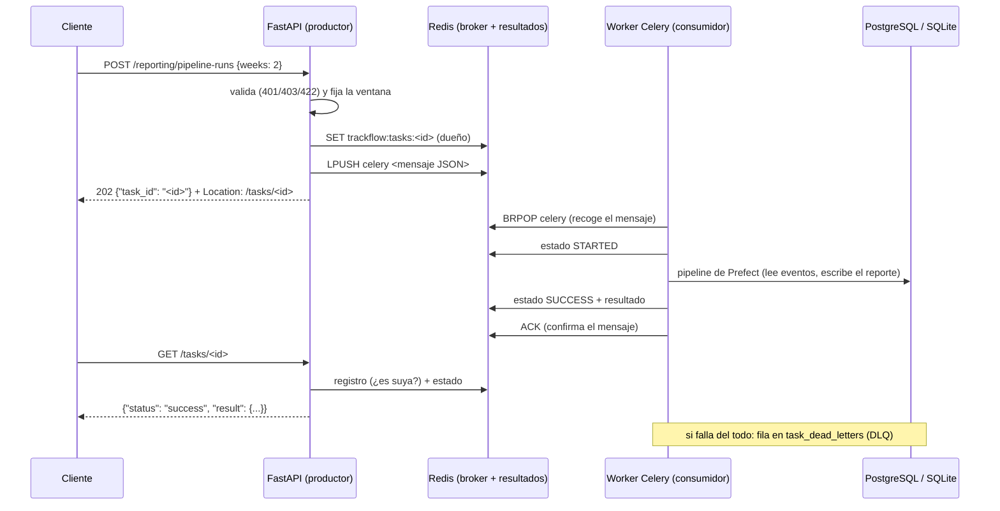

# Colas de mensajes y tareas asíncronas (Celery + Redis) — DEV-55

Práctica sin número de hito. La API de TrackFlow ya no ejecuta el pipeline semanal dentro de la petición HTTP: lo
**encola** en Redis y un **worker de Celery**, que es un proceso aparte, lo ejecuta. El cliente recibe al momento un
`task_id` y consulta el estado cuando quiere.

| Pieza | Dónde |
| --- | --- |
| Instancia y configuración de Celery | [`services/api/app/celery_app.py`](../services/api/app/celery_app.py) |
| Tarea de negocio (pipeline semanal) | [`services/api/app/tasks/reporting.py`](../services/api/app/tasks/reporting.py) |
| Reintentos, backoff y ganchos de la DLQ | [`services/api/app/tasks/base.py`](../services/api/app/tasks/base.py) |
| DLQ persistente | [`services/api/app/tasks/dead_letters.py`](../services/api/app/tasks/dead_letters.py) + migración [`20261116120000_task_dead_letters.sql`](../services/api/migrations/20261116120000_task_dead_letters.sql) |
| Productor y lectura de estados | [`services/api/app/tasks/queue.py`](../services/api/app/tasks/queue.py), [`registry.py`](../services/api/app/tasks/registry.py) |
| Logs estructurados | [`services/api/app/tasks/observability.py`](../services/api/app/tasks/observability.py) |
| Tarea mínima de comprobación | [`services/api/app/tasks/diagnostics.py`](../services/api/app/tasks/diagnostics.py) (`diagnostics.ping`) |
| Endpoints | `POST /reporting/pipeline-runs` ([`routes/reporting.py`](../services/api/app/routes/reporting.py)), `GET /tasks/{task_id}` y `GET /tasks/dead-letters` ([`routes/tasks.py`](../services/api/app/routes/tasks.py)) |
| Infraestructura | `redis`, `worker` y `flower` en [`docker-compose.yml`](../docker-compose.yml) |
| Tests | [`services/api/tests/tasks/`](../services/api/tests/tasks/) y los del `POST` en [`tests/reporting/test_endpoints.py`](../services/api/tests/reporting/test_endpoints.py) |

## 1. Problema y operación elegida

`POST /reporting/pipeline-runs` ejecutaba el flow de Prefect `weekly-warehouse-client-performance` **de forma
síncrona**. Eso incluye arrancar el servidor temporal de Prefect, extraer de `telemetry_events`, transformar, cargar y
registrar la ejecución, con reintentos internos que pueden sumar ~42 s en la extracción y ~20 s en la carga. Medido
sobre la misma base y los mismos eventos (§9.3): **70,6 s** la primera petición tras arrancar la API y **3,7–6,4 s**
las siguientes, con la conexión HTTP bloqueada todo ese tiempo.

Era el mejor candidato del repositorio:
- es la operación más larga de la API;
- sus parámetros son ligeros (`week_start`, `weeks`) y los datos se leen de la base por referencia;
- es idempotente (recalcula la ventana con upsert);
- ya tiene un candado entre procesos (índice único parcial en `reporting.pipeline_runs`);
- ya clasifica sus errores en transitorios y permanentes.

Ninguna otra operación encajaba igual: el analizador de incidencias recibe el CSV dentro de la propia petición y
`/telemetry/report` ya tiene caché. El backoffice no llama a este `POST` (solo a los dos `GET` de `/reporting`), así que
cambiar su respuesta a 202 no rompe ningún cliente del repositorio.

## 2. Arquitectura productor / broker / consumidor



- **Productor (FastAPI).** Valida, registra quién encola, publica el mensaje y responde. Nunca ejecuta la tarea: la
  configuración real no tiene modo eager, así que sin worker el mensaje espera en Redis.
- **Broker (Redis).** Guarda los mensajes pendientes en la lista `celery` hasta que un worker los recoge.
- **Consumidor (worker).** Proceso independiente: `celery -A app.celery_app worker`. Parar la API no lo para, y
  pararlo no hace que la API ejecute nada (comprobado en §9.2, escenarios A y B).
- **Result backend (el mismo Redis).** Guarda el estado y el resultado de cada tarea durante 24 h.
- **DLQ (base de datos).** Guarda los fallos definitivos para siempre (§6).

**Broker y result backend no son lo mismo**, aunque aquí compartan Redis. El broker transporta **mensajes**
(«ejecuta esto») y se vacía al confirmarlos. El result backend guarda **estados y resultados** («la tarea X terminó
con este JSON») y caduca a las 24 h. Se podrían separar; con un solo Redis local no aporta nada y `REDIS_URL` sigue
siendo la única dirección.

## 3. Configuración (`app/celery_app.py`)

| Opción | Valor | Por qué |
| --- | --- | --- |
| `broker` / `backend` | `REDIS_URL` | Una sola variable para la API, el worker y Flower. Docker: `redis://redis:6379/0` (fijada en `docker-compose.yml`). Local: `redis://127.0.0.1:6379/0` (§8). |
| Serialización | `json` (y solo se acepta JSON) | Nunca pickle, que ejecutaría código al deserializar un mensaje ajeno. |
| `task_track_started` | `True` | Publica `STARTED`, así el cliente distingue «en cola» de «ejecutándose». |
| `task_acks_late` | `True` | El mensaje se confirma al **terminar**, no al recibirlo: si el worker muere a mitad, el mensaje sigue en Redis (§7). |
| `task_reject_on_worker_lost` | `True` | Si el proceso hijo muere, el mensaje vuelve a la cola en lugar de darse por hecho. |
| `task_acks_on_failure_or_timeout` | `True` | Un fallo definitivo o un timeout sí confirman el mensaje: no se reentrega en bucle. |
| `worker_prefetch_multiplier` | `1` | Con tareas largas y ACK tardío, un worker no acapara mensajes que no puede ejecutar. |
| `task_soft_time_limit` / `task_time_limit` | 300 s / 360 s | El suave lanza `SoftTimeLimitExceeded` dentro de la tarea; el duro mata el proceso hijo. |
| `visibility_timeout` | 3600 s | Tiempo tras el que Redis devuelve a la cola un mensaje entregado y no confirmado. Es mayor que el límite duro. |
| Expiración de mensajes (`expires`) | 3600 s | Un pipeline pedido hace más de una hora y sin empezar se descarta (`REVOKED`) y va a la DLQ como `expired`. |
| `result_expires` | 1 día | Duración del estado en Redis (y del registro de dueños). |
| Conexión a Redis | `socket_connect_timeout` 2 s, 1 reintento al publicar | Fallar pronto: con Redis caído el `POST` responde 503 en ~2 s, no en decenas de segundos. |
| Eventos | `worker_send_task_events`, `task_send_sent_event` | Flower ve las tareas encoladas, activas, completadas y fallidas. |

## 4. Endpoints y contratos HTTP

### `POST /reporting/pipeline-runs` (productor)

Igual que antes: autenticación, `admin` o `manager` (403 para el resto) y validaciones 422 (`week_start` no es lunes,
semana sin terminar, `weeks` fuera de 1–53, claves desconocidas). Lo que cambia es la respuesta:

```http
POST /reporting/pipeline-runs
Authorization: Bearer <token>
Content-Type: application/json

{"weeks": 2}
```

```http
HTTP/1.1 202 Accepted
Location: /tasks/5512456d-d198-4e07-b77b-b0aeac3152ce
X-Request-Id: …

{"task_id": "5512456d-d198-4e07-b77b-b0aeac3152ce"}
```

| Antes | Ahora |
| --- | --- |
| 201 con la ejecución (`PipelineRun`) | 202 con `{"task_id"}`; la ejecución, en `GET /tasks/{id}` → `result` |
| 409 si había otra ejecución en curso | La tarea se reintenta con backoff (2, 4, 8 s); si sigue ocupado, `failure` / `retries_exhausted` |
| 503 si el pipeline fallaba | `failure` / `permanent_error` (y la ejecución, `failed` en `GET /reporting/pipeline-runs/latest`) |
| 503 si `data/` o Prefect no estaban en el despliegue | Lo comprueba el worker: `failure` / `permanent_error` |
| — | 503 si la cola (Redis) no responde: no se ha encolado nada |

La API **fija la ventana al encolar**: la tarea recibe la semana final explícita. Así cada reintento calcula las mismas
semanas aunque entre medias pase un lunes.

### `GET /tasks/{task_id}`

```json
{
  "task_id": "71801654-95e2-4530-b110-c7f1d946b4e0",
  "task_name": "reporting.run_weekly_performance",
  "status": "success",
  "submitted_at": "2026-11-16T20:24:14.431901Z",
  "result": {"id": "adbd3b34-…", "status": "succeeded", "outcome": "succeeded", "rows_upserted": 2, "…": "…"},
  "error": null
}
```

| Celery | `status` | Significado |
| --- | --- | --- |
| `PENDING`, `RECEIVED` | `pending` | En la cola |
| `STARTED` | `started` | Un worker la está ejecutando |
| `RETRY` | `retrying` | Falló de forma transitoria y espera su reintento. Es un estado real de Celery, no inventado; se expone para que el cliente sepa que no está parada |
| `SUCCESS` | `success` | `result` = la ejecución registrada (el JSON que devolvía el antiguo 201) |
| `FAILURE`, `REVOKED` | `failure` | `error` = `{"type": "retries_exhausted" \| "permanent_error" \| "time_limit" \| "expired" \| "unknown", "message": "…"}` |

- **Pendiente frente a desconocido.** Celery devuelve `PENDING` para cualquier id, exista o no. Por eso la API apunta
  cada tarea que encola en Redis (`trackflow:tasks:<id>` → dueño, nombre, fecha; caduca con el resultado). Un id sin
  registro responde **404**.
- **Propiedad.** Una tarea de otro usuario también responde 404, sin revelar que existe.
- **Errores controlados.** El mensaje de `error` es fijo por tipo; la traza, la excepción y los datos nunca llegan al
  cliente. El detalle técnico está en la DLQ y en los logs.
- **Otros códigos.** 401 sin token, 422 si el id no es un UUID, 503 si Redis no responde.

### `GET /tasks/dead-letters` (solo `admin`)

Devuelve los últimos fallos definitivos (`?limit=1..200`, 50 por defecto), del más reciente al más antiguo, leídos de
la tabla `task_dead_letters`.

## 5. Reintentos y backoff exponencial

```
intento 1 (inicial) ──falla transitorio──► espera 2 s ──► intento 2 (reintento 1)
                                           espera 4 s ──► intento 3 (reintento 2)
                                           espera 8 s ──► intento 4 (reintento 3) ──falla──► DLQ (retries_exhausted)
```

- **Como máximo, 1 intento inicial y 3 reintentos (4 ejecuciones).** `self.request.retries` cuenta los reintentos ya
  hechos, así que el intento en curso es `retries + 1`.
- **El backoff nunca es inmediato.** `countdown = 2 × 2^retries`. El reintento es un mensaje nuevo con el mismo
  `task_id`; mientras espera, el worker queda libre.
- **Solo se reintenta lo transitorio** (`classify` en `base.py`, que recorre la cadena de causas):

| Transitorio (se reintenta) | Permanente (falla a la primera) | Límite de tiempo (no se reintenta) |
| --- | --- | --- |
| `ReportingStorageError.transient` (SQLSTATE 08, 53, 57P, 40001, 40P01: conexión, saturación, reinicio, bloqueo), también como causa de `PipelineRunFailed` | Ventana no válida, tabla inexistente (42P01), contraseña errónea, un bug en la transformación (`PipelineRunFailed` con causa permanente) | `SoftTimeLimitExceeded`, `TimeLimitExceeded` |
| `PipelineAlreadyRunning` (otra ejecución en curso, p. ej. el cron) | `PipelineUnavailable` (no están `data/` ni Prefect) | |
| `ConnectionError`, `TimeoutError` | Cualquier excepción no clasificada | |

- **Dos niveles de reintento, sin pisarse.** Prefect reintenta **cada etapa** dentro de una ejecución (extract 2/10/30
  s, load 5/15 s). Celery reintenta **la tarea entera** solo si la ejecución completa falló por un motivo transitorio.
- **El reintento viaja con una excepción segura** (`TransientTaskError`, solo con los tipos de error), nunca con la
  original. Con un worker real, la excepción `PipelineAlreadyRunning` de `data.pipelines` tumbaba el proceso
  principal del worker con `ModuleNotFoundError`: el proceso padre no podía importar su clase al recibirla del hijo.
  Lo destapó la prueba E2E y lo fija un test de regresión.

Log real del worker en el E2E (resumido): 4 intentos a las 20:04:01,5 → 03,7 (+2,2 s) → 07,9 (+4,2 s) → 16,1 (+8,2 s):

```json
{"event": "task_retry_scheduled", "task_id": "7785880a-…", "attempt": 1, "error": "PipelineAlreadyRunning", "next_attempt": 2, "retries_left": 2, "countdown_s": 2}
{"event": "task_finished", "task_id": "7785880a-…", "attempt": 1, "state": "RETRY", "duration_ms": 261}
{"event": "task_started", "task_id": "7785880a-…", "attempt": 2, "worker": "worker@c5c3912e5bc1"}
…
{"event": "task_failed_permanently", "task_id": "7785880a-…", "attempt": 4, "error": "PipelineAlreadyRunning", "reason": "retries_exhausted"}
{"event": "dead_letter_recorded", "task_id": "7785880a-…", "reason": "retries_exhausted", "attempts": 4}
{"event": "task_finished", "task_id": "7785880a-…", "attempt": 4, "state": "FAILURE", "duration_ms": 258}
```

## 6. Dead Letter Queue persistente (`task_dead_letters`)

Una tarea llega a la DLQ **una sola vez**, cuando Celery ya no la va a volver a ejecutar:

| `reason` | Cuándo | Quién la registra |
| --- | --- | --- |
| `retries_exhausted` | Fallo transitorio en los 4 intentos | `on_failure` de la tarea (proceso hijo) |
| `permanent_error` | Error no recuperable, o una excepción no clasificada | `on_failure` (proceso hijo) |
| `time_limit` | Límite suave (en el intento en curso) o duro | `on_failure`. Con el límite duro lo llama el proceso **padre**, que no conoce el intento: `attempts` queda NULL |
| `expired` | El mensaje caducó en la cola (`expires`) | Señal `task_revoked` con `expired=True` |

Columnas: `task_id` (único), `task_name`, `reason`, `attempts` (1 = inicial; 4 = tras 3 reintentos), `max_retries`,
`exception_type` (causa raíz), `error_message`, `task_kwargs`, `worker`, `failed_at` y `created_at`.
`error_message` lleva la cadena completa de errores con las credenciales censuradas (`://***@`, `password=***`);
`task_kwargs`, solo los argumentos escalares, con los nombres sensibles ocultos.

- **Por qué no basta el log ni el estado `FAILURE`.** El log rota y el result backend caduca a las 24 h; la tabla vive
  en la base de `DATABASE_URL` y sobrevive al worker, a Redis y a los reinicios. Es la **misma base** del pipeline: no
  hay una segunda base de datos.
- **Cómo interactúa con el ciclo de reintentos.** `on_failure` no se llama en un reintento (eso es `RETRY`), solo en
  el fallo definitivo. Registrar ahí, y no en cada excepción, evita guardar los fallos intermedios.
- **Idempotencia.** `INSERT … ON CONFLICT (task_id) DO NOTHING RETURNING id`. Si el mismo fallo llega dos veces (el
  worker cae tras escribir y antes de confirmar, y Celery reentrega), la segunda escritura no hace nada y deja
  `dead_letter_duplicate` en el log. En PostgreSQL, 8 escrituras concurrentes del mismo `task_id` dejan una fila.
  `rowcount` no servía: con psycopg 3 no distinguía insertado de ignorado; `RETURNING` sí.
- **`raise … from None` se respeta.** La cadena de errores sigue la misma regla que Python al mostrar una traza: si el
  código ocultó la excepción del driver, por ejemplo `ReportingStorageError`, que puede llevar la cadena de conexión
  o la consulta, no se guarda.
- **Si la base no responde** (justo el caso de muchos fallos transitorios), la escritura se reintenta dos veces (0,5 y
  2 s). Si sigue fallando, el registro completo sale en el log como `dead_letter_not_persisted` con nivel CRITICAL. Es
  la única situación en que un fallo definitivo queda solo en el log.
- **Migración.** `services/api/migrations/20261116120000_task_dead_letters.sql`: idempotente, con RLS activado y sin
  privilegios para `anon`/`authenticated` (`service_role` solo lee). En SQLite la tabla se crea sola. **En Supabase
  hay que aplicarla** (SQL Editor o `psql`) antes de usar la cola contra esa base.

Consulta habitual:

```sql
select task_id, task_name, reason, attempts, exception_type, left(error_message, 80), failed_at
from public.task_dead_letters order by failed_at desc limit 20;
```

**Flower no es la DLQ.** Flower muestra las tareas fallidas mientras el worker y sus eventos están vivos, porque las
guarda en memoria. La DLQ es la tabla. No existe una cola de Redis «dead letter»: la DLQ es un registro persistente en
base de datos.

## 7. ACK, timeouts, recuperación y duplicados

- **ACK ≠ resultado.** El ACK confirma al broker que el mensaje se ha **entregado y procesado**, y Redis lo borra. El
  resultado se guarda aparte en el result backend. Con `acks_late`, el ACK llega después de guardar el resultado.
- **Caída del worker a mitad de tarea (SIGKILL, OOM).** El mensaje no confirmado queda en el hash `unacked` de Redis.
  Cuando vence el `visibility_timeout` (1 h), Redis lo devuelve a la cola y otro worker, o el mismo al reiniciarse, lo
  ejecuta otra vez (§9.2, escenario D).
- **Parada ordenada** (`docker compose stop|restart worker`, SIGTERM). Es una parada «en caliente»: el worker deja de
  aceptar mensajes y espera a la tarea en curso, con un máximo de 60 s de `stop_grace_period` antes del SIGKILL.
- **Duplicados.** `acks_late` da una entrega «al menos una vez»: la misma tarea puede ejecutarse dos veces.
  Ocurrió de verdad en las pruebas: el worker cayó justo después de programar un reintento, así que Redis devolvió el
  mensaje original y el reintento se ejecutó dos veces con el mismo `task_id`. Es seguro porque el pipeline es
  idempotente, solo hay una ejecución a la vez gracias al candado de `pipeline_runs`, y la DLQ es idempotente por
  `task_id`.
- **Interacción con el candado del pipeline.** Si un worker muere a mitad de una ejecución, su fila de
  `reporting.pipeline_runs` queda `running` hasta que la siguiente ejecución la marca `abandoned` (más de 30 min). Una
  tarea reentregada antes de ese plazo encuentra el candado ocupado, agota sus reintentos (14 s) y termina en la DLQ
  como `retries_exhausted`. Es el comportamiento deseado: no hay dos ejecuciones a la vez, y queda el rastro.
- **Expiración.** `expires` (1 h) caduca los mensajes que nadie empezó. El worker los descarta como `REVOKED` y la
  señal `task_revoked` los registra en la DLQ (`expired`).
- **Timeouts.** El límite suave (300 s) lanza `SoftTimeLimitExceeded` en la tarea, que falla con `TaskTimedOut` y sin
  reintento. El duro (360 s) mata el proceso hijo, y el worker lo sustituye y sigue. El pool de Celery programa el duro
  **después** del suave: el duro solo actúa si la tarea ignora el suave, como una llamada bloqueada en código C.
  `diagnostics.ping(simulate_hang=True)` lo simula para probarlo.
- **Límites en Windows.** Sin Docker, el worker de Windows usa `--pool=solo`: no hay señales, así que los límites de
  tiempo no se aplican (Celery avisa) y las tareas se ejecutan de una en una.

## 8. Operación

### Con Docker Compose (recomendado)

Desde la raíz, la primera vez: `Copy-Item .env.example .env` y rellena `SECRET_KEY` y `FLOWER_BASIC_AUTH`
(`usuario:contraseña`; sin ella, Flower no arranca).

```powershell
docker compose up -d redis backend worker flower
docker compose ps
docker compose logs -f worker
```

| Servicio | Puerto (solo `127.0.0.1`) | Notas |
| --- | --- | --- |
| `redis` | 6379 (`REDIS_PORT`) | `redis:8.10.3-alpine`, `--maxmemory 256mb --maxmemory-policy noeviction --appendonly yes`, volumen `redis-data`, healthcheck `redis-cli ping` |
| `worker` | — | `celery -A app.celery_app worker --concurrency=1` (`CELERY_WORKER_CONCURRENCY`), monta `data/` (el pipeline) y se reinicia solo si cae |
| `flower` | 5555 (`FLOWER_PORT`) | `celery -A app.celery_app flower` con autenticación básica |

- **`noeviction`.** Con la memoria llena, Redis **rechaza** escrituras nuevas y el productor responde 503; no borra
  claves en silencio, que podrían ser mensajes de la cola. Comprobado llenando un Redis de 2 MB: la escritura 17
  devuelve `OOM command not allowed`, se conservan las 16 claves y `evicted_keys:0`.
- **Persistencia.** AOF (`appendonly yes`) en el volumen `redis-data`: los mensajes pendientes sobreviven a
  `docker compose restart redis` (§9.2, escenario G2).
- **Parar y reanudar el worker:** `docker compose stop worker` / `docker compose start worker`. Los mensajes esperan
  en Redis. Tras cambiar el código de las tareas: `docker compose restart worker` (no hay recarga automática).
- **Comprobar la comunicación API → broker → worker:**
  `docker compose exec backend python -c "from app.tasks.diagnostics import ping; print(ping.delay().get(timeout=10))"`.
- **Flower:** http://localhost:5555, con el usuario y la contraseña de `FLOWER_BASIC_AUTH`. Pestañas *Workers*
  (estadísticas, pool, tareas registradas) y *Tasks* (estado, argumentos, tiempos, excepción). Sin credenciales
  responde 401. No lo publiques fuera de `127.0.0.1`: permite ver argumentos y apagar workers.

### Sin Docker (desarrollo local en Windows)

Redis sigue haciendo falta: `docker compose up -d redis`, o cualquier Redis 7+. En `services/api/.env`:
`REDIS_URL=redis://127.0.0.1:6379/0`. Usa **`127.0.0.1` y no `localhost`**: en Windows `localhost` prueba antes `::1`
(IPv6), donde Docker no publica Redis, y cada conexión pierde ~2 s. Medido: con `localhost`, el primer `POST` en frío
tardaba 8,3 s y el 503 con Redis parado, 4 s; con `127.0.0.1`, 245 ms y 2 s.

```powershell
cd services\api
uv run --env-file .env uvicorn app.main:app --port 8000
uv run --env-file .env celery -A app.celery_app worker --pool=solo --loglevel=INFO
```

(Dos terminales; el worker necesita `DATABASE_URL` igual que la API y se ejecuta desde `services\api`, que es donde
está el entorno con Prefect.)

## 9. Pruebas y resultados

### 9.1 Automatizadas

| Suite | Qué cubre | Resultado (2026-11-16) |
| --- | --- | --- |
| Suite completa de la API (`uv run pytest -q`) | Todo, incluidos los tests de abajo; los opcionales se omiten sin sus variables | **1867 passed, 25 skipped** (14 min 25 s) |
| `tests/tasks/test_retry_policy.py` | `REDIS_URL` como única fuente, configuración (JSON, ACK tardío, prefetch, límites, eventos, sin eager), backoff 2/4/8, clasificación por la cadena de causas | Verde |
| `tests/tasks/test_task_lifecycle.py` | Éxito tras reintentos, 4 intentos como máximo → DLQ, permanente sin reintento, límites suave y duro, excepción no clasificada, idempotencia, expiración, revocación manual, base caída → log CRITICAL, excepción segura en el reintento, `ping` | Verde |
| `tests/tasks/test_dead_letters.py` | Escritura y lectura, idempotencia, orden, censura de secretos, `raise … from None`, reintentos de escritura | Verde |
| `tests/tasks/test_tasks_endpoints.py` | `GET /tasks/{id}`: 401, 422, 404 (desconocido y ajeno), todos los estados, errores controlados, 503; `GET /tasks/dead-letters` | Verde |
| `tests/reporting/test_endpoints.py` (POST) | 202 + `Location`, resultado igual al antiguo 201, `X-Request-Id` en la ejecución, ventana fijada al encolar, 422 sin encolar, ocupado → reintentos → DLQ, fallo permanente, parcial, pipeline no disponible, registro caído transitorio/permanente, cola caída → 503 | Verde |
| `tests/tasks/test_dead_letters_postgres.py` (opcional, `TASKS_TEST_DATABASE_URL`) | Migración real: `ON CONFLICT`, 8 escrituras concurrentes → 1 fila, `CHECK`, RLS y privilegios | 6/6 contra PostgreSQL 16 |
| `tests/tasks/test_e2e_docker.py` (opcional, `ASYNC_E2E_*`) | HTTP real → Redis → worker → PostgreSQL: éxito, 202 < 200 ms, 404, reintentos con backoff real (≥ 14 s) → DLQ, error permanente → DLQ, lectura de la DLQ | 6/6 |

En los tests unitarios, Celery ejecuta las tareas en el mismo proceso (modo eager, solo en `tests/conftest.py`) y el
registro de Redis es un doble en memoria. Las integraciones reales son las dos suites opcionales.

### 9.2 Escenarios con servicios reales en Docker

Con PostgreSQL 16 desechable y las 4 migraciones aplicadas; datos ficticios: 56 eventos de inventario de dos marcas
inventadas.

| Escenario | Resultado |
| --- | --- |
| Ida y vuelta `diagnostics.ping` (API → Redis → worker) | `SUCCESS` en 13 ms en el worker |
| A. Se para la API mientras el worker trabaja | El worker termina (`SUCCESS`, 5,7 s); al volver la API, `GET /tasks` → `success` con el resultado |
| B. Worker parado | 202 en 53 ms; `pending` con 1 mensaje en Redis; al arrancar el worker, `success` |
| C. `docker compose restart worker` con un `ping` de 12 s en curso | Parada en caliente: espera a la tarea (`SUCCESS`) y reinicia |
| D. SIGKILL al worker a mitad de un `ping` de 20 s | Estado `STARTED`, mensaje en `unacked`. Al vencer el `visibility_timeout` (simulado envejeciendo su marca en `unacked_index`), el worker lo **recibe de nuevo** y lo completa |
| E. Mensaje con `expires=3` y worker parado 6 s | `REVOKED` (`Discarding revoked task`) y DLQ `expired` |
| F1. `soft_time_limit=2` con una tarea de 10 s | `TaskTimedOut`, sin reintento; DLQ `time_limit`, intento 1 |
| F2. Suave ignorado (`simulate_hang`) y `time_limit=3` | `Hard time limit (3s) exceeded`; DLQ `time_limit` con `attempts` NULL (proceso padre); el worker sigue atendiendo |
| G1. Redis parado (Docker) | `/health` 200; `POST` y `GET /tasks` → 503 sin detalles; el worker se reconecta solo al volver Redis |
| G2. Reinicio de Redis con un mensaje pendiente | La cola conserva el mensaje (AOF) y se procesa al arrancar el worker |
| G3. Redis parado (local, `127.0.0.1`) | 503 en ~2,0 s (`CONNECT_TIMEOUT_SECONDS`); reconexión al volver: 202 en 45 ms |
| Entorno local sin Docker (Windows, `--pool=solo`) | 202 en 15–18 ms; el worker ejecuta el pipeline real |

En G1 el 503 tardó 3,9–7,9 s porque, con el contenedor `redis` parado, **la resolución DNS de Docker** tarda en
fallar (`getaddrinfo('redis')`: 7,9 s), y ningún timeout de socket cubre esa espera. Cuando la dirección resuelve (G3),
el 503 llega en el tiempo del timeout de conexión.

### 9.3 Tiempo de respuesta del productor

| | Antes (`main` @ `dc694f8`, síncrono) | Ahora (202) |
| --- | --- | --- |
| Primera petición tras arrancar la API | 70,6 s (incluye arrancar el servidor temporal de Prefect) | 245 ms local (177 ms medidos en el servidor, Docker) |
| Peticiones siguientes | 3,7 – 6,4 s | 15 – 18 ms local; ~5 ms en el servidor (Docker); mediana < 200 ms en el E2E |

La primera petición tras arrancar abre las conexiones con Redis (registro y productor); las siguientes las reutilizan.

## 10. Limitaciones y riesgos

- **Migración sin aplicar en Supabase.** `task_dead_letters` hay que crearla en Supabase (como `job_runs`) antes de
  usar la cola contra esa base. Sin ella, los fallos definitivos solo quedan en el log (`dead_letter_not_persisted`).
- **Producción sin cola.** `docker-compose.prod.yml` no tiene Redis, worker ni Flower, y su imagen no incluye `data/`:
  en producción el `POST` encolaría sin nadie que consumiera. Antes de desplegar hay que decidir la imagen del worker
  y añadir los servicios (decisión de infraestructura pendiente).
- **Registro de dueños en Redis.** Caduca a las 24 h, como los resultados. Pasado ese plazo, `GET /tasks/{id}` → 404.
  El historial duradero está en `reporting.pipeline_runs` y en la DLQ.
- **Reentrega tras una caída: hasta 1 h** (`visibility_timeout`). Bajarlo acelera la recuperación, pero arriesga
  reentregar tareas que siguen vivas si alguna dura más.
- **Sin autenticación en Redis.** Solo se publica en `127.0.0.1` y en la red interna de Docker. Para un Redis
  compartido o gestionado, `REDIS_URL` admite `redis://:clave@host:puerto/db` o `rediss://` (TLS).
- **DNS de Docker.** Con el contenedor `redis` parado, el 503 tarda lo que tarda en fallar la resolución (~4–8 s).
- **El worker de Windows (`--pool=solo`) no aplica límites de tiempo.**
- **Flower guarda las tareas en memoria.** Al reiniciarlo se pierden las ya terminadas; la DLQ no.
- **Servidores temporales de Prefect huérfanos.** Si se mata el worker local (fuera de Docker), puede quedar vivo el
  servidor temporal de Prefect (limitación ya conocida del pipeline); dentro de Docker muere con el contenedor.

## 11. Glosario

- **Broker:** intermediario que guarda y reparte los mensajes (Redis, lista `celery`).
- **Result backend:** almacén del estado y el resultado de cada tarea (el mismo Redis, con caducidad de 24 h).
- **Productor / consumidor:** quien publica mensajes (la API) / quien los procesa (el worker).
- **ACK (*acknowledgement*):** confirmación de que un mensaje se ha procesado; el broker lo borra. *Late ACK* (ACK
  tardío): confirmar al terminar, no al recibir.
- **Visibility timeout:** tiempo tras el que un mensaje entregado y no confirmado vuelve a la cola.
- **Backoff exponencial:** esperas que crecen exponencialmente entre reintentos (2, 4, 8 s).
- **DLQ (*Dead Letter Queue*):** registro de los mensajes que no se han podido procesar definitivamente.
- **Idempotencia:** repetir la operación produce el mismo resultado que hacerla una vez.
- **Eager:** modo de Celery que ejecuta la tarea en el mismo proceso al encolarla (solo en los tests).
- **Prefork / solo:** pools del worker: procesos hijos (Linux) o el propio proceso, de uno en uno (Windows).
- **AOF (*Append Only File*):** persistencia de Redis que apunta cada escritura en un fichero.
- **`noeviction`:** política de Redis que, al llenarse la memoria, rechaza escrituras en vez de borrar claves.
