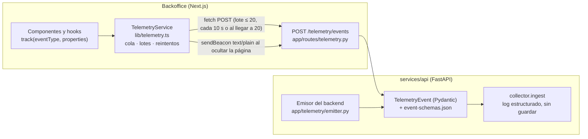

# Telemetría de TrackFlow — Captura en el frontend

| | |
| --- | --- |
| Fase | 2 de «Plan · Captura · Almacenamiento · Reporte» (la fase 1 es [`telemetry-plan.md`](./telemetry-plan.md)) |
| Contrato | [`event-schemas.json`](./event-schemas.json), catálogo `1.0.0` (43 eventos), sin cambios |
| BRIEFING | [`CONTEXT-telemetria.es.md`](../../CONTEXT-telemetria.es.md) (el enunciado lo llama `empresa-BRIEFING.md`) |
| Estado | Implementado y verificado de extremo a extremo (2026-11-10). Sin almacenamiento: el receptor es temporal |

## 1. Resumen

El backoffice tiene un único servicio de telemetría (`lib/telemetry.ts`) con una sola función pública, `track()`.
Los componentes capturan eventos del catálogo; el servicio construye el envelope, los acumula en memoria y los envía
en lotes a `POST /telemetry/events`, un receptor temporal de la API que valida cada evento contra el catálogo aprobado,
pone el `userId` seudonimizado a partir del token y registra el lote en el log. **No guarda nada**: la fase de
Almacenamiento solo tendrá que cambiar `collector.ingest` (y usar `TELEMETRY_ENDPOINT`), sin tocar el frontend.

Las cinco métricas obligatorias del BRIEFING son hechos que solo la API puede afirmar (una orden registrada, un
intento de editar el stock rechazado), y el contrato aprobado solo admite para ellas `source` `backend` o
`internal_process`. Por eso las emite un emisor del backend que entrega al **mismo receptor**. Tres están
instrumentadas; las otras dos siguen bloqueadas por falta de datos de negocio, como ya decía el plan (§5).



## 2. Decisiones de interpretación

El enunciado de la práctica y el contrato aprobado no coinciden en algunos puntos. Ante una diferencia manda el
contrato, que no se ha modificado.

| Enunciado | Contrato o código real | Decisión |
| --- | --- | --- |
| `empresa-BRIEFING.md` | No existe; el BRIEFING es `CONTEXT-telemetria.es.md` | Se usa ese fichero |
| Servicio en `uis/backoffice/src/services/telemetry.ts` | El backoffice no tiene `src/` (código en `lib/`); el plan propone `lib/telemetry.ts` (§18.1) | `uis/backoffice/lib/telemetry.ts` |
| `userId` «del usuario autenticado» en el envelope | El navegador **nunca** envía `userId`: lo pone el colector desde el token, como seudónimo HMAC (§8.3) | El frontend envía `null`; el receptor lo calcula con el Bearer del lote |
| Métricas obligatorias instrumentadas con `track()` | Sus esquemas solo admiten `source` `backend`/`internal_process`, y se emiten tras el commit (§5, §10.1) | Emisor del backend hacia el mismo receptor; el frontend registra el embudo del formulario (`form_submitted`), unido al evento de negocio por `requestId` |
| Lotes cada 10 s o 20 eventos; ningún envío individual | El plan proponía 30 s / 50 y envío inmediato de los eventos *stream* (§12.2), dejando el transporte para esta fase | 10 s / 20 para todo: cumple el objetivo de latencia de los eventos *stream* del frontend (≤ 60 s) |
| Reintentos exponenciales (máximo 3) | El plan proponía 1 s, 5 s y 30 s | 1 s, 2 s y 4 s |
| `sessionId` sin persistencia innecesaria | El plan lo guarda junto al token en `localStorage` (§8.2) | `localStorage`: tiene la misma vida que la sesión (recargas, pestañas) y se borra al cerrarla. No es un secreto |
| Buffer en `localStorage` sin conexión (plan §12.2) | El enunciado prohíbe persistencia local de eventos sin aprobación | No se implementa: cola solo en memoria |
| `login_failed` con `invalid_credentials`, `session_expired`, `network_error` | El enum aprobado es `invalid_credentials`, `account_inactive`, `invalid_payload` | Se usa el del contrato. La sesión caducada es `session_ended` (`token_expired` / `unauthorized_response`) y el fallo de red, `form_submitted` (`network_error`) + `backend_request_failed` |
| Web Vitals LCP, INP, CLS, FCP, TTFB | La allowlist de `page_performance_measured` solo tiene LCP, CLS, INP y TTFB | FCP (y FID) no se envían |
| Validación de propiedades en el backend | `jsonschema` sería una dependencia nueva que hay que aprobar (§18.1) | Validador propio de las palabras clave que usa el catálogo, contra la copia exacta del JSON (sin dependencias) |
| `telemetry_events_dropped` agregado cada 5 min (§13.4) | — | Un aviso por lote descartado y tipo afectado (`dropped_count`, `window_seconds` = duración real). Con el volumen de un equipo interno no compensa otro temporizador |

## 3. Frontend: `TelemetryService`

### 3.1. API pública

```ts
import { track } from "@/lib/telemetry";

track("navigation_section_viewed", { section: "inventory_orders", previous_section: "dashboard", navigation_trigger: "in_app_navigation" });
```

`track<T>(eventType: T, properties: FrontendEventProperties[T]): void` es la versión tipada de
`track(eventType: string, properties: Record<string, unknown>)`: TypeScript obliga a pasar exactamente las propiedades
del contrato de ese evento. No hay otra forma de enviar telemetría. `lib/telemetry.ts` exporta además la clase
`TelemetryService` (para los tests, que crean instancias con dependencias simuladas) y los valores por defecto.

### 3.2. Ficheros

| Fichero | Qué hace |
| --- | --- |
| `lib/telemetry.ts` | Servicio: envelope, allowlist, cola, lotes, reintentos, `sendBeacon`. Instancia única y `track()` |
| `lib/telemetryCatalog.ts` | Eventos con `source` `frontend` (11), sus propiedades y enums. `telemetryCatalog.test.ts` lo compara con `event-schemas.json` |
| `lib/telemetrySession.ts` | `sessionId` (inicio en el login, fin al cerrar sesión) y `requestId` (UUID v4 por petición) |
| `lib/telemetrySections.ts` | Ruta → `section` y ruta de la API → plantilla de FastAPI (nunca URLs) |
| `lib/telemetryCapture.ts` | Errores de JavaScript y fallos de comunicación con la API, con su control de frecuencia |
| `lib/useFormTelemetry.ts` | Embudo de formularios: `form_started`, `form_validation_failed`, `form_submitted`, `form_abandoned` |
| `components/telemetry/TelemetryProvider.tsx` | Montado en `app/layout.tsx`: navegación, `window.onerror`, `unhandledrejection` y Web Vitals |

### 3.3. Envelope

| Campo | Valor en el frontend |
| --- | --- |
| `eventId` | `crypto.randomUUID()` (v4) al capturar; respaldo con `getRandomValues` fuera de contextos seguros |
| `timestamp` | `new Date().toISOString()`: momento de la captura, UTC con milisegundos y `Z` |
| `sessionId` | Sesión autenticada (`lib/telemetrySession.ts`); `null` en páginas públicas |
| `userId` | Siempre `null`: lo pone el receptor |
| `event_type` | El de `track()` |
| `schemaVersion` | La del catálogo para ese evento (`1.0.0`) |
| `requestId` | Solo en `form_submitted`: el `X-Request-Id` de la petición del formulario (nulo si no hubo respuesta) |
| `source` | `frontend` |
| `environment` | `NEXT_PUBLIC_TELEMETRY_ENVIRONMENT` o, sin ella, `production` en los builds y `development` en `npm run dev` |
| `properties` | Solo las claves de la allowlist, en su orden. Un evento con claves de más o de menos se descarta y se cuenta |

### 3.4. Cola, lotes y reintentos

| Parámetro | Valor |
| --- | --- |
| Intervalo de envío | 10 s desde el primer evento pendiente |
| Tamaño máximo del lote | 20 eventos (envío inmediato al llegar a 20) |
| Lotes en vuelo | Uno; lo que se captura mientras tanto espera en la cola |
| Reintentos | 3 (4 intentos en total) con backoff 1 s, 2 s y 4 s, ante error de red, timeout (10 s), 408, 429 o 5xx |
| Errores definitivos | Otros 4xx (el lote no es válido; repetirlo no lo arregla) |
| Tope de la cola | 200 eventos; si se supera se descarta el más antiguo (`buffer_overflow`) |
| Descartes | `telemetry_events_dropped` por tipo afectado; los descartes de esos avisos no se cuentan (no hay cadena infinita) |

- Un lote nunca mezcla sesiones: el receptor pone el `userId` con el token del lote, y el token solo viaja si el lote
  es de la sesión actual. Así los eventos de una sesión anterior no se atribuyen al usuario siguiente.
- Ningún intento bloquea la interfaz: el envío es asíncrono y `track()` nunca lanza.
- `fetch` con `keepalive: true`, para que un lote en vuelo sobreviva al cierre de la página.

### 3.5. Página oculta: `sendBeacon`

Al recibir `visibilitychange` con `hidden` (y en `pagehide`), el servicio envía los eventos pendientes con
`navigator.sendBeacon` en lotes de hasta 20:

- Cuerpo `{"events": [...]}` como `text/plain;charset=UTF-8`: es un tipo «simple» de CORS, así el navegador no
  necesita la petición previa (`OPTIONS`) que un beacon no puede hacer. El receptor lo lee como JSON.
- Incluye el lote que esperaba un reintento (y cancela el reintento). **No** incluye un lote con un `fetch` en curso:
  se duplicaría.
- `sendBeacon` devuelve `true` cuando el navegador **acepta** el envío, no cuando el servidor lo recibe. Si devuelve
  `false`, los eventos vuelven a la cola. Sin `sendBeacon`, se usa `fetch` con `keepalive`.
- Un beacon no lleva cabeceras: los eventos que salen así llegan con `userId` nulo (se unen al usuario por `sessionId`
  con `login_succeeded`, como prevé el plan).
- El listener está en `window` (fase de burbuja): corre después de los de `document`, donde `web-vitals` cierra CLS e
  INP, y después del que emite `page_performance_measured`, que se registra antes.

### 3.6. Sesión y correlación

- **`sessionId`**: `AuthProvider.login` lo genera justo antes de enviar el login (viaja en `X-Session-Id` del propio
  login), lo confirma si el login va bien y lo descarta si falla. `logout` emite `session_ended` y lo borra. Si otra
  pestaña ya cerró la sesión, no se repite el evento. Un token guardado antes de existir la telemetría recibe un
  `sessionId` nuevo al validarse.
- **`requestId`**: `lib/http.ts` envía `X-Request-Id` (UUID v4) y `X-Session-Id` en todas las peticiones a la API. Los
  formularios reservan su `requestId` antes de enviar; la API lo devuelve en `X-Request-Id` y lo pone en sus eventos.

### 3.7. SSR y Strict Mode

- En el servidor `track()` no hace nada; ningún módulo toca `window`, `document` o `navigator` al importarse.
- Los listeners del servicio se registran una sola vez (módulo único). La navegación ignora la misma sección en menos
  de 2 s (doble montaje de Strict Mode y redirecciones como `/inventory` → `/inventory/products`).
- En desarrollo, el doble montaje de Strict Mode vuelve a registrar el listener de Web Vitals después del del servicio;
  en producción no ocurre.

## 4. Backend

### 4.1. Receptor temporal `POST /telemetry/events`

| Aspecto | Comportamiento |
| --- | --- |
| Cuerpo | `{"events": [...]}`, de 1 a 50 eventos y como máximo 64 KB (413 si se pasa) |
| Tipo de contenido | JSON aunque llegue como `text/plain` (beacon) |
| Validación | `TelemetryBatch` → `TelemetryEvent` (Pydantic, tipos estrictos, sin claves fuera del envelope) + esquema del `event_type` en `event-schemas.json` (formatos, fuentes, nulabilidad y allowlist cerrada) |
| Fuente | Solo `source = frontend` (lo del navegador no es de fiar, §15) |
| `userId` | Seudónimo del token Bearer si es válido y el evento tiene sesión; si no, `null`. Lo que envíe el navegador se ignora |
| Error | 422 si algún evento no cumple: se rechaza el lote entero, sin repetir los valores recibidos |
| Respuesta | `200 {"received": n}` |
| Log | `telemetry_batch_received {"channel": "http", "count": n, "event_types": [...], "by_type": {...}}` en `trackflow.telemetry` |
| Persistencia | Ninguna: ni Supabase, ni SQLite, ni TinyDB, ni memoria |

`TelemetryEvent` usa nombres de Python (`event_id`, `session_id`…) con los alias del contrato (`eventId`,
`sessionId`…); `to_contract()` devuelve el evento tal y como lo define el contrato, listo para guardarse.

### 4.2. Emisor del backend

`app/telemetry/emitter.py` construye cada evento campo a campo, lo valida con el mismo modelo y lo entrega a
`collector.ingest` (canal `backend`). Nunca lanza ni bloquea: si un evento no cumple el contrato se descarta con un
aviso `telemetry_event_dropped` en el log (sin valores).

- `source`: `backend` en una petición; `internal_process` fuera (el seed), con `sessionId` y `requestId` nulos.
- `eventId`: UUID v5 determinista en las órdenes (§8.3), para poder reconstruirlas desde las tablas sin duplicar.
- `timestamp`: el `created_at` de la fila en las órdenes.
- `userId` = `usr_` + HMAC-SHA256(`TELEMETRY_PSEUDONYM_KEY`, `"user:" + User.id`)[:32]; `account_ref`, lo mismo con
  `"email:"`. `client_id` es el slug de `client_name` (§8.4) y `warehouse`, `LA`/`ZGZ` → `los_angeles`/`zaragoza`.
- `app/telemetry/context.py` (middleware): `X-Request-Id` (acepta el del backoffice si es un UUID v4, si no lo genera,
  y lo devuelve), `X-Session-Id` (solo si es un UUID) y detección de los casos 1 y 2 de `direct_stock_edit_rejected`.
  CORS admite `X-Request-Id` y `X-Session-Id` y expone `X-Request-Id`.

## 5. Variables de entorno

| Variable | Dónde | Valor local | Para qué |
| --- | --- | --- | --- |
| `NEXT_PUBLIC_TELEMETRY_ENDPOINT` | `uis/backoffice/.env.local` | `http://localhost:8000/telemetry/events` | Receptor. Sin ella la telemetría está desactivada (aviso en la consola de desarrollo) |
| `NEXT_PUBLIC_TELEMETRY_ENVIRONMENT` | idem (opcional) | `development` | `environment` de los eventos |
| `NEXT_PUBLIC_APP_VERSION` | idem (opcional) | — | `app_version` (hash corto del commit); sin ella, `dev` |
| `TELEMETRY_PSEUDONYM_KEY` | `services/api/.env` | ≥ 32 caracteres | Seudónimos `userId`/`account_ref`. **Secreto**. Sin ella los eventos que exigen `userId` se descartan (aviso al arrancar) |
| `TELEMETRY_ENDPOINT` | idem | vacío | Colector definitivo (fase de Almacenamiento). Se valida y se muestra al arrancar; en esta fase no se envía nada |
| `TELEMETRY_ENVIRONMENT` | idem (opcional) | `development` | `environment` de los eventos del backend |

Las variables `NEXT_PUBLIC_*` se incrustan al compilar y van al navegador: nunca llevan secretos.

## 6. Eventos instrumentados

### 6.1. Métricas obligatorias del BRIEFING

| Evento | Estado | Dónde se captura | Cuándo | Prueba |
| --- | --- | --- | --- | --- |
| `inbound_order_created` | ✅ | `register_entry` (`app/services/inventory.py`) | Tras el commit del `StockEntry` (API y seed) | pytest + E2E |
| `outbound_order_created` | ✅ | `register_exit` | Tras el commit de un `StockExit` `dispatch` (una pérdida no es un despacho) | pytest + E2E |
| `direct_stock_edit_rejected` | ✅ | `TelemetryContextMiddleware` (casos 1 y 2) y `create_product` (caso 3) | `PUT`/`PATCH`/`DELETE /inventory/products/{id}` (405), escritura en una ruta de stock inexistente (404) y alta con `current_stock`/`stock`/`stock_by_warehouse` | pytest + E2E |
| `stock_threshold_triggered` | ⛔ Bloqueado | — | No existe un stock mínimo por cliente (los umbrales de `lib/inventory.ts` son de presentación) | — |
| `inventory_discrepancy_detected` | ⛔ Bloqueado | — | No existe un proceso de conteo físico | — |

Inventar un mínimo o un conteo sería inventar reglas de negocio. Desbloquearlos requiere las decisiones del plan
§18.2 (Ana y Miguel).

### 6.2. Eventos adicionales

| Evento | Categoría | Fuente | Dónde | Cuándo |
| --- | --- | --- | --- | --- |
| `stock_loss_recorded` | Inventario | backend | `register_exit` | Tras el commit de una pérdida |
| `inventory_order_rejected` | Inventario | backend | `create_inbound`/`create_outbound` | Stock insuficiente (400) o SKU inexistente (404) |
| `order_history_filtered` | Catálogo | frontend | `MovementHistory.tsx` | 1 s después de terminar la consulta con filtros que ha elegido el usuario, sin repetir combinación |
| `login_succeeded` | Autenticación | backend | `authenticate` (`app/routes/auth.py`) | Antes de devolver el token |
| `login_failed` | Autenticación | backend | `authenticate` y `validation_error` | 401, 403 (cuenta desactivada) o 422 en el login |
| `session_ended` | Autenticación | frontend | `AuthProvider` | Cierre voluntario, caducidad, 401 de la API u otra pestaña |
| `navigation_section_viewed` | Uso | frontend | `TelemetryProvider` | Carga inicial y cada cambio de ruta |
| `form_started` | Uso | frontend | `useFormTelemetry` (login, entrada, salida) | Primer cambio de un campo |
| `form_submitted` | Uso | frontend | idem | Al terminar la llamada a la API (resultado, código, duración, `requestId`) |
| `form_abandoned` | Uso | frontend | idem | Desmontaje o `pagehide` con el formulario empezado y sin envío correcto |
| `form_validation_failed` | Experiencia | frontend | idem | La validación local impide enviar (solo nombres de campo) |
| `frontend_error_captured` | Experiencia | frontend | `app/**/error.tsx`, `window.onerror`, `unhandledrejection` | Agregado por huella (60 s) y con tope de 20/min |
| `backend_request_failed` | Experiencia | frontend | `lib/http.ts`, `lib/inventory.ts` | Sin conexión, timeout, API sin configurar, respuesta ilegible o con forma inesperada (30 s por ruta y tipo) |
| `page_performance_measured` | Experiencia | frontend | `TelemetryProvider` (`useReportWebVitals`) | Una vez por carga, al ocultarse la página: LCP, CLS, INP y TTFB |
| `telemetry_events_dropped` | Procesos internos | frontend | `TelemetryService` y captura de errores | Lote descartado, cola llena, evento fuera de contrato o límite de errores |

Rendimiento transversal (Fase 4): `page_performance_measured` mide la **carga real de la página** (TTFB, LCP) y su
estabilidad e interactividad (CLS, INP) con la API de Next.js, sin dependencias. Se descartó medir la latencia de las
llamadas en el navegador: su evento (`api_latency_recorded`) es del backend en el contrato.

### 6.3. Cobertura

Por categoría del catálogo:

| Categoría | Eventos definidos | Instrumentados | Probados |
| --- | ---: | ---: | ---: |
| A. Inventario y operaciones | 10 | 5 | 5 |
| B. Productos y catálogo | 4 | 1 | 1 |
| C. Autenticación y sesiones | 6 | 3 | 3 |
| D. Usuarios y actividad | 5 | 4 | 4 |
| E. Frontend y experiencia | 4 | 4 | 4 |
| F. Backend y rendimiento | 7 | 0 | 0 |
| G. Integridad y seguridad | 4 | 0 | 0 |
| H. Procesos internos | 3 | 1 | 1 |
| **Total** | **43** | **18** | **18** |

Con la agrupación del enunciado:

| Grupo | Eventos definidos | Instrumentados | Probados |
| --- | ---: | ---: | ---: |
| Técnicos del frontend (errores, fallos de red, navegación, descartes) | 4 | 4 | 4 |
| Negocio obligatorios | 5 | 3 | 3 |
| Negocio adicionales (embudo de formularios, historial, pérdidas, rechazos) | 7 | 7 | 7 |
| Web Vitals (`page_performance_measured`: LCP, CLS, INP, TTFB) | 1 | 1 | 1 |
| Autenticación | 6 | 3 | 3 |

«Probado» significa test automático (pytest o Jest) **y** recepción comprobada en la prueba de extremo a extremo. Los
no instrumentados de F, G, H y C (`access_token_rejected`, `password_*`, `user_registered`) son eventos del backend o
de procesos programados fuera de esta fase de captura en el frontend.

## 7. Privacidad

- Allowlist en tres capas: tipos de TypeScript, filtro en `track()` y validación del receptor contra el JSON Schema.
- Nunca se capturan contraseñas, emails, nombres, tokens, cookies ni el contenido de los formularios: los formularios
  solo envían **nombres** de campo; los errores, el nombre de la clase y una huella (SHA-256 de nombre + primer marco
  propio, sin query); las rutas, la sección o la plantilla de FastAPI, nunca la URL (la de `/reset-password` lleva un
  token).
- `userId` y `account_ref` son seudónimos HMAC con clave secreta en el servidor; el navegador nunca los calcula.
- Los mensajes de error de validación (422 y log) nombran campos y reglas, nunca el valor recibido.
- `tracking_number` y `reference` de las órdenes no salen nunca (restricción 3 del BRIEFING).

## 8. Pruebas

| Suite | Resultado |
| --- | --- |
| `services/api`: `uv run pytest -q` | 1413 tests en verde (144 nuevos de telemetría: contrato, receptor y eventos del backend; 1 existente adaptado: la recuperación de contraseña ignora `X-Request-Id`, aleatorio por petición, al comparar cabeceras) |
| `uis/backoffice`: `npm test` | 255 tests en verde (107 nuevos: servicio, catálogo, captura, sesión) |
| `npm run lint`, `npm run typecheck`, `next build --webpack` | Sin errores |
| E2E (Chrome real, build de producción, API con copias de las bases) | 46/46 comprobaciones |

La prueba de extremo a extremo (script fuera del repositorio, como en las auditorías anteriores) comprobó con
interacciones reales: ninguna petición antes de 10 s, lote a los 10 s y lote inmediato de 20, envelope completo en
todos los eventos, `userId` nulo desde el navegador, un lote nunca mezcla sesiones, intentos fallidos a 0 / +1 s /
+2 s / +4 s y descarte contado, beacon `text/plain` al ocultar la página (visto en Network como `Ping`), todos los
eventos del frontend recibidos por la API, todos los lotes aceptados registrados en el log con su cantidad y tipos,
`form_submitted` unido a la orden por `requestId`, los siete eventos del backend, ningún 422 y ninguna PII ni URL.

Los beacons enviados **mientras la página se descarga** no aparecen en DevTools ni en el protocolo de DevTools (los
gestiona el proceso del navegador), pero sí en el log del receptor: la prueba lo comprueba comparando lotes vistos y
recibidos.

## 9. Ejecución local y verificación en DevTools

En `services\api` (PowerShell, un comando por línea), con `TELEMETRY_PSEUDONYM_KEY` en el `.env`:

```powershell
uv run --env-file .env uvicorn app.main:app --port 8000
```

En `uis\backoffice`, con `NEXT_PUBLIC_TELEMETRY_ENDPOINT` en `.env.local`:

```powershell
npm run dev
```

1. Abre `http://localhost:3002`, DevTools → **Network** → filtro **Fetch/XHR** y escribe `telemetry`.
2. Inicia sesión y navega: no aparece nada hasta pasados 10 s; entonces, un `POST /telemetry/events` con `events` en
   **Payload** y `{"received": n}` en **Response** (200).
3. Para el beacon: filtro **All** (o **Other**), cambia de pestaña y vuelve; aparece un `events` de tipo `ping` con
   `text/plain`.
4. En la terminal de la API: `telemetry_batch_received {...}` por cada lote, y los eventos del backend (`channel:
   backend`) al registrar órdenes.

## 10. Limitaciones conocidas

- **Sin almacenamiento**: el receptor solo registra. Los eventos de esta fase no se conservan.
- **Dos métricas obligatorias bloqueadas** (`stock_threshold_triggered`, `inventory_discrepancy_detected`) hasta que
  negocio defina los mínimos y el conteo físico.
- **Sin buffer persistente**: si el receptor está caído más de ~7 s y la página se cierra, los eventos pendientes se
  pierden (se cuentan cuando es posible).
- **Beacons sin `userId`** (no admiten cabeceras); se unen al usuario por `sessionId`.
- **`app_version`** vale `dev` mientras el build no reciba `NEXT_PUBLIC_APP_VERSION` (pasarle el `IMAGE_TAG` en Docker
  es un cambio de infraestructura pendiente de aprobar).
- **Web Vitals**: una medición por carga completa de página; las navegaciones internas no tienen LCP/TTFB propios.
- **Eventos del backend en el mismo proceso**: se entregan al momento, sin cola; la cola asíncrona del plan (§12.2)
  llega con el transporte real.
- **Hallazgo**: en la prueba E2E la pantalla de login tuvo un CLS de 0,31 (umbral «pobre» > 0,25) en escritorio. No se
  ha corregido (fuera del alcance); queda como dato para la auditoría de rendimiento.
