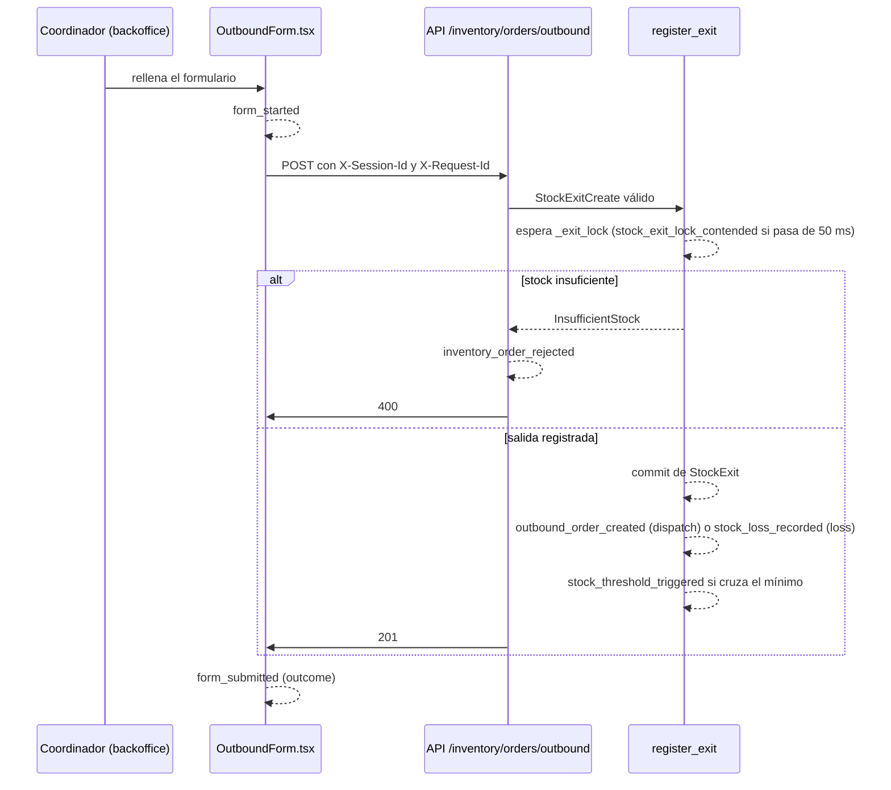

# Plan de telemetría de TrackFlow

| | |
| --- | --- |
| Versión del catálogo | `1.0.0` (todos los eventos en `schemaVersion` `1.0.0`) |
| Fecha | 2026-11-10 |
| Estado | **Diseño.** No hay nada implementado: este documento es la especificación para instrumentar |
| Esquemas validables | [`event-schemas.json`](./event-schemas.json) (JSON Schema Draft-07) |
| Fuente de negocio | [`CONTEXT-telemetria.es.md`](../../CONTEXT-telemetria.es.md) (BRIEFING de telemetría) y [`CONTEXT-gestor-inventario.es.md`](../../CONTEXT-gestor-inventario.es.md) (entidades del inventario) |
| Serie | Fase 1 de «Plan · Captura · Almacenamiento · Reporte» |

## Índice

1. [Resumen ejecutivo](#1-resumen-ejecutivo)
2. [Contexto y objetivos](#2-contexto-y-objetivos)
3. [Alcance y exclusiones](#3-alcance-y-exclusiones)
4. [Arquitectura actual relevante](#4-arquitectura-actual-relevante)
5. [Métricas obligatorias del BRIEFING](#5-métricas-obligatorias-del-briefing)
6. [Catálogo de oportunidades adicionales](#6-catálogo-de-oportunidades-adicionales)
7. [Mapa de instrumentación por proceso](#7-mapa-de-instrumentación-por-proceso)
8. [Event Envelope estándar](#8-event-envelope-estándar)
9. [Taxonomía de eventos](#9-taxonomía-de-eventos)
10. [Definición detallada de los eventos](#10-definición-detallada-de-los-eventos)
11. [Allowlist de propiedades por evento](#11-allowlist-de-propiedades-por-evento)
12. [Estrategia stream vs batch](#12-estrategia-stream-vs-batch)
13. [Throttle, debounce, agregación y muestreo](#13-throttle-debounce-agregación-y-muestreo)
14. [Privacidad y protección de PII](#14-privacidad-y-protección-de-pii)
15. [Seguridad y control de acceso](#15-seguridad-y-control-de-acceso)
16. [Retención y ciclo de vida](#16-retención-y-ciclo-de-vida)
17. [Riesgos y exclusiones](#17-riesgos-y-exclusiones)
18. [Recomendaciones para la futura implementación](#18-recomendaciones-para-la-futura-implementación)
19. [Priorización de instrumentación](#19-priorización-de-instrumentación)
20. [Matriz de trazabilidad con los requisitos del BRIEFING](#20-matriz-de-trazabilidad-con-los-requisitos-del-briefing)
21. [Relación entre el catálogo Markdown y `event-schemas.json`](#21-relación-entre-el-catálogo-markdown-y-event-schemasjson)

---

## 1. Resumen ejecutivo

TrackFlow necesita saber qué pasa dentro de su sistema de inventario, que es el núcleo del negocio: cuánta mercancía
entra y sale de cada almacén, cuándo un cliente se va a quedar sin stock, quién intenta saltarse la trazabilidad y
dónde aparecen discrepancias. Hoy la aplicación no emite ninguna telemetría: solo hay logs técnicos
(`trackflow.api.timing`, `trackflow.api`) que nadie agrega.

Este plan define **43 eventos**: los **5 obligatorios** del BRIEFING y
**38 oportunidades** encontradas al revisar el código, repartidos en **8
categorías**. Cada evento tiene hipótesis, decisión, fuente, momento de emisión, punto exacto de instrumentación en el
monorepo, allowlist cerrada de propiedades (220 en total), estrategia de entrega (17 en
stream y 26 en batch), control de frecuencia, tratamiento de datos personales y retención. Todos
comparten un **Event Envelope** común y están descritos en [`event-schemas.json`](./event-schemas.json), validable con
JSON Schema Draft-07.

Decisiones principales:

- **`userId` seudonimizado** con HMAC-SHA256 y clave secreta, en lugar del `user_uuid` real que guardan las órdenes
  (§8.3). Es la decisión más difícil del plan: se pierde el cruce directo con la auditoría, a cambio de que quien
  analiza la telemetría no pueda identificar a una persona sin la clave.
- **Los campos del BRIEFING se traducen, no se inventan:** `LA`/`ZGZ` → `los_angeles`/`zaragoza`; `client_id` es un
  slug determinista de `client_name` porque el modelo no tiene identificador de cliente (§8.4).
- **`eventId` determinista** en los eventos que nacen de una fila de la base: si se pierde un evento de inventario se
  puede reconstruir desde `stock_entries`/`stock_exits` sin duplicarlo (§8.3, §18.3).
- **Ningún evento de auditoría, seguridad o movimiento de stock se muestrea, se agrega ni se descarta** (§13.2).
- **La telemetría no sustituye a la auditoría:** las tablas de movimientos siguen siendo la fuente de verdad (§14.8).

Tres eventos están **bloqueados** por carencias del sistema que no se pueden resolver sin decisiones de negocio o
tablas nuevas (fuera del alcance de este reto): `stock_threshold_triggered` (no existe un mínimo por cliente),
`inventory_discrepancy_detected` e `inventory_count_completed` (no existe un proceso de conteo físico). Están
especificados completos para que se implementen en cuanto exista el dato (§18.2).

## 2. Contexto y objetivos

### 2.1. Contexto de negocio

TrackFlow gestiona almacenes y última milla para marcas de moda, electrónica y cosmética, con almacenes en Los Ángeles
y Zaragoza. Según el BRIEFING, «el inventario es literalmente el negocio»: el stock de cada SKU de cada cliente, en
cada almacén. Las métricas de este plan alimentarán más adelante:

- el **dashboard operativo de almacén de Ana** (Operaciones de almacén): volumen entrante y saliente, ritmo de
  despacho, discrepancias;
- el **dashboard ejecutivo global de Thomas** (CEO): comparación de volumen y SLA entre Estados Unidos y España;
- las **alertas comerciales de Miguel** (Comercial): quiebres de stock antes de que ocurran.

El BRIEFING pide diseñarlas «como si alguien más, más adelante, fuera a depender de ellas sin poder preguntarte cómo
funcionan»: por eso cada evento documenta de dónde sale cada dato y qué significa cada valor.

### 2.2. Objetivos

| Id | Objetivo | Cómo lo cubre el plan |
| --- | --- | --- |
| O1 | Medir de punta a punta las 5 métricas obligatorias, agregables por almacén, cliente y país | §5, §10.1, §20 |
| O2 | Hacer visible la actividad técnica (errores, rendimiento, caídas) que hoy solo está en logs locales | Categorías E y F |
| O3 | Vigilar las reglas de negocio y la seguridad (trazabilidad, permisos, autenticación) | Categorías C y G |
| O4 | Entender el uso del backoffice (secciones, flujos, abandono) | Categoría D |
| O5 | Que otro desarrollador pueda instrumentar sin preguntar | Fichas §10, allowlists §11, JSON Schema, §18 |
| O6 | Privacidad por diseño: ningún dato personal innecesario | §11, §14, §15 |

### 2.3. Fuentes y cómo se han interpretado

| Fuente | Uso |
| --- | --- |
| `CONTEXT-telemetria.es.md` | Es el BRIEFING de este reto: se titula «BRIEFING — TrackFlow» y contiene las métricas obligatorias. El enunciado lo llama `empresa-BRIEFING.md`, fichero que no existe en el repositorio; el BRIEFING enlaza además una versión inglesa (`trackflow-BRIEFING.md`) que tampoco está. Se usa el fichero en español como única fuente, sin modificarlo. |
| `CONTEXT-gestor-inventario.es.md` | Especificación de `SKU`, `StockEntry` y `StockExit` (Hito 5) y sus reglas de negocio. |
| Código del monorepo | `services/api` (FastAPI) y `uis/backoffice` (Next.js). Cada punto de instrumentación cita su fichero. |
| `memory-bank/techContext.md` | Stack y decisiones técnicas vigentes. |

El enunciado del reto describe un «modelo de datos relacional en Supabase» y «órdenes de entrada y salida». En el código
real: el inventario usa **SQLModel** sobre **SQLite** por defecto y sobre **Supabase/PostgreSQL** cuando se define
`DATABASE_URL`; los usuarios viven en **TinyDB** (`db/auth.json`), no en Supabase; y las órdenes son **movimientos
atómicos** (`StockEntry`, `StockExit`) sin estados de ciclo de vida. El plan se ajusta al código real (§4.4).

## 3. Alcance y exclusiones

**Dentro del alcance**

- `services/api`: inventario (`/inventory`), autenticación (`/auth`, `/users`, `/profiles`), manejo de errores,
  middleware de tiempos, bases de datos, caché y envío de emails.
- `uis/backoffice`: navegación, formularios, errores de JavaScript, rendimiento y comunicación con la API.
- Procesos internos: seeds existentes (`seed`, `seed-inventory`, `seed_incidents.py`) y los procesos programados que
  este plan propone (foto de stock, revisión de integridad, detección de duplicados, purga de retención).

**Fuera del alcance**

| Exclusión | Motivo |
| --- | --- |
| Implementación (código, middleware, endpoints, tablas, dependencias, despliegue) | Reto de diseño. Las fases de Captura y Almacenamiento de la serie lo harán. |
| `uis/website` y `uis/landing` (sitios públicos) | Son públicos y anónimos: su analítica exige consentimiento de cookies y es otra decisión. El BRIEFING se centra en el inventario. |
| Eventos de negocio de proveedores y del gestor de incidencias | No los pide el BRIEFING; sus rutas quedan cubiertas por los eventos técnicos genéricos (latencia, errores, navegación). Candidatos a la versión 1.1. |
| Datos del transportista y del destinatario final | Restricción 3 del BRIEFING: pertenecen al dominio de última milla. `tracking_number` nunca se emite. |
| Funciones que el sistema no tiene (estados de orden, cancelaciones, edición o desactivación de productos, renovación de tokens, bloqueo de cuentas) | No hay hecho que medir. Se justifican una a una en §17.1. |

## 4. Arquitectura actual relevante

### 4.1. Componentes

| Componente | Detalle que importa para la telemetría |
| --- | --- |
| Backoffice (`uis/backoffice`) | Next.js 16 + React 19. Token JWT en `localStorage` (`trackflow.backoffice.token`). Cliente HTTP único en `lib/http.ts` (Bearer, 401 → cierre de sesión, corte a los 20 s). Límites de error en `app/(panel)/error.tsx`, `app/error.tsx` y `app/global-error.tsx`. Sin analítica ni librerías de telemetría. |
| API (`services/api`) | FastAPI 0.141, **un solo worker** (requisito ya documentado). Middlewares, de fuera hacia dentro: `CORSMiddleware` → `RequestTimingMiddleware` (`app/timing.py`) → `UnexpectedErrorMiddleware` (`app/errors.py`). |
| Inventario | SQLModel (`app/inventory_models.py`) sobre SQLite (`db/inventory.db`) o Supabase vía *Session pooler* (`DATABASE_URL`, `connect_timeout` 10 s). Lógica en `app/services/inventory.py`; rutas en `app/routes/inventory.py`. |
| Usuarios | TinyDB (`db/auth.json`): `User.id` es un UUID, igual al `sub` del JWT y al `user_uuid` de los movimientos. Roles `admin`, `manager`, `user`. JWT HS256 de 30 min sin renovación. |
| Caché | `app/cache.py`: `TTLCache` con contadores (`hits`, `misses`, `invalidations`) en `GET /inventory/products` (30 s) y `GET /api/incidents/summary` (60 s). |
| Email | `app/services/email.py`: Resend por `urllib`; `deliver` nunca lanza y registra el resultado sin destinatario. |
| Despliegue | Docker en el VPS, sin acceso público (túnel SSH). No hay cola, colector, almacén de eventos ni planificador de tareas. |

### 4.2. Modelo de datos del inventario y equivalencias con el BRIEFING

| Entidad del BRIEFING | En el código | Campos usados por la telemetría |
| --- | --- | --- |
| `Product` | `SKU` (tabla `skus`) | `id`, `sku`, `client_name`, `category`, `warehouse` |
| `InboundOrder` | `StockEntry` (tabla `stock_entries`) | `id`, `sku_id`, `quantity`, `warehouse`, `created_at`, `user_uuid` |
| `OutboundOrder` | `StockExit` con `exit_type = dispatch` (tabla `stock_exits`) | `id`, `sku_id`, `quantity`, `exit_type`, `warehouse`, `created_at`, `user_uuid` |
| `warehouse` | Columna `warehouse` (`LA`, `ZGZ`) en las tres tablas | Se traduce a `los_angeles`/`zaragoza` |
| `client` | Solo el texto `SKU.client_name` | Se deriva `client_id` (§8.4) |

`current_stock` no es una columna: se calcula como entradas − salidas, por SKU y por almacén (reglas 1 y 6 del
inventario). La regla 2 rechaza, antes de escribir, una salida que dejaría el stock por debajo de cero.

### 4.3. Endpoints del inventario

| Método y ruta | Resultado | Eventos que genera |
| --- | --- | --- |
| `GET /inventory/products` | 200 (caché de 30 s) | `api_latency_recorded`, `cache_stats_recorded` |
| `POST /inventory/products` | 201 · 409 duplicado · 422 | `product_created` · `product_duplicate_rejected` · `product_validation_failed`; `direct_stock_edit_rejected` si trae campos de stock |
| `GET /inventory/products/{sku_id}` | 200 · 404 | `api_latency_recorded` |
| `PUT`/`PATCH`/`DELETE /inventory/products/{sku_id}` | 405 (no existen) | `direct_stock_edit_rejected` |
| `POST /inventory/orders/inbound` | 201 · 404 · 422 | `inbound_order_created` · `inventory_order_rejected` · `inventory_order_validation_failed` |
| `POST /inventory/orders/outbound` | 201 · 400 · 404 · 422 | `outbound_order_created` o `stock_loss_recorded` (+ `stock_threshold_triggered`) · `inventory_order_rejected` · `inventory_order_validation_failed` |
| `GET /inventory/orders` | 200 | `api_latency_recorded`; `order_history_filtered` desde el backoffice |

Todas exigen Bearer JWT (401 → `access_token_rejected`) pero **ninguna comprueba el rol** (§17.3).

### 4.4. Desajustes entre el BRIEFING y el sistema real

| Requisito del BRIEFING | Realidad del código | Resolución en el plan |
| --- | --- | --- |
| `warehouse` = `los_angeles`/`zaragoza` | Se guarda `LA`/`ZGZ` | Traducción fija en el emisor (§8.4) |
| `client_id` | No existe; solo `client_name` (texto libre) | Slug determinista de `client_name` (§8.4) y migración a un id real cuando exista la entidad `Client` |
| `product_id` (SKU) | `SKU.sku` (código del cliente, único sin distinguir mayúsculas) | Se usa tal cual; nunca el `id` numérico |
| Mínimo de stock por cliente | No existe (`STOCK_THRESHOLDS` del backoffice es orientativo de la pantalla) | Evento especificado y **bloqueado** hasta definir los mínimos (§18.2) |
| Conteo físico o auditoría | No existe | Eventos especificados y **bloqueados** (§18.2) |
| Edición directa de stock rechazada | No hay ninguna ruta que edite stock; `current_stock` en el alta se ignora en silencio | Se detecta el intento en tres formas concretas (§10.1) |
| `OutboundOrder` = picking y despacho | `StockExit` mezcla despachos (`dispatch`) y pérdidas (`loss`) | Solo `dispatch` emite `outbound_order_created`; `loss` emite `stock_loss_recorded` (§5.3) |
| Órdenes trazables a un usuario | `user_uuid` sale del token; los usuarios viven en TinyDB sin clave foránea | `userId` seudonimizado (§8.3); revisión de referencias huérfanas (`inventory_integrity_violation_detected`) |

### 4.5. Instrumentación existente que se reutiliza

- `RequestTimingMiddleware` (`app/timing.py`) ya mide cada petición con la **plantilla** de ruta (sin ids ni query),
  el estado y el número de consultas SQL: es la base de `api_latency_recorded` y `api_slow_request_detected`.
- `log_unexpected` y `_origin` (`app/errors.py`) ya registran errores sin valores: base de `api_exception_raised`.
- `validation_error` (`app/errors.py`) ya recorre los 422 sin `input` ni `ctx`: base de los eventos de validación.
- `TTLCache.stats()` (`app/cache.py`) ya cuenta aciertos y fallos: base de `cache_stats_recorded`.
- `count_sql_query` (`app/database.py`) ya escucha `before_cursor_execute`: base de `database_query_slow`.

## 5. Métricas obligatorias del BRIEFING

Las cinco métricas se mantienen con su `event_type`, su disparador, su hipótesis y su decisión literales del
BRIEFING.

| event_type | classification | category | source | hypothesis | decision | business_value | priority |
| --- | --- | --- | --- | --- | --- | --- | --- |
| `inbound_order_created` | `mandatory` | `inventory_operations` | `backend`, `internal_process` | Necesitamos saber cuánto volumen entra, por cliente y por almacén | Planificar capacidad de almacén y personal según el volumen entrante (Ana) | Volumen entrante por almacén, cliente y país: base del dashboard operativo de Ana y del ejecutivo de Thomas. | `critical` |
| `outbound_order_created` | `mandatory` | `inventory_operations` | `backend`, `internal_process` | Necesitamos saber cuántos pedidos se procesan, por cliente y almacén, y a qué ritmo | Detectar cuellos de botella operativos antes de que afecten el SLA de entrega (Ana) | Ritmo de despacho por almacén y cliente; comparación EE. UU./España del dashboard ejecutivo. | `critical` |
| `stock_threshold_triggered` | `mandatory` | `inventory_operations` | `backend`, `internal_process` | Necesitamos saber con qué frecuencia un cliente se queda sin stock disponible de un SKU | Alertar al cliente y al equipo comercial antes de un quiebre de stock (Miguel) | Aviso previo al quiebre de stock: evita pedidos que no se pueden servir y protege la relación comercial. | `critical` |
| `direct_stock_edit_rejected` | `mandatory` | `inventory_operations` | `backend` | Necesitamos saber si el personal de almacén intenta saltarse el control de trazabilidad | Reforzar capacitación o permisos en el almacén donde esto ocurre con más frecuencia | Protege la regla «el stock nunca se modifica directamente» y señala dónde formar al equipo. | `critical` |
| `inventory_discrepancy_detected` | `mandatory` | `inventory_operations` | `internal_process`, `backend` | Necesitamos saber en qué SKUs y almacenes ocurren más discrepancias | Priorizar auditorías de inventario en los SKUs con mayor tasa de discrepancia (Ana) | Una discrepancia es un problema contractual con el cliente; medirla permite atacarla donde más ocurre. | `critical` |

### 5.1. Campos mínimos y de dónde salen

| Campo del BRIEFING | Origen en el código | Transformación |
| --- | --- | --- |
| `warehouse` | `StockEntry.warehouse` / `StockExit.warehouse` (o `SKU.warehouse` cuando no hay movimiento) | `LA` → `los_angeles`, `ZGZ` → `zaragoza` |
| `client_id` | `SKU.client_name` | Slug determinista (§8.4) |
| `product_id` | `SKU.sku` | Ninguna |
| `product_category` | `SKU.category` | Ninguna (`fashion`, `electronics`, `cosmetics`) |
| `quantity` | `quantity` del movimiento | En `stock_threshold_triggered` es el stock restante; en `inventory_discrepancy_detected`, la diferencia absoluta; en `direct_stock_edit_rejected`, el valor que se intentaba fijar. Cada ficha lo define. |

**País.** Los dashboards agregan por país. No se añade una propiedad `country` (sería redundante y podría
contradecir a `warehouse`): la correspondencia es fija y se aplica al consultar.

| `warehouse` | País | Mercado |
| --- | --- | --- |
| `los_angeles` | `US` | Estados Unidos |
| `zaragoza` | `ES` | España |

### 5.2. Métricas derivadas

| Métrica | Cálculo | Dimensiones | Consumidor |
| --- | --- | --- | --- |
| Unidades recibidas | Σ `quantity` de `inbound_order_created` | día/semana × almacén × cliente × país | Ana, Thomas |
| Recepciones | nº de `inbound_order_created` | ídem | Ana |
| Pedidos despachados | nº de `outbound_order_created` | hora del turno × almacén × cliente | Ana |
| Ritmo de despacho | pedidos por hora; variación frente a la media de las 4 semanas anteriores en la misma franja | almacén | Ana (cuellos de botella) |
| Volumen EE. UU. vs. España | Σ `quantity` de entradas y salidas por país | mes × país | Thomas |
| Frecuencia de quiebre | nº de `stock_threshold_triggered` / nº de SKUs activos del cliente | mes × cliente × almacén | Miguel |
| SKUs en riesgo | SKUs con un `stock_threshold_triggered` sin una entrada posterior | almacén × cliente | Miguel |
| Intentos de saltarse la trazabilidad | nº de `direct_stock_edit_rejected` | semana × almacén × `attempt_channel` | Ana |
| Tasa de discrepancia | nº de `inventory_discrepancy_detected` / nº de `inventory_count_completed` | SKU × almacén × trimestre | Ana |
| Unidades discrepantes | Σ `quantity` de `inventory_discrepancy_detected` por `discrepancy_direction` | SKU × almacén | Ana, Miguel |

El SLA de entrega del dashboard de Thomas necesita además la fecha del pedido del cliente y la de entrega, que
pertenecen a última milla: con este plan solo se puede medir el ritmo de despacho del almacén (§17.2).

### 5.3. Qué cuenta como `OutboundOrder`

`StockExit` registra dos hechos distintos: el despacho de un pedido (`dispatch`) y la baja de unidades perdidas o
dañadas (`loss`). El BRIEFING define `outbound_order_created` como «un almacén completa el picking y despacho de un
pedido», así que **solo los `dispatch` lo emiten**. Las pérdidas emiten `stock_loss_recorded`. Así el ritmo de
despacho no se infla con bajas, y la suma de los dos eventos sigue cuadrando con la tabla `stock_exits`.

## 6. Catálogo de oportunidades adicionales

Cada evento adicional supera la prueba del enunciado: se puede completar la frase «Capturamos `x` porque necesitamos
saber [hipótesis], lo que nos permite tomar la decisión [decisión]». La frase completa de cada uno está en su ficha
(§10).

| Categoría | Eventos | Obligatorios | Oportunidades | Stream | Batch |
| --- | ---: | ---: | ---: | ---: | ---: |
| `inventory_operations` (A. Inventario y operaciones) | 10 | 5 | 5 | 6 | 4 |
| `product_catalog` (B. Productos y catálogo) | 4 | 0 | 4 | 0 | 4 |
| `authentication` (C. Autenticación y sesiones) | 6 | 0 | 6 | 2 | 4 |
| `user_activity` (D. Usuarios y actividad) | 5 | 0 | 5 | 0 | 5 |
| `frontend_experience` (E. Frontend y experiencia de usuario) | 4 | 0 | 4 | 2 | 2 |
| `backend_performance` (F. Backend y rendimiento) | 7 | 0 | 7 | 2 | 5 |
| `integrity_security` (G. Integridad y seguridad) | 4 | 0 | 4 | 3 | 1 |
| `internal_processes` (H. Procesos internos y tareas automatizadas) | 3 | 0 | 3 | 2 | 1 |
| **Total** | **43** | **5** | **38** | **17** | **26** |

Fuentes de los eventos (un evento puede tener más de una): `backend`: 29, `frontend`: 11, `internal_process`: 14. No hay eventos con fuente `database`:
emitir desde la base exigiría triggers o tablas nuevas, que este reto no permite crear.

### 6.1. A. Inventario y operaciones (`inventory_operations`)

| event_type | classification | category | source | hypothesis | decision | business_value | priority |
| --- | --- | --- | --- | --- | --- | --- | --- |
| `inventory_count_completed` | `identified_opportunity` | `inventory_operations` | `internal_process`, `backend` | Necesitamos saber cuántos conteos se hacen por SKU y almacén, para que la tasa de discrepancia tenga denominador | Fijar la frecuencia de conteo cíclico por SKU y comprobar que las auditorías priorizadas se ejecutan | Sin él, `inventory_discrepancy_detected` da un número absoluto, no la «tasa» que pide el BRIEFING. | `high` |
| `stock_loss_recorded` | `identified_opportunity` | `inventory_operations` | `backend`, `internal_process` | Necesitamos saber qué SKUs, clientes y almacenes acumulan más unidades dadas de baja como pérdida | Revisar manipulación, embalaje o ubicación en el almacén y los SKUs con más pérdidas, y abrir la conversación contractual con el cliente afectado | Las pérdidas son coste directo y un problema contractual; hoy se mezclan con los despachos en el historial. | `high` |
| `inventory_order_rejected` | `identified_opportunity` | `inventory_operations` | `backend` | Necesitamos saber cuántos despachos se intentan sin stock suficiente en el sistema, en qué SKUs y almacenes | Lanzar un conteo cíclico del SKU o revisar si hay recepciones sin registrar cuando un almacén acumula rechazos por stock insuficiente | Un despacho rechazado es un pedido de cliente que no sale: indicador adelantado de discrepancias y de recepciones no registradas. | `high` |
| `inventory_order_validation_failed` | `identified_opportunity` | `inventory_operations` | `backend` | Necesitamos saber qué campos de las órdenes fallan más en la validación del servidor (p. ej. la regla de `tracking_number`) | Mejorar el formulario o las integraciones que envían órdenes, o formar al equipo en la regla que más falla | Reduce el tiempo perdido por órdenes mal formadas y descubre integraciones que fallan en silencio. | `medium` |
| `stock_snapshot_recorded` | `identified_opportunity` | `inventory_operations` | `internal_process` | Necesitamos saber qué SKUs llevan días sin movimientos y cuánto stock inmovilizado hay por cliente y almacén | Pedir al cliente que retire o rote el stock sin actividad y reasignar espacio de almacén | Detecta productos sin actividad y da la serie diaria de stock por país al dashboard ejecutivo sin recalcular todo el historial. | `medium` |

### 6.2. B. Productos y catálogo (`product_catalog`)

| event_type | classification | category | source | hypothesis | decision | business_value | priority |
| --- | --- | --- | --- | --- | --- | --- | --- |
| `product_created` | `identified_opportunity` | `product_catalog` | `backend`, `internal_process` | Necesitamos saber cuántos SKUs nuevos registra cada cliente en cada almacén y a qué ritmo | Anticipar la carga de trabajo de alta de clientes y el espacio que necesitarán | Crecimiento del catálogo por cliente: señal comercial (Miguel) y operativa (Ana). | `medium` |
| `product_duplicate_rejected` | `identified_opportunity` | `product_catalog` | `backend` | Necesitamos saber con qué frecuencia se intenta registrar un código de SKU que ya existe, y en qué almacén | Definir una convención de códigos por almacén (el código es único global aunque el stock sea por almacén, como `CLT-SNK-W-42` y `CLT-SNK-W-42-Z` en el seed) | Evita altas fallidas y SKUs mal asignados entre almacenes. | `low` |
| `product_validation_failed` | `identified_opportunity` | `product_catalog` | `backend` | Necesitamos saber qué campos del alta de SKUs fallan más | Corregir la documentación o la integración que da de alta SKUs | Detecta integraciones de clientes que envían catálogos mal formados. | `low` |
| `order_history_filtered` | `identified_opportunity` | `product_catalog` | `frontend` | Necesitamos saber qué productos y almacenes se consultan más en el historial y si las consultas devuelven resultados | Crear accesos directos o informes propios para los productos y almacenes más consultados | Mide los «productos más consultados»: el backoffice no tiene ficha de producto ni buscador. | `low` |

### 6.3. C. Autenticación y sesiones (`authentication`)

| event_type | classification | category | source | hypothesis | decision | business_value | priority |
| --- | --- | --- | --- | --- | --- | --- | --- |
| `login_succeeded` | `identified_opportunity` | `authentication` | `backend` | Necesitamos saber cuántos usuarios entran, con qué rol y en qué franjas horarias | Dimensionar el soporte y saber qué perfiles usan realmente el backoffice | Inicio de sesión de cada sesión: une `sessionId` con usuario y rol para el resto de eventos. | `high` |
| `login_failed` | `identified_opportunity` | `authentication` | `backend` | Necesitamos saber si hay intentos repetidos contra una cuenta o picos de credenciales erróneas | Activar limitación de intentos o bloqueo temporal (hoy no existen) y avisar al usuario afectado | Única señal de ataques de fuerza bruta: la API no limita intentos. | `high` |
| `session_ended` | `identified_opportunity` | `authentication` | `frontend` | Necesitamos saber cuánto duran las sesiones y cuántas terminan por caducidad en mitad del trabajo | Ajustar `ACCESS_TOKEN_EXPIRE_MINUTES` (30 min por defecto) o plantear la renovación del token | Cubre cierre de sesión, sesiones expiradas y duración de sesión con un solo evento. | `medium` |
| `access_token_rejected` | `identified_opportunity` | `authentication` | `backend` | Necesitamos saber si los usuarios pierden trabajo por tokens caducados y si llegan tokens manipulados | Ajustar la caducidad del token o investigar el origen de tokens no válidos | Distingue el ruido normal (caducidad) de señales de ataque (firma no válida). | `high` |
| `password_reset_requested` | `identified_opportunity` | `authentication` | `backend` | Necesitamos saber cuántas recuperaciones se piden, para cuentas que existen o no, y cuántas se frenan por el límite de 60 s | Mejorar el aviso de contraseña en el login si las recuperaciones crecen, o investigar un abuso del formulario | Mide la fricción del login y el abuso del formulario público. | `low` |
| `password_changed` | `identified_opportunity` | `authentication` | `backend` | Necesitamos saber cuántos cambios de contraseña hay y por qué vía | Revisar la política de contraseñas o investigar cambios en ráfaga en una cuenta | Explica cierres de sesión masivos y es señal de compromiso de cuentas. | `low` |

### 6.4. D. Usuarios y actividad (`user_activity`)

| event_type | classification | category | source | hypothesis | decision | business_value | priority |
| --- | --- | --- | --- | --- | --- | --- | --- |
| `user_registered` | `identified_opportunity` | `user_activity` | `backend` | Necesitamos saber cuántas cuentas nuevas se crean y si el registro está abierto en producción | Exigir `REGISTRATION_CODE` en producción si aparecen registros fuera de los previstos | Controla el crecimiento de usuarios internos y el riesgo del registro abierto. | `low` |
| `navigation_section_viewed` | `identified_opportunity` | `user_activity` | `frontend` | Necesitamos saber qué secciones se usan, con qué frecuencia y por qué roles | Priorizar el desarrollo de las secciones más usadas y retirar o rediseñar las que nadie visita | Usuarios activos, frecuencia de uso, secciones y funcionalidades más usadas, actividad por rol (unida a `login_succeeded` por `sessionId`). | `medium` |
| `form_started` | `identified_opportunity` | `user_activity` | `frontend` | Necesitamos saber cuántos flujos se inician, como denominador de los completados y abandonados | Medir la tasa de abandono de cada formulario y priorizar el rediseño de los peores | Denominador de «órdenes iniciadas vs. completadas» y de los flujos abandonados. | `medium` |
| `form_submitted` | `identified_opportunity` | `user_activity` | `frontend` | Necesitamos saber qué parte de los envíos termina bien y cuántos reintentos necesita cada formulario | Corregir los formularios con más reintentos o errores y detectar si los fallos de red afectan a las órdenes | Diferencia entre órdenes iniciadas y completadas, reintentos y fallos vistos por el usuario. | `high` |
| `form_abandoned` | `identified_opportunity` | `user_activity` | `frontend` | Necesitamos saber en qué formularios y en qué campo se abandonan los flujos | Simplificar o reordenar el campo donde más se abandona (p. ej. `tracking_number` en las salidas) | Formularios abandonados y flujos abandonados. | `medium` |

### 6.5. E. Frontend y experiencia de usuario (`frontend_experience`)

| event_type | classification | category | source | hypothesis | decision | business_value | priority |
| --- | --- | --- | --- | --- | --- | --- | --- |
| `form_validation_failed` | `identified_opportunity` | `frontend_experience` | `frontend` | Necesitamos saber qué campos frenan más a los usuarios antes de llegar a la API | Mejorar textos de ayuda, valores por defecto o el orden de los campos | Errores de validación en frontend; complementa los 422 del backend (que solo ven lo que llega). | `low` |
| `frontend_error_captured` | `identified_opportunity` | `frontend_experience` | `frontend` | Necesitamos saber qué errores rompen pantallas del backoffice, en qué sección y desde qué versión | Priorizar la corrección de los errores con más usuarios afectados y decidir si se revierte un despliegue | Hoy los errores solo quedan en la consola del navegador de cada usuario: el equipo no los ve. | `high` |
| `backend_request_failed` | `identified_opportunity` | `frontend_experience` | `frontend` | Necesitamos saber cuántas veces los usuarios no pueden hablar con la API y en qué rutas | Investigar la red, el proxy o el despliegue cuando aparecen fallos que el backend no ve | Son los únicos fallos invisibles para el backend: si la petición no llega, la API no puede contarla. | `high` |
| `page_performance_measured` | `identified_opportunity` | `frontend_experience` | `frontend` | Necesitamos saber cuánto tardan en cargar las páginas para los usuarios reales, por sección y tipo de dispositivo | Priorizar optimizaciones de las secciones que superan los umbrales de Core Web Vitals (p. ej. el LCP móvil pendiente de `REPORT.md`) | Completa con datos de campo las mediciones de laboratorio de la auditoría Lighthouse. | `low` |

### 6.6. F. Backend y rendimiento (`backend_performance`)

| event_type | classification | category | source | hypothesis | decision | business_value | priority |
| --- | --- | --- | --- | --- | --- | --- | --- |
| `api_latency_recorded` | `identified_opportunity` | `backend_performance` | `backend` | Necesitamos saber cuál es la latencia y la tasa de error de cada endpoint y cómo evoluciona | Fijar SLO por endpoint y decidir dónde optimizar o escalar (p. ej. revisar TTL de caché) | Latencia, distribución de tiempos, errores HTTP (incluidos 404 a recursos inexistentes) por ruta. | `high` |
| `api_slow_request_detected` | `identified_opportunity` | `backend_performance` | `backend` | Necesitamos saber qué peticiones concretas son lentas y si coinciden con muchas consultas SQL | Optimizar la consulta o el endpoint responsable | Conserva el `requestId` que el agregado pierde: permite ir del síntoma al caso concreto. | `medium` |
| `api_exception_raised` | `identified_opportunity` | `backend_performance` | `backend` | Necesitamos saber qué excepciones internas rompen peticiones, dónde y desde qué versión | Corregir o revertir el despliegue que introduce el error | Excepciones internas con su origen, sin mensajes ni trazas que puedan llevar datos personales. | `critical` |
| `database_connection_failed` | `identified_opportunity` | `backend_performance` | `backend`, `internal_process` | Necesitamos saber si las caídas de Supabase o de los ficheros TinyDB explican los errores de la API | Cambiar de pooler, revisar la red del VPS o el disco, o escalar el plan de Supabase | Fallos de conexión con Supabase, timeouts de base de datos y ficheros corruptos. | `critical` |
| `database_query_slow` | `identified_opportunity` | `backend_performance` | `backend` | Necesitamos saber qué consultas del inventario se degradan al crecer los movimientos | Añadir índices o reescribir el cálculo de stock (suma de todas las entradas y salidas) | El stock se calcula siempre sumando movimientos: es el primer cuello de botella previsible. | `medium` |
| `stock_exit_lock_contended` | `identified_opportunity` | `backend_performance` | `backend` | Necesitamos saber si el candado global de salidas serializa los despachos de los dos almacenes en hora punta | Sustituir el candado global por uno por SKU y almacén, o confiar en el bloqueo de fila de PostgreSQL | Hallazgo del código: el candado es único para todos los SKUs y almacenes. | `low` |
| `cache_stats_recorded` | `identified_opportunity` | `backend_performance` | `backend` | Necesitamos saber si los TTL de las cachés (30 s productos, 60 s resumen de incidencias) aciertan lo suficiente | Ajustar el TTL o retirar una caché que no compensa (como se hizo con `/suppliers`) | Mantiene medida en producción la optimización de `CACHING_REPORT.md`. | `low` |

### 6.7. G. Integridad y seguridad (`integrity_security`)

| event_type | classification | category | source | hypothesis | decision | business_value | priority |
| --- | --- | --- | --- | --- | --- | --- | --- |
| `inventory_order_duplicate_detected` | `identified_opportunity` | `integrity_security` | `internal_process` | Necesitamos saber si se registran órdenes duplicadas por doble clic, reintentos tras un tiempo agotado o integraciones repetidas | Añadir una clave de idempotencia a las órdenes o bloquear el botón de envío, según el origen de los duplicados | Una entrada duplicada infla el stock; una salida duplicada lo vacía. Ambas acaban en discrepancias. | `medium` |
| `authorization_denied` | `identified_opportunity` | `integrity_security` | `backend` | Necesitamos saber quién intenta acceder a recursos restringidos y si es un error de permisos o un abuso | Ajustar los roles o investigar la cuenta implicada | Errores de autorización e intentos de acceso a recursos restringidos. | `high` |
| `user_permissions_changed` | `identified_opportunity` | `integrity_security` | `backend`, `internal_process` | Necesitamos saber si los cambios de privilegios siguen el proceso previsto | Revisar y revertir cambios de rol no autorizados | Rastro de escaladas de privilegios (incluida la promoción con `uv run create-admin`). | `high` |
| `inventory_integrity_violation_detected` | `identified_opportunity` | `integrity_security` | `internal_process` | Necesitamos saber si alguna escritura fuera de la API (Supabase, scripts, varios workers) ha roto las reglas del inventario | Corregir los datos con órdenes trazables y cerrar el acceso que los ha permitido | Detecta inconsistencias, stock negativo, referencias huérfanas y ediciones directas en la base que la API no puede ver. | `high` |

### 6.8. H. Procesos internos y tareas automatizadas (`internal_processes`)

| event_type | classification | category | source | hypothesis | decision | business_value | priority |
| --- | --- | --- | --- | --- | --- | --- | --- |
| `internal_job_finished` | `identified_opportunity` | `internal_processes` | `internal_process` | Necesitamos saber si las tareas programadas y los seeds se ejecutan, cuánto tardan y si fallan | Corregir o reprogramar las tareas que fallan o se dejan de ejecutar | Ejecuciones, duración y fallos de procesos; sin él, una revisión de integridad que no se ejecuta pasa por correcta. | `high` |
| `email_delivery_attempted` | `identified_opportunity` | `internal_processes` | `backend` | Necesitamos saber si los emails de recuperación salen y cuánto tarda el proveedor | Revisar el dominio o la clave de Resend, o cambiar de proveedor | Hoy un fallo de envío solo queda en el log: el usuario no recibe el enlace y nadie lo sabe. | `medium` |
| `telemetry_events_dropped` | `identified_opportunity` | `internal_processes` | `backend`, `frontend`, `internal_process` | Necesitamos saber si estamos perdiendo eventos y de qué tipo | Corregir el emisor o ampliar el buffer antes de que falten datos de las métricas obligatorias | Sin él, una métrica obligatoria puede bajar por un fallo de telemetría y parecer un cambio de negocio. | `high` |

### 6.9. Cobertura de los ámbitos investigados

| Ámbito | Elemento investigado | Cobertura |
| --- | --- | --- |
| A | Creación de órdenes de entrada / salida | `inbound_order_created`, `outbound_order_created` |
| A | Finalización de órdenes, órdenes pendientes, cancelaciones, reversiones | No aplica: las órdenes son atómicas, sin estados ni anulación (§17.1). Las correcciones se hacen con órdenes nuevas (`stock_loss_recorded` o una entrada). |
| A | Errores de validación | `inventory_order_validation_failed`, `form_validation_failed` |
| A | Intentos de modificación directa rechazados | `direct_stock_edit_rejected` |
| A | Alertas de stock mínimo | `stock_threshold_triggered` (bloqueado) |
| A | Productos con más errores | `inventory_order_rejected` y `inventory_order_validation_failed` (el primero lleva `product_id`; el 422 no, porque el SKU puede no ser válido) |
| A | Frecuencia de movimientos por producto | Agregación de `inbound_order_created`, `outbound_order_created` y `stock_loss_recorded` por `product_id` |
| A | Órdenes iniciadas vs. completadas | `form_started` / `form_submitted` / `form_abandoned` con `form_id` de inventario frente a los eventos de orden |
| A | Operaciones duplicadas | `inventory_order_duplicate_detected` |
| A | Rechazos por stock insuficiente (hallado en el código) | `inventory_order_rejected` |
| A | Pérdidas (hallado en el código) | `stock_loss_recorded` |
| B | Altas de productos | `product_created` |
| B | Modificaciones de atributos, desactivaciones | No aplica: la API no permite editar ni desactivar SKUs (§17.1) |
| B | Consultas, búsquedas, productos más consultados | `order_history_filtered` (el backoffice no tiene buscador ni ficha de producto) |
| B | Errores de validación por campo | `product_validation_failed` |
| B | Productos sin actividad | `stock_snapshot_recorded` (`days_since_last_movement`) |
| B | Productos en umbral crítico | `stock_threshold_triggered`, `stock_snapshot_recorded` |
| B | Altas duplicadas (hallado en el código) | `product_duplicate_rejected` |
| C | Intentos de login, login exitoso, fallido, fallos de credenciales | `login_succeeded`, `login_failed` (`failure_reason`) |
| C | Cuentas bloqueadas | No existe bloqueo; `login_failed` con `account_inactive` cubre las cuentas desactivadas, y `account_ref` permite detectar los ataques que justificarían crear el bloqueo |
| C | Cierre de sesión, sesiones expiradas, duración | `session_ended` (`end_reason`, `session_duration_seconds`) |
| C | Renovación de tokens | No existe (§17.1); `access_token_rejected` mide su necesidad |
| C | Errores de autorización, accesos a recursos restringidos | `access_token_rejected` (401), `authorization_denied` (403) |
| C | Recuperación y cambio de contraseña (hallado en el código) | `password_reset_requested`, `password_changed` |
| D | Usuarios activos, frecuencia de uso | Usuarios distintos y días con actividad en `navigation_section_viewed` y `login_succeeded` |
| D | Secciones más visitadas, funcionalidades más usadas | `navigation_section_viewed`, `form_submitted` |
| D | Duración de sesiones | `session_ended` |
| D | Flujos iniciados / abandonados | `form_started`, `form_abandoned` |
| D | Operaciones completadas por usuario | Eventos de orden por `userId` (seudónimo) |
| D | Actividad por rol | `login_succeeded.user_role` unido por `sessionId` |
| D | Altas de usuarios (hallado en el código) | `user_registered` |
| E | Errores JavaScript, de renderizado, de carga de componentes | `frontend_error_captured` (`error_kind`) |
| E | Tiempos de carga | `page_performance_measured` |
| E | Navegación entre secciones | `navigation_section_viewed` (`previous_section`) |
| E | Formularios abandonados / enviados | `form_abandoned`, `form_submitted` |
| E | Errores de validación en frontend | `form_validation_failed` |
| E | Reintentos | `form_submitted.attempt_number` |
| E | Fallos de comunicación con el backend | `backend_request_failed` |
| F | Latencia y distribución de tiempos | `api_latency_recorded` (percentiles e histograma) |
| F | Errores HTTP | `api_latency_recorded` agrupado por `status_code` |
| F | Excepciones internas | `api_exception_raised` |
| F | Timeouts | `backend_request_failed` (`timeout`), `database_connection_failed` (`connection_timeout`) |
| F | Consultas lentas | `database_query_slow` |
| F | Fallos de conexión con Supabase | `database_connection_failed` (`engine = postgresql`) |
| F | Operaciones concurrentes | `stock_exit_lock_contended`, `product_duplicate_rejected` (`unique_constraint`) |
| F | Reintentos del backend | No hay reintentos en la API; los del usuario se ven en `form_submitted` |
| F | Saturación de recursos | Sin fuente de medida hoy (§17.1) |
| F | Eficacia de la caché (hallado en el código) | `cache_stats_recorded` |
| G | Violaciones de reglas de negocio, operaciones rechazadas | `direct_stock_edit_rejected`, `inventory_order_rejected`, `inventory_integrity_violation_detected` |
| G | Accesos no autorizados, fallos de autorización | `authorization_denied`, `access_token_rejected` |
| G | Accesos a recursos inexistentes | `api_latency_recorded` con `status_code = 404` por ruta; `inventory_order_rejected` (`sku_not_found`) |
| G | Inconsistencias, integridad referencial | `inventory_integrity_violation_detected` (`orphan_user_reference`, `negative_stock`…) |
| G | Operaciones potencialmente duplicadas | `inventory_order_duplicate_detected` |
| G | Cambios de privilegios (hallado en el código) | `user_permissions_changed` |
| H | Ejecuciones, inicio y fin, fallos, duración de tareas | `internal_job_finished` (un solo evento al final; el inicio se deduce de `duration_ms`) |
| H | Reintentos, operaciones pendientes | No existen colas ni reintentos internos |
| H | Alertas generadas y procesadas | Generadas: eventos en stream. Procesadas: no hay interfaz de alertas (§17.1) |
| H | Emails transaccionales (hallado en el código) | `email_delivery_attempted` |
| H | Pérdida de eventos de la propia telemetría | `telemetry_events_dropped` |

## 7. Mapa de instrumentación por proceso

### 7.1. Recepción de mercancía (InboundOrder)

| Paso | Evento | Fuente | Fichero |
| --- | --- | --- | --- |
| 1. El operario abre la pantalla | `navigation_section_viewed` (`inventory_inbound`) | frontend | `app/layout.tsx` |
| 2. Empieza a rellenar | `form_started` (`inventory_inbound`) | frontend | `components/inventory/InboundForm.tsx` |
| 3. La validación local lo frena | `form_validation_failed` | frontend | `InboundForm.tsx` / `lib/inventory.ts` |
| 4. La API rechaza el esquema | `inventory_order_validation_failed` | backend | `app/errors.py` |
| 5. El SKU no existe | `inventory_order_rejected` (`sku_not_found`) | backend | `app/routes/inventory.py` |
| 6. **Entrada registrada** | **`inbound_order_created`** | backend | `app/services/inventory.py` (`register_entry`) |
| 7. Resultado visto por el usuario | `form_submitted` (`outcome`, `attempt_number`) | frontend | `InboundForm.tsx` |
| 8. Sale sin registrar | `form_abandoned` | frontend | `InboundForm.tsx` |

### 7.2. Despacho o pérdida (OutboundOrder)



### 7.3. Control del stock

| Control | Evento | Cuándo |
| --- | --- | --- |
| Intento de fijar stock fuera de una orden | `direct_stock_edit_rejected` | En la petición |
| Stock por debajo del mínimo | `stock_threshold_triggered` | Tras la salida que cruza el umbral |
| Conteo físico | `inventory_count_completed`, `inventory_discrepancy_detected` | Al cerrar el conteo (proceso por crear) |
| Revisión de integridad | `inventory_integrity_violation_detected` | Cada hora |
| Duplicados | `inventory_order_duplicate_detected` | Cada día |
| Foto de stock | `stock_snapshot_recorded` | Cada día |

### 7.4. Puntos de instrumentación del flujo de inventario

El flujo de inventario tiene **once puntos de instrumentación**: ocho en el código actual del backend y tres en procesos que hay que crear. A ellos se suman los del backoffice (§7.1):

| # | Punto | Fichero | Eventos |
| ---: | --- | --- | --- |
| 1 | `register_entry`, tras el commit | `app/services/inventory.py` | `inbound_order_created` |
| 2 | `register_exit`, tras el commit | `app/services/inventory.py` | `outbound_order_created`, `stock_loss_recorded`, `stock_threshold_triggered` |
| 3 | `register_exit`, al obtener `_exit_lock` | `app/services/inventory.py` | `stock_exit_lock_contended` |
| 4 | `create_inbound` / `create_outbound`, bloques `except` | `app/routes/inventory.py` | `inventory_order_rejected` |
| 5 | `validation_error` | `app/errors.py` | `inventory_order_validation_failed`, `product_validation_failed` |
| 6 | `create_sku`, tras el commit o al detectar el duplicado | `app/services/inventory.py` | `product_created`, `product_duplicate_rejected` |
| 7 | Middleware de detección de escrituras de stock | junto a `app/timing.py` | `direct_stock_edit_rejected` (casos 1 y 2) |
| 8 | Dependencia del cuerpo de `create_product` | `app/routes/inventory.py` | `direct_stock_edit_rejected` (caso 3) |
| 9 | Proceso de conteo físico (por crear) | — | `inventory_count_completed`, `inventory_discrepancy_detected` |
| 10 | Revisión de integridad (por crear) | — | `inventory_integrity_violation_detected` |
| 11 | Fotos y duplicados (por crear) | — | `stock_snapshot_recorded`, `inventory_order_duplicate_detected` |

### 7.5. Sesión y cuenta

`login_succeeded` / `login_failed` → (`access_token_rejected` en rutas protegidas) → `session_ended`. En paralelo:
`password_reset_requested`, `password_changed`, `user_registered`, `authorization_denied` y
`user_permissions_changed`. La sesión se identifica con `sessionId` desde el login (§8.2).

### 7.6. Plataforma

API: `api_latency_recorded` (toda petición), `api_slow_request_detected`, `api_exception_raised`,
`database_connection_failed`, `database_query_slow`, `cache_stats_recorded`, `email_delivery_attempted`. Backoffice:
`frontend_error_captured`, `backend_request_failed`, `page_performance_measured`. Telemetría: `telemetry_events_dropped`.
Procesos: `internal_job_finished`.

## 8. Event Envelope estándar

### 8.1. Campos

| Campo | Tipo | Obligatorio | Nulo | Quién lo pone | Descripción |
| --- | --- | --- | --- | --- | --- |
| `eventId` | string (UUID) | Sí | No | Emisor | Identificador único y clave de deduplicación. v4 aleatorio, o v5 determinista en eventos que nacen de una fila (§8.3). |
| `timestamp` | string (ISO 8601 UTC, `Z`) | Sí | No | Emisor | Momento del **hecho**, no del envío. En eventos de orden, el `created_at` de la fila. |
| `sessionId` | string (UUID) | Sí | Sí | Backoffice / API | Sesión autenticada del backoffice (§8.2). |
| `userId` | string (`usr_…`) | Sí | Sí | API o colector | Seudónimo del usuario que actúa (§8.3). Nunca lo calcula el navegador. |
| `event_type` | string | Sí | No | Emisor | Nombre en la taxonomía `entidad_acción` (§9). |
| `schemaVersion` | string (semver) | Sí | No | Emisor | Versión del esquema del `event_type` (`1.0.0` en todo el catálogo inicial). |
| `requestId` | string (UUID) | Sí | Sí | API | Correlación de una petición HTTP entre backoffice, API y logs (§8.3). |
| `source` | string (`frontend`, `backend`, `internal_process`) | Sí | No | Emisor | Componente que emite. Distingue, p. ej., una orden registrada por la API de una creada por el seed. |
| `environment` | string (`development`, `test`, `production`) | Sí | No | Emisor | Solo `production` alimenta los dashboards; evita mezclar datos de desarrollo y de producción. |
| `properties` | object | Sí | No | Emisor | Datos del evento según su allowlist (§11). |

`source` y `environment` no están en la lista mínima del enunciado. Se añaden porque sin ellos no se pueden separar
las órdenes del seed de las reales ni los datos de desarrollo de los de producción, y ambos casos existen hoy.

Reglas de nulabilidad comunes (además de las de cada evento, en su ficha):

- `source = internal_process` ⇒ `sessionId = null` y `requestId = null` (un script no tiene sesión ni petición).
  Está en el JSON Schema del envelope.
- `userId = null` cuando no hay usuario (procesos, agregados), cuando no se ha autenticado todavía (páginas públicas,
  login fallido) o cuando atribuirlo no aporta nada y aumenta el riesgo (fallos de base de datos).
- `requestId = null` en eventos que no describen una petición HTTP concreta (navegación, agregados, procesos).

### 8.2. `sessionId`

- **Qué es:** la sesión autenticada del backoffice, desde el login hasta su fin. La API no tiene sesiones (JWT sin
  estado), así que la crea el backoffice.
- **Generación:** `crypto.randomUUID()` justo antes de enviar el login. Se envía en la cabecera `X-Session-Id` en el
  login y en todas las peticiones posteriores, y se guarda junto al token en `localStorage`
  (`trackflow.backoffice.telemetry_session`), así que todas las pestañas comparten sesión, igual que el token.
- **Fin:** se borra en `logout` (cualquier motivo), tras emitir `session_ended`.
- **Nunca** se deriva del JWT ni lo contiene: un token es un secreto.
- **En la API:** el emisor lee `X-Session-Id` y lo usa solo si es un UUID válido; si no, `null`. Implica añadir
  `X-Session-Id` a `allow_headers` de CORS (`app/main.py`).
- **Es `null` en:** páginas públicas, login fallido, llamadas desde Swagger o `curl`, scripts y agregados.
- **No es una prueba:** el cliente puede enviar cualquier UUID. Sirve para agrupar, nunca para autorizar.

### 8.3. `userId`, `eventId` y `requestId`

**`userId` (seudónimo).** `"usr_" + hex(HMAC-SHA256(TELEMETRY_PSEUDONYM_KEY, "user:" + User.id))[:32]`.

- `TELEMETRY_PSEUDONYM_KEY`: secreto de ≥ 32 bytes en el `.env` de la API, nunca en el repositorio ni en el
  navegador. Lo custodia el responsable técnico (CTO).
- El backoffice **nunca** envía `userId`: el colector lo pone a partir del token de la petición. Así no se puede
  atribuir un evento a otra persona y la clave no sale del servidor.
- Es estable: el mismo usuario tiene siempre el mismo seudónimo, lo que permite contar usuarios activos y operaciones
  por usuario.
- **Por qué no el `user_uuid` real**, que ya está en las tablas de movimientos: con él, cualquiera con acceso a la
  telemetría y a `auth.json` identifica a la persona. Con el seudónimo, identificar a alguien exige la clave; y una
  investigación de seguridad sigue siendo posible en sentido inverso (calcular el seudónimo de un sospechoso y buscarlo).
  El coste es que la telemetría no se cruza directamente con la auditoría por usuario; sí por `order_id`.
- Rotar la clave rompe la continuidad: solo se rota si se filtra, y se documenta la fecha.
- `account_ref` (§11) usa la misma clave con otro prefijo de dominio (`"email:"`).

**`eventId`.** UUID v4 aleatorio, salvo en los eventos que nacen de una fila de la base, que usan un UUID v5
determinista con el espacio de nombres `uuid5(NAMESPACE_URL, "https://trackflow/telemetry")`:

| Evento | Nombre para el UUID v5 |
| --- | --- |
| `inbound_order_created` | `"{environment}:inbound_order_created:{order_id}:{created_at ISO}"` |
| `outbound_order_created`, `stock_loss_recorded` | `"{environment}:{event_type}:{order_id}:{created_at ISO}"` |
| `stock_threshold_triggered` | `"{environment}:stock_threshold_triggered:{trigger_order_id}"` |
| `product_created` | `"{environment}:product_created:{product_id}"` |
| `stock_snapshot_recorded` | `"{environment}:stock_snapshot_recorded:{product_id}:{warehouse}:{snapshot_date}"` |

`created_at` evita colisiones si la base cambia (SQLite → Supabase reinicia los ids). Con ids deterministas, reenviar
o reconstruir un evento no lo duplica (§18.3).

**`requestId`.** Un middleware nuevo genera un UUID v4 por petición (o acepta el `X-Request-Id` del backoffice si es
un UUID v4 válido), lo devuelve en la cabecera `X-Request-Id` (expuesta por CORS) y lo añade a la línea de
`trackflow.api.timing`. El backoffice lo copia en `form_submitted`: así un envío visto por el usuario se une con el
evento de negocio y con el log.

### 8.4. Normalización de identificadores de negocio

| Campo | Regla |
| --- | --- |
| `warehouse` | `LA` → `los_angeles`; `ZGZ` → `zaragoza`. Cualquier otro valor no se emite y se reporta en `inventory_integrity_violation_detected` (`invalid_warehouse_value`). |
| `client_id` | 1) Normalización Unicode NFKD y eliminación de diacríticos; 2) minúsculas; 3) cada secuencia de caracteres que no sea `a-z0-9` → `-`; 4) sin guiones al principio ni al final; 5) máximo 64 caracteres; 6) si queda vacío (un nombre sin letras ni números), `unknown-client`, para no perder un evento obligatorio por un nombre raro. |
| `product_id` | `SKU.sku` tal y como está guardado (la API lo trata sin distinguir mayúsculas, así que no hay dos SKUs que solo difieran en ellas). |
| `product_category` | `SKU.category` tal cual. |

Ejemplos de `client_id` con los clientes del seed del inventario:

| `client_name` | `client_id` |
| --- | --- |
| PureStep Footwear | `purestep-footwear` |
| SoundWave Electronics | `soundwave-electronics` |
| GlowLab Cosmetics | `glowlab-cosmetics` |
| UrbanThread | `urbanthread` |

Limitación conocida: si se renombra un cliente cambia su `client_id`. Cuando exista una entidad `Client` con id
estable, se sustituirá el slug con una versión mayor de los esquemas afectados (`2.0.0`).

### 8.5. Ejemplo de envelope

Evento de navegación de un usuario autenticado (el colector ha puesto `userId`):

```json
{
  "eventId": "73681e5d-3cdf-55a8-9b38-8823e4fd863f",
  "timestamp": "2026-11-10T09:15:42.318Z",
  "sessionId": "0b7e9c2a-5d4f-4a1b-8c3e-6f9d2a7b1c4e",
  "userId": "usr_4b0c6f2e9d1a7c3b5e8f0a2d4c6b8e1f",
  "event_type": "navigation_section_viewed",
  "schemaVersion": "1.0.0",
  "requestId": null,
  "source": "frontend",
  "environment": "production",
  "properties": {
    "section": "inventory_outbound",
    "previous_section": "inventory_products",
    "navigation_trigger": "in_app_navigation"
  }
}
```

## 9. Taxonomía de eventos

### 9.1. Reglas de nombres

- `snake_case` en inglés, patrón **`entidad_acción`**: primero el objeto del que se habla, después lo que le ha
  pasado, en participio (`created`, `rejected`, `failed`, `detected`, `recorded`…).
- El nombre describe **el hecho**, no una interpretación: `inventory_order_duplicate_detected` («se han detectado
  órdenes casi idénticas»), no `user_double_clicked`.
- Las entidades de negocio usan el vocabulario del BRIEFING (`inbound_order`, `outbound_order`, `product`), no el del
  código (`stock_entry`, `sku`): la telemetría la leerán personas de negocio.
- Sufijos con significado fijo:

| Sufijo | Significado |
| --- | --- |
| `_created` | Se ha persistido algo nuevo |
| `_rejected` / `_denied` | El sistema ha rechazado una petición por una regla de negocio o de permisos |
| `_failed` | Una operación no ha podido completarse por un fallo (datos no válidos, conexión) |
| `_detected` | Un proceso de revisión ha encontrado algo |
| `_recorded` / `_measured` | Medida o resumen periódico |
| `_captured` | Error capturado en el cliente |
| `_triggered` | Se ha cruzado un umbral (nombre del BRIEFING, se mantiene) |

- Un hecho, un evento: los motivos van en propiedades (`end_reason`, `failure_reason`), no en eventos distintos con
  el mismo significado. Por eso no hay `session_expired` y `logout_completed`, sino `session_ended`.

### 9.2. Entidades

| Entidad | Eventos |
| --- | --- |
| `inbound_order`, `outbound_order`, `inventory_order` | `inbound_order_created`, `outbound_order_created`, `inventory_order_rejected`, `inventory_order_validation_failed`, `inventory_order_duplicate_detected` |
| `stock`, `inventory` | `stock_threshold_triggered`, `direct_stock_edit_rejected`, `stock_loss_recorded`, `stock_snapshot_recorded`, `stock_exit_lock_contended`, `inventory_discrepancy_detected`, `inventory_count_completed`, `inventory_integrity_violation_detected` |
| `product`, `order_history` | `product_created`, `product_duplicate_rejected`, `product_validation_failed`, `order_history_filtered` |
| `login`, `session`, `access_token`, `password`, `user`, `authorization` | `login_succeeded`, `login_failed`, `session_ended`, `access_token_rejected`, `password_reset_requested`, `password_changed`, `user_registered`, `user_permissions_changed`, `authorization_denied` |
| `navigation`, `form`, `frontend`, `backend_request`, `page` | `navigation_section_viewed`, `form_started`, `form_submitted`, `form_abandoned`, `form_validation_failed`, `frontend_error_captured`, `backend_request_failed`, `page_performance_measured` |
| `api`, `database`, `cache` | `api_latency_recorded`, `api_slow_request_detected`, `api_exception_raised`, `database_connection_failed`, `database_query_slow`, `cache_stats_recorded` |
| `internal_job`, `email`, `telemetry` | `internal_job_finished`, `email_delivery_attempted`, `telemetry_events_dropped` |

### 9.3. Versionado

- Cada `event_type` tiene su `schemaVersion` semántica; el catálogo tiene la suya (`x-catalogVersion`).
- **PATCH**: cambios de documentación sin efecto en la validación.
- **MINOR**: nueva propiedad anulable o nuevo valor de un enum que los consumidores pueden ignorar.
- **MAJOR**: quitar o renombrar propiedades, cambiar tipos, restringir valores o cambiar el significado (p. ej.
  sustituir el slug de `client_id`). Durante 90 días el emisor convive con las dos versiones y el colector acepta
  ambas; después, la antigua se rechaza (`unsupported_schema_version`).
- Ningún cambio se publica sin actualizar a la vez este documento y `event-schemas.json` (§21).

### 9.4. Secciones del backoffice (`section`)

La sección se deriva de la ruta en el cliente con esta tabla. La URL nunca se envía (la de `/reset-password` lleva el
token de recuperación en la query).

| `section` | Ruta del backoffice | Pantalla |
| --- | --- | --- |
| `dashboard` | / | Resumen del panel |
| `suppliers` | /proveedores | Directorio de proveedores |
| `incident_analysis` | /incidencias | Analizador de incidencias |
| `incident_manager` | /gestor-incidencias | Gestor de incidencias (listado) |
| `incident_create` | /gestor-incidencias/nueva | Registrar incidencia |
| `inventory_products` | /inventory/products (y /inventory, que redirige) | Inventario: productos y stock |
| `inventory_orders` | /inventory/orders | Historial de movimientos |
| `inventory_inbound` | /inventory/orders/inbound | Registrar recepción (InboundOrder) |
| `inventory_outbound` | /inventory/orders/outbound | Registrar salida (OutboundOrder) |
| `account_profile` | /account/profile | Perfil |
| `account_change_password` | /account/change-password | Cambiar contraseña |
| `login` | /login | Inicio de sesión (pública) |
| `register` | /register | Registro (pública) |
| `forgot_password` | /forgot-password | Recuperar contraseña (pública) |
| `reset_password` | /reset-password | Restablecer contraseña (pública; la URL lleva un token: nunca se envía) |
| `not_found` | cualquier otra ruta | Página no encontrada |

### 9.5. Formularios (`form_id`) y campos (`form_field`)

| `form_id` | Componente (`uis/backoffice/`) | Campos (`form_field`) |
| --- | --- | --- |
| `login` | `components/auth/LoginScreen.tsx` | `email`, `password` |
| `register` | `components/auth/RegisterScreen.tsx` | `name`, `email`, `password`, `phone`, `address`, `invitation_code` |
| `forgot_password` | `components/auth/ForgotPasswordScreen.tsx` | `email` |
| `reset_password` | `components/auth/ResetPasswordScreen.tsx` | `new_password`, `confirm_password` |
| `change_password` | `components/auth/ChangePasswordForm.tsx` | `current_password`, `new_password`, `confirm_password` |
| `profile` | `components/auth/ProfileEditor.tsx` | `name`, `phone`, `address` |
| `supplier_create` | `components/SupplierForm.tsx` | `name`, `contact_email`, `country`, `currency`, `categories`, `rate_per_shipment`, `status`, `zone`, `notes` |
| `incident_create` | `components/gestor-incidencias/IncidentForm.tsx` | `title`, `description`, `category`, `origin`, `branch` |
| `inventory_inbound` | `components/inventory/InboundForm.tsx` | `sku_id`, `quantity`, `reference` |
| `inventory_outbound` | `components/inventory/OutboundForm.tsx` | `sku_id`, `quantity`, `exit_type`, `tracking_number` |

`form_field` admite además `form_level` (error que no pertenece a un campo, la clave `_form` de `lib/http.ts`). Solo
se envían nombres de campo, nunca valores.

### 9.6. Tipos de error de validación (`validation_error_type`)

| Valor | Tipos de Pydantic que agrupa |
| --- | --- |
| `missing` | `missing` |
| `too_short` | `string_too_short`, `too_short` |
| `too_long` | `string_too_long`, `too_long` |
| `not_positive` | `greater_than` (todas las cantidades usan `gt=0`) |
| `too_large` | `less_than_equal` |
| `invalid_choice` | `enum`, `literal_error` |
| `wrong_type` | `int_type`, `int_parsing`, `string_type`, `bool_type`, `model_type`, `dict_type` |
| `business_rule` | `value_error` (validadores propios, p. ej. la regla de `tracking_number`) |
| `malformed_body` | `json_invalid` |
| `other` | Cualquier otro |

### 9.7. Lista completa

`inbound_order_created`, `outbound_order_created`, `stock_threshold_triggered`, `direct_stock_edit_rejected`, `inventory_discrepancy_detected`, `inventory_count_completed`, `stock_loss_recorded`, `inventory_order_rejected`, `inventory_order_validation_failed`, `inventory_order_duplicate_detected`, `stock_snapshot_recorded`, `product_created`, `product_duplicate_rejected`, `product_validation_failed`, `order_history_filtered`, `login_succeeded`, `login_failed`, `session_ended`, `access_token_rejected`, `password_reset_requested`, `password_changed`, `user_registered`, `navigation_section_viewed`, `form_started`, `form_submitted`, `form_abandoned`, `form_validation_failed`, `frontend_error_captured`, `backend_request_failed`, `page_performance_measured`, `api_latency_recorded`, `api_slow_request_detected`, `api_exception_raised`, `database_connection_failed`, `database_query_slow`, `stock_exit_lock_contended`, `cache_stats_recorded`, `authorization_denied`, `user_permissions_changed`, `inventory_integrity_violation_detected`, `internal_job_finished`, `email_delivery_attempted`, `telemetry_events_dropped`

## 10. Definición detallada de los eventos

Cada ficha responde a los 16 puntos del enunciado. La allowlist con los tipos, la obligatoriedad, la nulabilidad y la
sensibilidad de cada propiedad está en §11, y la estrategia de entrega ampliada en §12. Los eventos obligatorios
incluyen un ejemplo validado contra `event-schemas.json`.

### 10.1. A. Inventario y operaciones

#### `inbound_order_created`

| Atributo | Valor |
| --- | --- |
| Descripción | Se ha registrado una orden de entrada (`InboundOrder`, en el código `StockEntry`): un almacén recibe mercancía de un cliente. |
| Clasificación | `mandatory` |
| Categoría | `inventory_operations` |
| Fuente | `backend`, `internal_process` |
| Se dispara cuando (BRIEFING) | Un almacén registra la recepción de mercancía de un cliente |
| Justificación | «Capturamos `inbound_order_created` porque necesitamos saber cuánto volumen entra, por cliente y por almacén, lo que nos permite tomar la decisión de planificar capacidad de almacén y personal según el volumen entrante (Ana).» |
| Hipótesis | Necesitamos saber cuánto volumen entra, por cliente y por almacén. |
| Decisión habilitada | Planificar capacidad de almacén y personal según el volumen entrante (Ana). |
| Valor para la compañía | Volumen entrante por almacén, cliente y país: base del dashboard operativo de Ana y del ejecutivo de Thomas. |
| Prioridad | `critical`: métrica obligatoria del BRIEFING y primer dato del flujo de inventario. |
| Momento de emisión | Después del `commit` del `StockEntry` (nunca antes: un evento no puede describir una entrada que no existe). |
| Punto de instrumentación | `register_entry` en `services/api/app/services/inventory.py` (lo usan `POST /inventory/orders/inbound` y `uv run seed-inventory`). |
| Disponibilidad | Instrumentable con el código actual. |
| `sessionId` | anulable: `X-Session-Id` de la petición; `null` si la llamada no viene del backoffice (Swagger, `curl`) o si la emite un script. |
| `userId` | obligatorio (no nulo): usuario del token (seudónimo). En los scripts, el usuario con el que se registran los movimientos. |
| `requestId` | anulable: id de la petición HTTP; `null` cuando el origen es `internal_process`. |
| Entrega | `stream`, objetivo ≤ 60 s: alimenta el panel operativo del turno y rearma las alertas de `stock_threshold_triggered` del SKU. |
| Control de frecuencia | Ninguno: cada orden es un evento (trazabilidad de stock; nunca se muestrea ni se agrega). |
| Privacidad | Datos personales: `userId` (seudónimo). Datos comerciales B2B (no personales): `warehouse`, `client_id`, `product_id`, `product_category`, `quantity`. |
| Retención | R1 · negocio: 25 meses; `userId` se pone a `null` a los 13 meses |
| Propiedades | 6 (allowlist en §11) |
| Esquema JSON | `#/definitions/inbound_order_created` · `schemaVersion` `1.0.0` |

Ejemplo válido:

```json
{
  "eventId": "b366bba9-528c-51c3-9476-4fe175ccb39f",
  "timestamp": "2026-11-10T09:15:42.318Z",
  "sessionId": "0b7e9c2a-5d4f-4a1b-8c3e-6f9d2a7b1c4e",
  "userId": "usr_4b0c6f2e9d1a7c3b5e8f0a2d4c6b8e1f",
  "event_type": "inbound_order_created",
  "schemaVersion": "1.0.0",
  "requestId": "c4a8e2f6-1b3d-4e5f-9a7c-2d4f6b8e0a1c",
  "source": "backend",
  "environment": "production",
  "properties": {
    "warehouse": "los_angeles",
    "client_id": "purestep-footwear",
    "product_id": "CLT-SNK-W-42",
    "product_category": "fashion",
    "quantity": 120,
    "order_id": 101
  }
}
```

#### `outbound_order_created`

| Atributo | Valor |
| --- | --- |
| Descripción | Se ha registrado una orden de salida de tipo despacho (`OutboundOrder`, en el código `StockExit` con `exit_type = dispatch`): el almacén ha preparado y entregado el pedido al transportista. |
| Clasificación | `mandatory` |
| Categoría | `inventory_operations` |
| Fuente | `backend`, `internal_process` |
| Se dispara cuando (BRIEFING) | Un almacén completa el picking y despacho de un pedido |
| Justificación | «Capturamos `outbound_order_created` porque necesitamos saber cuántos pedidos se procesan, por cliente y almacén, y a qué ritmo, lo que nos permite tomar la decisión de detectar cuellos de botella operativos antes de que afecten el SLA de entrega (Ana).» |
| Hipótesis | Necesitamos saber cuántos pedidos se procesan, por cliente y almacén, y a qué ritmo. |
| Decisión habilitada | Detectar cuellos de botella operativos antes de que afecten el SLA de entrega (Ana). |
| Valor para la compañía | Ritmo de despacho por almacén y cliente; comparación EE. UU./España del dashboard ejecutivo. |
| Prioridad | `critical`: métrica obligatoria del BRIEFING; mide el SLA de salida. |
| Momento de emisión | Después del `commit` de un `StockExit` con `exit_type = dispatch`. Las pérdidas (`loss`) no son pedidos: emiten `stock_loss_recorded`. |
| Punto de instrumentación | `register_exit` en `services/api/app/services/inventory.py`, al salir del bloque `_exit_lock`. |
| Disponibilidad | Instrumentable con el código actual. Limitación: el sistema no registra el inicio del picking; el evento marca el registro del despacho. |
| `sessionId` | anulable: `X-Session-Id` de la petición; `null` si la llamada no viene del backoffice (Swagger, `curl`) o si la emite un script. |
| `userId` | obligatorio (no nulo): usuario del token (seudónimo). En los scripts, el usuario con el que se registran los movimientos. |
| `requestId` | anulable: id de la petición HTTP; `null` cuando el origen es `internal_process`. |
| Entrega | `stream`, objetivo ≤ 60 s: el ritmo de despacho se vigila durante el turno: un cuello de botella detectado al día siguiente ya ha afectado al SLA. |
| Control de frecuencia | Ninguno: cada orden es un evento. |
| Privacidad | Datos personales: `userId` (seudónimo). Datos comerciales B2B (no personales): `warehouse`, `client_id`, `product_id`, `product_category`, `quantity`. |
| Retención | R1 · negocio: 25 meses; `userId` se pone a `null` a los 13 meses |
| Propiedades | 6 (allowlist en §11) |
| Esquema JSON | `#/definitions/outbound_order_created` · `schemaVersion` `1.0.0` |
| Exclusión explícita | `tracking_number` no se incluye: es un dato del transportista (restricción 3 del BRIEFING). |

Ejemplo válido:

```json
{
  "eventId": "551a24b6-8fc3-59e7-aa32-5c6863225c04",
  "timestamp": "2026-11-10T09:15:42.318Z",
  "sessionId": "0b7e9c2a-5d4f-4a1b-8c3e-6f9d2a7b1c4e",
  "userId": "usr_4b0c6f2e9d1a7c3b5e8f0a2d4c6b8e1f",
  "event_type": "outbound_order_created",
  "schemaVersion": "1.0.0",
  "requestId": "c4a8e2f6-1b3d-4e5f-9a7c-2d4f6b8e0a1c",
  "source": "backend",
  "environment": "production",
  "properties": {
    "warehouse": "los_angeles",
    "client_id": "purestep-footwear",
    "product_id": "CLT-SNK-W-42",
    "product_category": "fashion",
    "quantity": 4,
    "order_id": 57
  }
}
```

#### `stock_threshold_triggered`

| Atributo | Valor |
| --- | --- |
| Descripción | El stock disponible de un SKU en un almacén ha pasado de estar en el mínimo configurado para su cliente, o por encima, a estar por debajo. |
| Clasificación | `mandatory` |
| Categoría | `inventory_operations` |
| Fuente | `backend`, `internal_process` |
| Se dispara cuando (BRIEFING) | El stock de un SKU cae por debajo del mínimo configurado para ese cliente |
| Justificación | «Capturamos `stock_threshold_triggered` porque necesitamos saber con qué frecuencia un cliente se queda sin stock disponible de un SKU, lo que nos permite tomar la decisión de alertar al cliente y al equipo comercial antes de un quiebre de stock (Miguel).» |
| Hipótesis | Necesitamos saber con qué frecuencia un cliente se queda sin stock disponible de un SKU. |
| Decisión habilitada | Alertar al cliente y al equipo comercial antes de un quiebre de stock (Miguel). |
| Valor para la compañía | Aviso previo al quiebre de stock: evita pedidos que no se pueden servir y protege la relación comercial. |
| Prioridad | `critical`: métrica obligatoria y único aviso anticipado de quiebre de stock. |
| Momento de emisión | Después del `commit` de una salida (`dispatch` o `loss`) si `stock_antes ≥ mínimo` y `stock_después < mínimo` en ese almacén. Se dispara al cruzar el umbral (por flanco), no en cada salida posterior; se rearma cuando una entrada devuelve el stock al mínimo o por encima. |
| Punto de instrumentación | `register_exit` en `services/api/app/services/inventory.py` (el stock antes y después ya se calcula con `available_stock`). |
| Disponibilidad | **Bloqueado**: hoy no existe ningún mínimo por cliente (los umbrales de `ProductList.tsx` son orientativos de la pantalla). Necesita que negocio defina los mínimos y dónde se configuran (§18). |
| `sessionId` | anulable: `X-Session-Id` de la petición; `null` si la llamada no viene del backoffice (Swagger, `curl`) o si la emite un script. |
| `userId` | obligatorio (no nulo): usuario del token (seudónimo). En los scripts, el usuario con el que se registran los movimientos. |
| `requestId` | anulable: id de la petición HTTP; `null` cuando el origen es `internal_process`. |
| Entrega | `stream`, objetivo ≤ 10 s: es una alerta: su valor está en avisar antes del siguiente pedido del cliente. |
| Control de frecuencia | Ninguno: el disparo por flanco ya evita repeticiones; nunca se descarta. |
| Privacidad | Datos personales: `userId` (seudónimo). Datos comerciales B2B (no personales): `warehouse`, `client_id`, `product_id`, `product_category`, `quantity`, `threshold_quantity`. |
| Retención | R1 · negocio: 25 meses; `userId` se pone a `null` a los 13 meses |
| Propiedades | 8 (allowlist en §11) |
| Esquema JSON | `#/definitions/stock_threshold_triggered` · `schemaVersion` `1.0.0` |

Ejemplo válido:

```json
{
  "eventId": "330c3f06-8983-528e-a13e-a52db80a219c",
  "timestamp": "2026-11-10T09:15:42.318Z",
  "sessionId": "0b7e9c2a-5d4f-4a1b-8c3e-6f9d2a7b1c4e",
  "userId": "usr_4b0c6f2e9d1a7c3b5e8f0a2d4c6b8e1f",
  "event_type": "stock_threshold_triggered",
  "schemaVersion": "1.0.0",
  "requestId": "c4a8e2f6-1b3d-4e5f-9a7c-2d4f6b8e0a1c",
  "source": "backend",
  "environment": "production",
  "properties": {
    "warehouse": "los_angeles",
    "client_id": "purestep-footwear",
    "product_id": "CLT-SNK-W-42",
    "product_category": "fashion",
    "quantity": 8,
    "threshold_quantity": 10,
    "trigger_order_id": 57,
    "trigger_exit_type": "dispatch"
  }
}
```

#### `direct_stock_edit_rejected`

| Atributo | Valor |
| --- | --- |
| Descripción | Alguien ha intentado fijar el stock de un SKU fuera de una orden y el sistema no lo ha aplicado. |
| Clasificación | `mandatory` |
| Categoría | `inventory_operations` |
| Fuente | `backend` |
| Se dispara cuando (BRIEFING) | Un usuario intenta modificar el stock directamente (fuera de una orden) y el sistema lo rechaza |
| Justificación | «Capturamos `direct_stock_edit_rejected` porque necesitamos saber si el personal de almacén intenta saltarse el control de trazabilidad, lo que nos permite tomar la decisión de reforzar capacitación o permisos en el almacén donde esto ocurre con más frecuencia.» |
| Hipótesis | Necesitamos saber si el personal de almacén intenta saltarse el control de trazabilidad. |
| Decisión habilitada | Reforzar capacitación o permisos en el almacén donde esto ocurre con más frecuencia. |
| Valor para la compañía | Protege la regla «el stock nunca se modifica directamente» y señala dónde formar al equipo. |
| Prioridad | `critical`: métrica obligatoria y control de la regla de negocio central del inventario. |
| Momento de emisión | Al responder una petición que intenta fijar stock: (1) `PUT`, `PATCH` o `DELETE` sobre `/inventory/products/{sku_id}` (hoy 405); (2) cualquier escritura sobre una ruta de stock inexistente bajo `/inventory/products/{sku_id}/…` o `/inventory/stock…` (hoy 404); (3) `POST /inventory/products` con `current_stock`, `stock` o `stock_by_warehouse` en el cuerpo (hoy se ignoran en silencio: el SKU se crea sin stock). |
| Punto de instrumentación | Middleware nuevo junto a `RequestTimingMiddleware` (`services/api/app/timing.py`) para (1) y (2), que ya conoce método, plantilla y estado; dependencia en `create_product` (`app/routes/inventory.py`) que mira las claves del cuerpo para (3). |
| Disponibilidad | Instrumentable. Una edición directa en Supabase (fuera de la API) no se puede detectar sin objetos nuevos en la base: la cubre indirectamente `inventory_integrity_violation_detected`. |
| `sessionId` | anulable: `X-Session-Id` si lo hay. |
| `userId` | anulable: usuario del token si es válido. Un 405 se decide antes de las dependencias del router, así que el emisor decodifica el token sin lanzar; `null` si no hay token válido. |
| `requestId` | obligatorio (no nulo): petición rechazada. |
| Entrega | `stream`, objetivo ≤ 10 s: es una violación de una regla de negocio: el responsable del almacén debe poder actuar en el turno. |
| Control de frecuencia | Ninguno: cada intento cuenta (seguridad y trazabilidad). |
| Privacidad | Datos personales: `userId` (seudónimo). Datos comerciales B2B (no personales): `warehouse`, `client_id`, `product_id`, `product_category`, `quantity`. |
| Retención | R2 · seguridad: 13 meses (propiedades `account_ref` a `null` a los 90 días) |
| Propiedades | 9 (allowlist en §11) |
| Esquema JSON | `#/definitions/direct_stock_edit_rejected` · `schemaVersion` `1.0.0` |

Ejemplo válido:

```json
{
  "eventId": "a2557d0a-9121-54c1-99a6-17f3ac8a9154",
  "timestamp": "2026-11-10T09:15:42.318Z",
  "sessionId": "0b7e9c2a-5d4f-4a1b-8c3e-6f9d2a7b1c4e",
  "userId": "usr_4b0c6f2e9d1a7c3b5e8f0a2d4c6b8e1f",
  "event_type": "direct_stock_edit_rejected",
  "schemaVersion": "1.0.0",
  "requestId": "c4a8e2f6-1b3d-4e5f-9a7c-2d4f6b8e0a1c",
  "source": "backend",
  "environment": "production",
  "properties": {
    "warehouse": "los_angeles",
    "client_id": "purestep-footwear",
    "product_id": "CLT-SNK-W-42",
    "product_category": "fashion",
    "quantity": 500,
    "attempt_channel": "method_not_allowed",
    "route_template": "/inventory/products/{sku_id}",
    "http_method": "PATCH",
    "authenticated": true
  }
}
```

#### `inventory_discrepancy_detected`

| Atributo | Valor |
| --- | --- |
| Descripción | Un conteo físico o una auditoría ha encontrado una diferencia entre el stock del sistema y el real de un SKU en un almacén. |
| Clasificación | `mandatory` |
| Categoría | `inventory_operations` |
| Fuente | `internal_process`, `backend` |
| Se dispara cuando (BRIEFING) | Un conteo físico o una auditoría detecta una diferencia entre el stock del sistema y el stock real |
| Justificación | «Capturamos `inventory_discrepancy_detected` porque necesitamos saber en qué SKUs y almacenes ocurren más discrepancias, lo que nos permite tomar la decisión de priorizar auditorías de inventario en los SKUs con mayor tasa de discrepancia (Ana).» |
| Hipótesis | Necesitamos saber en qué SKUs y almacenes ocurren más discrepancias. |
| Decisión habilitada | Priorizar auditorías de inventario en los SKUs con mayor tasa de discrepancia (Ana). |
| Valor para la compañía | Una discrepancia es un problema contractual con el cliente; medirla permite atacarla donde más ocurre. |
| Prioridad | `critical`: métrica obligatoria y riesgo contractual directo. |
| Momento de emisión | Al cerrar el conteo de un SKU en un almacén cuando `counted_quantity ≠ system_quantity`. Acompaña siempre a un `inventory_count_completed` (denominador de la tasa). |
| Punto de instrumentación | Proceso de conteo físico: **no existe** en el sistema. Se emitirá desde el futuro registro de conteos (endpoint o script), que hoy no se puede crear sin tablas nuevas. |
| Disponibilidad | **Bloqueado**: no hay proceso de conteo. Un `StockExit` de tipo `loss` es la corrección posterior, no la detección (ver `stock_loss_recorded`). |
| `sessionId` | anulable: sesión del operario si el conteo se registra desde el backoffice; `null` desde un script. |
| `userId` | anulable: operario que registra el conteo; `null` si lo carga un proceso desde un fichero. |
| `requestId` | anulable: `null` cuando el origen es `internal_process`. |
| Entrega | `stream`, objetivo ≤ 60 s: el stock del SKU deja de ser fiable: los despachos siguientes pueden fallar y el account manager debe avisar al cliente el mismo día. El volumen es mínimo, así que el coste del stream es despreciable. |
| Control de frecuencia | Ninguno. |
| Privacidad | Datos personales: `userId` (seudónimo). Datos comerciales B2B (no personales): `warehouse`, `client_id`, `product_id`, `product_category`, `quantity`, `system_quantity`, `counted_quantity`. |
| Retención | R1 · negocio: 25 meses; `userId` se pone a `null` a los 13 meses |
| Propiedades | 9 (allowlist en §11) |
| Esquema JSON | `#/definitions/inventory_discrepancy_detected` · `schemaVersion` `1.0.0` |

Ejemplo válido:

```json
{
  "eventId": "15265cfe-72a8-5117-b37a-091d66e7d5d9",
  "timestamp": "2026-11-10T09:15:42.318Z",
  "sessionId": null,
  "userId": null,
  "event_type": "inventory_discrepancy_detected",
  "schemaVersion": "1.0.0",
  "requestId": null,
  "source": "internal_process",
  "environment": "production",
  "properties": {
    "warehouse": "los_angeles",
    "client_id": "purestep-footwear",
    "product_id": "CLT-SNK-W-42",
    "product_category": "fashion",
    "quantity": 3,
    "system_quantity": 40,
    "counted_quantity": 37,
    "discrepancy_direction": "shortage",
    "count_method": "cycle_count"
  }
}
```

#### `inventory_count_completed`

| Atributo | Valor |
| --- | --- |
| Descripción | Se ha cerrado el conteo físico de un SKU en un almacén, con o sin diferencia. |
| Clasificación | `identified_opportunity` |
| Categoría | `inventory_operations` |
| Fuente | `internal_process`, `backend` |
| Justificación | «Capturamos `inventory_count_completed` porque necesitamos saber cuántos conteos se hacen por SKU y almacén, para que la tasa de discrepancia tenga denominador, lo que nos permite tomar la decisión de fijar la frecuencia de conteo cíclico por SKU y comprobar que las auditorías priorizadas se ejecutan.» |
| Hipótesis | Necesitamos saber cuántos conteos se hacen por SKU y almacén, para que la tasa de discrepancia tenga denominador. |
| Decisión habilitada | Fijar la frecuencia de conteo cíclico por SKU y comprobar que las auditorías priorizadas se ejecutan. |
| Valor para la compañía | Sin él, `inventory_discrepancy_detected` da un número absoluto, no la «tasa» que pide el BRIEFING. |
| Prioridad | `high`: necesario para calcular la métrica obligatoria tal como la define el BRIEFING. |
| Momento de emisión | Al cerrar el conteo de cada SKU y almacén, haya diferencia o no. |
| Punto de instrumentación | Mismo proceso de conteo que `inventory_discrepancy_detected` (no existe). |
| Disponibilidad | **Bloqueado** por el mismo motivo que `inventory_discrepancy_detected`. |
| `sessionId` | anulable: igual que `inventory_discrepancy_detected`. |
| `userId` | anulable: igual que `inventory_discrepancy_detected`. |
| `requestId` | anulable: `null` cuando el origen es `internal_process`. |
| Entrega | `batch`, objetivo diario: solo sirve como denominador en análisis periódicos. |
| Control de frecuencia | Ninguno. |
| Privacidad | Datos personales: `userId` (seudónimo). Datos comerciales B2B (no personales): `warehouse`, `client_id`, `product_id`, `product_category`, `quantity`, `system_quantity`. |
| Retención | R1 · negocio: 25 meses; `userId` se pone a `null` a los 13 meses |
| Propiedades | 8 (allowlist en §11) |
| Esquema JSON | `#/definitions/inventory_count_completed` · `schemaVersion` `1.0.0` |

#### `stock_loss_recorded`

| Atributo | Valor |
| --- | --- |
| Descripción | Se ha registrado una salida de tipo pérdida (`StockExit` con `exit_type = loss`): daño o discrepancia confirmada. |
| Clasificación | `identified_opportunity` |
| Categoría | `inventory_operations` |
| Fuente | `backend`, `internal_process` |
| Justificación | «Capturamos `stock_loss_recorded` porque necesitamos saber qué SKUs, clientes y almacenes acumulan más unidades dadas de baja como pérdida, lo que nos permite tomar la decisión de revisar manipulación, embalaje o ubicación en el almacén y los SKUs con más pérdidas, y abrir la conversación contractual con el cliente afectado.» |
| Hipótesis | Necesitamos saber qué SKUs, clientes y almacenes acumulan más unidades dadas de baja como pérdida. |
| Decisión habilitada | Revisar manipulación, embalaje o ubicación en el almacén y los SKUs con más pérdidas, y abrir la conversación contractual con el cliente afectado. |
| Valor para la compañía | Las pérdidas son coste directo y un problema contractual; hoy se mezclan con los despachos en el historial. |
| Prioridad | `high`: coste directo y complemento de la métrica de discrepancias. |
| Momento de emisión | Después del `commit` de un `StockExit` con `exit_type = loss`. |
| Punto de instrumentación | `register_exit` en `services/api/app/services/inventory.py`. |
| Disponibilidad | Instrumentable con el código actual. |
| `sessionId` | anulable: `X-Session-Id` de la petición; `null` si la llamada no viene del backoffice (Swagger, `curl`) o si la emite un script. |
| `userId` | obligatorio (no nulo): usuario del token (seudónimo). En los scripts, el usuario con el que se registran los movimientos. |
| `requestId` | anulable: id de la petición HTTP; `null` cuando el origen es `internal_process`. |
| Entrega | `batch`, objetivo lote cada 5 min: la decisión (revisar procesos o embalaje) es semanal; si la pérdida deja el SKU bajo mínimo, ya lo avisa `stock_threshold_triggered` en stream. |
| Control de frecuencia | Ninguno: cada pérdida es un evento. |
| Privacidad | Datos personales: `userId` (seudónimo). Datos comerciales B2B (no personales): `warehouse`, `client_id`, `product_id`, `product_category`, `quantity`. |
| Retención | R1 · negocio: 25 meses; `userId` se pone a `null` a los 13 meses |
| Propiedades | 6 (allowlist en §11) |
| Esquema JSON | `#/definitions/stock_loss_recorded` · `schemaVersion` `1.0.0` |

#### `inventory_order_rejected`

| Atributo | Valor |
| --- | --- |
| Descripción | La API ha rechazado una orden de entrada o salida con datos válidos por una regla de negocio: stock insuficiente (400) o SKU inexistente (404). |
| Clasificación | `identified_opportunity` |
| Categoría | `inventory_operations` |
| Fuente | `backend` |
| Justificación | «Capturamos `inventory_order_rejected` porque necesitamos saber cuántos despachos se intentan sin stock suficiente en el sistema, en qué SKUs y almacenes, lo que nos permite tomar la decisión de lanzar un conteo cíclico del SKU o revisar si hay recepciones sin registrar cuando un almacén acumula rechazos por stock insuficiente.» |
| Hipótesis | Necesitamos saber cuántos despachos se intentan sin stock suficiente en el sistema, en qué SKUs y almacenes. |
| Decisión habilitada | Lanzar un conteo cíclico del SKU o revisar si hay recepciones sin registrar cuando un almacén acumula rechazos por stock insuficiente. |
| Valor para la compañía | Un despacho rechazado es un pedido de cliente que no sale: indicador adelantado de discrepancias y de recepciones no registradas. |
| Prioridad | `high`: afecta directamente al SLA y a la fiabilidad del stock. |
| Momento de emisión | Cuando el servicio lanza `InsufficientStock` o `SKUNotFound` en `POST /inventory/orders/inbound\|outbound`, antes de responder. |
| Punto de instrumentación | `create_inbound` y `create_outbound` en `services/api/app/routes/inventory.py` (bloques `except`). |
| Disponibilidad | Instrumentable con el código actual. |
| `sessionId` | anulable: `X-Session-Id` de la petición; `null` si la llamada no viene del backoffice. |
| `userId` | obligatorio (no nulo): usuario del token (las rutas de `/inventory` exigen autenticación). |
| `requestId` | obligatorio (no nulo): petición rechazada. |
| Entrega | `stream`, objetivo ≤ 60 s: el pedido no ha salido: el responsable del almacén puede contar el SKU o localizar la recepción pendiente dentro del turno. |
| Control de frecuencia | Ninguno (volumen bajo; cada rechazo es un pedido afectado). |
| Privacidad | Datos personales: `userId` (seudónimo). Datos comerciales B2B (no personales): `warehouse`, `client_id`, `product_id`, `product_category`, `quantity`, `available_quantity`. |
| Retención | R1 · negocio: 25 meses; `userId` se pone a `null` a los 13 meses |
| Propiedades | 9 (allowlist en §11) |
| Esquema JSON | `#/definitions/inventory_order_rejected` · `schemaVersion` `1.0.0` |

#### `inventory_order_validation_failed`

| Atributo | Valor |
| --- | --- |
| Descripción | La API ha respondido 422 a una orden de entrada o salida porque los datos no cumplen el esquema. |
| Clasificación | `identified_opportunity` |
| Categoría | `inventory_operations` |
| Fuente | `backend` |
| Justificación | «Capturamos `inventory_order_validation_failed` porque necesitamos saber qué campos de las órdenes fallan más en la validación del servidor (p. ej. la regla de `tracking_number`), lo que nos permite tomar la decisión de mejorar el formulario o las integraciones que envían órdenes, o formar al equipo en la regla que más falla.» |
| Hipótesis | Necesitamos saber qué campos de las órdenes fallan más en la validación del servidor (p. ej. la regla de `tracking_number`). |
| Decisión habilitada | Mejorar el formulario o las integraciones que envían órdenes, o formar al equipo en la regla que más falla. |
| Valor para la compañía | Reduce el tiempo perdido por órdenes mal formadas y descubre integraciones que fallan en silencio. |
| Prioridad | `medium`: mejora de eficiencia; no bloquea ninguna decisión urgente. |
| Momento de emisión | En el manejador global de `RequestValidationError` cuando la ruta es una de las dos de órdenes. |
| Punto de instrumentación | `validation_error` en `services/api/app/errors.py` (ya recorre los errores sin los valores recibidos). |
| Disponibilidad | Instrumentable con el código actual. |
| `sessionId` | anulable: `X-Session-Id` de la petición; `null` si la llamada no viene del backoffice. |
| `userId` | anulable: usuario del token si es válido: el manejador global del 422 no recibe el usuario y decodifica el token sin lanzar; `null` si no hay token válido. |
| `requestId` | obligatorio (no nulo): petición rechazada. |
| Entrega | `batch`, objetivo lote cada 5 min: se analiza por semanas para priorizar mejoras. |
| Control de frecuencia | Ninguno en el backend: cada 422 es una petición distinta. |
| Privacidad | Datos personales: `userId` (seudónimo). |
| Retención | R3 · uso y frontend: 90 días en bruto; agregados 13 meses |
| Propiedades | 3 (allowlist en §11) |
| Esquema JSON | `#/definitions/inventory_order_validation_failed` · `schemaVersion` `1.0.0` |

#### `stock_snapshot_recorded`

| Atributo | Valor |
| --- | --- |
| Descripción | Foto diaria del stock de un SKU en un almacén. |
| Clasificación | `identified_opportunity` |
| Categoría | `inventory_operations` |
| Fuente | `internal_process` |
| Justificación | «Capturamos `stock_snapshot_recorded` porque necesitamos saber qué SKUs llevan días sin movimientos y cuánto stock inmovilizado hay por cliente y almacén, lo que nos permite tomar la decisión de pedir al cliente que retire o rote el stock sin actividad y reasignar espacio de almacén.» |
| Hipótesis | Necesitamos saber qué SKUs llevan días sin movimientos y cuánto stock inmovilizado hay por cliente y almacén. |
| Decisión habilitada | Pedir al cliente que retire o rote el stock sin actividad y reasignar espacio de almacén. |
| Valor para la compañía | Detecta productos sin actividad y da la serie diaria de stock por país al dashboard ejecutivo sin recalcular todo el historial. |
| Prioridad | `medium`: decisión mensual de espacio y comercial; no urgente. |
| Momento de emisión | Una vez al día (00:00 UTC) por cada SKU y almacén con stock distinto de 0 o con movimientos en los últimos 90 días. |
| Punto de instrumentación | Proceso programado nuevo que reutiliza `stock_by_warehouse` de `app/services/inventory.py`. |
| Disponibilidad | Instrumentable (solo lectura); el proceso programado es nuevo. |
| `sessionId` | siempre `null`: proceso interno: no hay sesión. |
| `userId` | siempre `null`: proceso interno: no actúa ningún usuario. |
| `requestId` | siempre `null`: proceso interno: no hay petición HTTP. |
| Entrega | `batch`, objetivo diario: es una foto diaria por definición. |
| Control de frecuencia | Uno por SKU y almacén y día (idempotente: `eventId` determinista). |
| Privacidad | Sin datos personales. Datos comerciales B2B (no personales): `warehouse`, `client_id`, `product_id`, `product_category`, `quantity`. |
| Retención | R1 · negocio: 25 meses; `userId` se pone a `null` a los 13 meses |
| Propiedades | 7 (allowlist en §11) |
| Esquema JSON | `#/definitions/stock_snapshot_recorded` · `schemaVersion` `1.0.0` |

### 10.2. B. Productos y catálogo

#### `product_created`

| Atributo | Valor |
| --- | --- |
| Descripción | Se ha dado de alta un SKU (`Product`). |
| Clasificación | `identified_opportunity` |
| Categoría | `product_catalog` |
| Fuente | `backend`, `internal_process` |
| Justificación | «Capturamos `product_created` porque necesitamos saber cuántos SKUs nuevos registra cada cliente en cada almacén y a qué ritmo, lo que nos permite tomar la decisión de anticipar la carga de trabajo de alta de clientes y el espacio que necesitarán.» |
| Hipótesis | Necesitamos saber cuántos SKUs nuevos registra cada cliente en cada almacén y a qué ritmo. |
| Decisión habilitada | Anticipar la carga de trabajo de alta de clientes y el espacio que necesitarán. |
| Valor para la compañía | Crecimiento del catálogo por cliente: señal comercial (Miguel) y operativa (Ana). |
| Prioridad | `medium`: tendencia mensual. |
| Momento de emisión | Después del `commit` del `SKU`. |
| Punto de instrumentación | `create_sku` en `services/api/app/services/inventory.py`. |
| Disponibilidad | Instrumentable con el código actual. Hoy solo se crean SKUs por API o con el seed (el backoffice no tiene formulario de alta). |
| `sessionId` | anulable: `X-Session-Id` de la petición; `null` si la llamada no viene del backoffice (Swagger, `curl`) o si la emite un script. |
| `userId` | obligatorio (no nulo): usuario del token (seudónimo). En los scripts, el usuario con el que se registran los movimientos. |
| `requestId` | anulable: id de la petición HTTP; `null` cuando el origen es `internal_process`. |
| Entrega | `batch`, objetivo lote cada 5 min: análisis de tendencia. |
| Control de frecuencia | Ninguno. |
| Privacidad | Datos personales: `userId` (seudónimo). Datos comerciales B2B (no personales): `warehouse`, `client_id`, `product_id`, `product_category`. |
| Retención | R1 · negocio: 25 meses; `userId` se pone a `null` a los 13 meses |
| Propiedades | 4 (allowlist en §11) |
| Esquema JSON | `#/definitions/product_created` · `schemaVersion` `1.0.0` |

#### `product_duplicate_rejected`

| Atributo | Valor |
| --- | --- |
| Descripción | La API ha rechazado el alta de un SKU porque su código ya existe (409). |
| Clasificación | `identified_opportunity` |
| Categoría | `product_catalog` |
| Fuente | `backend` |
| Justificación | «Capturamos `product_duplicate_rejected` porque necesitamos saber con qué frecuencia se intenta registrar un código de SKU que ya existe, y en qué almacén, lo que nos permite tomar la decisión de definir una convención de códigos por almacén (el código es único global aunque el stock sea por almacén, como `CLT-SNK-W-42` y `CLT-SNK-W-42-Z` en el seed).» |
| Hipótesis | Necesitamos saber con qué frecuencia se intenta registrar un código de SKU que ya existe, y en qué almacén. |
| Decisión habilitada | Definir una convención de códigos por almacén (el código es único global aunque el stock sea por almacén, como `CLT-SNK-W-42` y `CLT-SNK-W-42-Z` en el seed). |
| Valor para la compañía | Evita altas fallidas y SKUs mal asignados entre almacenes. |
| Prioridad | `low`: fricción de alta, sin impacto en stock. |
| Momento de emisión | Cuando el servicio lanza `DuplicateSKU`, en la comprobación previa o al chocar con el índice único. |
| Punto de instrumentación | `create_sku` (`app/services/inventory.py`) y `create_product` (`app/routes/inventory.py`). |
| Disponibilidad | Instrumentable con el código actual. |
| `sessionId` | anulable: `X-Session-Id` de la petición; `null` si la llamada no viene del backoffice. |
| `userId` | obligatorio (no nulo): usuario del token (las rutas de `/inventory` exigen autenticación). |
| `requestId` | obligatorio (no nulo): petición rechazada. |
| Entrega | `batch`, objetivo lote cada 5 min: análisis periódico. |
| Control de frecuencia | Ninguno. |
| Privacidad | Datos personales: `userId` (seudónimo). Datos comerciales B2B (no personales): `warehouse`, `client_id`, `product_id`, `product_category`. |
| Retención | R3 · uso y frontend: 90 días en bruto; agregados 13 meses |
| Propiedades | 5 (allowlist en §11) |
| Esquema JSON | `#/definitions/product_duplicate_rejected` · `schemaVersion` `1.0.0` |

#### `product_validation_failed`

| Atributo | Valor |
| --- | --- |
| Descripción | La API ha respondido 422 al alta de un SKU. |
| Clasificación | `identified_opportunity` |
| Categoría | `product_catalog` |
| Fuente | `backend` |
| Justificación | «Capturamos `product_validation_failed` porque necesitamos saber qué campos del alta de SKUs fallan más, lo que nos permite tomar la decisión de corregir la documentación o la integración que da de alta SKUs.» |
| Hipótesis | Necesitamos saber qué campos del alta de SKUs fallan más. |
| Decisión habilitada | Corregir la documentación o la integración que da de alta SKUs. |
| Valor para la compañía | Detecta integraciones de clientes que envían catálogos mal formados. |
| Prioridad | `low`: volumen bajo y sin impacto en stock. |
| Momento de emisión | En el manejador global de `RequestValidationError` para `POST /inventory/products`. |
| Punto de instrumentación | `validation_error` en `services/api/app/errors.py`. |
| Disponibilidad | Instrumentable con el código actual. |
| `sessionId` | anulable: `X-Session-Id` de la petición; `null` si la llamada no viene del backoffice. |
| `userId` | anulable: usuario del token si es válido: el manejador global del 422 no recibe el usuario y decodifica el token sin lanzar; `null` si no hay token válido. |
| `requestId` | obligatorio (no nulo): petición rechazada. |
| Entrega | `batch`, objetivo lote cada 5 min: análisis periódico. |
| Control de frecuencia | Ninguno. |
| Privacidad | Datos personales: `userId` (seudónimo). |
| Retención | R3 · uso y frontend: 90 días en bruto; agregados 13 meses |
| Propiedades | 2 (allowlist en §11) |
| Esquema JSON | `#/definitions/product_validation_failed` · `schemaVersion` `1.0.0` |

#### `order_history_filtered`

| Atributo | Valor |
| --- | --- |
| Descripción | Un usuario ha cambiado los filtros del historial de movimientos (almacén y/o producto). |
| Clasificación | `identified_opportunity` |
| Categoría | `product_catalog` |
| Fuente | `frontend` |
| Justificación | «Capturamos `order_history_filtered` porque necesitamos saber qué productos y almacenes se consultan más en el historial y si las consultas devuelven resultados, lo que nos permite tomar la decisión de crear accesos directos o informes propios para los productos y almacenes más consultados.» |
| Hipótesis | Necesitamos saber qué productos y almacenes se consultan más en el historial y si las consultas devuelven resultados. |
| Decisión habilitada | Crear accesos directos o informes propios para los productos y almacenes más consultados. |
| Valor para la compañía | Mide los «productos más consultados»: el backoffice no tiene ficha de producto ni buscador. |
| Prioridad | `low`: mejora de usabilidad. |
| Momento de emisión | Cuando la petición del historial con los filtros nuevos termina (tras el debounce). |
| Punto de instrumentación | `MovementHistory.tsx` (`uis/backoffice/components/inventory/`). |
| Disponibilidad | Instrumentable con el código actual. |
| `sessionId` | obligatorio (no nulo): sesión autenticada del backoffice (§8.2). |
| `userId` | anulable: lo pone el colector a partir del token; `null` si el token ya no es válido. |
| `requestId` | siempre `null`: no describe una petición concreta. |
| Entrega | `batch`, objetivo al ocultar la página o cada 30 s: análisis de uso. |
| Control de frecuencia | Debounce 1 s y deduplicación de combinaciones idénticas (§13). |
| Privacidad | Datos personales: `userId` (seudónimo). Datos comerciales B2B (no personales): `warehouse`, `product_id`. |
| Retención | R3 · uso y frontend: 90 días en bruto; agregados 13 meses |
| Propiedades | 3 (allowlist en §11) |
| Esquema JSON | `#/definitions/order_history_filtered` · `schemaVersion` `1.0.0` |

### 10.3. C. Autenticación y sesiones

#### `login_succeeded`

| Atributo | Valor |
| --- | --- |
| Descripción | Un usuario ha iniciado sesión: la API ha emitido un token. |
| Clasificación | `identified_opportunity` |
| Categoría | `authentication` |
| Fuente | `backend` |
| Justificación | «Capturamos `login_succeeded` porque necesitamos saber cuántos usuarios entran, con qué rol y en qué franjas horarias, lo que nos permite tomar la decisión de dimensionar el soporte y saber qué perfiles usan realmente el backoffice.» |
| Hipótesis | Necesitamos saber cuántos usuarios entran, con qué rol y en qué franjas horarias. |
| Decisión habilitada | Dimensionar el soporte y saber qué perfiles usan realmente el backoffice. |
| Valor para la compañía | Inicio de sesión de cada sesión: une `sessionId` con usuario y rol para el resto de eventos. |
| Prioridad | `high`: es el ancla de usuarios activos, duración de sesión y actividad por rol. |
| Momento de emisión | Antes de devolver el token en `POST /auth/login` o `POST /auth/token`. |
| Punto de instrumentación | `login` y `token` en `services/api/app/routes/auth.py`. |
| Disponibilidad | Instrumentable. El `sessionId` necesita que el backoffice envíe `X-Session-Id` (§8.2), lo que obliga a añadir la cabecera a `allow_headers` de CORS. |
| `sessionId` | anulable: `X-Session-Id` generado por el backoffice antes del login; `null` desde Swagger o `curl`. |
| `userId` | obligatorio (no nulo): usuario autenticado (seudónimo). |
| `requestId` | obligatorio (no nulo): petición de login. |
| Entrega | `batch`, objetivo lote cada 5 min: análisis de uso; los inicios correctos no requieren reacción. |
| Control de frecuencia | Ninguno. |
| Privacidad | Datos personales: `userId` (seudónimo). |
| Retención | R2 · seguridad: 13 meses (propiedades `account_ref` a `null` a los 90 días) |
| Propiedades | 2 (allowlist en §11) |
| Esquema JSON | `#/definitions/login_succeeded` · `schemaVersion` `1.0.0` |

#### `login_failed`

| Atributo | Valor |
| --- | --- |
| Descripción | Un intento de inicio de sesión no ha terminado en token. |
| Clasificación | `identified_opportunity` |
| Categoría | `authentication` |
| Fuente | `backend` |
| Justificación | «Capturamos `login_failed` porque necesitamos saber si hay intentos repetidos contra una cuenta o picos de credenciales erróneas, lo que nos permite tomar la decisión de activar limitación de intentos o bloqueo temporal (hoy no existen) y avisar al usuario afectado.» |
| Hipótesis | Necesitamos saber si hay intentos repetidos contra una cuenta o picos de credenciales erróneas. |
| Decisión habilitada | Activar limitación de intentos o bloqueo temporal (hoy no existen) y avisar al usuario afectado. |
| Valor para la compañía | Única señal de ataques de fuerza bruta: la API no limita intentos. |
| Prioridad | `high`: seguridad: sin limitación de intentos, este evento es la única defensa observable. |
| Momento de emisión | Antes de responder 401 (credenciales), 403 (cuenta desactivada) o 422 (datos no válidos) en el login. |
| Punto de instrumentación | `authenticate` en `services/api/app/routes/auth.py`; el 422 en `validation_error` (`app/errors.py`). |
| Disponibilidad | Instrumentable con el código actual. |
| `sessionId` | siempre `null`: no hay sesión: el login ha fallado. |
| `userId` | anulable: solo con `failure_reason = account_inactive` (la contraseña era correcta); `null` en los demás casos para no asociar intentos ajenos a una cuenta. |
| `requestId` | obligatorio (no nulo): petición de login. |
| Entrega | `stream`, objetivo ≤ 10 s: un ataque se detecta y se corta mientras ocurre. |
| Control de frecuencia | Ninguno: nunca se descarta ni se muestrea (seguridad). |
| Privacidad | Datos personales: `userId` (seudónimo), `account_ref` (seudónimo). |
| Retención | R2 · seguridad: 13 meses (propiedades `account_ref` a `null` a los 90 días) |
| Propiedades | 3 (allowlist en §11) |
| Esquema JSON | `#/definitions/login_failed` · `schemaVersion` `1.0.0` |

#### `session_ended`

| Atributo | Valor |
| --- | --- |
| Descripción | La sesión del backoffice ha terminado: cierre voluntario, caducidad del token, 401 de la API o cierre en otra pestaña. |
| Clasificación | `identified_opportunity` |
| Categoría | `authentication` |
| Fuente | `frontend` |
| Justificación | «Capturamos `session_ended` porque necesitamos saber cuánto duran las sesiones y cuántas terminan por caducidad en mitad del trabajo, lo que nos permite tomar la decisión de ajustar `ACCESS_TOKEN_EXPIRE_MINUTES` (30 min por defecto) o plantear la renovación del token.» |
| Hipótesis | Necesitamos saber cuánto duran las sesiones y cuántas terminan por caducidad en mitad del trabajo. |
| Decisión habilitada | Ajustar `ACCESS_TOKEN_EXPIRE_MINUTES` (30 min por defecto) o plantear la renovación del token. |
| Valor para la compañía | Cubre cierre de sesión, sesiones expiradas y duración de sesión con un solo evento. |
| Prioridad | `medium`: afecta a la experiencia, no a la operación. |
| Momento de emisión | En `logout(reason)` del `AuthProvider`, antes de borrar el token y el `sessionId`. |
| Punto de instrumentación | `components/auth/AuthProvider.tsx` (motivos actuales `logout` y `expired`) y el evento `storage` entre pestañas. |
| Disponibilidad | Instrumentable con el código actual. |
| `sessionId` | obligatorio (no nulo): sesión autenticada del backoffice (§8.2). |
| `userId` | anulable: lo pone el colector a partir del token; `null` si el token ya no es válido. |
| `requestId` | siempre `null`: no describe una petición concreta. |
| Entrega | `batch`, objetivo al ocultar la página o cada 30 s: análisis de uso. |
| Control de frecuencia | Uno por sesión (la primera pestaña que lo detecta; las demás no lo repiten). |
| Privacidad | Datos personales: `userId` (seudónimo). |
| Retención | R3 · uso y frontend: 90 días en bruto; agregados 13 meses |
| Propiedades | 2 (allowlist en §11) |
| Esquema JSON | `#/definitions/session_ended` · `schemaVersion` `1.0.0` |

#### `access_token_rejected`

| Atributo | Valor |
| --- | --- |
| Descripción | La API ha respondido 401 a una ruta protegida. |
| Clasificación | `identified_opportunity` |
| Categoría | `authentication` |
| Fuente | `backend` |
| Justificación | «Capturamos `access_token_rejected` porque necesitamos saber si los usuarios pierden trabajo por tokens caducados y si llegan tokens manipulados, lo que nos permite tomar la decisión de ajustar la caducidad del token o investigar el origen de tokens no válidos.» |
| Hipótesis | Necesitamos saber si los usuarios pierden trabajo por tokens caducados y si llegan tokens manipulados. |
| Decisión habilitada | Ajustar la caducidad del token o investigar el origen de tokens no válidos. |
| Valor para la compañía | Distingue el ruido normal (caducidad) de señales de ataque (firma no válida). |
| Prioridad | `high`: mezcla experiencia (caducidad) y seguridad (tokens falsos). |
| Momento de emisión | En `get_current_user` antes de lanzar el 401. |
| Punto de instrumentación | `get_current_user` en `services/api/app/dependencies.py`. |
| Disponibilidad | Instrumentable con el código actual. |
| `sessionId` | anulable: `X-Session-Id` si lo hay. |
| `userId` | anulable: solo si la firma era válida (`user_inactive_or_deleted`, `issued_before_password_change`); `null` en los demás. |
| `requestId` | obligatorio (no nulo): primera petición rechazada de la ventana. |
| Entrega | `stream`, objetivo ≤ 10 s: `invalid_token` puede indicar un token forjado o una clave filtrada. |
| Control de frecuencia | `missing_token` y `expired_token`: un evento por sesión y motivo cada 10 s con `occurrence_count`. `invalid_token`: nunca se agrega. |
| Privacidad | Datos personales: `userId` (seudónimo). |
| Retención | R2 · seguridad: 13 meses (propiedades `account_ref` a `null` a los 90 días) |
| Propiedades | 4 (allowlist en §11) |
| Esquema JSON | `#/definitions/access_token_rejected` · `schemaVersion` `1.0.0` |

#### `password_reset_requested`

| Atributo | Valor |
| --- | --- |
| Descripción | Alguien ha pedido un enlace de recuperación de contraseña. |
| Clasificación | `identified_opportunity` |
| Categoría | `authentication` |
| Fuente | `backend` |
| Justificación | «Capturamos `password_reset_requested` porque necesitamos saber cuántas recuperaciones se piden, para cuentas que existen o no, y cuántas se frenan por el límite de 60 s, lo que nos permite tomar la decisión de mejorar el aviso de contraseña en el login si las recuperaciones crecen, o investigar un abuso del formulario.» |
| Hipótesis | Necesitamos saber cuántas recuperaciones se piden, para cuentas que existen o no, y cuántas se frenan por el límite de 60 s. |
| Decisión habilitada | Mejorar el aviso de contraseña en el login si las recuperaciones crecen, o investigar un abuso del formulario. |
| Valor para la compañía | Mide la fricción del login y el abuso del formulario público. |
| Prioridad | `low`: señal de soporte; el abuso ya está limitado por la API. |
| Momento de emisión | En `POST /auth/forgot-password`, con la decisión interna tomada (la respuesta al cliente es siempre igual). |
| Punto de instrumentación | `forgot_password` en `services/api/app/routes/auth.py`. |
| Disponibilidad | Instrumentable con el código actual. |
| `sessionId` | siempre `null`: página pública: no hay sesión. |
| `userId` | anulable: usuario si el email es de una cuenta (activa o no); `null` si no existe. |
| `requestId` | obligatorio (no nulo): petición de recuperación. |
| Entrega | `batch`, objetivo lote cada 5 min: análisis periódico. |
| Control de frecuencia | Ninguno. |
| Privacidad | Datos personales: `userId` (seudónimo). |
| Retención | R2 · seguridad: 13 meses (propiedades `account_ref` a `null` a los 90 días) |
| Propiedades | 1 (allowlist en §11) |
| Esquema JSON | `#/definitions/password_reset_requested` · `schemaVersion` `1.0.0` |

#### `password_changed`

| Atributo | Valor |
| --- | --- |
| Descripción | Un usuario ha cambiado su contraseña (con enlace de recuperación o desde su cuenta). Cierra sus demás sesiones. |
| Clasificación | `identified_opportunity` |
| Categoría | `authentication` |
| Fuente | `backend` |
| Justificación | «Capturamos `password_changed` porque necesitamos saber cuántos cambios de contraseña hay y por qué vía, lo que nos permite tomar la decisión de revisar la política de contraseñas o investigar cambios en ráfaga en una cuenta.» |
| Hipótesis | Necesitamos saber cuántos cambios de contraseña hay y por qué vía. |
| Decisión habilitada | Revisar la política de contraseñas o investigar cambios en ráfaga en una cuenta. |
| Valor para la compañía | Explica cierres de sesión masivos y es señal de compromiso de cuentas. |
| Prioridad | `low`: baja frecuencia. |
| Momento de emisión | Después de guardar la contraseña nueva. |
| Punto de instrumentación | `reset_password` y `change_password` en `services/api/app/routes/auth.py`. |
| Disponibilidad | Instrumentable con el código actual. |
| `sessionId` | anulable: sesión en un cambio desde la cuenta; `null` con enlace de recuperación. |
| `userId` | obligatorio (no nulo): usuario cuya contraseña cambia. |
| `requestId` | obligatorio (no nulo): petición de cambio. |
| Entrega | `batch`, objetivo lote cada 5 min: análisis periódico. |
| Control de frecuencia | Ninguno. |
| Privacidad | Datos personales: `userId` (seudónimo). |
| Retención | R2 · seguridad: 13 meses (propiedades `account_ref` a `null` a los 90 días) |
| Propiedades | 1 (allowlist en §11) |
| Esquema JSON | `#/definitions/password_changed` · `schemaVersion` `1.0.0` |

### 10.4. D. Usuarios y actividad

#### `user_registered`

| Atributo | Valor |
| --- | --- |
| Descripción | Se ha creado una cuenta de usuario con `POST /users`. |
| Clasificación | `identified_opportunity` |
| Categoría | `user_activity` |
| Fuente | `backend` |
| Justificación | «Capturamos `user_registered` porque necesitamos saber cuántas cuentas nuevas se crean y si el registro está abierto en producción, lo que nos permite tomar la decisión de exigir `REGISTRATION_CODE` en producción si aparecen registros fuera de los previstos.» |
| Hipótesis | Necesitamos saber cuántas cuentas nuevas se crean y si el registro está abierto en producción. |
| Decisión habilitada | Exigir `REGISTRATION_CODE` en producción si aparecen registros fuera de los previstos. |
| Valor para la compañía | Controla el crecimiento de usuarios internos y el riesgo del registro abierto. |
| Prioridad | `low`: baja frecuencia. |
| Momento de emisión | Después de crear el usuario. |
| Punto de instrumentación | `register` en `services/api/app/routes/users.py`. |
| Disponibilidad | Instrumentable con el código actual. |
| `sessionId` | siempre `null`: página pública. |
| `userId` | obligatorio (no nulo): seudónimo del usuario creado. |
| `requestId` | obligatorio (no nulo): petición de registro. |
| Entrega | `batch`, objetivo lote cada 5 min: análisis periódico. |
| Control de frecuencia | Ninguno. |
| Privacidad | Datos personales: `userId` (seudónimo). |
| Retención | R2 · seguridad: 13 meses (propiedades `account_ref` a `null` a los 90 días) |
| Propiedades | 1 (allowlist en §11) |
| Esquema JSON | `#/definitions/user_registered` · `schemaVersion` `1.0.0` |

#### `navigation_section_viewed`

| Atributo | Valor |
| --- | --- |
| Descripción | Se ha mostrado una sección del backoffice. |
| Clasificación | `identified_opportunity` |
| Categoría | `user_activity` |
| Fuente | `frontend` |
| Justificación | «Capturamos `navigation_section_viewed` porque necesitamos saber qué secciones se usan, con qué frecuencia y por qué roles, lo que nos permite tomar la decisión de priorizar el desarrollo de las secciones más usadas y retirar o rediseñar las que nadie visita.» |
| Hipótesis | Necesitamos saber qué secciones se usan, con qué frecuencia y por qué roles. |
| Decisión habilitada | Priorizar el desarrollo de las secciones más usadas y retirar o rediseñar las que nadie visita. |
| Valor para la compañía | Usuarios activos, frecuencia de uso, secciones y funcionalidades más usadas, actividad por rol (unida a `login_succeeded` por `sessionId`). |
| Prioridad | `medium`: orienta la hoja de ruta del backoffice. |
| Momento de emisión | En cada cambio de `pathname` (y en la carga inicial). |
| Punto de instrumentación | Componente cliente en `uis/backoffice/app/layout.tsx` con `usePathname`. |
| Disponibilidad | Instrumentable con el código actual. |
| `sessionId` | anulable: `null` en las páginas públicas (antes del login). |
| `userId` | anulable: lo pone el colector a partir del token; `null` en páginas públicas. |
| `requestId` | siempre `null`: no describe una petición concreta. |
| Entrega | `batch`, objetivo al ocultar la página o cada 30 s: estadística de uso. |
| Control de frecuencia | Deduplicación: la misma sección en < 2 s no se repite (§13). |
| Privacidad | Datos personales: `userId` (seudónimo). |
| Retención | R3 · uso y frontend: 90 días en bruto; agregados 13 meses |
| Propiedades | 3 (allowlist en §11) |
| Esquema JSON | `#/definitions/navigation_section_viewed` · `schemaVersion` `1.0.0` |

#### `form_started`

| Atributo | Valor |
| --- | --- |
| Descripción | Un usuario ha empezado a rellenar un formulario (primera modificación de un campo). |
| Clasificación | `identified_opportunity` |
| Categoría | `user_activity` |
| Fuente | `frontend` |
| Justificación | «Capturamos `form_started` porque necesitamos saber cuántos flujos se inician, como denominador de los completados y abandonados, lo que nos permite tomar la decisión de medir la tasa de abandono de cada formulario y priorizar el rediseño de los peores.» |
| Hipótesis | Necesitamos saber cuántos flujos se inician, como denominador de los completados y abandonados. |
| Decisión habilitada | Medir la tasa de abandono de cada formulario y priorizar el rediseño de los peores. |
| Valor para la compañía | Denominador de «órdenes iniciadas vs. completadas» y de los flujos abandonados. |
| Prioridad | `medium`: necesario para las tasas de abandono. |
| Momento de emisión | En el primer `change` de cualquier campo de la instancia del formulario. |
| Punto de instrumentación | Formularios de la tabla §9.5. |
| Disponibilidad | Instrumentable con el código actual. |
| `sessionId` | anulable: `null` en los formularios públicos (login, registro, recuperación). |
| `userId` | anulable: lo pone el colector a partir del token; `null` en formularios públicos. |
| `requestId` | siempre `null`: no describe una petición. |
| Entrega | `batch`, objetivo al ocultar la página o cada 30 s: análisis de embudo. |
| Control de frecuencia | Uno por instancia de formulario (nunca por pulsación). |
| Privacidad | Datos personales: `userId` (seudónimo). |
| Retención | R3 · uso y frontend: 90 días en bruto; agregados 13 meses |
| Propiedades | 2 (allowlist en §11) |
| Esquema JSON | `#/definitions/form_started` · `schemaVersion` `1.0.0` |

#### `form_submitted`

| Atributo | Valor |
| --- | --- |
| Descripción | Un formulario se ha enviado a la API y ha recibido respuesta (o ha fallado la conexión). |
| Clasificación | `identified_opportunity` |
| Categoría | `user_activity` |
| Fuente | `frontend` |
| Justificación | «Capturamos `form_submitted` porque necesitamos saber qué parte de los envíos termina bien y cuántos reintentos necesita cada formulario, lo que nos permite tomar la decisión de corregir los formularios con más reintentos o errores y detectar si los fallos de red afectan a las órdenes.» |
| Hipótesis | Necesitamos saber qué parte de los envíos termina bien y cuántos reintentos necesita cada formulario. |
| Decisión habilitada | Corregir los formularios con más reintentos o errores y detectar si los fallos de red afectan a las órdenes. |
| Valor para la compañía | Diferencia entre órdenes iniciadas y completadas, reintentos y fallos vistos por el usuario. |
| Prioridad | `high`: mide el éxito de los flujos de inventario desde el punto de vista del usuario. |
| Momento de emisión | Cuando termina la llamada del envío (éxito, error de la API o error de conexión). |
| Punto de instrumentación | Formularios de la tabla §9.5, en el `catch`/`then` del envío. |
| Disponibilidad | Instrumentable. `requestId` necesita que la API devuelva `X-Request-Id` (y lo exponga por CORS). |
| `sessionId` | anulable: `null` en formularios públicos. |
| `userId` | anulable: lo pone el colector; `null` en formularios públicos. |
| `requestId` | anulable: `X-Request-Id` de la respuesta; `null` si no hubo respuesta. |
| Entrega | `batch`, objetivo al ocultar la página o cada 30 s: análisis de embudo; los fallos de servidor ya llegan en stream desde el backend. |
| Control de frecuencia | Uno por envío. |
| Privacidad | Datos personales: `userId` (seudónimo). |
| Retención | R3 · uso y frontend: 90 días en bruto; agregados 13 meses |
| Propiedades | 5 (allowlist en §11) |
| Esquema JSON | `#/definitions/form_submitted` · `schemaVersion` `1.0.0` |

#### `form_abandoned`

| Atributo | Valor |
| --- | --- |
| Descripción | Un usuario ha salido de un formulario empezado sin enviarlo con éxito. |
| Clasificación | `identified_opportunity` |
| Categoría | `user_activity` |
| Fuente | `frontend` |
| Justificación | «Capturamos `form_abandoned` porque necesitamos saber en qué formularios y en qué campo se abandonan los flujos, lo que nos permite tomar la decisión de simplificar o reordenar el campo donde más se abandona (p. ej. `tracking_number` en las salidas).» |
| Hipótesis | Necesitamos saber en qué formularios y en qué campo se abandonan los flujos. |
| Decisión habilitada | Simplificar o reordenar el campo donde más se abandona (p. ej. `tracking_number` en las salidas). |
| Valor para la compañía | Formularios abandonados y flujos abandonados. |
| Prioridad | `medium`: mejora de experiencia con impacto en el registro de órdenes. |
| Momento de emisión | Al desmontar el formulario, cambiar de ruta u ocultar la página (`pagehide`) con el formulario empezado y sin un envío con éxito. |
| Punto de instrumentación | Formularios de la tabla §9.5. |
| Disponibilidad | Instrumentable con el código actual. |
| `sessionId` | anulable: `null` en los formularios públicos (login, registro, recuperación). |
| `userId` | anulable: lo pone el colector a partir del token; `null` en formularios públicos. |
| `requestId` | siempre `null`: no describe una petición. |
| Entrega | `batch`, objetivo al ocultar la página o cada 30 s: análisis de embudo. Se envía con `navigator.sendBeacon` porque la página se está cerrando. |
| Control de frecuencia | Uno por instancia (bandera para no repetir en `pagehide` + desmontaje). |
| Privacidad | Datos personales: `userId` (seudónimo). |
| Retención | R3 · uso y frontend: 90 días en bruto; agregados 13 meses |
| Propiedades | 5 (allowlist en §11) |
| Esquema JSON | `#/definitions/form_abandoned` · `schemaVersion` `1.0.0` |

### 10.5. E. Frontend y experiencia de usuario

#### `form_validation_failed`

| Atributo | Valor |
| --- | --- |
| Descripción | La validación del navegador ha impedido enviar un formulario. |
| Clasificación | `identified_opportunity` |
| Categoría | `frontend_experience` |
| Fuente | `frontend` |
| Justificación | «Capturamos `form_validation_failed` porque necesitamos saber qué campos frenan más a los usuarios antes de llegar a la API, lo que nos permite tomar la decisión de mejorar textos de ayuda, valores por defecto o el orden de los campos.» |
| Hipótesis | Necesitamos saber qué campos frenan más a los usuarios antes de llegar a la API. |
| Decisión habilitada | Mejorar textos de ayuda, valores por defecto o el orden de los campos. |
| Valor para la compañía | Errores de validación en frontend; complementa los 422 del backend (que solo ven lo que llega). |
| Prioridad | `low`: optimización de experiencia. |
| Momento de emisión | Al pulsar enviar cuando la validación local devuelve errores (no en cada pulsación ni al salir de un campo). |
| Punto de instrumentación | Validaciones locales de los formularios (p. ej. `validateOutboundDraft` en `lib/inventory.ts`). |
| Disponibilidad | Instrumentable con el código actual. |
| `sessionId` | anulable: `null` en los formularios públicos (login, registro, recuperación). |
| `userId` | anulable: lo pone el colector a partir del token; `null` en formularios públicos. |
| `requestId` | siempre `null`: no describe una petición. |
| Entrega | `batch`, objetivo al ocultar la página o cada 30 s: análisis periódico. |
| Control de frecuencia | Throttle: máximo uno por formulario cada 2 s (doble clic). |
| Privacidad | Datos personales: `userId` (seudónimo). |
| Retención | R3 · uso y frontend: 90 días en bruto; agregados 13 meses |
| Propiedades | 3 (allowlist en §11) |
| Esquema JSON | `#/definitions/form_validation_failed` · `schemaVersion` `1.0.0` |

#### `frontend_error_captured`

| Atributo | Valor |
| --- | --- |
| Descripción | Se ha producido un error de JavaScript no controlado, un error de renderizado o un fallo al cargar un componente. |
| Clasificación | `identified_opportunity` |
| Categoría | `frontend_experience` |
| Fuente | `frontend` |
| Justificación | «Capturamos `frontend_error_captured` porque necesitamos saber qué errores rompen pantallas del backoffice, en qué sección y desde qué versión, lo que nos permite tomar la decisión de priorizar la corrección de los errores con más usuarios afectados y decidir si se revierte un despliegue.» |
| Hipótesis | Necesitamos saber qué errores rompen pantallas del backoffice, en qué sección y desde qué versión. |
| Decisión habilitada | Priorizar la corrección de los errores con más usuarios afectados y decidir si se revierte un despliegue. |
| Valor para la compañía | Hoy los errores solo quedan en la consola del navegador de cada usuario: el equipo no los ve. |
| Prioridad | `high`: un error de renderizado deja una sección inutilizable. |
| Momento de emisión | En los límites de error (`app/(panel)/error.tsx`, `app/error.tsx`, `app/global-error.tsx`), en `window.onerror`/`unhandledrejection` y cuando falla un `import()` diferido. |
| Punto de instrumentación | Ficheros citados y `lib/deferredModule.ts` (`uis/backoffice/`). |
| Disponibilidad | Instrumentable con el código actual. |
| `sessionId` | anulable: `null` en las páginas públicas (antes del login). |
| `userId` | anulable: lo pone el colector a partir del token; `null` en páginas públicas. |
| `requestId` | siempre `null`: no describe una petición concreta. |
| Entrega | `stream`, objetivo ≤ 60 s: un error tras un despliegue se detecta y se revierte en minutos. |
| Control de frecuencia | Por `fingerprint`: el primero se envía al momento; los repetidos se agrupan 60 s en `occurrence_count`; máximo 20 eventos por sesión y minuto (el exceso se cuenta en `telemetry_events_dropped`). |
| Privacidad | Datos personales: `userId` (seudónimo). |
| Retención | R4 · técnico: 30 días en bruto; agregados 13 meses |
| Propiedades | 8 (allowlist en §11) |
| Esquema JSON | `#/definitions/frontend_error_captured` · `schemaVersion` `1.0.0` |

#### `backend_request_failed`

| Atributo | Valor |
| --- | --- |
| Descripción | El backoffice no ha podido completar una llamada a la API sin recibir una respuesta de error útil: sin conexión, tiempo agotado (20 s), API sin configurar, respuesta ilegible o con forma inesperada. |
| Clasificación | `identified_opportunity` |
| Categoría | `frontend_experience` |
| Fuente | `frontend` |
| Justificación | «Capturamos `backend_request_failed` porque necesitamos saber cuántas veces los usuarios no pueden hablar con la API y en qué rutas, lo que nos permite tomar la decisión de investigar la red, el proxy o el despliegue cuando aparecen fallos que el backend no ve.» |
| Hipótesis | Necesitamos saber cuántas veces los usuarios no pueden hablar con la API y en qué rutas. |
| Decisión habilitada | Investigar la red, el proxy o el despliegue cuando aparecen fallos que el backend no ve. |
| Valor para la compañía | Son los únicos fallos invisibles para el backend: si la petición no llega, la API no puede contarla. |
| Prioridad | `high`: detecta caídas que ninguna métrica del servidor registra. |
| Momento de emisión | En `fetchApi` cuando lanza `ApiError` con estado 0, y en las guardas de `lib/inventory.ts` cuando la respuesta no tiene la forma esperada. Los 4xx/5xx con respuesta no generan este evento (los registra el backend). |
| Punto de instrumentación | `uis/backoffice/lib/http.ts` (`fetchApi`) y `uis/backoffice/lib/inventory.ts`. |
| Disponibilidad | Instrumentable con el código actual. |
| `sessionId` | anulable: `null` en las páginas públicas (antes del login). |
| `userId` | anulable: lo pone el colector a partir del token; `null` en páginas públicas. |
| `requestId` | siempre `null`: no describe una petición concreta. |
| Entrega | `stream`, objetivo ≤ 60 s: si la API está caída, este evento es el aviso; con buffer local y reintento porque el colector puede estar caído también (§17). |
| Control de frecuencia | Throttle por (`api_route`, `failure_kind`): uno cada 30 s con `occurrence_count`. |
| Privacidad | Datos personales: `userId` (seudónimo). |
| Retención | R4 · técnico: 30 días en bruto; agregados 13 meses |
| Propiedades | 5 (allowlist en §11) |
| Esquema JSON | `#/definitions/backend_request_failed` · `schemaVersion` `1.0.0` |

#### `page_performance_measured`

| Atributo | Valor |
| --- | --- |
| Descripción | Métricas de rendimiento real (Web Vitals) de una vista del backoffice. |
| Clasificación | `identified_opportunity` |
| Categoría | `frontend_experience` |
| Fuente | `frontend` |
| Justificación | «Capturamos `page_performance_measured` porque necesitamos saber cuánto tardan en cargar las páginas para los usuarios reales, por sección y tipo de dispositivo, lo que nos permite tomar la decisión de priorizar optimizaciones de las secciones que superan los umbrales de Core Web Vitals (p. ej. el LCP móvil pendiente de `REPORT.md`).» |
| Hipótesis | Necesitamos saber cuánto tardan en cargar las páginas para los usuarios reales, por sección y tipo de dispositivo. |
| Decisión habilitada | Priorizar optimizaciones de las secciones que superan los umbrales de Core Web Vitals (p. ej. el LCP móvil pendiente de `REPORT.md`). |
| Valor para la compañía | Completa con datos de campo las mediciones de laboratorio de la auditoría Lighthouse. |
| Prioridad | `low`: optimización; ya hay mediciones de laboratorio. |
| Momento de emisión | Una vez por vista, cuando `useReportWebVitals` entrega los valores finales (al ocultar la página). |
| Punto de instrumentación | `useReportWebVitals` de Next.js (incluido en `next`, sin dependencias nuevas) en `uis/backoffice/app/`. |
| Disponibilidad | Instrumentable con el código actual. |
| `sessionId` | anulable: `null` en las páginas públicas (antes del login). |
| `userId` | anulable: lo pone el colector a partir del token; `null` en páginas públicas. |
| `requestId` | siempre `null`: no describe una petición concreta. |
| Entrega | `batch`, objetivo al ocultar la página o cada 30 s: análisis histórico de percentiles. |
| Control de frecuencia | Uno por vista; sin muestreo mientras el volumen sea el de un equipo interno (§13). |
| Privacidad | Datos personales: `userId` (seudónimo). |
| Retención | R4 · técnico: 30 días en bruto; agregados 13 meses |
| Propiedades | 8 (allowlist en §11) |
| Esquema JSON | `#/definitions/page_performance_measured` · `schemaVersion` `1.0.0` |

### 10.6. F. Backend y rendimiento

#### `api_latency_recorded`

| Atributo | Valor |
| --- | --- |
| Descripción | Resumen de 60 s de las peticiones de una ruta, método y estado: número, percentiles e histograma de duración y consultas SQL. |
| Clasificación | `identified_opportunity` |
| Categoría | `backend_performance` |
| Fuente | `backend` |
| Justificación | «Capturamos `api_latency_recorded` porque necesitamos saber cuál es la latencia y la tasa de error de cada endpoint y cómo evoluciona, lo que nos permite tomar la decisión de fijar SLO por endpoint y decidir dónde optimizar o escalar (p. ej. revisar TTL de caché).» |
| Hipótesis | Necesitamos saber cuál es la latencia y la tasa de error de cada endpoint y cómo evoluciona. |
| Decisión habilitada | Fijar SLO por endpoint y decidir dónde optimizar o escalar (p. ej. revisar TTL de caché). |
| Valor para la compañía | Latencia, distribución de tiempos, errores HTTP (incluidos 404 a recursos inexistentes) por ruta. |
| Prioridad | `high`: base de cualquier SLO técnico. |
| Momento de emisión | Al cerrar cada ventana de 60 s, una por combinación (`route_template`, `http_method`, `status_code`) con peticiones. |
| Punto de instrumentación | `RequestTimingMiddleware` en `services/api/app/timing.py` (ya mide duración, plantilla y consultas SQL). |
| Disponibilidad | Instrumentable con el código actual. La agregación en memoria exige un solo worker (ya es requisito de la API). |
| `sessionId` | siempre `null`: agregado de muchas peticiones: no pertenece a una sesión. |
| `userId` | siempre `null`: agregado de muchas peticiones: no pertenece a un usuario. |
| `requestId` | siempre `null`: agregado de muchas peticiones. |
| Entrega | `batch`, objetivo ventana de 60 s + lote cada 5 min: tendencias e informes; los errores 5xx individuales llegan en stream con `api_exception_raised`. |
| Control de frecuencia | Agregación de 60 s (en lugar de un evento por petición). |
| Privacidad | Sin datos personales. |
| Retención | R4 · técnico: 30 días en bruto; agregados 13 meses |
| Propiedades | 11 (allowlist en §11) |
| Esquema JSON | `#/definitions/api_latency_recorded` · `schemaVersion` `1.0.0` |

#### `api_slow_request_detected`

| Atributo | Valor |
| --- | --- |
| Descripción | Una petición ha tardado más de 1.000 ms. |
| Clasificación | `identified_opportunity` |
| Categoría | `backend_performance` |
| Fuente | `backend` |
| Justificación | «Capturamos `api_slow_request_detected` porque necesitamos saber qué peticiones concretas son lentas y si coinciden con muchas consultas SQL, lo que nos permite tomar la decisión de optimizar la consulta o el endpoint responsable.» |
| Hipótesis | Necesitamos saber qué peticiones concretas son lentas y si coinciden con muchas consultas SQL. |
| Decisión habilitada | Optimizar la consulta o el endpoint responsable. |
| Valor para la compañía | Conserva el `requestId` que el agregado pierde: permite ir del síntoma al caso concreto. |
| Prioridad | `medium`: diagnóstico; el SLO ya lo vigila el agregado. |
| Momento de emisión | Al terminar la petición si `duration_ms > threshold_ms`. |
| Punto de instrumentación | `RequestTimingMiddleware` (`services/api/app/timing.py`). |
| Disponibilidad | Instrumentable con el código actual. |
| `sessionId` | anulable: `X-Session-Id` de la petición, si lo hay. |
| `userId` | anulable: usuario del token si la petición estaba autenticada; `null` si no. |
| `requestId` | obligatorio (no nulo): id de la petición: permite cruzarlo con el log `trackflow.api.timing`. |
| Entrega | `batch`, objetivo lote cada 5 min: diagnóstico posterior. |
| Control de frecuencia | Máximo 60 por minuto; el exceso se cuenta en `telemetry_events_dropped`. |
| Privacidad | Datos personales: `userId` (seudónimo). |
| Retención | R4 · técnico: 30 días en bruto; agregados 13 meses |
| Propiedades | 6 (allowlist en §11) |
| Esquema JSON | `#/definitions/api_slow_request_detected` · `schemaVersion` `1.0.0` |

#### `api_exception_raised`

| Atributo | Valor |
| --- | --- |
| Descripción | Un error no controlado ha terminado en un 500 genérico. |
| Clasificación | `identified_opportunity` |
| Categoría | `backend_performance` |
| Fuente | `backend` |
| Justificación | «Capturamos `api_exception_raised` porque necesitamos saber qué excepciones internas rompen peticiones, dónde y desde qué versión, lo que nos permite tomar la decisión de corregir o revertir el despliegue que introduce el error.» |
| Hipótesis | Necesitamos saber qué excepciones internas rompen peticiones, dónde y desde qué versión. |
| Decisión habilitada | Corregir o revertir el despliegue que introduce el error. |
| Valor para la compañía | Excepciones internas con su origen, sin mensajes ni trazas que puedan llevar datos personales. |
| Prioridad | `critical`: cada evento es una operación fallida para un usuario. |
| Momento de emisión | Donde hoy se registra con `log_unexpected`: `UnexpectedErrorMiddleware` y el manejador global. |
| Punto de instrumentación | `services/api/app/errors.py`. |
| Disponibilidad | Instrumentable con el código actual. |
| `sessionId` | anulable: `X-Session-Id` de la petición, si lo hay. |
| `userId` | anulable: usuario del token si la petición estaba autenticada; `null` si no. |
| `requestId` | obligatorio (no nulo): id de la petición: permite cruzarlo con el log `trackflow.api.timing`. |
| Entrega | `stream`, objetivo ≤ 10 s: un error tras un despliegue se revierte en minutos. |
| Control de frecuencia | Ninguno (cada 500 es un fallo real); si un mismo `fingerprint` supera 30/min, se agrega en `occurrence_count`. |
| Privacidad | Datos personales: `userId` (seudónimo). |
| Retención | R4 · técnico: 30 días en bruto; agregados 13 meses |
| Propiedades | 7 (allowlist en §11) |
| Esquema JSON | `#/definitions/api_exception_raised` · `schemaVersion` `1.0.0` |

#### `database_connection_failed`

| Atributo | Valor |
| --- | --- |
| Descripción | No se ha podido usar una base de datos: Supabase/PostgreSQL o SQLite del inventario, o un fichero TinyDB. |
| Clasificación | `identified_opportunity` |
| Categoría | `backend_performance` |
| Fuente | `backend`, `internal_process` |
| Justificación | «Capturamos `database_connection_failed` porque necesitamos saber si las caídas de Supabase o de los ficheros TinyDB explican los errores de la API, lo que nos permite tomar la decisión de cambiar de pooler, revisar la red del VPS o el disco, o escalar el plan de Supabase.» |
| Hipótesis | Necesitamos saber si las caídas de Supabase o de los ficheros TinyDB explican los errores de la API. |
| Decisión habilitada | Cambiar de pooler, revisar la red del VPS o el disco, o escalar el plan de Supabase. |
| Valor para la compañía | Fallos de conexión con Supabase, timeouts de base de datos y ficheros corruptos. |
| Prioridad | `critical`: sin base de datos no hay inventario ni login. |
| Momento de emisión | Al capturar `OperationalError`/`InterfaceError` de SQLAlchemy o `StorageError` de TinyDB. |
| Punto de instrumentación | `get_engine`/`get_db` y `_open_db` en `services/api/app/database.py`; el mapeo a respuesta en `app/errors.py`. |
| Disponibilidad | Instrumentable con el código actual. |
| `sessionId` | anulable: `X-Session-Id` si ocurre en una petición; `null` en scripts. |
| `userId` | siempre `null`: no aporta nada al diagnóstico. |
| `requestId` | anulable: primera petición afectada; `null` en scripts. |
| Entrega | `stream`, objetivo ≤ 10 s: es una caída: hay que actuar ya. |
| Control de frecuencia | Uno por (`database`, `failure_kind`) cada 30 s con `occurrence_count`. |
| Privacidad | Sin datos personales. |
| Retención | R4 · técnico: 30 días en bruto; agregados 13 meses |
| Propiedades | 5 (allowlist en §11) |
| Esquema JSON | `#/definitions/database_connection_failed` · `schemaVersion` `1.0.0` |

#### `database_query_slow`

| Atributo | Valor |
| --- | --- |
| Descripción | Una consulta SQL del inventario ha tardado más de 250 ms. |
| Clasificación | `identified_opportunity` |
| Categoría | `backend_performance` |
| Fuente | `backend` |
| Justificación | «Capturamos `database_query_slow` porque necesitamos saber qué consultas del inventario se degradan al crecer los movimientos, lo que nos permite tomar la decisión de añadir índices o reescribir el cálculo de stock (suma de todas las entradas y salidas).» |
| Hipótesis | Necesitamos saber qué consultas del inventario se degradan al crecer los movimientos. |
| Decisión habilitada | Añadir índices o reescribir el cálculo de stock (suma de todas las entradas y salidas). |
| Valor para la compañía | El stock se calcula siempre sumando movimientos: es el primer cuello de botella previsible. |
| Prioridad | `medium`: preventivo. |
| Momento de emisión | En `after_cursor_execute` si la duración supera el umbral. |
| Punto de instrumentación | Listeners de SQLAlchemy en `services/api/app/database.py`, junto a `count_sql_query`. |
| Disponibilidad | Instrumentable con el código actual. |
| `sessionId` | anulable: `X-Session-Id` de la petición, si lo hay. |
| `userId` | anulable: usuario del token si la petición estaba autenticada; `null` si no. |
| `requestId` | obligatorio (no nulo): id de la petición: permite cruzarlo con el log `trackflow.api.timing`. |
| Entrega | `batch`, objetivo lote cada 5 min: diagnóstico. |
| Control de frecuencia | Máximo 10 por minuto por (`statement_kind`, `tables`); el exceso se cuenta. |
| Privacidad | Datos personales: `userId` (seudónimo). |
| Retención | R4 · técnico: 30 días en bruto; agregados 13 meses |
| Propiedades | 5 (allowlist en §11) |
| Esquema JSON | `#/definitions/database_query_slow` · `schemaVersion` `1.0.0` |

#### `stock_exit_lock_contended`

| Atributo | Valor |
| --- | --- |
| Descripción | Una salida ha esperado más de 50 ms para entrar en `_exit_lock`, el candado que serializa todas las salidas. |
| Clasificación | `identified_opportunity` |
| Categoría | `backend_performance` |
| Fuente | `backend` |
| Justificación | «Capturamos `stock_exit_lock_contended` porque necesitamos saber si el candado global de salidas serializa los despachos de los dos almacenes en hora punta, lo que nos permite tomar la decisión de sustituir el candado global por uno por SKU y almacén, o confiar en el bloqueo de fila de PostgreSQL.» |
| Hipótesis | Necesitamos saber si el candado global de salidas serializa los despachos de los dos almacenes en hora punta. |
| Decisión habilitada | Sustituir el candado global por uno por SKU y almacén, o confiar en el bloqueo de fila de PostgreSQL. |
| Valor para la compañía | Hallazgo del código: el candado es único para todos los SKUs y almacenes. |
| Prioridad | `low`: riesgo de escalado futuro, no actual. |
| Momento de emisión | Al obtener el candado si la espera supera el umbral. |
| Punto de instrumentación | `register_exit` en `services/api/app/services/inventory.py`. |
| Disponibilidad | Instrumentable con el código actual. |
| `sessionId` | anulable: `X-Session-Id` de la petición, si lo hay. |
| `userId` | anulable: usuario del token si la petición estaba autenticada; `null` si no. |
| `requestId` | obligatorio (no nulo): id de la petición: permite cruzarlo con el log `trackflow.api.timing`. |
| Entrega | `batch`, objetivo lote cada 5 min: análisis de capacidad. |
| Control de frecuencia | Ninguno (solo se emite por encima del umbral). |
| Privacidad | Datos personales: `userId` (seudónimo). Datos comerciales B2B (no personales): `warehouse`. |
| Retención | R4 · técnico: 30 días en bruto; agregados 13 meses |
| Propiedades | 3 (allowlist en §11) |
| Esquema JSON | `#/definitions/stock_exit_lock_contended` · `schemaVersion` `1.0.0` |

#### `cache_stats_recorded`

| Atributo | Valor |
| --- | --- |
| Descripción | Resumen de 5 minutos de una caché en memoria de la API. |
| Clasificación | `identified_opportunity` |
| Categoría | `backend_performance` |
| Fuente | `backend` |
| Justificación | «Capturamos `cache_stats_recorded` porque necesitamos saber si los TTL de las cachés (30 s productos, 60 s resumen de incidencias) aciertan lo suficiente, lo que nos permite tomar la decisión de ajustar el TTL o retirar una caché que no compensa (como se hizo con `/suppliers`).» |
| Hipótesis | Necesitamos saber si los TTL de las cachés (30 s productos, 60 s resumen de incidencias) aciertan lo suficiente. |
| Decisión habilitada | Ajustar el TTL o retirar una caché que no compensa (como se hizo con `/suppliers`). |
| Valor para la compañía | Mantiene medida en producción la optimización de `CACHING_REPORT.md`. |
| Prioridad | `low`: optimización. |
| Momento de emisión | Cada 5 min por caché registrada, con los contadores de la ventana. |
| Punto de instrumentación | `stats()` de `TTLCache` y `all_caches()` en `services/api/app/cache.py`. |
| Disponibilidad | Instrumentable con el código actual. |
| `sessionId` | siempre `null`: agregado de muchas peticiones: no pertenece a una sesión. |
| `userId` | siempre `null`: agregado de muchas peticiones: no pertenece a un usuario. |
| `requestId` | siempre `null`: agregado de muchas peticiones. |
| Entrega | `batch`, objetivo lote cada 5 min: análisis. |
| Control de frecuencia | Agregación de 5 min. |
| Privacidad | Sin datos personales. |
| Retención | R4 · técnico: 30 días en bruto; agregados 13 meses |
| Propiedades | 6 (allowlist en §11) |
| Esquema JSON | `#/definitions/cache_stats_recorded` · `schemaVersion` `1.0.0` |

### 10.7. G. Integridad y seguridad

#### `inventory_order_duplicate_detected`

| Atributo | Valor |
| --- | --- |
| Descripción | Un proceso de revisión ha encontrado órdenes casi idénticas registradas en pocos segundos (posible doble envío). |
| Clasificación | `identified_opportunity` |
| Categoría | `integrity_security` |
| Fuente | `internal_process` |
| Justificación | «Capturamos `inventory_order_duplicate_detected` porque necesitamos saber si se registran órdenes duplicadas por doble clic, reintentos tras un tiempo agotado o integraciones repetidas, lo que nos permite tomar la decisión de añadir una clave de idempotencia a las órdenes o bloquear el botón de envío, según el origen de los duplicados.» |
| Hipótesis | Necesitamos saber si se registran órdenes duplicadas por doble clic, reintentos tras un tiempo agotado o integraciones repetidas. |
| Decisión habilitada | Añadir una clave de idempotencia a las órdenes o bloquear el botón de envío, según el origen de los duplicados. |
| Valor para la compañía | Una entrada duplicada infla el stock; una salida duplicada lo vacía. Ambas acaban en discrepancias. |
| Prioridad | `medium`: riesgo de integridad real (no hay idempotencia), pero de baja frecuencia esperada. |
| Momento de emisión | Al terminar la revisión diaria de los movimientos de las últimas 24 h, por cada grupo sospechoso: mismo SKU, almacén, tipo, cantidad, usuario y referencia (entradas) o número de seguimiento (salidas) en ≤ 120 s. |
| Punto de instrumentación | Proceso programado nuevo (`internal_process`) que lee `stock_entries` y `stock_exits`; el número de seguimiento solo se usa para comparar, nunca se emite. |
| Disponibilidad | Instrumentable (solo lectura de tablas existentes); el proceso programado es nuevo. |
| `sessionId` | siempre `null`: proceso interno: no hay sesión. |
| `userId` | siempre `null`: proceso interno: no actúa ningún usuario. |
| `requestId` | siempre `null`: proceso interno: no hay petición HTTP. |
| Entrega | `batch`, objetivo diario: la decisión es de diseño (idempotencia), no operativa. |
| Control de frecuencia | Ninguno. |
| Privacidad | Sin datos personales. Datos comerciales B2B (no personales): `warehouse`, `client_id`, `product_id`, `product_category`, `quantity`. |
| Retención | R2 · seguridad: 13 meses (propiedades `account_ref` a `null` a los 90 días) |
| Propiedades | 9 (allowlist en §11) |
| Esquema JSON | `#/definitions/inventory_order_duplicate_detected` · `schemaVersion` `1.0.0` |

#### `authorization_denied`

| Atributo | Valor |
| --- | --- |
| Descripción | Un usuario autenticado (o un registro) ha recibido 403 al intentar una acción sin permiso. |
| Clasificación | `identified_opportunity` |
| Categoría | `integrity_security` |
| Fuente | `backend` |
| Justificación | «Capturamos `authorization_denied` porque necesitamos saber quién intenta acceder a recursos restringidos y si es un error de permisos o un abuso, lo que nos permite tomar la decisión de ajustar los roles o investigar la cuenta implicada.» |
| Hipótesis | Necesitamos saber quién intenta acceder a recursos restringidos y si es un error de permisos o un abuso. |
| Decisión habilitada | Ajustar los roles o investigar la cuenta implicada. |
| Valor para la compañía | Errores de autorización e intentos de acceso a recursos restringidos. |
| Prioridad | `high`: seguridad. |
| Momento de emisión | Antes de cada `forbidden(...)` de `app/routes/users.py` (incluido el código de invitación). |
| Punto de instrumentación | `services/api/app/routes/users.py`. El inventario no tiene comprobaciones de rol (§17). |
| Disponibilidad | Instrumentable con el código actual. |
| `sessionId` | anulable: `X-Session-Id` si lo hay. |
| `userId` | anulable: usuario que lo intenta; `null` en el registro (anónimo). |
| `requestId` | obligatorio (no nulo): petición rechazada. |
| Entrega | `stream`, objetivo ≤ 60 s: un intento de escalada se investiga el mismo día. |
| Control de frecuencia | Ninguno. |
| Privacidad | Datos personales: `userId` (seudónimo). |
| Retención | R2 · seguridad: 13 meses (propiedades `account_ref` a `null` a los 90 días) |
| Propiedades | 4 (allowlist en §11) |
| Esquema JSON | `#/definitions/authorization_denied` · `schemaVersion` `1.0.0` |

#### `user_permissions_changed`

| Atributo | Valor |
| --- | --- |
| Descripción | Han cambiado el rol o el estado (activo/desactivado) de un usuario. |
| Clasificación | `identified_opportunity` |
| Categoría | `integrity_security` |
| Fuente | `backend`, `internal_process` |
| Justificación | «Capturamos `user_permissions_changed` porque necesitamos saber si los cambios de privilegios siguen el proceso previsto, lo que nos permite tomar la decisión de revisar y revertir cambios de rol no autorizados.» |
| Hipótesis | Necesitamos saber si los cambios de privilegios siguen el proceso previsto. |
| Decisión habilitada | Revisar y revertir cambios de rol no autorizados. |
| Valor para la compañía | Rastro de escaladas de privilegios (incluida la promoción con `uv run create-admin`). |
| Prioridad | `high`: seguridad: un rol `admin` controla todos los usuarios. |
| Momento de emisión | Después de guardar el cambio. |
| Punto de instrumentación | `update_user` en `services/api/app/routes/users.py` y `services/api/app/create_admin.py`. |
| Disponibilidad | Instrumentable con el código actual. |
| `sessionId` | anulable: sesión del administrador; `null` desde el script. |
| `userId` | anulable: administrador que hace el cambio; `null` desde `create-admin`. |
| `requestId` | anulable: `null` desde el script. |
| Entrega | `stream`, objetivo ≤ 60 s: una escalada indebida se revierte el mismo día. |
| Control de frecuencia | Ninguno. |
| Privacidad | Datos personales: `userId` (seudónimo), `target_user_ref` (seudónimo). |
| Retención | R2 · seguridad: 13 meses (propiedades `account_ref` a `null` a los 90 días) |
| Propiedades | 5 (allowlist en §11) |
| Esquema JSON | `#/definitions/user_permissions_changed` · `schemaVersion` `1.0.0` |

#### `inventory_integrity_violation_detected`

| Atributo | Valor |
| --- | --- |
| Descripción | La revisión de integridad del inventario ha encontrado datos que rompen una regla de negocio. |
| Clasificación | `identified_opportunity` |
| Categoría | `integrity_security` |
| Fuente | `internal_process` |
| Justificación | «Capturamos `inventory_integrity_violation_detected` porque necesitamos saber si alguna escritura fuera de la API (Supabase, scripts, varios workers) ha roto las reglas del inventario, lo que nos permite tomar la decisión de corregir los datos con órdenes trazables y cerrar el acceso que los ha permitido.» |
| Hipótesis | Necesitamos saber si alguna escritura fuera de la API (Supabase, scripts, varios workers) ha roto las reglas del inventario. |
| Decisión habilitada | Corregir los datos con órdenes trazables y cerrar el acceso que los ha permitido. |
| Valor para la compañía | Detecta inconsistencias, stock negativo, referencias huérfanas y ediciones directas en la base que la API no puede ver. |
| Prioridad | `high`: el stock negativo o huérfano invalida todas las métricas de inventario. |
| Momento de emisión | Al terminar la revisión (cada hora), un evento por comprobación fallida y SKU/almacén afectado. |
| Punto de instrumentación | Proceso programado nuevo, de solo lectura, sobre `skus`, `stock_entries`, `stock_exits` y `db/auth.json`. |
| Disponibilidad | Instrumentable (solo lectura); el proceso programado es nuevo. |
| `sessionId` | siempre `null`: proceso interno: no hay sesión. |
| `userId` | siempre `null`: proceso interno: no actúa ningún usuario. |
| `requestId` | siempre `null`: proceso interno: no hay petición HTTP. |
| Entrega | `stream`, objetivo ≤ 60 s desde el fin de la revisión: una violación se corrige antes de que contamine más operaciones. |
| Control de frecuencia | Ninguno. |
| Privacidad | Sin datos personales. Datos comerciales B2B (no personales): `warehouse`, `client_id`, `product_id`, `product_category`. |
| Retención | R2 · seguridad: 13 meses (propiedades `account_ref` a `null` a los 90 días) |
| Propiedades | 6 (allowlist en §11) |
| Esquema JSON | `#/definitions/inventory_integrity_violation_detected` · `schemaVersion` `1.0.0` |

### 10.8. H. Procesos internos y tareas automatizadas

#### `internal_job_finished`

| Atributo | Valor |
| --- | --- |
| Descripción | Ha terminado un script o tarea programada. |
| Clasificación | `identified_opportunity` |
| Categoría | `internal_processes` |
| Fuente | `internal_process` |
| Justificación | «Capturamos `internal_job_finished` porque necesitamos saber si las tareas programadas y los seeds se ejecutan, cuánto tardan y si fallan, lo que nos permite tomar la decisión de corregir o reprogramar las tareas que fallan o se dejan de ejecutar.» |
| Hipótesis | Necesitamos saber si las tareas programadas y los seeds se ejecutan, cuánto tardan y si fallan. |
| Decisión habilitada | Corregir o reprogramar las tareas que fallan o se dejan de ejecutar. |
| Valor para la compañía | Ejecuciones, duración y fallos de procesos; sin él, una revisión de integridad que no se ejecuta pasa por correcta. |
| Prioridad | `high`: vigila los procesos que producen eventos de integridad. |
| Momento de emisión | Al final de cada ejecución, también si falla (bloque `finally`). |
| Punto de instrumentación | `app/seed.py`, `app/seed_inventory.py`, `scripts/seed_incidents.py` y los procesos programados nuevos de este plan. |
| Disponibilidad | Instrumentable con el código actual (seeds); las tareas programadas son nuevas. |
| `sessionId` | siempre `null`: proceso interno: no hay sesión. |
| `userId` | siempre `null`: proceso interno: no actúa ningún usuario. |
| `requestId` | siempre `null`: proceso interno: no hay petición HTTP. |
| Entrega | `stream`, objetivo ≤ 60 s: volumen mínimo; un fallo de una tarea crítica debe avisar. Una regla de ausencia (sin `success` en 26 h) detecta las que no se ejecutan. |
| Control de frecuencia | Ninguno. |
| Privacidad | Sin datos personales. |
| Retención | R4 · técnico: 30 días en bruto; agregados 13 meses |
| Propiedades | 6 (allowlist en §11) |
| Esquema JSON | `#/definitions/internal_job_finished` · `schemaVersion` `1.0.0` |

#### `email_delivery_attempted`

| Atributo | Valor |
| --- | --- |
| Descripción | La API ha intentado enviar un email transaccional (hoy, el de recuperación de contraseña por Resend). |
| Clasificación | `identified_opportunity` |
| Categoría | `internal_processes` |
| Fuente | `backend` |
| Justificación | «Capturamos `email_delivery_attempted` porque necesitamos saber si los emails de recuperación salen y cuánto tarda el proveedor, lo que nos permite tomar la decisión de revisar el dominio o la clave de Resend, o cambiar de proveedor.» |
| Hipótesis | Necesitamos saber si los emails de recuperación salen y cuánto tarda el proveedor. |
| Decisión habilitada | Revisar el dominio o la clave de Resend, o cambiar de proveedor. |
| Valor para la compañía | Hoy un fallo de envío solo queda en el log: el usuario no recibe el enlace y nadie lo sabe. |
| Prioridad | `medium`: afecta al acceso de usuarios, con volumen bajo. |
| Momento de emisión | Al terminar `deliver` (tarea en segundo plano). |
| Punto de instrumentación | `deliver` en `services/api/app/services/email.py`. |
| Disponibilidad | Instrumentable con el código actual. |
| `sessionId` | siempre `null`: tarea en segundo plano de una página pública. |
| `userId` | obligatorio (no nulo): usuario destinatario (seudónimo; nunca su email). |
| `requestId` | obligatorio (no nulo): petición que encoló el envío. |
| Entrega | `batch`, objetivo lote cada 5 min: revisión periódica; el usuario puede pedir otro enlace. |
| Control de frecuencia | Ninguno. |
| Privacidad | Datos personales: `userId` (seudónimo). |
| Retención | R4 · técnico: 30 días en bruto; agregados 13 meses |
| Propiedades | 4 (allowlist en §11) |
| Esquema JSON | `#/definitions/email_delivery_attempted` · `schemaVersion` `1.0.0` |

#### `telemetry_events_dropped`

| Atributo | Valor |
| --- | --- |
| Descripción | El sistema de telemetría ha descartado eventos (esquema no válido, buffer lleno, límite de frecuencia o envío fallido). |
| Clasificación | `identified_opportunity` |
| Categoría | `internal_processes` |
| Fuente | `backend`, `frontend`, `internal_process` |
| Justificación | «Capturamos `telemetry_events_dropped` porque necesitamos saber si estamos perdiendo eventos y de qué tipo, lo que nos permite tomar la decisión de corregir el emisor o ampliar el buffer antes de que falten datos de las métricas obligatorias.» |
| Hipótesis | Necesitamos saber si estamos perdiendo eventos y de qué tipo. |
| Decisión habilitada | Corregir el emisor o ampliar el buffer antes de que falten datos de las métricas obligatorias. |
| Valor para la compañía | Sin él, una métrica obligatoria puede bajar por un fallo de telemetría y parecer un cambio de negocio. |
| Prioridad | `high`: protege la completitud de las métricas obligatorias. |
| Momento de emisión | Cada 5 min, por (`component`, `drop_reason`, `affected_event_type`) con descartes. |
| Punto de instrumentación | Emisores nuevos del backend y del frontend, y el colector. |
| Disponibilidad | Se implementa con el propio sistema de telemetría. |
| `sessionId` | anulable: sesión del navegador si lo emite el frontend; `null` en el resto. |
| `userId` | siempre `null`: no aporta nada. |
| `requestId` | siempre `null`: agregado. |
| Entrega | `stream`, objetivo ≤ 60 s: un descarte de un evento obligatorio debe corregirse antes de perder un día de datos. |
| Control de frecuencia | Agregación de 5 min. |
| Privacidad | Sin datos personales. |
| Retención | R4 · técnico: 30 días en bruto; agregados 13 meses |
| Propiedades | 5 (allowlist en §11) |
| Esquema JSON | `#/definitions/telemetry_events_dropped` · `schemaVersion` `1.0.0` |

## 11. Allowlist de propiedades por evento

Reglas que se aplican a todos los eventos:

1. **Allowlist cerrada.** `properties` lleva `additionalProperties: false`: una clave no documentada invalida el
   evento.
2. **No hay propiedades opcionales.** Todas las claves deben estar presentes; lo que no aplica se envía como `null`,
   y solo en las propiedades marcadas como anulables, con la condición documentada. Así cada evento tiene siempre la
   misma forma y un `null` significa «no aplica», nunca «se olvidó».
3. **Sin texto libre.** Solo enums, identificadores con patrón, números con rango, booleanos y fechas. Ningún mensaje
   de error, comentario, referencia de cliente ni contenido de formulario.
4. **Sanitización antes de emitir**, no al almacenar (§14.4): cada evento se construye con una función propia que
   copia campo a campo (nunca `**payload` ni un objeto de la petición) y el emisor lo valida contra su esquema antes
   de encolarlo. Un evento no válido no se envía: se cuenta en `telemetry_events_dropped`.
5. **El colector vuelve a validar** lo que llega del navegador y sobrescribe `userId` con el del token.

### 11.1. Tipos comunes

| Tipo común | Tipo JSON | Restricciones | Descripción |
| --- | --- | --- | --- |
| `uuid` | `string` | patrón `^[0-9a-f]{8}-[0-9a-f]{4}-[1-8][0-9a-f]{3}-[89ab][0-9a-f]{3}-[0-9a-f]{12}$` | UUID en minúsculas (RFC 9562). v4 aleatorio o v5 determinista (ver §8.3). |
| `timestamp_utc` | `string` | patrón `^[0-9]{4}-[0-9]{2}-[0-9]{2}T[0-9]{2}:[0-9]{2}:[0-9]{2}(\.[0-9]{1,6})?Z$`; formato `date-time` | Fecha y hora ISO 8601 en UTC con sufijo Z (milisegundos o microsegundos opcionales). |
| `date` | `string` | patrón `^[0-9]{4}-[0-9]{2}-[0-9]{2}$`; formato `date` | Fecha ISO 8601 (AAAA-MM-DD) en UTC. |
| `semver` | `string` | patrón `^(0\|[1-9][0-9]*)\.(0\|[1-9][0-9]*)\.(0\|[1-9][0-9]*)$` | Versión semántica MAJOR.MINOR.PATCH. |
| `event_type_name` | `string` | longitud máxima 64; patrón `^[a-z]+(_[a-z]+)+$` | Nombre de evento en snake_case con el patrón entidad_acción. |
| `user_ref` | `string` | patrón `^usr_[0-9a-f]{32}$` | Seudónimo del usuario: `usr_` + 32 hex de HMAC-SHA256(TELEMETRY_PSEUDONYM_KEY, 'user:' + User.id). |
| `account_ref` | `string` | patrón `^acc_[0-9a-f]{32}$` | Seudónimo de un email de login: `acc_` + 32 hex de HMAC-SHA256(TELEMETRY_PSEUDONYM_KEY, 'email:' + email normalizado). Nunca el email. |
| `warehouse` | `string` | enum: `los_angeles`, `zaragoza` | Almacén. Traducción del valor interno: `LA` → `los_angeles`, `ZGZ` → `zaragoza`. |
| `client_id` | `string` | longitud 1–64; patrón `^[a-z0-9]+(-[a-z0-9]+)*$` | Cliente (marca B2B) dueño del SKU: slug determinista de `SKU.client_name` (§8.4). |
| `product_id` | `string` | longitud 1–64; patrón `^\S([\s\S]*\S)?$` | Código del SKU (`SKU.sku`) tal y como está guardado, sin espacios al principio ni al final. |
| `product_category` | `string` | enum: `fashion`, `electronics`, `cosmetics` | Categoría del SKU (`SKU.category`): moda, electrónica o cosmética. |
| `quantity` | `integer` | [1, 2147483647] | Unidades (entero positivo; mismo límite que `MAX_QUANTITY` de la API). |
| `stock_quantity` | `integer` | [-2147483647, 2147483647] | Stock calculado (entradas − salidas). Puede ser 0; negativo solo si se ha roto la regla 2. |
| `order_id` | `integer` | [1, 2147483647] | Id del movimiento en la base del inventario (`stock_entries.id` o `stock_exits.id`). |
| `order_type` | `string` | enum: `inbound`, `outbound` | `inbound` = InboundOrder (`StockEntry`); `outbound` = OutboundOrder (`StockExit`). |
| `exit_type` | `string` | enum: `dispatch`, `loss` | Tipo de salida (`StockExit.exit_type`). |
| `count_method` | `string` | enum: `cycle_count`, `full_audit` | Conteo físico parcial y periódico (`cycle_count`) o auditoría completa (`full_audit`). |
| `user_role` | `string` | enum: `admin`, `manager`, `user` | Rol del usuario (`app.auth_models.Role`). |
| `section` | `string` | enum: `dashboard`, `suppliers`, `incident_analysis`, `incident_manager`, `incident_create`, `inventory_products`, `inventory_orders`, `inventory_inbound`, `inventory_outbound`, `account_profile`, `account_change_password`, `login`, `register`, `forgot_password`, `reset_password`, `not_found` | Sección del backoffice, derivada de la ruta (tabla §9.4). Nunca la URL. |
| `form_id` | `string` | enum: `login`, `register`, `forgot_password`, `reset_password`, `change_password`, `profile`, `supplier_create`, `incident_create`, `inventory_inbound`, `inventory_outbound` | Formulario del backoffice (tabla §9.5). |
| `form_field` | `string` | enum: `email`, `password`, `name`, `phone`, `address`, `invitation_code`, `new_password`, `confirm_password`, `current_password`, `contact_email`, `country`, `currency`, `categories`, `rate_per_shipment`, `status`, `zone`, `notes`, `title`, `description`, `category`, `origin`, `branch`, `sku_id`, `quantity`, `reference`, `exit_type`, `tracking_number`, `form_level` | Nombre de campo de formulario (nunca su valor). `form_level` = error que no es de un campo. |
| `validation_error_type` | `string` | enum: `missing`, `too_short`, `too_long`, `not_positive`, `too_large`, `invalid_choice`, `wrong_type`, `business_rule`, `malformed_body`, `other` | Tipo de fallo de validación, traducido del `type` de Pydantic (tabla §9.6). Nunca el valor. |
| `api_route` | `string` | longitud máxima 120; patrón `^(/[a-z0-9_{}.-]*)+$\|^unmatched$` | Plantilla de ruta de FastAPI (`/inventory/products/{sku_id}`), nunca la URL real ni la query. `unmatched` si no corresponde a ninguna ruta. |
| `http_method` | `string` | enum: `GET`, `POST`, `PUT`, `PATCH`, `DELETE`, `HEAD`, `OPTIONS` | Método HTTP. |
| `http_status` | `integer` | [100, 599] | Código de estado HTTP. |
| `duration_ms` | `number` | [0, 3600000] | Duración en milisegundos (hasta 2 decimales). |
| `error_name` | `string` | patrón `^[A-Za-z_][A-Za-z0-9_.]{0,79}$` | Nombre de la clase del error (`TypeError`, `OperationalError`). Nunca el mensaje ni la traza. |
| `fingerprint` | `string` | patrón `^[0-9a-f]{16}$` | 16 hex de SHA-256 de (nombre del error + primer marco propio normalizado, sin query ni valores). |
| `app_version` | `string` | patrón `^[0-9A-Za-z._-]{1,40}$` | Versión desplegada: hash corto del commit (`git rev-parse --short HEAD`, como `IMAGE_TAG`). |
| `non_negative_count` | `integer` | [0, 1000000000] | Contador (entero ≥ 0). |
| `positive_count` | `integer` | [1, 1000000000] | Contador (entero ≥ 1). |
| `window_seconds` | `integer` | [1, 86400] | Duración de la ventana de agregación, en segundos. |

### 11.2. Allowlist de cada evento

#### `inbound_order_created` · allowlist

| Propiedad | Tipo JSON | Obligatoria | Nulo | Restricciones | Descripción | Sensibilidad |
| --- | --- | --- | --- | --- | --- | --- |
| `warehouse` | `string` | Sí | No | tipo común `warehouse` | Almacén receptor (`StockEntry.warehouse`). | Comercial B2B (no personal) |
| `client_id` | `string` | Sí | No | tipo común `client_id` | Cliente dueño del SKU, derivado de `SKU.client_name` (§8.4). | Comercial B2B (no personal). Nombre de empresa (B2B), no de persona; se publica como slug. |
| `product_id` | `string` | Sí | No | tipo común `product_id` | Código del SKU (`SKU.sku`). | Comercial B2B (no personal) |
| `product_category` | `string` | Sí | No | tipo común `product_category` | Categoría del SKU (`SKU.category`). | Comercial B2B (no personal) |
| `quantity` | `integer` | Sí | No | tipo común `quantity` | Unidades recibidas (`StockEntry.quantity`). | Comercial B2B (no personal) |
| `order_id` | `integer` | Sí | No | tipo común `order_id` | Id del `StockEntry` creado: enlaza el evento con el registro de auditoría. | Sin datos personales |

#### `outbound_order_created` · allowlist

| Propiedad | Tipo JSON | Obligatoria | Nulo | Restricciones | Descripción | Sensibilidad |
| --- | --- | --- | --- | --- | --- | --- |
| `warehouse` | `string` | Sí | No | tipo común `warehouse` | Almacén desde el que sale el pedido (`StockExit.warehouse`). | Comercial B2B (no personal) |
| `client_id` | `string` | Sí | No | tipo común `client_id` | Cliente dueño del SKU, derivado de `SKU.client_name` (§8.4). | Comercial B2B (no personal). Nombre de empresa (B2B), no de persona; se publica como slug. |
| `product_id` | `string` | Sí | No | tipo común `product_id` | Código del SKU (`SKU.sku`). | Comercial B2B (no personal) |
| `product_category` | `string` | Sí | No | tipo común `product_category` | Categoría del SKU (`SKU.category`). | Comercial B2B (no personal) |
| `quantity` | `integer` | Sí | No | tipo común `quantity` | Unidades despachadas (`StockExit.quantity`). | Comercial B2B (no personal) |
| `order_id` | `integer` | Sí | No | tipo común `order_id` | Id del `StockExit` creado. | Sin datos personales |

#### `stock_threshold_triggered` · allowlist

| Propiedad | Tipo JSON | Obligatoria | Nulo | Restricciones | Descripción | Sensibilidad |
| --- | --- | --- | --- | --- | --- | --- |
| `warehouse` | `string` | Sí | No | tipo común `warehouse` | Almacén en el que el stock ha caído por debajo del mínimo. | Comercial B2B (no personal) |
| `client_id` | `string` | Sí | No | tipo común `client_id` | Cliente dueño del SKU, derivado de `SKU.client_name` (§8.4). | Comercial B2B (no personal). Nombre de empresa (B2B), no de persona; se publica como slug. |
| `product_id` | `string` | Sí | No | tipo común `product_id` | Código del SKU (`SKU.sku`). | Comercial B2B (no personal) |
| `product_category` | `string` | Sí | No | tipo común `product_category` | Categoría del SKU (`SKU.category`). | Comercial B2B (no personal) |
| `quantity` | `integer` | Sí | No | tipo común `stock_quantity` | Stock disponible en el almacén **después** de la salida que cruza el umbral (puede ser 0). | Comercial B2B (no personal) |
| `threshold_quantity` | `integer` | Sí | No | tipo común `quantity` | Mínimo configurado para el cliente y SKU en ese momento. | Comercial B2B (no personal) |
| `trigger_order_id` | `integer` | Sí | No | tipo común `order_id` | Id del `StockExit` que ha provocado el cruce. | Sin datos personales |
| `trigger_exit_type` | `string` | Sí | No | tipo común `exit_type` | Tipo de la salida que ha provocado el cruce. | Sin datos personales |

Reglas condicionales:

- `quantity` debe ser menor que `threshold_quantity`; lo comprueba el emisor. *(no está en el JSON Schema)*

#### `direct_stock_edit_rejected` · allowlist

| Propiedad | Tipo JSON | Obligatoria | Nulo | Restricciones | Descripción | Sensibilidad |
| --- | --- | --- | --- | --- | --- | --- |
| `warehouse` | `string` | Sí | Sí: el SKU no existe o el cuerpo no trae un almacén válido | tipo común `warehouse` | Almacén del SKU afectado (o el del cuerpo en el caso 3). | Comercial B2B (no personal) |
| `client_id` | `string` | Sí | Sí: el SKU no existe o no se puede leer del cuerpo | tipo común `client_id` | Cliente dueño del SKU, derivado de `SKU.client_name` (§8.4). | Comercial B2B (no personal). Nombre de empresa (B2B), no de persona; se publica como slug. |
| `product_id` | `string` | Sí | Sí: la ruta no identifica un SKU existente | tipo común `product_id` | Código del SKU (`SKU.sku`). | Comercial B2B (no personal) |
| `product_category` | `string` | Sí | Sí: el SKU no existe o no se puede leer del cuerpo | tipo común `product_category` | Categoría del SKU (`SKU.category`). | Comercial B2B (no personal) |
| `quantity` | `integer` | Sí | Sí: el cuerpo no trae un valor entero positivo (o no se puede leer) | tipo común `quantity` | Valor de stock que se intentaba fijar, si el cuerpo trae un entero ≥ 1. | Comercial B2B (no personal) |
| `attempt_channel` | `string` | Sí | No | enum: `method_not_allowed`, `unknown_stock_route`, `stock_field_in_payload` | Cómo se ha intentado: casos (1), (2) y (3) del momento de emisión. | Sin datos personales |
| `route_template` | `string` | Sí | No | tipo común `api_route` | Plantilla de la ruta (`unmatched` en el caso 2). | Sin datos personales |
| `http_method` | `string` | Sí | No | tipo común `http_method` | Método HTTP de la petición. | Sin datos personales |
| `authenticated` | `boolean` | Sí | No | — | Si la petición llevaba un token válido. | Sin datos personales |

#### `inventory_discrepancy_detected` · allowlist

| Propiedad | Tipo JSON | Obligatoria | Nulo | Restricciones | Descripción | Sensibilidad |
| --- | --- | --- | --- | --- | --- | --- |
| `warehouse` | `string` | Sí | No | tipo común `warehouse` | Almacén contado. | Comercial B2B (no personal) |
| `client_id` | `string` | Sí | No | tipo común `client_id` | Cliente dueño del SKU, derivado de `SKU.client_name` (§8.4). | Comercial B2B (no personal). Nombre de empresa (B2B), no de persona; se publica como slug. |
| `product_id` | `string` | Sí | No | tipo común `product_id` | Código del SKU (`SKU.sku`). | Comercial B2B (no personal) |
| `product_category` | `string` | Sí | No | tipo común `product_category` | Categoría del SKU (`SKU.category`). | Comercial B2B (no personal) |
| `quantity` | `integer` | Sí | No | tipo común `quantity` | Unidades de diferencia en valor absoluto: `\|counted_quantity − system_quantity\|`. | Comercial B2B (no personal) |
| `system_quantity` | `integer` | Sí | No | tipo común `stock_quantity` | Stock calculado por el sistema en el momento del conteo. | Comercial B2B (no personal) |
| `counted_quantity` | `integer` | Sí | No | [0, 2147483647] | Unidades contadas físicamente. | Comercial B2B (no personal) |
| `discrepancy_direction` | `string` | Sí | No | enum: `shortage`, `surplus` | `shortage` si faltan unidades (contado < sistema); `surplus` si sobran. | Sin datos personales |
| `count_method` | `string` | Sí | No | tipo común `count_method` | Tipo de conteo que ha detectado la diferencia. | Sin datos personales |

#### `inventory_count_completed` · allowlist

| Propiedad | Tipo JSON | Obligatoria | Nulo | Restricciones | Descripción | Sensibilidad |
| --- | --- | --- | --- | --- | --- | --- |
| `warehouse` | `string` | Sí | No | tipo común `warehouse` | Almacén contado. | Comercial B2B (no personal) |
| `client_id` | `string` | Sí | No | tipo común `client_id` | Cliente dueño del SKU, derivado de `SKU.client_name` (§8.4). | Comercial B2B (no personal). Nombre de empresa (B2B), no de persona; se publica como slug. |
| `product_id` | `string` | Sí | No | tipo común `product_id` | Código del SKU (`SKU.sku`). | Comercial B2B (no personal) |
| `product_category` | `string` | Sí | No | tipo común `product_category` | Categoría del SKU (`SKU.category`). | Comercial B2B (no personal) |
| `quantity` | `integer` | Sí | No | [0, 2147483647] | Unidades contadas físicamente. | Comercial B2B (no personal) |
| `system_quantity` | `integer` | Sí | No | tipo común `stock_quantity` | Stock calculado por el sistema en el momento del conteo. | Comercial B2B (no personal) |
| `has_discrepancy` | `boolean` | Sí | No | — | `true` si el conteo emite también `inventory_discrepancy_detected`. | Sin datos personales |
| `count_method` | `string` | Sí | No | tipo común `count_method` | Tipo de conteo. | Sin datos personales |

#### `stock_loss_recorded` · allowlist

| Propiedad | Tipo JSON | Obligatoria | Nulo | Restricciones | Descripción | Sensibilidad |
| --- | --- | --- | --- | --- | --- | --- |
| `warehouse` | `string` | Sí | No | tipo común `warehouse` | Almacén del movimiento (`StockEntry/StockExit.warehouse`), con el valor interno traducido. | Comercial B2B (no personal) |
| `client_id` | `string` | Sí | No | tipo común `client_id` | Cliente dueño del SKU, derivado de `SKU.client_name` (§8.4). | Comercial B2B (no personal). Nombre de empresa (B2B), no de persona; se publica como slug. |
| `product_id` | `string` | Sí | No | tipo común `product_id` | Código del SKU (`SKU.sku`). | Comercial B2B (no personal) |
| `product_category` | `string` | Sí | No | tipo común `product_category` | Categoría del SKU (`SKU.category`). | Comercial B2B (no personal) |
| `quantity` | `integer` | Sí | No | tipo común `quantity` | Unidades dadas de baja. | Comercial B2B (no personal) |
| `order_id` | `integer` | Sí | No | tipo común `order_id` | Id del `StockExit` creado. | Sin datos personales |

#### `inventory_order_rejected` · allowlist

| Propiedad | Tipo JSON | Obligatoria | Nulo | Restricciones | Descripción | Sensibilidad |
| --- | --- | --- | --- | --- | --- | --- |
| `order_type` | `string` | Sí | No | tipo común `order_type` | Tipo de orden rechazada. | Sin datos personales |
| `rejection_reason` | `string` | Sí | No | enum: `insufficient_stock`, `sku_not_found` | Regla que la rechaza: regla 2 del inventario (400) o SKU inexistente (404). | Sin datos personales |
| `warehouse` | `string` | Sí | Sí: el SKU no existe y el cuerpo no indica almacén | tipo común `warehouse` | Almacén de la orden (el del cuerpo o, si no lo trae, el del SKU). | Comercial B2B (no personal) |
| `client_id` | `string` | Sí | Sí: `rejection_reason = sku_not_found` | tipo común `client_id` | Cliente dueño del SKU, derivado de `SKU.client_name` (§8.4). | Comercial B2B (no personal). Nombre de empresa (B2B), no de persona; se publica como slug. |
| `product_id` | `string` | Sí | Sí: `rejection_reason = sku_not_found` | tipo común `product_id` | Código del SKU (`SKU.sku`). | Comercial B2B (no personal) |
| `product_category` | `string` | Sí | Sí: `rejection_reason = sku_not_found` | tipo común `product_category` | Categoría del SKU (`SKU.category`). | Comercial B2B (no personal) |
| `quantity` | `integer` | Sí | No | tipo común `quantity` | Unidades solicitadas. | Comercial B2B (no personal) |
| `available_quantity` | `integer` | Sí | Sí: `rejection_reason = sku_not_found` | tipo común `stock_quantity` | Stock disponible en el almacén en el momento del rechazo. | Comercial B2B (no personal) |
| `exit_type` | `string` | Sí | Sí: `order_type = inbound` | tipo común `exit_type` | Tipo de salida solicitada. | Sin datos personales |

Reglas condicionales:

- Si `rejection_reason = insufficient_stock`: `order_type = outbound` y `available_quantity`, `client_id`, `product_id` y `product_category` no nulos.
- Si `rejection_reason = sku_not_found`: `client_id`, `product_id`, `product_category` y `available_quantity` nulos.
- `exit_type` es nulo si y solo si `order_type = inbound`.

#### `inventory_order_validation_failed` · allowlist

| Propiedad | Tipo JSON | Obligatoria | Nulo | Restricciones | Descripción | Sensibilidad |
| --- | --- | --- | --- | --- | --- | --- |
| `order_type` | `string` | Sí | No | tipo común `order_type` | Ruta que ha fallado: `inbound` u `outbound`. | Sin datos personales |
| `failed_fields` | `array<string>` | Sí | No | 1–7 elementos, sin repetidos; elementos: enum: `sku_id`, `quantity`, `reference`, `warehouse`, `exit_type`, `tracking_number`, `body` | Campos que han fallado (de `loc`); `body` si el cuerpo entero no es válido. | Sin datos personales |
| `error_types` | `array<string>` | Sí | No | 1–10 elementos, sin repetidos; elementos: tipo común `validation_error_type` | Tipos de fallo, sin valores. | Sin datos personales |

#### `inventory_order_duplicate_detected` · allowlist

| Propiedad | Tipo JSON | Obligatoria | Nulo | Restricciones | Descripción | Sensibilidad |
| --- | --- | --- | --- | --- | --- | --- |
| `order_type` | `string` | Sí | No | tipo común `order_type` | Tipo de las órdenes duplicadas. | Sin datos personales |
| `warehouse` | `string` | Sí | No | tipo común `warehouse` | Almacén del movimiento (`StockEntry/StockExit.warehouse`), con el valor interno traducido. | Comercial B2B (no personal) |
| `client_id` | `string` | Sí | No | tipo común `client_id` | Cliente dueño del SKU, derivado de `SKU.client_name` (§8.4). | Comercial B2B (no personal). Nombre de empresa (B2B), no de persona; se publica como slug. |
| `product_id` | `string` | Sí | No | tipo común `product_id` | Código del SKU (`SKU.sku`). | Comercial B2B (no personal) |
| `product_category` | `string` | Sí | No | tipo común `product_category` | Categoría del SKU (`SKU.category`). | Comercial B2B (no personal) |
| `quantity` | `integer` | Sí | No | tipo común `quantity` | Cantidad de cada orden del grupo. | Comercial B2B (no personal) |
| `order_ids` | `array<integer>` | Sí | No | 2–20 elementos, sin repetidos; elementos: tipo común `order_id` | Ids de los movimientos sospechosos. | Sin datos personales |
| `window_seconds` | `integer` | Sí | No | tipo común `window_seconds` | Segundos entre la primera y la última orden del grupo. | Sin datos personales |
| `match_basis` | `string` | Sí | No | enum: `same_reference`, `same_tracking_number` | Dato que coincide además de SKU, almacén, cantidad y usuario. | Sin datos personales |

#### `stock_snapshot_recorded` · allowlist

| Propiedad | Tipo JSON | Obligatoria | Nulo | Restricciones | Descripción | Sensibilidad |
| --- | --- | --- | --- | --- | --- | --- |
| `warehouse` | `string` | Sí | No | tipo común `warehouse` | Almacén de la foto. | Comercial B2B (no personal) |
| `client_id` | `string` | Sí | No | tipo común `client_id` | Cliente dueño del SKU, derivado de `SKU.client_name` (§8.4). | Comercial B2B (no personal). Nombre de empresa (B2B), no de persona; se publica como slug. |
| `product_id` | `string` | Sí | No | tipo común `product_id` | Código del SKU (`SKU.sku`). | Comercial B2B (no personal) |
| `product_category` | `string` | Sí | No | tipo común `product_category` | Categoría del SKU (`SKU.category`). | Comercial B2B (no personal) |
| `quantity` | `integer` | Sí | No | tipo común `stock_quantity` | Stock calculado del SKU en ese almacén al cierre del día. | Comercial B2B (no personal) |
| `snapshot_date` | `string` | Sí | No | tipo común `date` | Día (UTC) al que corresponde la foto. | Sin datos personales |
| `days_since_last_movement` | `integer` | Sí | Sí: no ha tenido nunca movimientos | [0, 36500] | Días desde el último movimiento del SKU en ese almacén. | Sin datos personales |

#### `product_created` · allowlist

| Propiedad | Tipo JSON | Obligatoria | Nulo | Restricciones | Descripción | Sensibilidad |
| --- | --- | --- | --- | --- | --- | --- |
| `warehouse` | `string` | Sí | No | tipo común `warehouse` | Almacén en el que se registra el SKU (`SKU.warehouse`). | Comercial B2B (no personal) |
| `client_id` | `string` | Sí | No | tipo común `client_id` | Cliente dueño del SKU, derivado de `SKU.client_name` (§8.4). | Comercial B2B (no personal). Nombre de empresa (B2B), no de persona; se publica como slug. |
| `product_id` | `string` | Sí | No | tipo común `product_id` | Código del SKU (`SKU.sku`). | Comercial B2B (no personal) |
| `product_category` | `string` | Sí | No | tipo común `product_category` | Categoría del SKU (`SKU.category`). | Comercial B2B (no personal) |

#### `product_duplicate_rejected` · allowlist

| Propiedad | Tipo JSON | Obligatoria | Nulo | Restricciones | Descripción | Sensibilidad |
| --- | --- | --- | --- | --- | --- | --- |
| `warehouse` | `string` | Sí | No | tipo común `warehouse` | Almacén del alta rechazada (del cuerpo). | Comercial B2B (no personal) |
| `client_id` | `string` | Sí | No | tipo común `client_id` | Cliente dueño del SKU, derivado de `SKU.client_name` (§8.4). | Comercial B2B (no personal). Nombre de empresa (B2B), no de persona; se publica como slug. |
| `product_id` | `string` | Sí | No | tipo común `product_id` | Código que ya existía. | Comercial B2B (no personal) |
| `product_category` | `string` | Sí | No | tipo común `product_category` | Categoría del SKU (`SKU.category`). | Comercial B2B (no personal) |
| `detected_by` | `string` | Sí | No | enum: `pre_check`, `unique_constraint` | `pre_check` = `find_sku_by_code`; `unique_constraint` = otra petición lo creó a la vez (carrera). | Sin datos personales |

#### `product_validation_failed` · allowlist

| Propiedad | Tipo JSON | Obligatoria | Nulo | Restricciones | Descripción | Sensibilidad |
| --- | --- | --- | --- | --- | --- | --- |
| `failed_fields` | `array<string>` | Sí | No | 1–6 elementos, sin repetidos; elementos: enum: `name`, `sku`, `client_name`, `category`, `warehouse`, `body` | Campos que han fallado (de `loc`). | Sin datos personales |
| `error_types` | `array<string>` | Sí | No | 1–10 elementos, sin repetidos; elementos: tipo común `validation_error_type` | Tipos de fallo, sin valores. | Sin datos personales |

#### `order_history_filtered` · allowlist

| Propiedad | Tipo JSON | Obligatoria | Nulo | Restricciones | Descripción | Sensibilidad |
| --- | --- | --- | --- | --- | --- | --- |
| `warehouse` | `string` | Sí | Sí: no hay filtro de almacén | tipo común `warehouse` | Almacén filtrado. | Comercial B2B (no personal) |
| `product_id` | `string` | Sí | Sí: no hay filtro de producto | tipo común `product_id` | SKU filtrado (código, traducido desde el `sku_id` del selector). | Comercial B2B (no personal) |
| `result_count` | `integer` | Sí | Sí: la petición ha fallado | tipo común `non_negative_count` | Movimientos devueltos. | Sin datos personales |

#### `login_succeeded` · allowlist

| Propiedad | Tipo JSON | Obligatoria | Nulo | Restricciones | Descripción | Sensibilidad |
| --- | --- | --- | --- | --- | --- | --- |
| `auth_method` | `string` | Sí | No | enum: `password_json`, `oauth2_form` | `password_json` = `/auth/login` (backoffice); `oauth2_form` = `/auth/token` (Swagger). | Sin datos personales |
| `user_role` | `string` | Sí | No | tipo común `user_role` | Rol del usuario al iniciar sesión. | Sin datos personales |

#### `login_failed` · allowlist

| Propiedad | Tipo JSON | Obligatoria | Nulo | Restricciones | Descripción | Sensibilidad |
| --- | --- | --- | --- | --- | --- | --- |
| `failure_reason` | `string` | Sí | No | enum: `invalid_credentials`, `account_inactive`, `invalid_payload` | Motivo interno (la respuesta al cliente no lo distingue entre email inexistente y contraseña mala). | Sin datos personales |
| `auth_method` | `string` | Sí | No | enum: `password_json`, `oauth2_form` | Endpoint usado. | Sin datos personales |
| `account_ref` | `string` | Sí | Sí: el email no es válido (`invalid_payload`) | tipo común `account_ref` | Seudónimo del email intentado (agrupa intentos contra una cuenta). | Seudónimo (dato personal seudonimizado). HMAC con clave secreta; existe o no el email. A los 90 días se pone a `null`. |

#### `session_ended` · allowlist

| Propiedad | Tipo JSON | Obligatoria | Nulo | Restricciones | Descripción | Sensibilidad |
| --- | --- | --- | --- | --- | --- | --- |
| `end_reason` | `string` | Sí | No | enum: `user_logout`, `token_expired`, `unauthorized_response`, `ended_in_other_tab` | Motivo del fin de sesión. | Sin datos personales |
| `session_duration_seconds` | `integer` | Sí | Sí: no se conoce el inicio (sesión anterior al despliegue de la telemetría) | [0, 2592000] | Segundos desde el login de esta sesión. | Sin datos personales |

#### `access_token_rejected` · allowlist

| Propiedad | Tipo JSON | Obligatoria | Nulo | Restricciones | Descripción | Sensibilidad |
| --- | --- | --- | --- | --- | --- | --- |
| `rejection_reason` | `string` | Sí | No | enum: `missing_token`, `expired_token`, `invalid_token`, `user_inactive_or_deleted`, `issued_before_password_change` | Rama de `get_current_user` que rechaza. | Sin datos personales |
| `route_template` | `string` | Sí | No | tipo común `api_route` | Plantilla de la ruta de la petición. | Sin datos personales |
| `http_method` | `string` | Sí | No | tipo común `http_method` | Método HTTP de la petición. | Sin datos personales |
| `occurrence_count` | `integer` | Sí | No | tipo común `positive_count` | Rechazos iguales agrupados en la ventana (1 si no se agrega). | Sin datos personales |

Reglas condicionales:

- Si `rejection_reason = invalid_token`, `occurrence_count = 1` (nunca se agrega).

#### `password_reset_requested` · allowlist

| Propiedad | Tipo JSON | Obligatoria | Nulo | Restricciones | Descripción | Sensibilidad |
| --- | --- | --- | --- | --- | --- | --- |
| `outcome` | `string` | Sí | No | enum: `email_queued`, `unknown_account`, `inactive_account`, `rate_limited` | Decisión interna. Solo la ve el equipo técnico; el cliente siempre recibe el mismo mensaje. | Sin datos personales |

#### `password_changed` · allowlist

| Propiedad | Tipo JSON | Obligatoria | Nulo | Restricciones | Descripción | Sensibilidad |
| --- | --- | --- | --- | --- | --- | --- |
| `change_method` | `string` | Sí | No | enum: `reset_link`, `authenticated_change` | Vía del cambio. | Sin datos personales |

#### `user_registered` · allowlist

| Propiedad | Tipo JSON | Obligatoria | Nulo | Restricciones | Descripción | Sensibilidad |
| --- | --- | --- | --- | --- | --- | --- |
| `registration_mode` | `string` | Sí | No | enum: `open`, `invitation_code` | `invitation_code` si `REGISTRATION_CODE` está configurada. | Sin datos personales |

#### `navigation_section_viewed` · allowlist

| Propiedad | Tipo JSON | Obligatoria | Nulo | Restricciones | Descripción | Sensibilidad |
| --- | --- | --- | --- | --- | --- | --- |
| `section` | `string` | Sí | No | tipo común `section` | Sección mostrada. | Sin datos personales |
| `previous_section` | `string` | Sí | Sí: es la carga inicial | tipo común `section` | Sección anterior en esta pestaña. | Sin datos personales |
| `navigation_trigger` | `string` | Sí | No | enum: `initial_load`, `in_app_navigation`, `browser_history` | Origen del cambio (el botón atrás/adelante se detecta con `popstate`). | Sin datos personales |

#### `form_started` · allowlist

| Propiedad | Tipo JSON | Obligatoria | Nulo | Restricciones | Descripción | Sensibilidad |
| --- | --- | --- | --- | --- | --- | --- |
| `form_id` | `string` | Sí | No | tipo común `form_id` | Formulario. | Sin datos personales |
| `section` | `string` | Sí | No | tipo común `section` | Sección en la que está el formulario. | Sin datos personales |

#### `form_submitted` · allowlist

| Propiedad | Tipo JSON | Obligatoria | Nulo | Restricciones | Descripción | Sensibilidad |
| --- | --- | --- | --- | --- | --- | --- |
| `form_id` | `string` | Sí | No | tipo común `form_id` | Formulario. | Sin datos personales |
| `outcome` | `string` | Sí | No | enum: `success`, `validation_error`, `business_rejection`, `unauthorized`, `network_error`, `server_error` | Resultado: 2xx; 422; otro 4xx (400, 404, 409, 403); 401; sin respuesta; 5xx. | Sin datos personales |
| `http_status` | `integer` | Sí | Sí: no hubo respuesta | tipo común `http_status` | Estado HTTP de la respuesta. | Sin datos personales |
| `attempt_number` | `integer` | Sí | No | [1, 50] | Número de envío de esta instancia del formulario (2 o más = reintento). | Sin datos personales |
| `duration_ms` | `number` | Sí | Sí: el formulario se envió sin modificar ningún campo | tipo común `duration_ms` | Tiempo desde `form_started` hasta el envío. | Sin datos personales |

#### `form_abandoned` · allowlist

| Propiedad | Tipo JSON | Obligatoria | Nulo | Restricciones | Descripción | Sensibilidad |
| --- | --- | --- | --- | --- | --- | --- |
| `form_id` | `string` | Sí | No | tipo común `form_id` | Formulario. | Sin datos personales |
| `duration_ms` | `number` | Sí | No | tipo común `duration_ms` | Tiempo desde `form_started`. | Sin datos personales |
| `fields_touched_count` | `integer` | Sí | No | [1, 50] | Campos distintos modificados. | Sin datos personales |
| `last_field` | `string` | Sí | No | tipo común `form_field` | Último campo con el que interactuó (nombre, no valor). | Sin datos personales |
| `had_failed_submit` | `boolean` | Sí | No | — | Si hubo algún envío fallido antes de abandonar. | Sin datos personales |

#### `form_validation_failed` · allowlist

| Propiedad | Tipo JSON | Obligatoria | Nulo | Restricciones | Descripción | Sensibilidad |
| --- | --- | --- | --- | --- | --- | --- |
| `form_id` | `string` | Sí | No | tipo común `form_id` | Formulario. | Sin datos personales |
| `failed_fields` | `array<string>` | Sí | No | 1–10 elementos, sin repetidos; elementos: tipo común `form_field` | Campos con error (nombres, nunca valores). | Sin datos personales |
| `attempt_number` | `integer` | Sí | No | [1, 50] | Intento de envío de esta instancia. | Sin datos personales |

#### `frontend_error_captured` · allowlist

| Propiedad | Tipo JSON | Obligatoria | Nulo | Restricciones | Descripción | Sensibilidad |
| --- | --- | --- | --- | --- | --- | --- |
| `error_kind` | `string` | Sí | No | enum: `uncaught_exception`, `unhandled_rejection`, `render_error`, `chunk_load_error` | Clase de fallo. | Sin datos personales |
| `error_name` | `string` | Sí | No | tipo común `error_name` | Nombre del error (sin mensaje). | Sin datos personales |
| `boundary` | `string` | Sí | No | enum: `panel`, `root`, `global`, `none` | Límite de error que lo ha capturado: `panel` = `app/(panel)/error.tsx`, `root` = `app/error.tsx`, `global` = `app/global-error.tsx`, `none` = listener de `window`. | Sin datos personales |
| `section` | `string` | Sí | No | tipo común `section` | Sección en la que ha ocurrido. | Sin datos personales |
| `fingerprint` | `string` | Sí | No | tipo común `fingerprint` | Huella para agrupar el mismo error. | Sin datos personales |
| `digest` | `string` | Sí | Sí: el error no trae `digest` | patrón `^[A-Za-z0-9]{1,64}$` | `error.digest` de Next.js (error del servidor). | Sin datos personales |
| `app_version` | `string` | Sí | No | tipo común `app_version` | Versión desplegada del backoffice. | Sin datos personales |
| `occurrence_count` | `integer` | Sí | No | tipo común `positive_count` | Repeticiones agrupadas en la ventana. | Sin datos personales |

#### `backend_request_failed` · allowlist

| Propiedad | Tipo JSON | Obligatoria | Nulo | Restricciones | Descripción | Sensibilidad |
| --- | --- | --- | --- | --- | --- | --- |
| `failure_kind` | `string` | Sí | No | enum: `network_error`, `timeout`, `api_not_configured`, `unreadable_response`, `unexpected_response_shape` | Tipo de fallo (`network_error` y `timeout` se distinguen por el `AbortController` de `fetchApi`). | Sin datos personales |
| `api_route` | `string` | Sí | No | tipo común `api_route` | Plantilla de la ruta llamada (constante en el cliente). | Sin datos personales |
| `http_method` | `string` | Sí | No | tipo común `http_method` | Método HTTP de la petición. | Sin datos personales |
| `section` | `string` | Sí | No | tipo común `section` | Sección desde la que se llamó. | Sin datos personales |
| `occurrence_count` | `integer` | Sí | No | tipo común `positive_count` | Fallos iguales agrupados en la ventana. | Sin datos personales |

#### `page_performance_measured` · allowlist

| Propiedad | Tipo JSON | Obligatoria | Nulo | Restricciones | Descripción | Sensibilidad |
| --- | --- | --- | --- | --- | --- | --- |
| `section` | `string` | Sí | No | tipo común `section` | Sección medida. | Sin datos personales |
| `lcp_ms` | `number` | Sí | Sí: el navegador no lo reporta | tipo común `duration_ms` | Largest Contentful Paint. | Sin datos personales |
| `cls` | `number` | Sí | Sí: el navegador no lo reporta | [0, 10] | Cumulative Layout Shift. | Sin datos personales |
| `inp_ms` | `number` | Sí | Sí: no hubo interacción | tipo común `duration_ms` | Interaction to Next Paint. | Sin datos personales |
| `ttfb_ms` | `number` | Sí | Sí: el navegador no lo reporta | tipo común `duration_ms` | Time To First Byte. | Sin datos personales |
| `navigation_type` | `string` | Sí | No | enum: `navigate`, `reload`, `back_forward`, `soft_navigation` | Tipo de navegación. | Sin datos personales |
| `device_class` | `string` | Sí | No | enum: `mobile`, `tablet`, `desktop` | Por ancho de ventana (< 768, < 1024, resto). Nunca el user agent. | Sin datos personales |
| `app_version` | `string` | Sí | No | tipo común `app_version` | Versión desplegada. | Sin datos personales |

#### `api_latency_recorded` · allowlist

| Propiedad | Tipo JSON | Obligatoria | Nulo | Restricciones | Descripción | Sensibilidad |
| --- | --- | --- | --- | --- | --- | --- |
| `window_start` | `string` | Sí | No | tipo común `timestamp_utc` | Inicio de la ventana. | Sin datos personales |
| `window_seconds` | `integer` | Sí | No | tipo común `window_seconds` | Duración de la ventana. | Sin datos personales |
| `route_template` | `string` | Sí | No | tipo común `api_route` | Plantilla de la ruta de la petición. | Sin datos personales |
| `http_method` | `string` | Sí | No | tipo común `http_method` | Método HTTP de la petición. | Sin datos personales |
| `status_code` | `integer` | Sí | No | tipo común `http_status` | Estado HTTP de las peticiones agrupadas. | Sin datos personales |
| `request_count` | `integer` | Sí | No | tipo común `positive_count` | Peticiones en la ventana. | Sin datos personales |
| `duration_p50_ms` | `number` | Sí | No | tipo común `duration_ms` | Mediana de duración. | Sin datos personales |
| `duration_p95_ms` | `number` | Sí | No | tipo común `duration_ms` | Percentil 95 de duración. | Sin datos personales |
| `duration_max_ms` | `number` | Sí | No | tipo común `duration_ms` | Duración máxima. | Sin datos personales |
| `histogram_counts` | `array<integer>` | Sí | No | 10–10 elementos; elementos: tipo común `non_negative_count` | Peticiones por cubo de duración con límites fijos (ms): ≤10, ≤25, ≤50, ≤100, ≤250, ≤500, ≤1000, ≤2500, ≤5000, >5000. Permite combinar ventanas (los percentiles no se pueden promediar). | Sin datos personales |
| `sql_query_count` | `integer` | Sí | No | tipo común `non_negative_count` | Consultas SQL del inventario sumadas en la ventana. | Sin datos personales |

#### `api_slow_request_detected` · allowlist

| Propiedad | Tipo JSON | Obligatoria | Nulo | Restricciones | Descripción | Sensibilidad |
| --- | --- | --- | --- | --- | --- | --- |
| `route_template` | `string` | Sí | No | tipo común `api_route` | Plantilla de la ruta de la petición. | Sin datos personales |
| `http_method` | `string` | Sí | No | tipo común `http_method` | Método HTTP de la petición. | Sin datos personales |
| `status_code` | `integer` | Sí | No | tipo común `http_status` | Estado HTTP. | Sin datos personales |
| `duration_ms` | `number` | Sí | No | tipo común `duration_ms` | Duración total. | Sin datos personales |
| `sql_query_count` | `integer` | Sí | No | tipo común `non_negative_count` | Consultas SQL de la petición. | Sin datos personales |
| `threshold_ms` | `integer` | Sí | No | [1, 60000] | Umbral aplicado. | Sin datos personales |

#### `api_exception_raised` · allowlist

| Propiedad | Tipo JSON | Obligatoria | Nulo | Restricciones | Descripción | Sensibilidad |
| --- | --- | --- | --- | --- | --- | --- |
| `route_template` | `string` | Sí | No | tipo común `api_route` | Plantilla de la ruta de la petición. | Sin datos personales |
| `http_method` | `string` | Sí | No | tipo común `http_method` | Método HTTP de la petición. | Sin datos personales |
| `error_type` | `string` | Sí | No | tipo común `error_name` | Clase de la excepción. | Sin datos personales |
| `error_origin` | `string` | Sí | No | longitud máxima 160; patrón `^[A-Za-z0-9_./-]+:[A-Za-z0-9_<>]+$` | Fichero propio y función donde se originó (como `_origin` en `errors.py`), sin número de línea. | Sin datos personales |
| `fingerprint` | `string` | Sí | No | tipo común `fingerprint` | Huella de `error_type` + `error_origin`. | Sin datos personales |
| `app_version` | `string` | Sí | No | tipo común `app_version` | Versión desplegada de la API. | Sin datos personales |
| `occurrence_count` | `integer` | Sí | No | tipo común `positive_count` | Repeticiones agregadas (1 si no se agrega). | Sin datos personales |

#### `database_connection_failed` · allowlist

| Propiedad | Tipo JSON | Obligatoria | Nulo | Restricciones | Descripción | Sensibilidad |
| --- | --- | --- | --- | --- | --- | --- |
| `database` | `string` | Sí | No | enum: `inventory_sql`, `auth_store`, `suppliers_store`, `incidents_store` | Base afectada (`inventory.db`/Supabase, `auth.json`, `suppliers.json`, `incidents.json`). | Sin datos personales |
| `engine` | `string` | Sí | No | enum: `sqlite`, `postgresql`, `tinydb` | Motor. | Sin datos personales |
| `failure_kind` | `string` | Sí | No | enum: `connection_refused`, `connection_timeout`, `authentication_failed`, `storage_unavailable`, `storage_corrupted`, `other` | Tipo de fallo (sin el mensaje del driver, que puede incluir host y usuario). | Sin datos personales |
| `route_template` | `string` | Sí | Sí: ocurre fuera de una petición (script) | tipo común `api_route` | Ruta afectada. | Sin datos personales |
| `occurrence_count` | `integer` | Sí | No | tipo común `positive_count` | Fallos agrupados en la ventana. | Sin datos personales |

#### `database_query_slow` · allowlist

| Propiedad | Tipo JSON | Obligatoria | Nulo | Restricciones | Descripción | Sensibilidad |
| --- | --- | --- | --- | --- | --- | --- |
| `statement_kind` | `string` | Sí | No | enum: `select`, `insert`, `update`, `delete`, `other` | Tipo de sentencia (primera palabra). Nunca el SQL ni los parámetros. | Sin datos personales |
| `tables` | `array<string>` | Sí | No | 1–3 elementos, sin repetidos; elementos: enum: `skus`, `stock_entries`, `stock_exits` | Tablas del inventario implicadas (de los metadatos de SQLAlchemy). | Sin datos personales |
| `duration_ms` | `number` | Sí | No | tipo común `duration_ms` | Duración de la consulta. | Sin datos personales |
| `engine` | `string` | Sí | No | enum: `sqlite`, `postgresql` | Motor. | Sin datos personales |
| `route_template` | `string` | Sí | No | tipo común `api_route` | Plantilla de la ruta de la petición. | Sin datos personales |

#### `stock_exit_lock_contended` · allowlist

| Propiedad | Tipo JSON | Obligatoria | Nulo | Restricciones | Descripción | Sensibilidad |
| --- | --- | --- | --- | --- | --- | --- |
| `wait_ms` | `number` | Sí | No | tipo común `duration_ms` | Tiempo de espera del candado. | Sin datos personales |
| `threshold_ms` | `integer` | Sí | No | [1, 60000] | Umbral aplicado. | Sin datos personales |
| `warehouse` | `string` | Sí | No | tipo común `warehouse` | Almacén de la salida que esperaba. | Comercial B2B (no personal) |

#### `cache_stats_recorded` · allowlist

| Propiedad | Tipo JSON | Obligatoria | Nulo | Restricciones | Descripción | Sensibilidad |
| --- | --- | --- | --- | --- | --- | --- |
| `cache_name` | `string` | Sí | No | enum: `inventory.products`, `incidents.summary` | Caché (nombre registrado en `register`). | Sin datos personales |
| `window_seconds` | `integer` | Sí | No | tipo común `window_seconds` | Duración de la ventana. | Sin datos personales |
| `hits` | `integer` | Sí | No | tipo común `non_negative_count` | Aciertos en la ventana. | Sin datos personales |
| `misses` | `integer` | Sí | No | tipo común `non_negative_count` | Fallos en la ventana. | Sin datos personales |
| `invalidations` | `integer` | Sí | No | tipo común `non_negative_count` | Invalidaciones en la ventana. | Sin datos personales |
| `entries` | `integer` | Sí | No | tipo común `non_negative_count` | Entradas guardadas al cerrar la ventana. | Sin datos personales |

#### `authorization_denied` · allowlist

| Propiedad | Tipo JSON | Obligatoria | Nulo | Restricciones | Descripción | Sensibilidad |
| --- | --- | --- | --- | --- | --- | --- |
| `resource` | `string` | Sí | No | enum: `user_account`, `user_list`, `registration` | Recurso protegido. | Sin datos personales |
| `action` | `string` | Sí | No | enum: `list`, `read`, `update`, `update_role_or_status`, `update_email`, `delete`, `register` | Acción denegada. | Sin datos personales |
| `reason` | `string` | Sí | No | enum: `insufficient_role`, `not_resource_owner`, `invalid_invitation_code` | Motivo. | Sin datos personales |
| `actor_role` | `string` | Sí | Sí: registro anónimo | tipo común `user_role` | Rol de quien lo intenta. | Sin datos personales |

#### `user_permissions_changed` · allowlist

| Propiedad | Tipo JSON | Obligatoria | Nulo | Restricciones | Descripción | Sensibilidad |
| --- | --- | --- | --- | --- | --- | --- |
| `target_user_ref` | `string` | Sí | No | tipo común `user_ref` | Seudónimo del usuario modificado. | Seudónimo (dato personal seudonimizado) |
| `changed_fields` | `array<string>` | Sí | No | 1–2 elementos, sin repetidos; elementos: enum: `role`, `is_active` | Campos cambiados (el email no se registra). | Sin datos personales |
| `new_role` | `string` | Sí | Sí: no cambia el rol | tipo común `user_role` | Rol nuevo. | Sin datos personales |
| `new_is_active` | `boolean` | Sí | Sí: no cambia el estado | — | Estado nuevo. | Sin datos personales |
| `change_channel` | `string` | Sí | No | enum: `api`, `admin_script` | Vía del cambio. | Sin datos personales |

#### `inventory_integrity_violation_detected` · allowlist

| Propiedad | Tipo JSON | Obligatoria | Nulo | Restricciones | Descripción | Sensibilidad |
| --- | --- | --- | --- | --- | --- | --- |
| `check` | `string` | Sí | No | enum: `negative_stock`, `orphan_user_reference`, `invalid_warehouse_value`, `tracking_rule_violation`, `invalid_category_value` | Comprobación que falla: stock < 0 (regla 2); `user_uuid` que no existe en TinyDB (regla 4, sin clave foránea); `warehouse` o `category` fuera de los valores; `tracking_number` incoherente con `exit_type` (regla 3). | Sin datos personales |
| `warehouse` | `string` | Sí | Sí: el valor de almacén guardado no es válido | tipo común `warehouse` | Almacén del movimiento (`StockEntry/StockExit.warehouse`), con el valor interno traducido. | Comercial B2B (no personal) |
| `client_id` | `string` | Sí | Sí: la comprobación no afecta a un SKU concreto | tipo común `client_id` | Cliente dueño del SKU, derivado de `SKU.client_name` (§8.4). | Comercial B2B (no personal). Nombre de empresa (B2B), no de persona; se publica como slug. |
| `product_id` | `string` | Sí | Sí: la comprobación no afecta a un SKU concreto | tipo común `product_id` | Código del SKU (`SKU.sku`). | Comercial B2B (no personal) |
| `product_category` | `string` | Sí | Sí: la comprobación no afecta a un SKU concreto o su categoría no es válida | tipo común `product_category` | Categoría del SKU (`SKU.category`). | Comercial B2B (no personal) |
| `affected_records` | `integer` | Sí | No | tipo común `positive_count` | Registros afectados. | Sin datos personales |

#### `internal_job_finished` · allowlist

| Propiedad | Tipo JSON | Obligatoria | Nulo | Restricciones | Descripción | Sensibilidad |
| --- | --- | --- | --- | --- | --- | --- |
| `job_name` | `string` | Sí | No | enum: `seed_inventory`, `seed_suppliers`, `seed_incidents`, `stock_snapshot`, `integrity_check`, `duplicate_detection`, `telemetry_retention_purge` | Tarea. | Sin datos personales |
| `outcome` | `string` | Sí | No | enum: `success`, `partial`, `failed` | Resultado. | Sin datos personales |
| `duration_ms` | `number` | Sí | No | tipo común `duration_ms` | Duración. | Sin datos personales |
| `records_processed` | `integer` | Sí | No | tipo común `non_negative_count` | Registros leídos o procesados. | Sin datos personales |
| `records_written` | `integer` | Sí | No | tipo común `non_negative_count` | Registros creados o eventos emitidos. | Sin datos personales |
| `error_type` | `string` | Sí | Sí: `outcome = success` | tipo común `error_name` | Clase del error. | Sin datos personales |

Reglas condicionales:

- `error_type` es nulo si y solo si `outcome = success`.

#### `email_delivery_attempted` · allowlist

| Propiedad | Tipo JSON | Obligatoria | Nulo | Restricciones | Descripción | Sensibilidad |
| --- | --- | --- | --- | --- | --- | --- |
| `email_kind` | `string` | Sí | No | enum: `password_reset` | Propósito del email. | Sin datos personales |
| `outcome` | `string` | Sí | No | enum: `sent`, `provider_rejected`, `provider_unreachable`, `disabled`, `unexpected_error` | Resultado (`disabled` = sin `RESEND_API_KEY`). | Sin datos personales |
| `provider_status_code` | `integer` | Sí | Sí: no hubo respuesta del proveedor | tipo común `http_status` | Estado HTTP de Resend. | Sin datos personales |
| `duration_ms` | `number` | Sí | No | tipo común `duration_ms` | Duración del envío. | Sin datos personales |

#### `telemetry_events_dropped` · allowlist

| Propiedad | Tipo JSON | Obligatoria | Nulo | Restricciones | Descripción | Sensibilidad |
| --- | --- | --- | --- | --- | --- | --- |
| `component` | `string` | Sí | No | enum: `backend_emitter`, `frontend_emitter`, `collector`, `job_emitter` | Dónde se descartan. | Sin datos personales |
| `drop_reason` | `string` | Sí | No | enum: `schema_validation_failed`, `buffer_overflow`, `rate_limited`, `delivery_failed`, `unknown_event_type`, `unsupported_schema_version` | Motivo. | Sin datos personales |
| `affected_event_type` | `string` | Sí | No | tipo común `event_type_name` o const `unknown` | Evento descartado (`unknown` si no se pudo leer). | Sin datos personales |
| `dropped_count` | `integer` | Sí | No | tipo común `positive_count` | Eventos descartados en la ventana. | Sin datos personales |
| `window_seconds` | `integer` | Sí | No | tipo común `window_seconds` | Duración de la ventana. | Sin datos personales |

## 12. Estrategia stream vs batch

### 12.1. Criterios

- **Stream**: el evento sirve para actuar mientras ocurre: una alerta (stock mínimo), una violación de una regla de
  negocio, un incidente de seguridad, una caída o un error que obliga a revertir un despliegue, o el pulso operativo
  del turno (entradas y despachos en el panel de Ana). Latencia objetivo extremo a extremo (p95): **≤ 10 s** para
  alertas y seguridad, **≤ 60 s** para operación.
- **Batch**: el evento solo se usa en análisis agregados (tendencias, embudos, informes, capacidad). Basta con
  enviarlo en lotes y procesarlo por periodos.
- Ante la duda se elige batch: el stream cuesta más (conexión permanente, reglas de alerta, guardias) y solo se
  justifica si un retraso tiene consecuencias.

### 12.2. Flujo lógico

No existe infraestructura de telemetría: el transporte y el almacén concretos se deciden en las fases de Captura y
Almacenamiento. Este es el contrato lógico que deben cumplir:

1. **Emisor del backend** (`services/api`): construye el evento, lo valida y lo encola en memoria (cola acotada).
   Nunca bloquea ni lanza excepciones a la operación de negocio: si falla, cuenta el descarte. Los eventos stream se
   envían en cuanto se encolan; los batch, cada 5 min o al llegar a 500.
2. **Emisor del backoffice** (`uis/backoffice`): eventos stream con `fetch(..., { keepalive: true })` en el momento;
   batch acumulados y enviados cada 30 s o al ocultar la página con `navigator.sendBeacon`, en lotes de hasta 50.
   Si no hay conexión, se guardan en `localStorage` (máximo 200) y se reenvían después.
3. **Colector** (endpoint de la API o servicio aparte, por decidir): valida otra vez, pone `userId`, deduplica por
   `eventId` y separa el canal de stream (reglas de alerta) del almacén de análisis.
4. **Garantía**: *al menos una vez*. Los reintentos (1 s, 5 s y 30 s) pueden duplicar: los consumidores deduplican
   por `eventId`. El orden de llegada no está garantizado: se ordena por `timestamp` y, en inventario, por `order_id`.

### 12.3. Decisión por evento

| Evento | Modo | Latencia objetivo | Motivo | Consecuencia de un retraso | Dependencias técnicas |
| --- | --- | --- | --- | --- | --- |
| `inbound_order_created` | `stream` | ≤ 60 s | Alimenta el panel operativo del turno y rearma las alertas de `stock_threshold_triggered` del SKU. | El panel del turno muestra menos entradas de las reales y una alerta de stock mínimo sigue abierta aunque ya haya llegado mercancía. | Emisor del backend y canal de stream (proyecto de Captura). |
| `outbound_order_created` | `stream` | ≤ 60 s | El ritmo de despacho se vigila durante el turno: un cuello de botella detectado al día siguiente ya ha afectado al SLA. | Los retrasos de despacho se descubren cuando el SLA ya se ha incumplido. | Emisor del backend y canal de stream. |
| `stock_threshold_triggered` | `stream` | ≤ 10 s | Es una alerta: su valor está en avisar antes del siguiente pedido del cliente. | El aviso llega después de que un pedido falle por falta de stock (`inventory_order_rejected`). | Configuración del mínimo por cliente (pendiente) y canal de stream con reglas de alerta. |
| `direct_stock_edit_rejected` | `stream` | ≤ 10 s | Es una violación de una regla de negocio: el responsable del almacén debe poder actuar en el turno. | Un patrón repetido (p. ej. un script que intenta ajustar stock) sigue activo sin que nadie lo sepa. | Canal de stream con regla de alerta por almacén. |
| `inventory_discrepancy_detected` | `stream` | ≤ 60 s | El stock del SKU deja de ser fiable: los despachos siguientes pueden fallar y el account manager debe avisar al cliente el mismo día. El volumen es mínimo, así que el coste del stream es despreciable. | Se siguen aceptando pedidos contra un stock que no existe. | Proceso de conteo físico (pendiente de diseño de producto). |
| `inventory_order_rejected` | `stream` | ≤ 60 s | El pedido no ha salido: el responsable del almacén puede contar el SKU o localizar la recepción pendiente dentro del turno. | El pedido se queda sin servir hasta que alguien lo reclama. | Canal de stream. |
| `login_failed` | `stream` | ≤ 10 s | Un ataque se detecta y se corta mientras ocurre. | Un ataque de fuerza bruta sigue sin respuesta. | Canal de stream con regla de alerta (p. ej. ≥ 10 fallos de la misma `account_ref` en 5 min). |
| `access_token_rejected` | `stream` | ≤ 10 s | `invalid_token` puede indicar un token forjado o una clave filtrada. | Un uso de tokens falsos pasa desapercibido. | Canal de stream; alerta solo sobre `invalid_token`. |
| `frontend_error_captured` | `stream` | ≤ 60 s | Un error tras un despliegue se detecta y se revierte en minutos. | Los usuarios trabajan con una sección rota sin que nadie lo sepa. | Colector del frontend. |
| `backend_request_failed` | `stream` | ≤ 60 s | Si la API está caída, este evento es el aviso; con buffer local y reintento porque el colector puede estar caído también (§17). | Una caída solo se descubre cuando un usuario llama al equipo técnico. | Colector del frontend fuera de la ruta que falla, o reenvío diferido. |
| `api_exception_raised` | `stream` | ≤ 10 s | Un error tras un despliegue se revierte en minutos. | Los usuarios repiten operaciones que fallan. | Canal de stream con alerta por nuevo `fingerprint`. |
| `database_connection_failed` | `stream` | ≤ 10 s | Es una caída: hay que actuar ya. | El inventario no responde y nadie lo sabe hasta que llaman los almacenes. | Canal de stream; el emisor no puede depender de la base que falla. |
| `authorization_denied` | `stream` | ≤ 60 s | Un intento de escalada se investiga el mismo día. | Un abuso continuado pasa desapercibido. | Canal de stream. |
| `user_permissions_changed` | `stream` | ≤ 60 s | Una escalada indebida se revierte el mismo día. | Un administrador indebido actúa sin control. | Canal de stream. |
| `inventory_integrity_violation_detected` | `stream` | ≤ 60 s desde el fin de la revisión | Una violación se corrige antes de que contamine más operaciones. | Se siguen tomando decisiones sobre stock incorrecto. | Planificador de tareas y canal de stream. |
| `internal_job_finished` | `stream` | ≤ 60 s | Volumen mínimo; un fallo de una tarea crítica debe avisar. Una regla de ausencia (sin `success` en 26 h) detecta las que no se ejecutan. | Una tarea rota deja de producir sus eventos sin que nadie lo note. | Canal de stream. |
| `telemetry_events_dropped` | `stream` | ≤ 60 s | Un descarte de un evento obligatorio debe corregirse antes de perder un día de datos. | Huecos irrecuperables en métricas (salvo las de inventario, que se pueden reconstruir: §18). | Canal de stream. |
| `inventory_count_completed` | `batch` | diario | Solo sirve como denominador en análisis periódicos. | La tasa del día se calcula un día más tarde; sin impacto operativo. | Proceso de conteo físico. |
| `stock_loss_recorded` | `batch` | lote cada 5 min | La decisión (revisar procesos o embalaje) es semanal; si la pérdida deja el SKU bajo mínimo, ya lo avisa `stock_threshold_triggered` en stream. | Ninguno operativo. | Emisor del backend (lote). |
| `inventory_order_validation_failed` | `batch` | lote cada 5 min | Se analiza por semanas para priorizar mejoras. | Ninguno operativo. | Emisor del backend (lote). |
| `inventory_order_duplicate_detected` | `batch` | diario | La decisión es de diseño (idempotencia), no operativa. | Ninguno: las correcciones de stock se hacen con órdenes nuevas. | Planificador de tareas (cron del VPS o equivalente). |
| `stock_snapshot_recorded` | `batch` | diario | Es una foto diaria por definición. | Ninguno. | Planificador de tareas. |
| `product_created` | `batch` | lote cada 5 min | Análisis de tendencia. | Ninguno. | Emisor del backend (lote). |
| `product_duplicate_rejected` | `batch` | lote cada 5 min | Análisis periódico. | Ninguno. | Emisor del backend (lote). |
| `product_validation_failed` | `batch` | lote cada 5 min | Análisis periódico. | Ninguno. | Emisor del backend (lote). |
| `order_history_filtered` | `batch` | al ocultar la página o cada 30 s | Análisis de uso. | Ninguno. | Colector de eventos del frontend. |
| `login_succeeded` | `batch` | lote cada 5 min | Análisis de uso; los inicios correctos no requieren reacción. | Ninguno. | Emisor del backend; cabecera `X-Session-Id`. |
| `session_ended` | `batch` | al ocultar la página o cada 30 s | Análisis de uso. | Ninguno. | Colector del frontend que acepte eventos sin token válido (la sesión puede haber caducado). |
| `password_reset_requested` | `batch` | lote cada 5 min | Análisis periódico. | Ninguno. | Emisor del backend (lote). |
| `password_changed` | `batch` | lote cada 5 min | Análisis periódico. | Ninguno. | Emisor del backend (lote). |
| `user_registered` | `batch` | lote cada 5 min | Análisis periódico. | Ninguno. | Emisor del backend (lote). |
| `navigation_section_viewed` | `batch` | al ocultar la página o cada 30 s | Estadística de uso. | Ninguno. | Colector del frontend. |
| `form_started` | `batch` | al ocultar la página o cada 30 s | Análisis de embudo. | Ninguno. | Colector del frontend. |
| `form_submitted` | `batch` | al ocultar la página o cada 30 s | Análisis de embudo; los fallos de servidor ya llegan en stream desde el backend. | Ninguno. | Colector del frontend; cabecera `X-Request-Id`. |
| `form_abandoned` | `batch` | al ocultar la página o cada 30 s | Análisis de embudo. Se envía con `navigator.sendBeacon` porque la página se está cerrando. | Ninguno. | Colector del frontend. |
| `form_validation_failed` | `batch` | al ocultar la página o cada 30 s | Análisis periódico. | Ninguno. | Colector del frontend. |
| `page_performance_measured` | `batch` | al ocultar la página o cada 30 s | Análisis histórico de percentiles. | Ninguno. | Colector del frontend. |
| `api_latency_recorded` | `batch` | ventana de 60 s + lote cada 5 min | Tendencias e informes; los errores 5xx individuales llegan en stream con `api_exception_raised`. | Las gráficas de latencia van 5 min por detrás. | Emisor del backend (lote). |
| `api_slow_request_detected` | `batch` | lote cada 5 min | Diagnóstico posterior. | Ninguno. | Emisor del backend (lote). |
| `database_query_slow` | `batch` | lote cada 5 min | Diagnóstico. | Ninguno. | Emisor del backend (lote). |
| `stock_exit_lock_contended` | `batch` | lote cada 5 min | Análisis de capacidad. | Ninguno. | Emisor del backend (lote). |
| `cache_stats_recorded` | `batch` | lote cada 5 min | Análisis. | Ninguno. | Emisor del backend (lote) con temporizador. |
| `email_delivery_attempted` | `batch` | lote cada 5 min | Revisión periódica; el usuario puede pedir otro enlace. | Ninguno operativo. | Emisor del backend (lote). |

## 13. Throttle, debounce, agregación y muestreo

### 13.1. Técnicas

| Técnica | Qué hace | Cuándo se usa aquí |
| --- | --- | --- |
| Throttle | Limita la frecuencia de emisión de un mismo evento (máximo N por ventana) | Errores repetidos, validaciones por doble clic, fallos de conexión |
| Debounce | Emite solo cuando pasa un tiempo sin nuevos cambios | Filtros del historial |
| Agregación | Resume muchas observaciones en un evento con contadores | Latencia por ruta, caché, errores repetidos (`occurrence_count`) |
| Deduplicación | No repite un evento idéntico en una ventana corta | Navegación por re-renderizado, 401 en paralelo |
| Muestreo | Captura una proporción de eventos | **No se aplica** en la versión 1.0 |

### 13.2. Regla crítica

Estos eventos **nunca** se muestrean, agregan ni descartan por frecuencia, porque sirven para auditoría, seguridad,
trazabilidad de stock o cumplimiento de reglas de negocio: `inbound_order_created`, `outbound_order_created`,
`stock_threshold_triggered`, `direct_stock_edit_rejected`, `inventory_discrepancy_detected`,
`inventory_count_completed`, `stock_loss_recorded`, `inventory_order_rejected`, `inventory_integrity_violation_detected`,
`inventory_order_duplicate_detected`, `login_failed`, `authorization_denied`, `user_permissions_changed`,
`password_changed` y `access_token_rejected` con `invalid_token`. Si el emisor no puede enviarlos (cola llena), el
descarte se cuenta en `telemetry_events_dropped` en stream y los eventos de inventario se reconstruyen desde las
tablas (§18.3).

Cuando un evento técnico se agrega (`occurrence_count`), la agregación es por ventana corta y el primer caso se envía
siempre al momento, así que nunca se pierde la primera señal.

### 13.3. Eventos de alta frecuencia

| Evento | Riesgo de volumen | Técnica |
| --- | --- | --- |
| `api_latency_recorded` | Un evento por petición multiplicaría el volumen por cada llamada del backoffice | Agregación por ventana de 60 s con histograma; las peticiones lentas sueltas van en `api_slow_request_detected` (máximo 60/min) |
| `navigation_section_viewed` | Re-renderizados y redirecciones (`/inventory` → `/inventory/products`) | Deduplicación de la misma sección en < 2 s; las redirecciones solo cuentan el destino |
| `form_started` / `form_validation_failed` | Un evento por pulsación | Uno por instancia de formulario / por intento de envío, con throttle de 2 s |
| `order_history_filtered` | Cambios rápidos de los selectores | Debounce de 1 s y deduplicación de combinaciones idénticas |
| `frontend_error_captured` | Un error en un bucle de render genera cientos | Throttle por `fingerprint` (60 s, `occurrence_count`) y tope de 20 por sesión y minuto |
| `backend_request_failed` | Con la API caída, cada pantalla falla en bucle | Throttle por ruta y tipo de fallo (30 s) |
| `access_token_rejected` | Al caducar el token, varias peticiones en paralelo reciben 401 | Deduplicación de 10 s por sesión y motivo, salvo `invalid_token` |
| `database_connection_failed` | Con la base caída, falla cada petición | Uno por base y tipo de fallo cada 30 s |
| `database_query_slow` | Una tabla grande vuelve lentas todas las consultas | Máximo 10/min por tipo de sentencia y tablas |
| `page_performance_measured` | Uno por vista | Sin reducción mientras el volumen sea el de un equipo interno; si se muestrea, se añade `sample_rate` (versión menor) para reponderar |

### 13.4. Control de frecuencia de cada evento

| Evento | Fuente | Control de frecuencia |
| --- | --- | --- |
| `inbound_order_created` | `backend`, `internal_process` | Ninguno: cada orden es un evento (trazabilidad de stock; nunca se muestrea ni se agrega). |
| `outbound_order_created` | `backend`, `internal_process` | Ninguno: cada orden es un evento. |
| `stock_threshold_triggered` | `backend`, `internal_process` | Ninguno: el disparo por flanco ya evita repeticiones; nunca se descarta. |
| `direct_stock_edit_rejected` | `backend` | Ninguno: cada intento cuenta (seguridad y trazabilidad). |
| `inventory_discrepancy_detected` | `internal_process`, `backend` | Ninguno. |
| `inventory_count_completed` | `internal_process`, `backend` | Ninguno. |
| `stock_loss_recorded` | `backend`, `internal_process` | Ninguno: cada pérdida es un evento. |
| `inventory_order_rejected` | `backend` | Ninguno (volumen bajo; cada rechazo es un pedido afectado). |
| `inventory_order_validation_failed` | `backend` | Ninguno en el backend: cada 422 es una petición distinta. |
| `inventory_order_duplicate_detected` | `internal_process` | Ninguno. |
| `stock_snapshot_recorded` | `internal_process` | Uno por SKU y almacén y día (idempotente: `eventId` determinista). |
| `product_created` | `backend`, `internal_process` | Ninguno. |
| `product_duplicate_rejected` | `backend` | Ninguno. |
| `product_validation_failed` | `backend` | Ninguno. |
| `order_history_filtered` | `frontend` | Debounce 1 s y deduplicación de combinaciones idénticas (§13). |
| `login_succeeded` | `backend` | Ninguno. |
| `login_failed` | `backend` | Ninguno: nunca se descarta ni se muestrea (seguridad). |
| `session_ended` | `frontend` | Uno por sesión (la primera pestaña que lo detecta; las demás no lo repiten). |
| `access_token_rejected` | `backend` | `missing_token` y `expired_token`: un evento por sesión y motivo cada 10 s con `occurrence_count`. `invalid_token`: nunca se agrega. |
| `password_reset_requested` | `backend` | Ninguno. |
| `password_changed` | `backend` | Ninguno. |
| `user_registered` | `backend` | Ninguno. |
| `navigation_section_viewed` | `frontend` | Deduplicación: la misma sección en < 2 s no se repite (§13). |
| `form_started` | `frontend` | Uno por instancia de formulario (nunca por pulsación). |
| `form_submitted` | `frontend` | Uno por envío. |
| `form_abandoned` | `frontend` | Uno por instancia (bandera para no repetir en `pagehide` + desmontaje). |
| `form_validation_failed` | `frontend` | Throttle: máximo uno por formulario cada 2 s (doble clic). |
| `frontend_error_captured` | `frontend` | Por `fingerprint`: el primero se envía al momento; los repetidos se agrupan 60 s en `occurrence_count`; máximo 20 eventos por sesión y minuto (el exceso se cuenta en `telemetry_events_dropped`). |
| `backend_request_failed` | `frontend` | Throttle por (`api_route`, `failure_kind`): uno cada 30 s con `occurrence_count`. |
| `page_performance_measured` | `frontend` | Uno por vista; sin muestreo mientras el volumen sea el de un equipo interno (§13). |
| `api_latency_recorded` | `backend` | Agregación de 60 s (en lugar de un evento por petición). |
| `api_slow_request_detected` | `backend` | Máximo 60 por minuto; el exceso se cuenta en `telemetry_events_dropped`. |
| `api_exception_raised` | `backend` | Ninguno (cada 500 es un fallo real); si un mismo `fingerprint` supera 30/min, se agrega en `occurrence_count`. |
| `database_connection_failed` | `backend`, `internal_process` | Uno por (`database`, `failure_kind`) cada 30 s con `occurrence_count`. |
| `database_query_slow` | `backend` | Máximo 10 por minuto por (`statement_kind`, `tables`); el exceso se cuenta. |
| `stock_exit_lock_contended` | `backend` | Ninguno (solo se emite por encima del umbral). |
| `cache_stats_recorded` | `backend` | Agregación de 5 min. |
| `authorization_denied` | `backend` | Ninguno. |
| `user_permissions_changed` | `backend`, `internal_process` | Ninguno. |
| `inventory_integrity_violation_detected` | `internal_process` | Ninguno. |
| `internal_job_finished` | `internal_process` | Ninguno. |
| `email_delivery_attempted` | `backend` | Ninguno. |
| `telemetry_events_dropped` | `backend`, `frontend`, `internal_process` | Agregación de 5 min. |

## 14. Privacidad y protección de PII

### 14.1. Datos personales que existen en el sistema

| Dato | Dónde está | ¿Entra en la telemetría? |
| --- | --- | --- |
| Email, nombre, teléfono, dirección | `db/auth.json` (usuarios y perfiles) | No. Solo el seudónimo `userId`; el email, como `account_ref` en `login_failed`. |
| Contraseña (hash), tokens JWT, enlaces de recuperación | `db/auth.json`, cabecera `Authorization`, URL de `/reset-password` | Nunca. |
| `user_uuid` de los movimientos | `stock_entries`, `stock_exits` | No: se emite el seudónimo. |
| `tracking_number` (transportista y, con él, el destinatario) | `stock_exits` | Nunca (restricción 3 del BRIEFING). |
| `reference` de la recepción (orden de compra del cliente) | `stock_entries` | No: no la necesita ninguna métrica. |
| Contenido de incidencias y emails de proveedores | TinyDB de incidencias y proveedores | No (fuera del alcance). |
| IP del cliente | Peticiones HTTP | No se almacena en ningún evento (§17.1). |

### 14.2. Seudonimización

`userId`, `target_user_ref` y `account_ref` son seudónimos HMAC con clave secreta (§8.3). Siguen siendo **datos
personales** (con la clave se puede volver a la persona): se tratan con control de acceso y retención propios.

### 14.3. Anonimización

- Son anónimos por construcción: `api_latency_recorded`, `cache_stats_recorded`, `telemetry_events_dropped`,
  `stock_snapshot_recorded` y los eventos de procesos internos (sin usuario).
- Los eventos de negocio se anonimizan a los 13 meses poniendo `userId` a `null` (retención R1, §16).
- **Riesgo residual:** `order_id` permite volver a la fila de auditoría, que guarda el `user_uuid`. Es aceptable
  porque la auditoría se conserva por motivos contractuales y su acceso está restringido; quien solo tiene acceso a la
  telemetría no puede hacer ese cruce.

### 14.4. Sanitización antes de emitir

1. Constructores por evento que copian campo a campo desde valores conocidos (modelos, enums), nunca desde la
   petición entera.
2. Rutas como plantilla de FastAPI (como ya hace `app/timing.py`) y secciones desde la tabla §9.4. Nunca URL, query,
   fragmento ni `document.referrer`.
3. Errores: solo el nombre de la clase y el origen (fichero y función). Nunca `message`, `stack`, `str(error)` ni
   `repr`, que pueden llevar valores (Pydantic incluye los datos que no validan).
4. Validación: solo campos y tipos de fallo (§9.6), como ya hace `validation_error`.
5. Base de datos: tipo de sentencia y tablas, nunca SQL ni parámetros; fallos de conexión sin el mensaje del driver
   (puede incluir host y usuario).
6. Validación del esquema en el emisor (allowlist + patrones) y otra vez en el colector.

### 14.5. Datos excluidos explícitamente

Contraseñas, tokens, cookies, cabecera `Authorization`, `X-Session-Id` de otra sesión, IP completa, user agent,
emails, nombres de personas, teléfono y dirección, contenido de formularios, mensajes y trazas de excepciones, SQL,
peticiones y respuestas HTTP completas, `tracking_number`, `reference`, `client_name` sin normalizar y cualquier dato
del destinatario final.

### 14.6. Riesgos de reidentificación

| Riesgo | Mitigación |
| --- | --- |
| Grupos pequeños (un almacén con pocos coordinadores): almacén + franja horaria señala a una persona | Los informes por usuario solo los ve el responsable del almacén; los dashboards agregan por almacén y cliente |
| Ataque de diccionario sobre `account_ref` (hash de emails conocidos) | HMAC con clave secreta, no un hash simple; `account_ref` a `null` a los 90 días |
| Cruce por `order_id` con la auditoría | Acceso separado (§14.3, §15) |
| `timestamp` exacto + acción única | Retención limitada y acceso por rol |

### 14.7. Matriz de sensibilidad por evento

| Evento | `userId` | Seudónimos en `properties` | Datos comerciales B2B | Retención |
| --- | --- | --- | --- | --- |
| `inbound_order_created` | Sí | — | `warehouse`, `client_id`, `product_id`, `product_category`, `quantity` | R1 |
| `outbound_order_created` | Sí | — | `warehouse`, `client_id`, `product_id`, `product_category`, `quantity` | R1 |
| `stock_threshold_triggered` | Sí | — | `warehouse`, `client_id`, `product_id`, `product_category`, `quantity`, `threshold_quantity` | R1 |
| `direct_stock_edit_rejected` | Anulable | — | `warehouse`, `client_id`, `product_id`, `product_category`, `quantity` | R2 |
| `inventory_discrepancy_detected` | Anulable | — | `warehouse`, `client_id`, `product_id`, `product_category`, `quantity`, `system_quantity`, `counted_quantity` | R1 |
| `inventory_count_completed` | Anulable | — | `warehouse`, `client_id`, `product_id`, `product_category`, `quantity`, `system_quantity` | R1 |
| `stock_loss_recorded` | Sí | — | `warehouse`, `client_id`, `product_id`, `product_category`, `quantity` | R1 |
| `inventory_order_rejected` | Sí | — | `warehouse`, `client_id`, `product_id`, `product_category`, `quantity`, `available_quantity` | R1 |
| `inventory_order_validation_failed` | Anulable | — | — | R3 |
| `inventory_order_duplicate_detected` | No | — | `warehouse`, `client_id`, `product_id`, `product_category`, `quantity` | R2 |
| `stock_snapshot_recorded` | No | — | `warehouse`, `client_id`, `product_id`, `product_category`, `quantity` | R1 |
| `product_created` | Sí | — | `warehouse`, `client_id`, `product_id`, `product_category` | R1 |
| `product_duplicate_rejected` | Sí | — | `warehouse`, `client_id`, `product_id`, `product_category` | R3 |
| `product_validation_failed` | Anulable | — | — | R3 |
| `order_history_filtered` | Anulable | — | `warehouse`, `product_id` | R3 |
| `login_succeeded` | Sí | — | — | R2 |
| `login_failed` | Anulable | `account_ref` | — | R2 |
| `session_ended` | Anulable | — | — | R3 |
| `access_token_rejected` | Anulable | — | — | R2 |
| `password_reset_requested` | Anulable | — | — | R2 |
| `password_changed` | Sí | — | — | R2 |
| `user_registered` | Sí | — | — | R2 |
| `navigation_section_viewed` | Anulable | — | — | R3 |
| `form_started` | Anulable | — | — | R3 |
| `form_submitted` | Anulable | — | — | R3 |
| `form_abandoned` | Anulable | — | — | R3 |
| `form_validation_failed` | Anulable | — | — | R3 |
| `frontend_error_captured` | Anulable | — | — | R4 |
| `backend_request_failed` | Anulable | — | — | R4 |
| `page_performance_measured` | Anulable | — | — | R4 |
| `api_latency_recorded` | No | — | — | R4 |
| `api_slow_request_detected` | Anulable | — | — | R4 |
| `api_exception_raised` | Anulable | — | — | R4 |
| `database_connection_failed` | No | — | — | R4 |
| `database_query_slow` | Anulable | — | — | R4 |
| `stock_exit_lock_contended` | Anulable | — | `warehouse` | R4 |
| `cache_stats_recorded` | No | — | — | R4 |
| `authorization_denied` | Anulable | — | — | R2 |
| `user_permissions_changed` | Anulable | `target_user_ref` | — | R2 |
| `inventory_integrity_violation_detected` | No | — | `warehouse`, `client_id`, `product_id`, `product_category` | R2 |
| `internal_job_finished` | No | — | — | R4 |
| `email_delivery_attempted` | Sí | — | — | R4 |
| `telemetry_events_dropped` | No | — | — | R4 |

### 14.8. Telemetría, auditoría y logs

| | Auditoría de operaciones | Telemetría (este plan) | Logs técnicos |
| --- | --- | --- | --- |
| Qué es | Filas de `stock_entries` y `stock_exits` con `user_uuid` y `created_at` | Eventos para análisis y alertas | Líneas de `trackflow.*` y uvicorn |
| Fuente de verdad de | Stock y responsabilidad de cada movimiento | Volúmenes, tendencias, comportamiento | Diagnóstico de un fallo concreto |
| ¿Puede perder datos? | No (transacción de la base) | Sí, de forma acotada y medida (`telemetry_events_dropped`) | Sí |
| Identidad | `user_uuid` real | Seudónimo | Id de usuario en algunos mensajes |
| Retención | La del contrato con el cliente | R1–R4 (§16) | La del servidor |

La telemetría **nunca** se usa para calcular el stock, demostrar quién hizo un movimiento ni resolver una disputa
con un cliente: para eso está la auditoría. A la inversa, la auditoría no se usa para análisis de uso.

## 15. Seguridad y control de acceso

- **Colector**: exige el Bearer del backoffice para eventos autenticados; los de páginas públicas (sin token) entran
  por un canal anónimo con límites estrictos: lotes de 50 eventos y 64 KB como máximo, límite de frecuencia por
  origen (la IP se usa en memoria para limitar, nunca se guarda) y solo los `event_type` que pueden ser anónimos.
- **Lo que llega del navegador no es de fiar**: cualquiera con un token puede enviar eventos falsos. Las métricas de
  negocio y las decisiones de seguridad salen de eventos del backend; los del frontend solo miden experiencia.
- **CORS**: mismos orígenes explícitos que la API (`CORS_ALLOWED_ORIGINS`), añadiendo `X-Session-Id` a
  `allow_headers` y `X-Request-Id` a `expose_headers`.
- **Acceso al almacén de telemetría** por rol:

| Rol | Acceso |
| --- | --- |
| Tecnología (Andrés Kim) | Eventos en bruto; custodia de `TELEMETRY_PSEUDONYM_KEY` |
| Operaciones de almacén (Ana) | Agregados de inventario y operación por almacén y cliente; detalle por seudónimo solo de su almacén |
| Comercial (Miguel) | Alertas y agregados por cliente, sin seudónimos |
| Dirección (Thomas) | Agregados por país y almacén |

- **Secretos**: `TELEMETRY_PSEUDONYM_KEY` y las credenciales del almacén van al `.env` (nunca versionado). Añadir su
  marcador a `.env.example` requiere la confirmación del desarrollador (`AGENTS.md`).
- **La telemetría no puede romper la operación**: emitir es asíncrono y nunca lanza; si el colector está caído, las
  órdenes se siguen registrando.

## 16. Retención y ciclo de vida

| Clase | Eventos | Retención | Motivo |
| --- | --- | --- | --- |
| R1 · negocio | `inbound_order_created`, `outbound_order_created`, `stock_threshold_triggered`, `inventory_discrepancy_detected`, `inventory_count_completed`, `stock_loss_recorded`, `inventory_order_rejected`, `stock_snapshot_recorded`, `product_created` | 25 meses; `userId` a `null` a los 13 meses | Comparar el mismo mes de dos años en el dashboard ejecutivo; la identidad no hace falta tras el ciclo anual |
| R2 · seguridad | `direct_stock_edit_rejected`, `inventory_order_duplicate_detected`, `login_succeeded`, `login_failed`, `access_token_rejected`, `password_reset_requested`, `password_changed`, `user_registered`, `authorization_denied`, `user_permissions_changed`, `inventory_integrity_violation_detected` | 13 meses; `account_ref` a `null` a los 90 días | Investigar incidentes con un año de margen; el seudónimo del email solo sirve para ataques recientes |
| R3 · uso y frontend | `inventory_order_validation_failed`, `product_duplicate_rejected`, `product_validation_failed`, `order_history_filtered`, `session_ended`, `navigation_section_viewed`, `form_started`, `form_submitted`, `form_abandoned`, `form_validation_failed` | 90 días en bruto; agregados 13 meses | El detalle solo se usa en análisis recientes |
| R4 · técnico | `frontend_error_captured`, `backend_request_failed`, `page_performance_measured`, `api_latency_recorded`, `api_slow_request_detected`, `api_exception_raised`, `database_connection_failed`, `database_query_slow`, `stock_exit_lock_contended`, `cache_stats_recorded`, `internal_job_finished`, `email_delivery_attempted`, `telemetry_events_dropped` | 30 días en bruto; agregados 13 meses | El diagnóstico es inmediato; las tendencias, anuales |

- **Eliminación**: una tarea diaria (`telemetry_retention_purge`, registrada con `internal_job_finished`) borra o
  anonimiza lo que supera su plazo.
- **Baja de un usuario**: al borrar una cuenta (`DELETE /users/{id}`) se calcula su seudónimo y se borran o
  anonimizan sus eventos con `userId` en R2 y R3; en R1 se pone `userId` a `null`.
- **Esquemas**: una versión antigua se mantiene 90 días tras publicar la nueva (§9.3).

## 17. Riesgos y exclusiones

### 17.1. Eventos descartados

| Candidato | Decisión | Motivo |
| --- | --- | --- |
| Cada pulsación de teclado | Descartado | Volumen enorme, capta contenido (contraseñas, direcciones) y no responde ninguna hipótesis que no cubran `form_started`/`form_abandoned`. |
| Grabación de sesiones | Descartado | Capta datos personales en pantalla y exige consentimiento; las preguntas de experiencia se responden con eventos. |
| Contenido completo de formularios | Descartado | Datos personales (perfil, registro) y comerciales; basta con nombres de campos. |
| Captura indiscriminada de peticiones HTTP | Descartado | Cabeceras con tokens y cuerpos con datos personales; se sustituye por `api_latency_recorded` y eventos concretos. |
| Contraseñas o tokens en cualquier forma | Prohibido | Seguridad. |
| IP completa | Descartado | No responde ninguna hipótesis: la API no es pública y la fuerza bruta se detecta con `account_ref`. Si hiciera falta, IP truncada (/24, /48) con versión menor. |
| `product_viewed` (`GET /inventory/products/{sku_id}`) | Descartado | Lo llaman los formularios antes de enviar: mediría código, no interés. Los productos consultados salen de `order_history_filtered`. |
| `product_updated`, `product_deactivated` | No aplica | La API no permite editar ni desactivar SKUs. |
| `order_completed`, `order_cancelled`, `order_pending`, reversiones | No aplica | Las órdenes son atómicas y sin anulación. |
| `token_refreshed` | No aplica | No hay renovación de tokens; `access_token_rejected` y `session_ended` miden si hace falta. |
| `account_locked` | No aplica | No hay bloqueo de cuentas; `login_failed` mide si hace falta. |
| `alert_acknowledged` | No aplica | No hay interfaz de alertas; se añadirá con ella. |
| Saturación de CPU y memoria | Sin fuente | No hay métricas de sistema; con Docker se podrían leer de `docker stats`, que es infraestructura (fuera del alcance). |
| `password_reset_link_rejected` | Descartado | Los enlaces tienen 256 bits aleatorios: adivinarlos no es viable y el evento sería ruido. |
| `session_expired` y `logout_completed` por separado | Fusionados | Mismo hecho: `session_ended` con `end_reason`. |
| `form_submitted` con 5xx desde el frontend como métrica de errores | Restringido | Los 5xx los cuenta el backend (`api_latency_recorded`, `api_exception_raised`); el frontend solo informa del resultado visto por el usuario. |
| Eventos emitidos por la base (`source = database`) | Descartado | Exigen triggers o tablas nuevas; las escrituras directas se detectan con la revisión de integridad. |
| Eventos de negocio de proveedores e incidencias | Aplazado | Fuera del BRIEFING; versión 1.1. |

### 17.2. Riesgos

| Riesgo | Impacto | Mitigación |
| --- | --- | --- |
| Duplicación entre frontend y backend | Contar dos veces el mismo hecho | Cada hecho tiene un único dueño: el negocio, el backend; la experiencia, el frontend. `form_submitted` no se suma a los eventos de orden: se une por `requestId`. |
| Sobrecarga por eventos frecuentes | Coste y ruido | §13: agregación, throttle y deduplicación en los eventos técnicos. |
| Pérdida de eventos | Métricas por debajo de la realidad | Cola con reintentos; `telemetry_events_dropped` en stream; reconstrucción de los eventos de inventario desde las tablas (§18.3). |
| Pérdida entre el commit y la emisión (el proceso cae justo después) | Falta un evento de orden | El `eventId` determinista permite reconstruirlo sin duplicar. Un *outbox* transaccional lo evitaría, pero necesita una tabla nueva (fuera del alcance). |
| Eventos duplicados | Métricas infladas | `eventId` + deduplicación en el colector. |
| Eventos fuera de orden | Series temporales mal ordenadas | `timestamp` del hecho y `order_id`; nunca el orden de llegada. |
| Relojes de los navegadores desajustados | `timestamp` erróneo en eventos del frontend | El colector guarda también la hora de recepción (metadato del almacén, fuera del envelope) y marca diferencias > 5 min. |
| Cambios incompatibles de esquema | Consumidores rotos | Semver por evento y convivencia de 90 días (§9.3). |
| Falsos positivos de `stock_threshold_triggered` | Alertas en ráfaga cuando el stock oscila alrededor del mínimo | Disparo por flanco; si aun así oscila, histéresis (rearme al superar el mínimo en un margen), pendiente de decidir. |
| Falsos positivos de `direct_stock_edit_rejected` | Contar como intento algo que no lo es (un cliente que envía campos de más) | `attempt_channel` y `authenticated` permiten separarlos; la regla de alerta se calibra con los primeros datos. |
| Dependencia de la telemetría | Que una caída del colector bloquee órdenes | Emisión asíncrona que nunca lanza (§15). |
| Colector caído junto con la API | Sin eventos justo cuando la API falla | Buffer en el navegador; si se necesita aviso de caída total, comprobación externa de `/health` (infraestructura). |
| Más de un worker | La agregación en memoria y `_exit_lock` dejan de ser globales | La API ya exige un worker; si cambia, la agregación pasa al colector y se revisa el candado. |
| Renombrar un cliente | `client_id` cambia y rompe la serie | Documentado (§8.4); migración a id estable con versión mayor. |
| Eventos falsos desde el navegador | Métricas de uso manipuladas | Nunca se usan para negocio ni seguridad (§15). |
| Coste y volumen | Almacenamiento y procesamiento crecen con el uso | Solo 17 eventos en stream; los técnicos se agregan; retención por clases (§16). |
| Mantenimiento | Que el código y el plan diverjan | Esquemas validados en los tests del emisor (§18.1) y regla de actualizar ambos ficheros a la vez (§21). |

### 17.3. Hallazgos del análisis fuera de la telemetría

No se corrigen aquí (este reto no modifica funcionalidades), pero condicionan las decisiones:

1. **Las rutas `/inventory` no comprueban el rol**: cualquier usuario autenticado puede registrar entradas y salidas.
   `userId` y `login_succeeded.user_role` permitirán medir quién lo hace antes de decidir permisos.
2. **`current_stock` en el alta de un SKU se ignora en silencio** (200/201 sin error): para el usuario no hay
   rechazo visible. Se recomienda responder 422 (cambio funcional que requiere aprobación).
3. **`_exit_lock` es único para todas las salidas** de los dos almacenes: `stock_exit_lock_contended` medirá si
   importa.
4. **Las órdenes no son idempotentes**: un reintento tras un tiempo agotado puede duplicarlas
   (`inventory_order_duplicate_detected`).
5. **El login no limita intentos**: `login_failed` es hoy la única defensa observable.

## 18. Recomendaciones para la futura implementación

### 18.1. Orden de trabajo

1. **Base común en `services/api`**: módulo de telemetría con constructores por evento, validación contra
   `event-schemas.json` y cola asíncrona. Validar con JSON Schema en Python requiere una dependencia (`jsonschema`),
   que debe aprobarse; la alternativa sin dependencias es generar modelos Pydantic con `extra="forbid"` equivalentes
   y comprobar en los tests que coinciden con el JSON.
2. **Correlación**: middleware de `requestId` (`X-Request-Id`), lectura de `X-Session-Id` y cambios de CORS.
3. **Eventos obligatorios disponibles** (`inbound_order_created`, `outbound_order_created`,
   `direct_stock_edit_rejected`) y sus vecinos de inventario (`stock_loss_recorded`, `inventory_order_rejected`).
4. **Colector** y emisor del backoffice (`lib/telemetry.ts`, usado por `lib/http.ts` y los formularios).
5. **Seguridad y errores** (categorías C, F y G), después **uso** (D, E), después **procesos programados** (H y las
   fotos de stock).
6. **Tests**: cada ejemplo de `event-schemas.json` valida; una operación de negocio termina bien aunque el emisor
   falle; ningún evento contiene un email, un token o una URL (tests de privacidad como los que ya tiene la API para
   el analizador de incidencias).

### 18.2. Decisiones pendientes de confirmación

| Decisión | Quién | Desbloquea |
| --- | --- | --- |
| Mínimo de stock por cliente (y por SKU, si hace falta) y dónde se configura | Ana y Miguel; dónde, tecnología (una tabla nueva requiere aprobación) | `stock_threshold_triggered` |
| Proceso de conteo físico (cíclico y auditorías) | Ana | `inventory_count_completed`, `inventory_discrepancy_detected` |
| Destino de los eventos (almacén y canal de stream) | Fases de Captura y Almacenamiento | Todo el plan |
| Custodia de `TELEMETRY_PSEUDONYM_KEY` | CTO | `userId` |
| Rechazar con 422 los campos de stock en el alta de SKUs | Desarrollador / CTO | Coherencia de `direct_stock_edit_rejected` (caso 3) |
| Histéresis de las alertas de stock mínimo | Ana | Ruido de alertas |
| Plazos de retención R1–R4 | Dirección | §16 |
| Planificador de tareas (cron del VPS u otro) | Tecnología | Categoría H y fotos de stock |

### 18.3. Reconstrucción de eventos de inventario

Si se pierden eventos de orden (despliegue inicial, caída del colector, `telemetry_events_dropped` con eventos de
inventario), se regeneran desde `stock_entries` y `stock_exits`: cada fila produce su evento con el mismo `eventId`
determinista (§8.3), `timestamp = created_at` y `source = internal_process`. El colector descarta los que ya tenía.
Es la razón principal de los `eventId` deterministas y lo que permite que los dashboards de inventario nunca dependan
de una telemetría perfecta.

### 18.4. Datos semilla del BRIEFING

El BRIEFING sugiere datos semilla (8–10 SKUs, 15–20 órdenes de cada tipo, 2 casos de stock mínimo y 1 de
discrepancia). Corresponden a la fase de Captura. Con este diseño: `uv run seed-inventory` llama a los mismos
servicios que la API, así que emitirá los eventos de orden con `source = internal_process`; los casos de stock mínimo
necesitan antes los mínimos (§18.2), y el de discrepancia, el proceso de conteo o un script de carga de conteos.

## 19. Priorización de instrumentación

Criterios: `critical` = métrica obligatoria o evento sin el cual un incidente de stock o una caída pasa
desapercibida; `high` = seguridad, integridad o una decisión operativa principal; `medium` = mejoras con revisión
semanal o mensual; `low` = optimizaciones.

Recuento: `critical`: 7, `high`: 15, `medium`: 11, `low`: 10.

| Prioridad | Evento | Clasificación | Justificación | Disponibilidad |
| --- | --- | --- | --- | --- |
| `critical` | `inbound_order_created` | `mandatory` | Métrica obligatoria del BRIEFING y primer dato del flujo de inventario. | Instrumentable con el código actual. |
| `critical` | `outbound_order_created` | `mandatory` | Métrica obligatoria del BRIEFING; mide el SLA de salida. | Instrumentable con el código actual. Limitación: el sistema no registra el inicio del picking; el evento marca el registro del despacho. |
| `critical` | `stock_threshold_triggered` | `mandatory` | Métrica obligatoria y único aviso anticipado de quiebre de stock. | **Bloqueado**: hoy no existe ningún mínimo por cliente (los umbrales de `ProductList.tsx` son orientativos de la pantalla). Necesita que negocio defina los mínimos y dónde se configuran (§18). |
| `critical` | `direct_stock_edit_rejected` | `mandatory` | Métrica obligatoria y control de la regla de negocio central del inventario. | Instrumentable. Una edición directa en Supabase (fuera de la API) no se puede detectar sin objetos nuevos en la base: la cubre indirectamente `inventory_integrity_violation_detected`. |
| `critical` | `inventory_discrepancy_detected` | `mandatory` | Métrica obligatoria y riesgo contractual directo. | **Bloqueado**: no hay proceso de conteo. Un `StockExit` de tipo `loss` es la corrección posterior, no la detección (ver `stock_loss_recorded`). |
| `critical` | `api_exception_raised` | `identified_opportunity` | Cada evento es una operación fallida para un usuario. | Instrumentable con el código actual. |
| `critical` | `database_connection_failed` | `identified_opportunity` | Sin base de datos no hay inventario ni login. | Instrumentable con el código actual. |
| `high` | `inventory_count_completed` | `identified_opportunity` | Necesario para calcular la métrica obligatoria tal como la define el BRIEFING. | **Bloqueado** por el mismo motivo que `inventory_discrepancy_detected`. |
| `high` | `stock_loss_recorded` | `identified_opportunity` | Coste directo y complemento de la métrica de discrepancias. | Instrumentable con el código actual. |
| `high` | `inventory_order_rejected` | `identified_opportunity` | Afecta directamente al SLA y a la fiabilidad del stock. | Instrumentable con el código actual. |
| `high` | `login_succeeded` | `identified_opportunity` | Es el ancla de usuarios activos, duración de sesión y actividad por rol. | Instrumentable. El `sessionId` necesita que el backoffice envíe `X-Session-Id` (§8.2), lo que obliga a añadir la cabecera a `allow_headers` de CORS. |
| `high` | `login_failed` | `identified_opportunity` | Seguridad: sin limitación de intentos, este evento es la única defensa observable. | Instrumentable con el código actual. |
| `high` | `access_token_rejected` | `identified_opportunity` | Mezcla experiencia (caducidad) y seguridad (tokens falsos). | Instrumentable con el código actual. |
| `high` | `form_submitted` | `identified_opportunity` | Mide el éxito de los flujos de inventario desde el punto de vista del usuario. | Instrumentable. `requestId` necesita que la API devuelva `X-Request-Id` (y lo exponga por CORS). |
| `high` | `frontend_error_captured` | `identified_opportunity` | Un error de renderizado deja una sección inutilizable. | Instrumentable con el código actual. |
| `high` | `backend_request_failed` | `identified_opportunity` | Detecta caídas que ninguna métrica del servidor registra. | Instrumentable con el código actual. |
| `high` | `api_latency_recorded` | `identified_opportunity` | Base de cualquier SLO técnico. | Instrumentable con el código actual. La agregación en memoria exige un solo worker (ya es requisito de la API). |
| `high` | `authorization_denied` | `identified_opportunity` | Seguridad. | Instrumentable con el código actual. |
| `high` | `user_permissions_changed` | `identified_opportunity` | Seguridad: un rol `admin` controla todos los usuarios. | Instrumentable con el código actual. |
| `high` | `inventory_integrity_violation_detected` | `identified_opportunity` | El stock negativo o huérfano invalida todas las métricas de inventario. | Instrumentable (solo lectura); el proceso programado es nuevo. |
| `high` | `internal_job_finished` | `identified_opportunity` | Vigila los procesos que producen eventos de integridad. | Instrumentable con el código actual (seeds); las tareas programadas son nuevas. |
| `high` | `telemetry_events_dropped` | `identified_opportunity` | Protege la completitud de las métricas obligatorias. | Se implementa con el propio sistema de telemetría. |
| `medium` | `inventory_order_validation_failed` | `identified_opportunity` | Mejora de eficiencia; no bloquea ninguna decisión urgente. | Instrumentable con el código actual. |
| `medium` | `inventory_order_duplicate_detected` | `identified_opportunity` | Riesgo de integridad real (no hay idempotencia), pero de baja frecuencia esperada. | Instrumentable (solo lectura de tablas existentes); el proceso programado es nuevo. |
| `medium` | `stock_snapshot_recorded` | `identified_opportunity` | Decisión mensual de espacio y comercial; no urgente. | Instrumentable (solo lectura); el proceso programado es nuevo. |
| `medium` | `product_created` | `identified_opportunity` | Tendencia mensual. | Instrumentable con el código actual. Hoy solo se crean SKUs por API o con el seed (el backoffice no tiene formulario de alta). |
| `medium` | `session_ended` | `identified_opportunity` | Afecta a la experiencia, no a la operación. | Instrumentable con el código actual. |
| `medium` | `navigation_section_viewed` | `identified_opportunity` | Orienta la hoja de ruta del backoffice. | Instrumentable con el código actual. |
| `medium` | `form_started` | `identified_opportunity` | Necesario para las tasas de abandono. | Instrumentable con el código actual. |
| `medium` | `form_abandoned` | `identified_opportunity` | Mejora de experiencia con impacto en el registro de órdenes. | Instrumentable con el código actual. |
| `medium` | `api_slow_request_detected` | `identified_opportunity` | Diagnóstico; el SLO ya lo vigila el agregado. | Instrumentable con el código actual. |
| `medium` | `database_query_slow` | `identified_opportunity` | Preventivo. | Instrumentable con el código actual. |
| `medium` | `email_delivery_attempted` | `identified_opportunity` | Afecta al acceso de usuarios, con volumen bajo. | Instrumentable con el código actual. |
| `low` | `product_duplicate_rejected` | `identified_opportunity` | Fricción de alta, sin impacto en stock. | Instrumentable con el código actual. |
| `low` | `product_validation_failed` | `identified_opportunity` | Volumen bajo y sin impacto en stock. | Instrumentable con el código actual. |
| `low` | `order_history_filtered` | `identified_opportunity` | Mejora de usabilidad. | Instrumentable con el código actual. |
| `low` | `password_reset_requested` | `identified_opportunity` | Señal de soporte; el abuso ya está limitado por la API. | Instrumentable con el código actual. |
| `low` | `password_changed` | `identified_opportunity` | Baja frecuencia. | Instrumentable con el código actual. |
| `low` | `user_registered` | `identified_opportunity` | Baja frecuencia. | Instrumentable con el código actual. |
| `low` | `form_validation_failed` | `identified_opportunity` | Optimización de experiencia. | Instrumentable con el código actual. |
| `low` | `page_performance_measured` | `identified_opportunity` | Optimización; ya hay mediciones de laboratorio. | Instrumentable con el código actual. |
| `low` | `stock_exit_lock_contended` | `identified_opportunity` | Riesgo de escalado futuro, no actual. | Instrumentable con el código actual. |
| `low` | `cache_stats_recorded` | `identified_opportunity` | Optimización. | Instrumentable con el código actual. |

## 20. Matriz de trazabilidad con los requisitos del BRIEFING

| Requisito (`CONTEXT-telemetria.es.md`) | Dónde se cumple | Estado |
| --- | --- | --- |
| §2 Entidad `Product` (SKU de un cliente, con categoría) | §4.2; `product_id`, `client_id`, `product_category` | Cubierto |
| §2 Entidad `InboundOrder` | `inbound_order_created` (§10.1) | Cubierto |
| §2 Entidad `OutboundOrder` | `outbound_order_created` (§5.3) | Cubierto |
| §2 `warehouse` (Los Ángeles o Zaragoza) | Tipo común `warehouse` (§8.4) | Cubierto (con traducción de `LA`/`ZGZ`) |
| §2 `client` (marca dueña del SKU) | `client_id` (§8.4) | Cubierto (slug; id estable pendiente) |
| §3 `inbound_order_created`: disparador, hipótesis y decisión | §5, ficha §10.1 | Especificado; instrumentable hoy |
| §3 `outbound_order_created`: disparador, hipótesis y decisión | §5, §5.3, ficha §10.1 | Especificado; instrumentable hoy |
| §3 `stock_threshold_triggered`: disparador, hipótesis y decisión | §5, ficha §10.1 | Especificado; **bloqueado** por los mínimos (§18.2) |
| §3 `direct_stock_edit_rejected`: disparador, hipótesis y decisión | §5, ficha §10.1 | Especificado; instrumentable hoy (salvo ediciones directas en Supabase) |
| §3 `inventory_discrepancy_detected`: disparador, hipótesis y decisión | §5, ficha §10.1, `inventory_count_completed` para la tasa | Especificado; **bloqueado** por el conteo (§18.2) |
| §3 Campos mínimos `warehouse`, `client_id`, `product_id`, `product_category`, `quantity` | Presentes en los 5 eventos obligatorios (§11.2); significado de `quantity` en cada ficha | Cubierto |
| §3 Sin datos del consumidor final | §14.1, §14.5; ningún evento lo admite (`additionalProperties: false`) | Cubierto |
| §3 Agregación por almacén, cliente y país | §5.1 (país derivado de `warehouse`), §5.2 | Cubierto |
| §4 Diseñar para que otros dependan sin preguntar | Fichas §10, allowlists §11, JSON Schema, §21 | Cubierto |
| §5 Datos semilla | §18.4 | Pendiente (fase de Captura) |
| §6 El stock nunca se modifica directamente; trazable a un usuario | `direct_stock_edit_rejected`, `inventory_integrity_violation_detected`, `userId` | Cubierto |
| §6 Cada SKU pertenece a un único cliente | `client_id` derivado del SKU (nunca del cuerpo de la orden) | Cubierto |
| §6 Sin datos del transportista ni del destinatario | `tracking_number` excluido (§14.5, ficha de `outbound_order_created`) | Cubierto |

## 21. Relación entre el catálogo Markdown y `event-schemas.json`

### 21.1. Estructura del JSON

- `$schema`: JSON Schema Draft-07. El documento raíz es un `oneOf` con una referencia por evento: un evento es válido
  si cumple exactamente el esquema de su `event_type`.
- `definitions` contiene, sin anidar:
  - los **tipos comunes** de §11.1 (`uuid`, `warehouse`, `client_id`…), reutilizados con `$ref`;
  - `envelope`: el sobre de §8, con `additionalProperties: false` y la regla de `internal_process`;
  - **una definición por evento**, con el mismo nombre que su `event_type`, que combina (`allOf`) el envelope con sus
    restricciones: `event_type` y `schemaVersion` fijos (`const`), fuentes permitidas, nulabilidad de `sessionId`,
    `userId` y `requestId`, y la allowlist de `properties` (`additionalProperties: false`, todas las claves en
    `required`, reglas condicionales con `if`/`then`).
- Metadatos con prefijo `x-` (los validadores los ignoran): `x-classification`, `x-category`, `x-sources`,
  `x-delivery`, `x-latencyTarget`, `x-priority` y `x-retention` en cada evento; `x-catalogVersion`, `x-eventCount`,
  `x-mandatoryCount`, `x-identifiedOpportunityCount`, `x-categories` y `x-eventTypes` en la raíz.
- `examples`: un evento de ejemplo válido por definición.

### 21.2. Correspondencia

Cada fila es un evento de §10 y §11 y una definición del JSON con la misma clasificación, categoría, modo de entrega
y número de propiedades. Las restricciones que JSON Schema no puede expresar están marcadas en su allowlist como
«no está en el JSON Schema» y las comprueba el emisor.

| # | event_type | Definición JSON | classification | category | x-delivery | Propiedades |
| ---: | --- | --- | --- | --- | --- | ---: |
| 1 | `inbound_order_created` | `#/definitions/inbound_order_created` | `mandatory` | `inventory_operations` | `stream` | 6 |
| 2 | `outbound_order_created` | `#/definitions/outbound_order_created` | `mandatory` | `inventory_operations` | `stream` | 6 |
| 3 | `stock_threshold_triggered` | `#/definitions/stock_threshold_triggered` | `mandatory` | `inventory_operations` | `stream` | 8 |
| 4 | `direct_stock_edit_rejected` | `#/definitions/direct_stock_edit_rejected` | `mandatory` | `inventory_operations` | `stream` | 9 |
| 5 | `inventory_discrepancy_detected` | `#/definitions/inventory_discrepancy_detected` | `mandatory` | `inventory_operations` | `stream` | 9 |
| 6 | `inventory_count_completed` | `#/definitions/inventory_count_completed` | `identified_opportunity` | `inventory_operations` | `batch` | 8 |
| 7 | `stock_loss_recorded` | `#/definitions/stock_loss_recorded` | `identified_opportunity` | `inventory_operations` | `batch` | 6 |
| 8 | `inventory_order_rejected` | `#/definitions/inventory_order_rejected` | `identified_opportunity` | `inventory_operations` | `stream` | 9 |
| 9 | `inventory_order_validation_failed` | `#/definitions/inventory_order_validation_failed` | `identified_opportunity` | `inventory_operations` | `batch` | 3 |
| 10 | `inventory_order_duplicate_detected` | `#/definitions/inventory_order_duplicate_detected` | `identified_opportunity` | `integrity_security` | `batch` | 9 |
| 11 | `stock_snapshot_recorded` | `#/definitions/stock_snapshot_recorded` | `identified_opportunity` | `inventory_operations` | `batch` | 7 |
| 12 | `product_created` | `#/definitions/product_created` | `identified_opportunity` | `product_catalog` | `batch` | 4 |
| 13 | `product_duplicate_rejected` | `#/definitions/product_duplicate_rejected` | `identified_opportunity` | `product_catalog` | `batch` | 5 |
| 14 | `product_validation_failed` | `#/definitions/product_validation_failed` | `identified_opportunity` | `product_catalog` | `batch` | 2 |
| 15 | `order_history_filtered` | `#/definitions/order_history_filtered` | `identified_opportunity` | `product_catalog` | `batch` | 3 |
| 16 | `login_succeeded` | `#/definitions/login_succeeded` | `identified_opportunity` | `authentication` | `batch` | 2 |
| 17 | `login_failed` | `#/definitions/login_failed` | `identified_opportunity` | `authentication` | `stream` | 3 |
| 18 | `session_ended` | `#/definitions/session_ended` | `identified_opportunity` | `authentication` | `batch` | 2 |
| 19 | `access_token_rejected` | `#/definitions/access_token_rejected` | `identified_opportunity` | `authentication` | `stream` | 4 |
| 20 | `password_reset_requested` | `#/definitions/password_reset_requested` | `identified_opportunity` | `authentication` | `batch` | 1 |
| 21 | `password_changed` | `#/definitions/password_changed` | `identified_opportunity` | `authentication` | `batch` | 1 |
| 22 | `user_registered` | `#/definitions/user_registered` | `identified_opportunity` | `user_activity` | `batch` | 1 |
| 23 | `navigation_section_viewed` | `#/definitions/navigation_section_viewed` | `identified_opportunity` | `user_activity` | `batch` | 3 |
| 24 | `form_started` | `#/definitions/form_started` | `identified_opportunity` | `user_activity` | `batch` | 2 |
| 25 | `form_submitted` | `#/definitions/form_submitted` | `identified_opportunity` | `user_activity` | `batch` | 5 |
| 26 | `form_abandoned` | `#/definitions/form_abandoned` | `identified_opportunity` | `user_activity` | `batch` | 5 |
| 27 | `form_validation_failed` | `#/definitions/form_validation_failed` | `identified_opportunity` | `frontend_experience` | `batch` | 3 |
| 28 | `frontend_error_captured` | `#/definitions/frontend_error_captured` | `identified_opportunity` | `frontend_experience` | `stream` | 8 |
| 29 | `backend_request_failed` | `#/definitions/backend_request_failed` | `identified_opportunity` | `frontend_experience` | `stream` | 5 |
| 30 | `page_performance_measured` | `#/definitions/page_performance_measured` | `identified_opportunity` | `frontend_experience` | `batch` | 8 |
| 31 | `api_latency_recorded` | `#/definitions/api_latency_recorded` | `identified_opportunity` | `backend_performance` | `batch` | 11 |
| 32 | `api_slow_request_detected` | `#/definitions/api_slow_request_detected` | `identified_opportunity` | `backend_performance` | `batch` | 6 |
| 33 | `api_exception_raised` | `#/definitions/api_exception_raised` | `identified_opportunity` | `backend_performance` | `stream` | 7 |
| 34 | `database_connection_failed` | `#/definitions/database_connection_failed` | `identified_opportunity` | `backend_performance` | `stream` | 5 |
| 35 | `database_query_slow` | `#/definitions/database_query_slow` | `identified_opportunity` | `backend_performance` | `batch` | 5 |
| 36 | `stock_exit_lock_contended` | `#/definitions/stock_exit_lock_contended` | `identified_opportunity` | `backend_performance` | `batch` | 3 |
| 37 | `cache_stats_recorded` | `#/definitions/cache_stats_recorded` | `identified_opportunity` | `backend_performance` | `batch` | 6 |
| 38 | `authorization_denied` | `#/definitions/authorization_denied` | `identified_opportunity` | `integrity_security` | `stream` | 4 |
| 39 | `user_permissions_changed` | `#/definitions/user_permissions_changed` | `identified_opportunity` | `integrity_security` | `stream` | 5 |
| 40 | `inventory_integrity_violation_detected` | `#/definitions/inventory_integrity_violation_detected` | `identified_opportunity` | `integrity_security` | `stream` | 6 |
| 41 | `internal_job_finished` | `#/definitions/internal_job_finished` | `identified_opportunity` | `internal_processes` | `stream` | 6 |
| 42 | `email_delivery_attempted` | `#/definitions/email_delivery_attempted` | `identified_opportunity` | `internal_processes` | `batch` | 4 |
| 43 | `telemetry_events_dropped` | `#/definitions/telemetry_events_dropped` | `identified_opportunity` | `internal_processes` | `stream` | 5 |

### 21.3. Cómo validar

Cualquier validador Draft-07 sirve. En esta entrega se ha validado con Ajv 6 (ya presente en
`uis/backoffice/node_modules` como dependencia de ESLint, sin instalar nada) desde un script fuera del repositorio:
compilación del esquema, resolución de todas las `$ref`, validación de cada ejemplo y de los ejemplos de este
documento, y casos negativos (propiedad no permitida, `event_type` desconocido, campo nulo no permitido, valor fuera
de enum). Con `ajv-cli` sería, por ejemplo:

```text
npx ajv-cli@5 validate --spec=draft7 -s docs/telemetry/event-schemas.json -d evento.json
```

### 21.4. Regla de mantenimiento

Un cambio en un evento actualiza **a la vez** su ficha (§10), su allowlist (§11), las tablas de §12, §13, §14 y §19 si
le afectan, su definición en `event-schemas.json` y su `schemaVersion` (§9.3). No puede existir un evento, una
propiedad o un tipo en un fichero y no en el otro.
