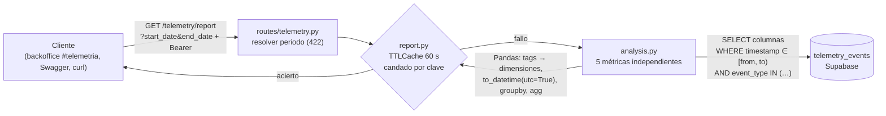

# Reporte técnico de telemetría de TrackFlow

| Campo | Valor |
| --- | --- |
| Serie | Fase 4 de «Plan · Captura · Almacenamiento · Reporte» (antes: [`telemetry-plan.md`](./telemetry-plan.md), [`telemetry-capture.md`](./telemetry-capture.md) y [`telemetry-storage.md`](./telemetry-storage.md)) |
| Rama | `feature/telemetry-report` |
| Estado | Implementado y verificado contra Supabase (2026-11-11): 31 eventos reales, resultados contrastados con SQL independiente |
| Contrato | [`event-schemas.json`](./event-schemas.json) sin cambios. La tabla `telemetry_events` solo se lee (`SELECT`) |

`GET /telemetry/report` responde preguntas sobre el **estado técnico** del sistema: cuántos eventos se registran al
día, qué incidencias técnicas predominan y cómo evolucionan, qué porcentaje de los inicios de sesión falla y qué
formularios concentran los envíos que la API no acepta. No hay métricas comerciales (ingresos, ventas, conversión):
corresponden al futuro hito de Data Pipelines.

## 1. Arquitectura



| Pieza | Fichero | Qué hace |
| --- | --- | --- |
| Pipeline | `services/api/app/telemetry/analysis.py` | Una función por métrica: SQL (periodo y `event_type`) + Pandas. Devuelve `list[dict]` serializable |
| Reporte | `services/api/app/telemetry/report.py` | Resuelve el periodo, caché de 60 s con candado por clave, modelos Pydantic de la respuesta |
| Endpoint | `services/api/app/routes/telemetry.py` | `GET /telemetry/report`: autenticación, validación del periodo (422) y 503 si falla la base |
| Motor | `services/api/app/telemetry/storage.py` (`telemetry_engine`) | La misma conexión que la inserción (`DATABASE_URL`): no se crea otra |
| Vista | `uis/backoffice/components/telemetry/TelemetryReport.tsx` | Sección «Telemetría técnica» del panel de inicio (`/#telemetria`) |
| Tests | `services/api/tests/test_telemetry_analysis.py`, `test_telemetry_report.py`; `uis/backoffice/lib/telemetryReport.test.ts` | Pandas con SQLite temporal y DataFrames a mano, endpoint, periodo y caché; utilidades de la vista |

Se usa `services/api/app/telemetry/` y no un `services/telemetry/` nuevo: en `services/` cada carpeta es un servicio y
la telemetría ya vive dentro de la API (captura y almacenamiento). Única dependencia nueva: **`pandas`** (3.1, con
`numpy`). `services/requirements.txt` (imagen Docker) se regeneró desde `uv.lock` con el comando de su cabecera.

## 2. Orden del pipeline (todas las métricas)

1. **SQL** (`load_events`): solo las columnas necesarias y solo las filas de `[start, end)`; `event_type IN (…)` cuando
   la métrica trabaja con unos tipos concretos. Los índices B-tree de `timestamp` y `event_type` de la migración sirven
   esos filtros (`EXPLAIN` en Supabase: *Index Scan using telemetry_events_timestamp_idx*). Nunca se carga la tabla
   entera ni se filtra el periodo en Pandas.
2. **Pandas**: las dimensiones salen de `tags` con `Series.str.get(clave)` (nulo si falta la clave o `tags` no es un
   objeto). `pd.to_datetime(..., utc=True, format="ISO8601", errors="coerce")` antes de agrupar; las filas con un
   timestamp imposible de interpretar se descartan y se avisa en el log.
3. **Agregación** vectorizada: `groupby()` + `size()`, `sum()` o `agg()`. Sin bucles sobre los datos.
4. **Salida**: `list[dict]` con tipos nativos (fechas `YYYY-MM-DD`, `None` en lugar de `NaN`), en orden determinista.

Las funciones reciben el periodo como parámetros y no tienen uno por defecto: lo resuelve el endpoint. Cada una hace su
propia consulta (independientes entre sí).

## 3. Clasificación de incidencias técnicas

Un evento es una incidencia técnica **por su `event_type`** según el catálogo, no porque su nombre contenga «error» o
«failed». La misma lista (`ERROR_EVENT_TYPES`) alimenta `error_rate_by_type` y `errors_per_day`, y un test comprueba
que cada tipo y su campo de motivo existen en el catálogo.

| Categoría | `event_type` | Motivo (`reason`, de `tags`) |
| --- | --- | --- |
| `authentication` | `login_failed`, `access_token_rejected` | `failure_reason`, `rejection_reason` |
| `authorization` | `authorization_denied` | `reason` |
| `validation` | `form_validation_failed`, `inventory_order_validation_failed`, `product_validation_failed` | — |
| `frontend` | `frontend_error_captured` | `error_kind` |
| `api_communication` | `backend_request_failed` | `failure_kind` |
| `server` | `api_exception_raised` | `error_type` |
| `database` | `database_connection_failed` | `failure_kind` |
| `telemetry` | `telemetry_events_dropped` | `drop_reason` |

Fuera de la lista, a propósito:

- **Rechazos de negocio** (`direct_stock_edit_rejected`, `inventory_order_rejected`, `product_duplicate_rejected`):
  el sistema funciona correctamente al rechazarlos.
- **`form_submitted` con `outcome` de error**: es la misma incidencia vista desde el formulario (un 401 del login es
  también un `login_failed`); contarla aquí la duplicaría. Tiene su propia métrica (`submission_failures_by_form`).

## 4. Métricas

| Clave | Pregunta | SQL | Agrupación | Fórmula / salida |
| --- | --- | --- | --- | --- |
| `events_per_day` | ¿Cuántos eventos registra el sistema cada día? | `timestamp` del periodo | día UTC | `size()`; días sin eventos = 0 |
| `error_rate_by_type` | ¿Qué incidencias técnicas predominan? | `timestamp, event_type, tags` + `event_type IN (incidencias)` | categoría, `event_type`, motivo | `errors = size()`; `share_pct = errors / Σ errors × 100` |
| `errors_per_day` | ¿Cómo evolucionan las incidencias? | `timestamp` + `event_type IN (incidencias)` | día UTC | `size()`; días sin incidencias = 0 |
| `auth_failure_rate` | ¿Qué porcentaje de los inicios de sesión falla? | `timestamp, event_type` + `event_type IN ('login_failed', 'login_succeeded')` | día UTC | `failed / (failed + succeeded) × 100`; solo días con intentos; nulo si no hay intentos |
| `submission_failures_by_form` | ¿Qué formularios (llamadas a la API) concentran los envíos fallidos? | `timestamp, tags` + `event_type = 'form_submitted'` | `form_id` | `failed` = `outcome` presente y ≠ `success`; `failure_rate_pct = failed / submissions × 100` |

Detalles: porcentajes con dos decimales y nunca una división entre cero (`total.where(total > 0)`); un motivo que no
es texto (lista, objeto) pasa a `null`; un envío sin `outcome` cuenta como envío pero no como fallo; uno sin `form_id`
se agrupa en `form_id = null`. Los eventos del catálogo se llaman `login_failed`/`login_succeeded` (no
`user_login_*`).

**Latencia: no se reporta.** Los eventos que la medirían (`api_latency_recorded`, `api_slow_request_detected`) no
están instrumentados, y `form_submitted.duration_ms` es el tiempo que el usuario tarda en rellenar el formulario, no
la latencia de la API. Inventarla sería engañoso.

## 5. Endpoint

`GET /telemetry/report` — requiere `Authorization: Bearer <token>` (cualquier usuario autenticado, como el resto de
lecturas del backoffice).

| Parámetro | Formato | Por defecto |
| --- | --- | --- |
| `start_date` | ISO 8601 (`2026-11-10T00:00:00Z`, `2026-11-10T01:00:00+01:00`, `2026-11-10`) | `to − 7 días` |
| `end_date` | ISO 8601 | el minuto siguiente al actual (UTC, truncado) |

- Periodo `[from, to)`: inicio inclusivo, fin exclusivo. Fechas sin zona horaria = UTC; todo se normaliza a UTC.
- Solo `start_date`: hasta ahora. Solo `end_date`: los 7 días anteriores. Ninguno: los últimos 7 días.
- **422** (formato de errores de la API, sin el valor recibido): fecha no válida, `from ≥ to`, periodo de más de 366
  días. **401** sin token. **503** si no se pueden leer los eventos (y no se cachea nada).
- Redondear «ahora» al minuto siguiente hace que las peticiones sin fechas del mismo minuto compartan entrada de caché
  y que entren todos los eventos hasta el momento de la petición.

### Respuesta real (Supabase, 2026-11-11)

`GET /telemetry/report?start_date=2026-11-11T00:00:00Z&end_date=2026-11-12T00:00:00Z`:

```json
{
  "period": { "from": "2026-11-11T00:00:00Z", "to": "2026-11-12T00:00:00Z" },
  "metrics": {
    "events_per_day": [{ "date": "2026-11-11", "total_events": 31 }],
    "error_rate_by_type": [
      { "error_category": "authentication", "event_type": "login_failed", "reason": "invalid_credentials", "errors": 1, "share_pct": 50.0 },
      { "error_category": "validation", "event_type": "form_validation_failed", "reason": null, "errors": 1, "share_pct": 50.0 }
    ],
    "errors_per_day": [{ "date": "2026-11-11", "errors": 2 }],
    "auth_failure_rate": [
      { "date": "2026-11-11", "failed": 1, "succeeded": 1, "attempts": 2, "failure_rate_pct": 50.0 }
    ],
    "submission_failures_by_form": [
      { "form_id": "login", "submissions": 2, "failed": 1, "failure_rate_pct": 50.0 },
      { "form_id": "inventory_inbound", "submissions": 2, "failed": 0, "failure_rate_pct": 0.0 },
      { "form_id": "inventory_outbound", "submissions": 2, "failed": 0, "failure_rate_pct": 0.0 }
    ]
  }
}
```

## 6. Caché

- Reutiliza `TTLCache` de `app/cache.py` (la de `/inventory/products` y `/api/incidents/summary`): caché
  `telemetry.report`, **TTL de 60 s**, instantáneas JSON inmutables y un máximo de 64 entradas.
- **Clave**: `(origen de los datos, from, to)` con `from` y `to` en UTC. Periodos distintos nunca comparten resultado;
  el mismo instante escrito con otra zona (`+01:00` y `Z`) sí. La clave no se escribe en el log (la URL de la base
  lleva la contraseña).
- **Concurrencia**: un candado por clave (`report._locked`). Si llegan a la vez varias peticiones del mismo periodo,
  calcula una y las demás reciben el resultado de la caché; periodos distintos se calculan en paralelo. Los candados
  se liberan solos cuando nadie los usa.
- **Errores**: si una métrica falla no se guarda nada (ni respuestas a medias) y la siguiente petición lo reintenta.
- **Alcance**: memoria **del proceso**. Con varios workers de uvicorn cada uno tendría su caché (la API se despliega
  con uno, `docs/despliegue-api.md`). Un evento nuevo tarda como mucho 60 s en aparecer en un periodo ya cacheado.
- La autenticación se comprueba antes de leer la caché.

## 7. Vista en el backoffice

Sección **«Telemetría técnica»** del panel de inicio (`/#telemetria`, enlace en la navegación): periodo mostrado,
selector «Últimos 7/30 días» y «Actualizar», cuatro tarjetas (eventos, incidencias, % de fallos de login, envíos
fallidos), columnas diarias de eventos y de incidencias (una serie cada una, con tooltip y «Ver tabla»), barras de
incidencias por tipo (`ListaBarras`, el componente del analizador) y dos tablas (login por día y envíos por
formulario). Estados de carga, error con «Reintentar» y periodo vacío. Sin librería de gráficos nueva.

Es una sección del panel y no una ruta propia porque el `section` de la telemetría es un enum cerrado del catálogo: una
ruta nueva se registraría como `not_found` o exigiría un cambio MINOR del contrato (§9.3 del plan) en cinco eventos.
La llamada a `/telemetry/report` se añadió a las plantillas de `apiRouteTemplate` (un fallo de red se informa con su
ruta y no como `unmatched`).

## 8. Verificación

| Prueba | Resultado |
| --- | --- |
| `services/api`: `uv run pytest -q` | 1536 tests en verde (59 nuevos: 31 de análisis, 28 de endpoint/periodo/caché; 2 existentes actualizados: inventario de rutas, 35, y registro de cachés) |
| `uis/backoffice`: `npm run lint`, `npm run typecheck`, `npx jest` | Sin errores; 262 tests (7 nuevos) |
| API real contra Supabase | 6 peticiones: sin parámetros, día completo, la misma con `+01:00`, ventana de 740 ms para comprobar los límites, 401, dos 422 |
| Contraste con SQL independiente (`GROUP BY` en PostgreSQL) | Las cinco métricas coinciden: 31 eventos el 11/11, 2 incidencias, login 1/2 = 50 %, `login` 2 envíos / 1 fallido |
| Límites del periodo | `[19:35:07.973, 19:35:08.713)`: entra el `login_failed` del inicio exacto y queda fuera el `login_succeeded` del fin exacto |
| JSON | Sin `NaN`/`Infinity`, sin `datetime` ni tipos de numpy (parser estricto) |
| Caché | 1.ª petición 1,65 s (Supabase); 2.ª dentro del TTL 6 ms con el mismo cuerpo; la misma tras > 60 s se recalcula (0,75 s) |
| Carga | Cada métrica lee solo sus filas (log: 31, 2, 2, 2 y 6 filas); `EXPLAIN` usa el índice de `timestamp` |
| Vista (Chrome, build de producción) | Datos reales, cambio a 30 días, error 503 y periodo vacío (estos dos simulados en el navegador solo para ver esos estados), móvil sin scroll horizontal |
| Escrituras | Ninguna: la tabla tiene 31 filas antes y después (sesión del navegador por token, telemetría del build desactivada) |

### 8.1. Capturas

Hechas por el desarrollador en local (backoffice con `npm run dev`, API con su `.env` contra Supabase), en
[`docs/screenshots/telemetry-report/`](../screenshots/telemetry-report/). Son posteriores a la verificación: sus
sesiones de login y navegación añadieron eventos reales, por eso las cifras superan las 31 filas de la tabla anterior.

| Captura | Qué muestra |
| --- | --- |
| [Dashboard, 7 días](../screenshots/telemetry-report/01-dashboard-7-dias.png) | La sección «Telemetría técnica» con el periodo en UTC, las cuatro tarjetas, las columnas diarias (días sin eventos a cero) y las incidencias por tipo |
| [Dashboard, 30 días](../screenshots/telemetry-report/02-dashboard-30-dias.png) | El mismo reporte tras cambiar a «Últimos 30 días»: otro periodo, otra entrada de caché |
| [Incidencias y tablas](../screenshots/telemetry-report/03-incidencias-y-tablas.png) | Incidencias por categoría · evento · motivo y las tablas de inicios de sesión por día y de envíos por formulario |
| [Endpoint en Swagger](../screenshots/telemetry-report/04-swagger-report.png) | `GET /telemetry/report` autenticado con un periodo fijo: respuesta 200 con `period` y `metrics` (token tapado) |

## 9. Limitaciones conocidas

- **Pocos datos**: los 31 eventos son de un único día y dos minutos (la verificación E2E del almacenamiento). Las
  series diarias tienen un solo punto con valores; las métricas crecerán con el uso real.
- **Sin latencia de la API** ni códigos HTTP del backend: los eventos de la categoría F del catálogo no están
  instrumentados.
- **Entornos mezclados**: el reporte no filtra por `environment` (hoy todo es `development`). Los dashboards de negocio
  solo deberían usar `production` (plan §8.1); filtrarlo es una mejora futura.
- Las métricas cargan las filas del periodo en memoria (no agregan en SQL, por requisito del ejercicio): con volúmenes
  grandes convendrá agregar en SQL o materializar; el límite de 366 días acota la carga.
- Caché local al proceso (§6).
