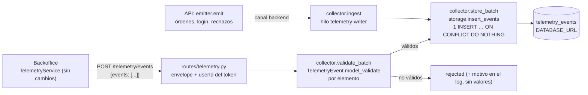

# Almacenamiento de telemetría de TrackFlow

| Campo | Valor |
| --- | --- |
| Serie | Fase 3 de «Plan · Captura · Almacenamiento · Reporte» (antes: [`telemetry-plan.md`](./telemetry-plan.md) y [`telemetry-capture.md`](./telemetry-capture.md)) |
| Rama | `feature/telemetry-storage` |
| Estado | Implementado y verificado de extremo a extremo en Supabase (2026-11-11): migración aplicada, 31 eventos reales (§11) |
| Contrato | [`event-schemas.json`](./event-schemas.json) (sin cambios) y el modelo Pydantic `TelemetryEvent` (sin cambios) |

`POST /telemetry/events` deja de ser un receptor temporal: valida cada evento por separado, acepta lotes mixtos y
guarda los válidos en la tabla `telemetry_events` (Supabase/PostgreSQL) con **un único INSERT por lote**. El frontend
no cambia: misma URL, método, envelope y respuesta 200 cuando el lote se procesa.

## 1. Arquitectura



| Pieza | Fichero | Qué hace |
| --- | --- | --- |
| Migración | `services/api/migrations/20261110120000_telemetry_events.sql` | Tabla, índices, RLS, privilegios y triggers de solo inserción |
| Almacenamiento | `services/api/app/telemetry/storage.py` | Definición de la tabla para SQLAlchemy, `to_row` (evento → fila) e `insert_events` (un INSERT por lote) |
| Colector | `services/api/app/telemetry/collector.py` | `validate_batch`, `store_batch`, `log_batch` y el canal del backend en segundo plano (`ingest`) |
| Endpoint | `services/api/app/routes/telemetry.py` | Envelope, `userId`, respuesta `{received, stored, rejected}` y códigos de error |
| Contrato | `services/api/app/telemetry/contract.py` | Nueva función `allowed_properties(event_type)` (allowlist de `properties` del catálogo) |

No hay cliente `supabase-py` en el proyecto ni hace falta: la API ya llega a Supabase por `DATABASE_URL`
(SQLAlchemy + psycopg, la misma conexión del inventario). Sin `DATABASE_URL`, los eventos se guardan en el SQLite
local (`db/inventory.db`), en una tabla equivalente que la API crea al primer uso.

## 2. Esquema de `telemetry_events`

Una fila por evento válido. Las columnas son los **10 campos del envelope** (§8.1 del plan), con `eventId` como clave
primaria y `properties` en `tags`:

| # | Columna | Tipo PostgreSQL | Nulo | Origen |
| --- | --- | --- | --- | --- |
| 1 | `id` | `uuid` PK | No | `eventId` |
| 2 | `event_type` | `text` | No | `event_type` |
| 3 | `timestamp` | `timestamptz` | No | `timestamp` |
| 4 | `service` | `text` (`frontend`, `backend`, `internal_process`) | No | `source` |
| 5 | `tags` | `jsonb` (objeto) | No | `properties` |
| 6 | `session_id` | `uuid` | Sí | `sessionId` |
| 7 | `user_id` | `text` (`usr_…`) | Sí | `userId` |
| 8 | `request_id` | `uuid` | Sí | `requestId` |
| 9 | `schema_version` | `text` (semver) | No | `schemaVersion` |
| 10 | `environment` | `text` (`development`, `test`, `production`) | No | `environment` |

**Por qué 10 columnas y no 8.** El enunciado habla de «las ocho columnas del contrato», pero el BRIEFING
([`CONTEXT-telemetria.es.md`](../../CONTEXT-telemetria.es.md)) no las define. El plan (§8.1) explica que la lista mínima
del enunciado eran 8 campos (`eventId`, `timestamp`, `sessionId`, `userId`, `event_type`, `schemaVersion`,
`requestId`, `properties`) y que se añadieron `source` y `environment` porque sin ellos no se separan las órdenes del
seed de las reales ni los datos de desarrollo de los de producción. Las 10 columnas son esas 8 más las 2 que exige el
modelo. Quitar dos para llegar a 8 perdería `schemaVersion` (necesaria para versionar `tags`, §9.3) o `requestId`
(correlación con los logs). No se ha añadido ningún metadato de persistencia (`received_at`, etc.): el diseño
existente no lo pide.

**Restricciones**: `check` de los valores permitidos de `service` y `environment`, y `jsonb_typeof(tags) = 'object'`.
El resto del contrato (patrones, enums de `tags`, nulabilidad por evento) lo valida `TelemetryEvent` antes de
insertar: repetirlo en SQL obligaría a migrar la base cada vez que cambie el catálogo.

## 3. Mapeo del modelo Pydantic

| `TelemetryEvent` | Columna | Transformación (`storage.to_row`) |
| --- | --- | --- |
| `event_id` (`eventId`) | `id` | `uuid.UUID(...)`. Clave de deduplicación |
| `event_type` | `event_type` | Tal cual (ya validado contra el catálogo) |
| `timestamp` | `timestamp` | `datetime.fromisoformat` del ISO 8601 con `Z` → fecha con zona UTC (ms o µs) |
| `source` | `service` | Tal cual |
| `properties` | `tags` | Copia **campo a campo** de las claves de la allowlist del `event_type` (`contract.allowed_properties`). El modelo ya rechaza claves de más; esta copia es una segunda barrera |
| `session_id` (`sessionId`) | `session_id` | `uuid.UUID(...)` o `NULL` |
| `user_id` (`userId`) | `user_id` | Seudónimo puesto por la API (desde el token en el canal HTTP) o `NULL` |
| `request_id` (`requestId`) | `request_id` | `uuid.UUID(...)` o `NULL` |
| `schema_version` (`schemaVersion`) | `schema_version` | Tal cual |
| `environment` | `environment` | Tal cual |

`tags` conserva todas las dimensiones del BRIEFING de los eventos de inventario: `warehouse` (`los_angeles` /
`zaragoza`), `client_id`, `product_id`, `product_category` y `quantity` (más `order_id`). El país se deriva de
`warehouse` al consultar; no se guarda aparte.

## 4. Índices

| Índice | Tipo | Para |
| --- | --- | --- |
| `telemetry_events_timestamp_idx` | B-tree (`"timestamp"`) | Rangos de fechas (series temporales de los dashboards) |
| `telemetry_events_event_type_idx` | B-tree (`event_type`) | Filtrar por evento |
| `telemetry_events_tags_idx` | GIN (`tags`, `jsonb_ops`) | `tags @> '{"warehouse": "zaragoza"}'`, `tags ? 'client_id'` |
| `telemetry_events_pkey` | B-tree único (`id`) | Lo crea la clave primaria; deduplicación |

Se usa `jsonb_ops` (el operador por defecto) y no `jsonb_path_ops` porque admite también `?`, `?|` y `?&`. No hay
índices compuestos: sin consultas reales todavía, serían especulativos (fase de Reporte).

Ejemplo de consulta que usa el índice GIN y el de fechas:

```sql
select tags->>'client_id' as client_id, sum((tags->>'quantity')::int) as units
from public.telemetry_events
where event_type = 'inbound_order_created'
  and environment = 'production'
  and tags @> '{"warehouse": "zaragoza"}'
  and "timestamp" >= now() - interval '30 days'
group by 1;
```

## 5. Endpoint `POST /telemetry/events`

| Aspecto | Comportamiento |
| --- | --- |
| URL, método y envelope | Sin cambios: `POST /telemetry/events`, `{"events": [...]}` (también como `text/plain` de `sendBeacon`) |
| Envelope | Se comprueba a mano (`parse_envelope`): JSON válido, objeto, sin claves de más, `events` presente, lista y de 50 elementos como máximo. Si no, **422** con el formato del resto de la API y sin tocar la base. Más de 64 KB: **413** |
| Validación | Cada elemento, por separado, con `TelemetryEvent.model_validate(raw)`; un `ValidationError` suma un rechazo y se sigue con el siguiente. Solo se aceptan eventos con `source = frontend` (§15 del plan); los demás se cuentan como rechazados |
| `userId` | Lo pone el receptor desde el Bearer (seudónimo HMAC). Lo que envíe el navegador se ignora |
| Persistencia | Los válidos, en **un único** `INSERT … VALUES (…), (…) ON CONFLICT (id) DO NOTHING RETURNING id`, en una transacción. Sin válidos no se ejecuta ningún INSERT. Las filas nuevas se cuentan con `RETURNING` (con psycopg detrás del pooler de Supabase, `rowcount` llega como -1) |
| Respuesta | **200** `{"received": n, "stored": s, "rejected": r}`, siempre con `received = stored + rejected` |
| Fallo de la base | **503** `{"detail": "No se han podido guardar los eventos…"}`, sin cifras. El navegador reintenta con 5xx (3 veces). No se reintenta en el servidor ni se inserta evento a evento |

Ejemplo (lote mixto con 3 válidos y 2 no válidos):

```json
{ "received": 5, "stored": 3, "rejected": 2 }
```

**`stored` y los duplicados.** `stored` cuenta los eventos válidos que quedan guardados. Si un `eventId` ya estaba
(reintento del navegador cuya respuesta se perdió, o un evento de orden reconstruido con su UUID v5 determinista,
§18.3 del plan), `ON CONFLICT DO NOTHING` no lo inserta otra vez, pero sigue contando en `stored` porque está guardado.
El log distingue los nuevos de los repetidos (`duplicates`). Sin esto, un reintento haría fallar el lote entero por la
clave primaria y el navegador acabaría descartándolo.

**Log** (`trackflow.telemetry`, sin valores de los eventos):

```text
INFO:     trackflow.telemetry: telemetry_batch_received {"channel": "http", "received": 5, "stored": 3, "rejected": 2, "duplicates": 0, "event_types": [...], "by_type": {...}, "rejections": [{"index": 1, "event_type": null, "reason": "schema_validation_failed", "errors": [{"loc": ["eventId"], "type": "missing", "msg": "Field required"}]}]}
ERROR:    trackflow.telemetry: telemetry_batch_store_failed {"count": 3, "error": "OperationalError (SQLSTATE 08006)"}
```

Los rechazos solo registran la posición, el `event_type` si es del catálogo y la ruta y el tipo de cada error (máximo
5). Nunca el valor recibido: un evento no válido podría llevar un email o un texto libre.

## 6. Eventos del backend

Los eventos que emite la propia API (órdenes de entrada y salida, rechazos, login, ediciones directas de stock) pasan
por el mismo `store_batch` → `insert_events`, en un hilo aparte (`telemetry-writer`, un solo hilo). Así:

- una orden o un login no esperan a la base de la telemetría ni fallan si está caída (§15 del plan);
- los manejadores asíncronos que emiten (`validation_error` del login, detección de ediciones directas) no bloquean
  el bucle de eventos;
- si se acumulan más de 1000 lotes pendientes (base caída o lenta), los nuevos se descartan con
  `telemetry_event_dropped {"drop_reason": "storage_queue_full"}` en vez de crecer sin límite.

En los tests, un fixture de `conftest.py` ejecuta esa escritura en el momento (`run_in_background`), y un test aparte
comprueba el hilo real.

## 7. Seguridad, permisos e inmutabilidad

| Medida | Dónde |
| --- | --- |
| Credenciales solo en `services/api/.env` (`DATABASE_URL`), nunca en el código, la migración, los logs ni el navegador. No se usa la `service_role` | `.env` (ignorado en git) |
| RLS activado y **sin políticas**: la API REST de Supabase (`anon`, `authenticated`) no lee ni escribe nada | Migración §3 |
| `revoke all` a `public`, `anon`, `authenticated` y `service_role` (los privilegios por defecto del esquema `public` de Supabase les daban todo); `service_role` recupera solo `select, insert` | Migración §3 |
| Triggers `BEFORE UPDATE OR DELETE` (por fila) y `BEFORE TRUNCATE` que lanzan `insufficient_privilege` para **cualquier** rol, incluido el propietario (`postgres`), que es con el que se conecta la API | Migración §4 |
| La aplicación solo inserta: no hay funciones ni endpoints de actualización o borrado (lo comprueba `test_solo_inserta`) | `storage.py`, `collector.py` |
| Los errores de la base se registran con el tipo y el SQLSTATE, nunca con la sentencia, los parámetros ni la cadena de conexión | `storage.insert_events` |
| La tabla vive en un `MetaData` propio: el `create_all` del inventario no la crea en PostgreSQL sin RLS ni triggers | `storage.py` |

**Límite de la garantía.** La inmutabilidad depende de los triggers: un rol con permisos de DDL (el propietario)
puede desactivarlos o borrar la tabla. Es una acción deliberada y visible, no un `UPDATE` accidental. Para cerrarlo del
todo, la API debería conectarse con un rol propio con solo `INSERT` (y `SELECT`), distinto del propietario; cambiar el
usuario de `DATABASE_URL` afecta también al inventario y queda como recomendación (§10).

## 8. Migración

No hay un sistema de migraciones en el repositorio (el inventario usa `create_all`) ni Supabase CLI. Se añade una
migración SQL versionada, con nombre compatible con Supabase CLI por si se adopta más adelante, sin introducir ninguna
herramienta nueva: `services/api/migrations/20261110120000_telemetry_events.sql`. Es idempotente (`if not exists`,
`or replace`, `drop trigger if exists`) y transaccional (`begin` … `commit`).

**Aplicarla en Supabase** (una vez, desde la cuenta del proyecto):

1. Supabase → **SQL Editor** → **New query**.
2. Pegar el contenido completo del fichero y pulsar **Run**. Debe terminar con «Success. No rows returned».
3. Comprobar con:

```sql
select column_name, data_type, is_nullable
from information_schema.columns
where table_schema = 'public' and table_name = 'telemetry_events'
order by ordinal_position;                                   -- 10 filas

select indexname, indexdef from pg_indexes
where schemaname = 'public' and tablename = 'telemetry_events';  -- 4 (3 + clave primaria)

select relrowsecurity from pg_class where oid = 'public.telemetry_events'::regclass;  -- true

select grantee, string_agg(privilege_type, ',') from information_schema.role_table_grants
where table_schema = 'public' and table_name = 'telemetry_events' group by 1;  -- postgres (propietario) y service_role (INSERT,SELECT)
```

Alternativa con psql: `psql "<cadena de conexión>" -v ON_ERROR_STOP=1 -f migrations/20261110120000_telemetry_events.sql`.

**Deshacerla** (borra los eventos guardados; solo con confirmación):
`drop table public.telemetry_events; drop function public.telemetry_events_reject_changes();`.

## 9. Pruebas

| Nivel | Qué | Cómo |
| --- | --- | --- |
| Unitarias e integración (SQLite) | Casos 1–7 del enunciado, envelope, duplicados, mapeo de los 43 eventos del catálogo, allowlist, log sin PII, hilo de escritura, migración (columnas, índices, permisos) | `uv run pytest tests/test_telemetry_endpoint.py tests/test_telemetry_storage.py` |
| Bulk insert | Se cuentan las llamadas a `insert_events` y las sentencias `INSERT INTO telemetry_events` que llegan a la base (`before_cursor_execute`): 5 válidos → 1 sentencia con 5 filas; 3+2 → 1 con 3; 0 válidos → ninguna | Mismos tests |
| PostgreSQL real (local) | Migración aplicada dos veces sobre PostgreSQL 16 con los roles de Supabase simulados; API real contra esa base (lote mixto, reenvío, órdenes de entrada y salida, `tags` JSONB, consulta GIN) | `pgserver` en un entorno aislado fuera del repo (sin dependencias nuevas) |
| Supabase + backoffice (E2E) | Eventos reales del backoffice en `telemetry_events`, lote mixto con `curl` | Chrome (playwright-core) sobre el backoffice en `next dev` y la API con el `.env` real (Supabase). Resultados en §11 |

Regresión: toda la suite de la API (`uv run pytest -q`).

## 10. Limitaciones y siguientes pasos

- **Rol de la API**: se conecta como propietario (`postgres`); la inmutabilidad la garantizan los triggers (§7). Un rol
  de solo inserción para la telemetría reforzaría el aislamiento.
- **Retención (§16 del plan)**: no implementada. La purga necesitará una migración propia que permita borrar de forma
  controlada (los triggers lo impiden hoy a propósito).
- **Sin límite de frecuencia por origen** en el canal anónimo (§15 del plan): sigue pendiente, como en la captura.
- **Pérdida en un apagado brusco**: los eventos del backend pendientes en el hilo de escritura se pierden si el proceso
  muere; se reconstruyen desde las tablas de movimientos (§18.3 del plan).
- `TELEMETRY_ENDPOINT` sigue declarada pero no se usa: los eventos se guardan directamente en `DATABASE_URL`.
- **Eventos del navegador sin `userId`**: los lotes que el backoffice envía con `sendBeacon` (al cambiar de página o
  cerrarla) no llevan token, así que se guardan con `user_id` nulo (diseño de la captura, `telemetry-capture.md`). Los
  eventos de negocio, que emite la API, siempre lo llevan.

## 11. Verificación de extremo a extremo (2026-11-11)

Migración aplicada por el desarrollador en el SQL Editor de Supabase y comprobada con consultas de solo lectura:
10 columnas con sus tipos (`tags` `jsonb`), 4 índices (los 3 pedidos + la clave primaria), RLS activado sin políticas,
privilegios solo del propietario y de `service_role` (`INSERT, SELECT`) y los dos triggers.

**Eventos reales.** Backoffice (`next dev`, `:3002`, sin cambios) → API (`:8000`, `.env` real con `DATABASE_URL` de
Supabase; usuario de pruebas en una copia de `auth.json`) operado con Chrome: login fallido y correcto, navegación, dos
órdenes de entrada y dos de salida (Zaragoza y Los Ángeles, misma cantidad para no cambiar el stock neto) y cierre de
sesión. Los 8 lotes del navegador respondieron 200 y los 6 eventos del backend se guardaron en segundo plano.

| `event_type` | `service` | Filas | Con `user_id` |
| --- | --- | --- | --- |
| `inbound_order_created` | backend | 2 | 2 |
| `outbound_order_created` | backend | 2 | 2 |
| `login_succeeded` | backend | 1 | 1 |
| `login_failed` | backend | 1 | 0 |
| `navigation_section_viewed` | frontend | 9 (+3 del lote mixto) | 2 |
| `form_submitted` | frontend | 6 | 1 |
| `form_started` | frontend | 5 | 1 |
| `form_validation_failed` | frontend | 1 | 0 |
| `session_ended` | frontend | 1 | 0 |

Dimensiones del BRIEFING en `tags` (consulta con `@>` sobre el índice GIN):

| `warehouse` | `event_type` | `client_id` | `product_id` | `product_category` | `quantity` |
| --- | --- | --- | --- | --- | --- |
| `zaragoza` | `inbound_order_created` | `purestep-footwear` | `CLT-SNK-W-42-Z` | `fashion` | 4 |
| `los_angeles` | `inbound_order_created` | `soundwave-electronics` | `TEC-EAR-001` | `electronics` | 3 |
| `zaragoza` | `outbound_order_created` | `purestep-footwear` | `CLT-SNK-W-42-Z` | `fashion` | 4 |
| `los_angeles` | `outbound_order_created` | `soundwave-electronics` | `TEC-EAR-001` | `electronics` | 3 |

**Lote mixto con `curl`** contra la API conectada a Supabase: 3 `navigation_section_viewed` válidos, un objeto sin
envelope (`{"evento_incorrecto": true}`) y un `event_type` fuera del catálogo.

```text
POST /telemetry/events            → 200 {"received":5,"stored":3,"rejected":2}   (log: duplicates 0)
POST /telemetry/events (reenvío)  → 200 {"received":5,"stored":3,"rejected":2}   (log: duplicates 3)
POST /telemetry/events {"eventos": []} → 422 extra_forbidden
```

En Supabase quedan exactamente 3 filas con esos `eventId` (el reenvío no duplica). Total tras la verificación: 31 filas
(6 del backend y 25 del frontend), ninguna con `event_type`, `timestamp` o `tags` vacíos.

Comprobación en Supabase (SQL Editor):

```sql
select service, event_type, count(*) from public.telemetry_events group by 1, 2 order by 1, 2;
select "timestamp", event_type, service, tags from public.telemetry_events order by "timestamp" desc limit 20;
```

Las capturas de la tabla en Supabase las añade el desarrollador a mano.
